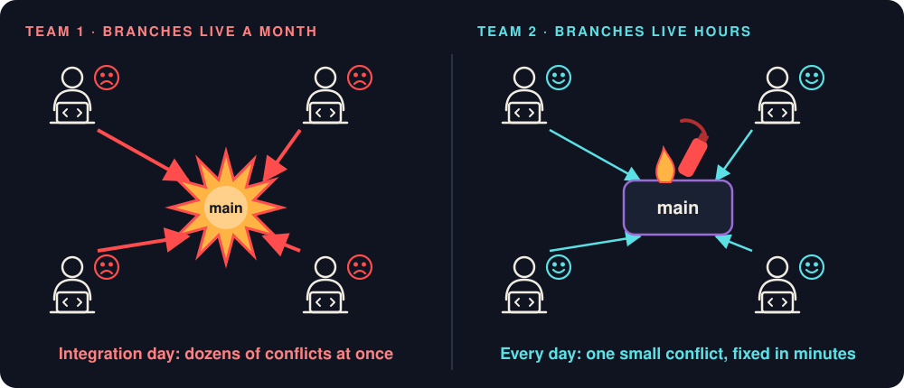
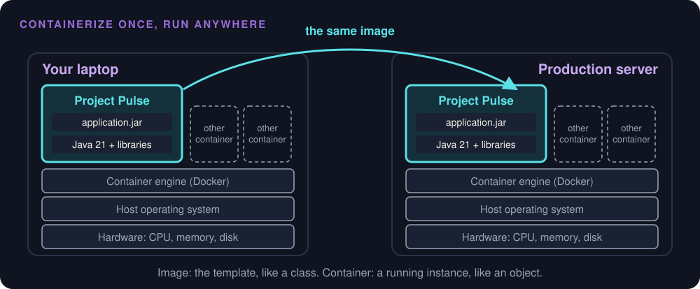
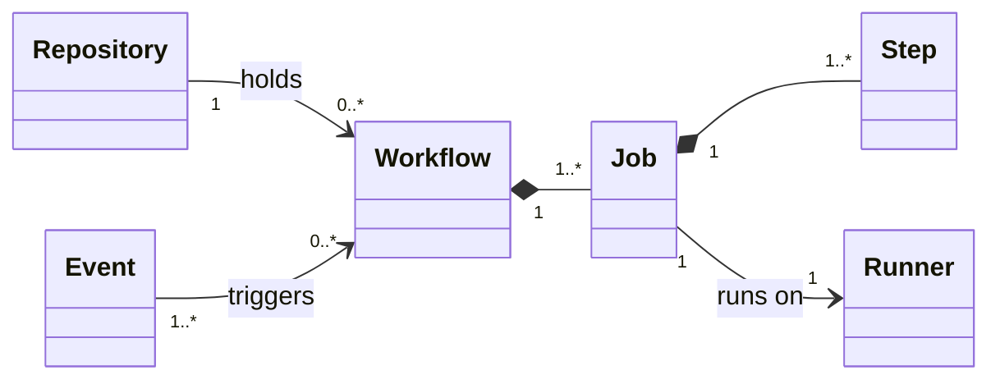
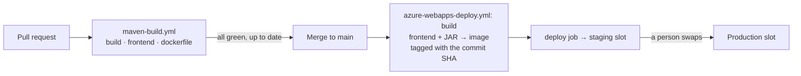
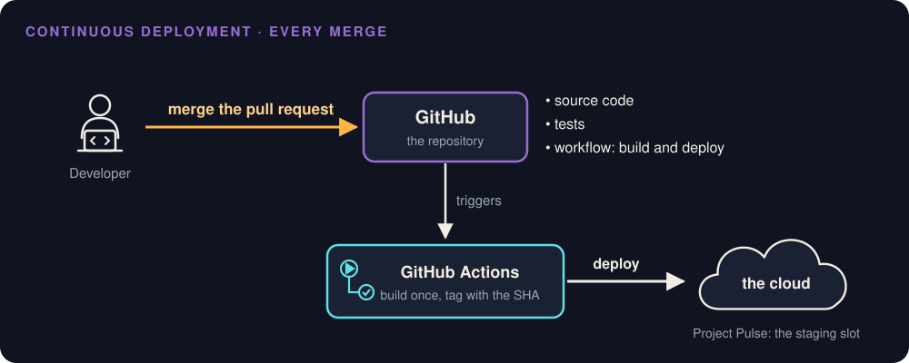
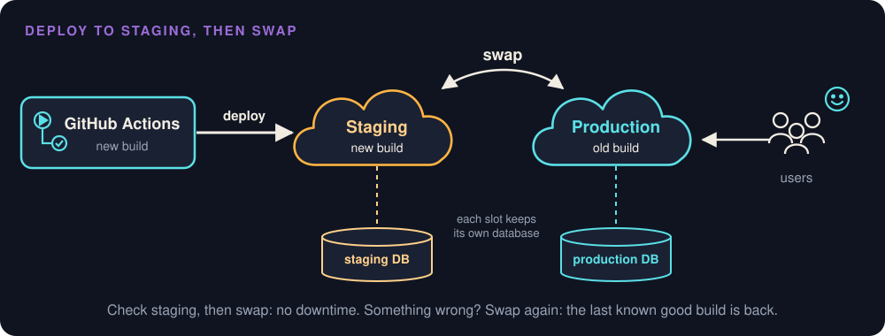

# CI/CD and Continuous Deployment

> **Purpose (one line):** get every change from a laptop to a running system the same way every time: checked on every pull request, blocked when red, deployed from exactly what was checked, and undoable when it goes wrong.

## 1. Learning objectives

By the end of this module, a student can:

1. Tell continuous integration, continuous delivery, and continuous deployment apart, and say which one a given pipeline practices.
2. Read a GitHub Actions workflow and name its event, jobs, steps, and runner.
3. Make checks a gate with a ruleset on `main`, and explain why a green pull request must also be up to date with `main`.
4. Trace one commit from pull request to production: built once, tagged with its commit SHA, deployed to staging, swapped into production.
5. Roll back a bad release, and recognize a database change that makes rolling back impossible.
6. Keep the pipeline's secrets away from code that should not have them, including an agent running in CI.
7. Tag a release with release notes, and always be able to name the commit production runs.

## 2. Where it fits

- **Prerequisites:** [Static Analysis](static-analysis.md) (Monday of the same week), whose checks this pipeline runs; [Testing](testing.md); and [4.10 of The AI-Augmented Team](ai-augmented-team.md#410-knowing-exactly-what-you-built), which named configuration items and baselines and left releases to this module.
- **Leads into:** [Reliability](reliability.md) (week 12), which measures what runs in production and counts on the rollback taught here; the deployment view of your [architecture-of-record](architecture.md#45-describing-it-views-and-c4-to-draw-them), drawn for Checkpoint 3.
- **How it's taught:** Wednesday of week 11. Friday's studio builds the gate on your team's repository together with Monday's analyzers. Release tags start with this week's Checkpoint 2.
- **About the examples:** Project Pulse code links are pinned to commit [`90668c5`](https://github.com/Washingtonwei/project-pulse/tree/90668c51b83f5352acf8d0f304a46590625cc87c), as Project Pulse stood in fall 2026. Its ruleset on `main` was added on 3 November 2026, and [4.4](#44-from-a-check-to-a-gate) shows the repository before and after.
- **Course outcome it delivers:** [build, test, and ship a working MVP](../syllabus.md#learning-outcomes) (outcome 4).

## 3. Motivation

Two teams start the same project from the same repository.



**Team 1** gives each developer a large feature. Each one works on a branch for a month, drifting further from `main` every day. On integration day everyone merges at once: dozens of conflicts, and bugs that interact, so each one is harder to find because fifty arrived together. Integration takes weeks, and the team is exhausted before it starts testing.

**Team 2** splits the work into small pieces. A branch lives for hours and merges the same day. There are still conflicts and bugs, but they are small, the code is fresh in its author's mind, and they are fixed in minutes. Neither team writes better code. Team 2 integrates more often, so each integration is small:

> "Instead of heading for a big integration breakdown, I decided to have a small breakdown every Tuesday evening." (Adapted from Graham Parke, *No Hope for Gomez!*)

Merging several times a day only works if checking each merge costs nobody anything, so a machine does it. Deploying is the same story, with higher stakes. In late July 2012, a technician at Knight Capital copied new trading code onto its order router's servers and missed **one of eight**. The eighth still held Power Peg, code Knight had stopped using in 2003, and the new code reused the flag that used to switch Power Peg on. On 1 August the flag went live, and the eighth server turned 212 customer orders into millions: 4 million executions, more than 397 million shares, in about 45 minutes. Knight lost more than $460 million (SEC, 2013). Nothing about it was exotic: a manual deploy no second person checked, dead code left in, and a reused flag. A pipeline puts the same artifact on every server, or on none.

**AI raises the stakes.** An agent multiplies the pull requests a team produces; it does not multiply the hours people have to review them. The pipeline is the one reviewer that checks every pull request the same way, however many there are.

## 4. Core concepts

### 4.1 Continuous integration

**Continuous integration (CI)** is a practice: everyone merges into the shared `main` branch at least daily, and every change is built and tested automatically, so a broken `main` is found within minutes (Fowler). On GitHub it takes the shape of a short-lived branch and a pull request: the pull request triggers the build and the tests, and it merges when they pass. Your team already works this way, one sub-issue, one branch, one pull request ([the Git workflow](../git-workflow.md)).

CI is a habit before it is a tool. A team with GitHub Actions configured and three-week branches is not doing CI. The practice has three rules:

- Merge small changes, at least daily.
- Every change runs the same checks.
- A red `main` is fixed before anyone does anything else.

### 4.2 What gets shipped: build, artifact, container

**Building** turns source code into an **artifact**, the thing that actually runs. For Spring Boot, `./mvnw package` produces an executable JAR (a "fat JAR"): your classes, every dependency, and an embedded Tomcat server in one file you start with `java -jar`. Project Pulse's deploy workflow builds the Vue frontend first and copies it into Spring Boot's `static/` folder, so one JAR serves both.

A JAR still depends on the machine it lands on: the right Java version, the right libraries, the right settings. That is where "it works on my machine" comes from. A **container** packages the application together with the runtime it needs, so the server only has to run containers. An **image** is the read-only template; a **container** is a running instance of it, the way an object is an instance of a class. Project Pulse's [`Dockerfile`](https://github.com/Washingtonwei/project-pulse/blob/90668c51b83f5352acf8d0f304a46590625cc87c/Dockerfile) starts from `eclipse-temurin:21-jre`, so Java 21 travels with the application. Containers share the host's operating system kernel instead of virtualizing hardware, which makes them much lighter than virtual machines.



A **Dockerfile** is the recipe for an image. Project Pulse's, shortened:

```dockerfile
FROM eclipse-temurin:21-jre AS builder                # stage 1: a scratch workspace
WORKDIR /builder
COPY backend/target/*.jar application.jar
RUN java -Djarmode=tools -jar application.jar extract --layers --destination extracted

FROM eclipse-temurin:21-jre                           # stage 2: the image that ships
WORKDIR /application
COPY --from=builder /builder/extracted/dependencies/ ./
COPY --from=builder /builder/extracted/application/ ./
ENTRYPOINT ["java", "-jar", "application.jar"]
```

- **`FROM`** names the **base image** to start from, here Java 21 on Linux, so the runtime comes with it instead of being installed by hand.
- **`COPY`** puts files into the image. The JAR is already built: Maven runs first, and Docker only packages the result.
- **Two `FROM` lines make a multi-stage build.** Stage 1 unpacks the JAR and is thrown away; only stage 2 ships, so the image holds just what it needs to run.
- **`ENTRYPOINT`** is the command a container runs when it starts.

Each instruction adds a **layer**, and Docker rebuilds only from the first layer that changed. That is why stage 2 copies the libraries before your code: when only your code changes, the library layers come from the cache, and Azure downloads only the small last one. The full file has four such copies ([Spring Boot's documentation](https://docs.spring.io/spring-boot/reference/packaging/container-images/dockerfiles.html) explains them). The workflow then pushes the image to a **registry**, GitHub's `ghcr.io`, tagged with the commit SHA, and Azure pulls it from there. The image is the artifact the pipeline ships.

### 4.3 A pipeline, read on Project Pulse

A **pipeline** is the automated sequence that takes a change to a result: checked, built, deployed. GitHub's pipeline tool is GitHub Actions, and its vocabulary is small:



| Concept | What it is | In Project Pulse's pull request workflow |
|---|---|---|
| **Workflow** | One YAML file in `.github/workflows/` | [`maven-build.yml`](https://github.com/Washingtonwei/project-pulse/blob/90668c51b83f5352acf8d0f304a46590625cc87c/.github/workflows/maven-build.yml) |
| **Event** | What starts it | `pull_request` to `main` (opened, or a new commit pushed) |
| **Job** | A group of steps on one runner; jobs run in parallel unless one `needs` another | `build`, `frontend`, `dockerfile` |
| **Step** | One action (`uses:`) or one shell command (`run:`) | `uses: actions/checkout@…`, then `run: mvn --batch-mode verify` |
| **Runner** | The machine a job runs on | `ubuntu-latest`: a fresh virtual machine, thrown away after the job |

The backend job, in full:

```yaml
build:
  runs-on: ubuntu-latest
  steps:
    - name: Check out the repository
      uses: actions/checkout@11d5960a326750d5838078e36cf38b85af677262 # v4.4.0
    - name: Set up JDK 21
      uses: actions/setup-java@cf277c60eb25467037889841efdb72551f06f6c3 # v4.9.1
      with:
        java-version: "21"
        distribution: "temurin"
        cache: maven
    - name: Build, test, and run static analysis with Maven
      working-directory: ./backend
      run: mvn --batch-mode verify
```

**The runner is the point.** It starts with nothing from your laptop: no local database, no file you forgot to commit, no dependency you installed by hand. A test that passes in your IDE and fails here has found something real about your project, not about GitHub.

**Keep it fast.** The three jobs run in parallel, so the slowest one sets the wait. A pipeline people wait half an hour for gets bypassed; aim for Extreme Programming's ten-minute build, which Fowler calls "perfectly within reason" for most projects.

Project Pulse has a second workflow, [`azure-webapps-deploy.yml`](https://github.com/Washingtonwei/project-pulse/blob/90668c51b83f5352acf8d0f304a46590625cc87c/.github/workflows/azure-webapps-deploy.yml), triggered by a push to `main`. Together the two make the whole path:



#### Before you merge a workflow your agent wrote {#reviewing-a-workflow}

An agent drafts a workflow in a minute, and the workflow runs with your repository's access, so read it the way you read code. Every member should be able to answer these about your own workflow:

1. **When does it run?** The `on:` block: which events, which branches. A check workflow runs on `pull_request` to `main`.
2. **What can fail it?** In each job, find the command that exits non-zero on a failed test or a finding. A job with no such command is green forever.
3. **Is anything made to pass?** `continue-on-error: true`, `|| true`, and fixing variants (`--fix`, `--write`) each turn a check into advice. Remove them, or say in the pull request why one stays, as Project Pulse does for its `frontend` job ([4.4](#44-from-a-check-to-a-gate)).
4. **Is every action pinned?** Each `uses:` names a full commit SHA, with the version in a comment, as in the backend job above ([why](static-analysis.md#410-beyond-your-code-dependencies-containers-secrets-and-your-own-tools)).
5. **Does it match your laptop?** It runs the commands your team runs before pushing, so a red run is never a surprise.
6. **Does it ask for secrets or write `permissions:`?** A check workflow needs neither.

**A line nobody on the team can explain does not merge.** Ask the agent what it does, then check the documentation it cites.

### 4.4 From a check to a gate

**A check that does not block is advice** ([Static Analysis 4.5](static-analysis.md#45-make-it-a-gate)). Project Pulse shows why. Until 3 November 2026, its three checks ran on every pull request, and nothing required them to pass: the merge button stayed enabled next to a red X. After the merge, the deploy workflow built with `-DskipTests`, trusting tests that might never have passed. The checks ran; nothing listened.

The fix is a **ruleset** on `main` (Settings, Rules, Rulesets, New branch ruleset). Project Pulse's, named "Protect main," targets the default branch with an empty bypass list:

| Rule | What it stops |
|---|---|
| Restrict deletions | Deleting `main` |
| Block force pushes | Rewriting history, so a released commit SHA always exists |
| Require a pull request before merging (0 approvals) | Pushing straight to `main` around the checks. A solo maintainer cannot approve their own pull request, so 0; a team should require 1 |
| Require status checks to pass: `build`, `frontend`, `dockerfile` | Merging while any check is red or still running |
| Require branches to be up to date before merging | Merging a pull request that was tested against an old `main` |

**Leave the bypass list empty, yourself included.** A gate the maintainer can walk around is not one.

**"Up to date" is the subtle rule.** A student opens a pull request on Monday, branched from Monday's `main`, and it goes green. On Tuesday a teammate merges something else. The Monday branch's green checks tested Monday's `main` plus its change, which is not what `main` becomes after the merge, so both changes can pass alone and break together. With this rule, GitHub shows **Update branch**: it merges the new `main` into the branch, and the checks run again on the real combination. Large teams use a **merge queue** instead, which tests each pull request together with the ones ahead of it.

**Know what each required check actually checks.** Project Pulse's `frontend` job runs ESLint, the type check, and Prettier with `continue-on-error: true`, because none passes on `main` yet (130, 18, and 75 findings). Requiring `frontend` blocks a broken `npm ci` and nothing else, until each step's findings are fixed or baselined and the step turns blocking ([Static Analysis 4.6](static-analysis.md#46-an-existing-codebase-baseline-then-ratchet)).

**A flaky check destroys the gate.** A test that fails at random teaches everyone to press "Re-run" until it goes green, and then a real failure gets re-run too. Fix a flaky test, or quarantine it with an issue, the day it is seen.

#### Set up the ruleset, step by step {#ruleset-step-by-step}

**The repository owner does this.** On a personal repository every collaborator has write access, and only the owner sees the Settings tab, so put the owner's screen up and have the team watch. **First, the pull request workflow has to have run once** on a pull request, recently; until it has, its checks do not appear in step 6.

1. In the repository, open **Settings**. In the sidebar under **Code, planning, and automation**, open **Rulesets**. Click **New ruleset**, then **New branch ruleset**.
2. **Ruleset Name:** `Protect main`.
3. **Enforcement status:** a new ruleset starts at **Disabled**; change it to **Active**. A ruleset saved as Disabled enforces nothing.
4. **Bypass list:** leave it empty. Do not click **Add bypass**.
5. **Target branches:** click **Add a target**, then include the default branch.
6. Under **Rules**, set exactly these and leave every other rule unchecked:
    - **Restrict deletions:** checked.
    - **Require a pull request before merging:** checked. In its settings, set **Required approvals** to 1.
    - **Require status checks to pass:** checked. Check **Require branches to be up to date before merging** under it, and leave "Do not require status checks on creation" unchecked. Add a check (the **+** button), type a job name (`build`), and pick the entry whose source is **GitHub Actions**. Repeat for every job in your pull request workflow.
    - **Block force pushes:** checked.
7. Click **Create**.
8. **Retire the week 3 rule.** Under **Settings**, **Branches**, if a branch protection rule on `main` from the [Git Workflow](../git-workflow.md#repository-settings) setup is listed, delete it. Both would apply, and a team should have one place to look.

**Check that it holds.** Open any pull request: each check you added shows **Required**, and Merge stays disabled until they pass and a teammate approves. Then try to walk around it from a laptop, on an up-to-date `main`:

```bash
git commit --allow-empty -m "Test the ruleset"
git push origin main     # rejected: repository rule violations
git reset --soft HEAD~1  # drop the test commit
```

**When a check will not appear in step 6.** It has not run recently, so open a pull request that runs the workflow and come back. Search for the job's `name:` if it has one, otherwise its ID. A job with a `matrix` reports one check per combination, such as `build (21)`, and each one is added separately.

### 4.5 Continuous delivery and continuous deployment

"CD" means two different things:

| Practice | What is automatic | Who decides when production changes |
|---|---|---|
| **Continuous integration** | Build and test every change | Not about production |
| **Continuous delivery** | Every green merge is built into a release that could go to production | A person, by pressing a button |
| **Continuous deployment** | Every green merge goes to production | Nobody; the pipeline does |



Project Pulse practices both, at different stages. Every merge to `main` is deployed automatically to the **staging** slot, which is continuous deployment to staging. Production changes only when a person swaps the slots, which is continuous delivery to production. For a client project, a person deciding when users see a change is a sound choice.

**Build once, then promote that build.** The deploy workflow tags the image with the commit's SHA (`ghcr.io/…:${{ github.sha }}`) and deploys that image to staging; the swap moves the same image into production. Nothing is rebuilt for production, because a rebuild is a new artifact nobody tested. The SHA tag also answers "which commit is production running?" at any moment.

**So when is `-DskipTests` at deploy time safe?** Only when [4.4](#44-from-a-check-to-a-gate) holds: the tests passed on exactly the code being merged, with the branch up to date. Since 3 November 2026 that is enforced on Project Pulse; before, it was trust.

**A pipeline ships bad changes as fast as good ones.** On 18 November 2025, a database permissions change made a query return duplicate entries, and a configuration file Cloudflare generates every five minutes for its bot detection doubled in size. It passed a hardcoded limit of 200 features (normal use was about 60), the proxy's Rust code called `unwrap()` on the error and panicked, and each bad copy of the file was "rapidly propagated across the network." Sites behind Cloudflare returned errors from 11:20 UTC until core traffic recovered around 14:30, and everything was normal again at 17:06. Cloudflare's first remediation:

> "Hardening ingestion of Cloudflare-generated configuration files in the same way we would for user-generated input."

Anything the pipeline ships, configuration included, goes through the gate and through staging.

### 4.6 Staging, swap, and rolling back

Deploying straight into production has two costs. Users get errors while the new container starts, which takes a minute or two for Project Pulse, and they are the first to meet the new build.



A **staging slot** is a second copy of the application with its own URL, invisible to users. Deploy there, check it by hand (log in, open the pages the change touched, submit one form; a **smoke test**), then **swap**. Azure warms the new build up before routing traffic to it, so users see no downtime. Deployment slots need Azure App Service's Standard tier or higher.

Each slot keeps its own database. Project Pulse's code reads the database address from Azure Key Vault, and two app settings on each slot choose which: `SPRING_PROFILES_ACTIVE` (`staging` or `prod`, picking [`application-staging.yml`](https://github.com/Washingtonwei/project-pulse/blob/90668c51b83f5352acf8d0f304a46590625cc87c/backend/src/main/resources/application-staging.yml) or `application-prod.yml`) and `AZURE_KEY_VAULT_ENDPOINT` (the vault holding that environment's secrets). Both are marked as *deployment slot settings*, so they stay with the slot instead of travelling with the code. A new build therefore meets staging data first. During the swap, Azure restarts the new build with production's settings before routing users to it. That restart is when Flyway runs the new migration on production's database, while the old build is still serving users from it.

**Rolling back code is a swap back,** in seconds, with no rebuild. [Reliability](reliability.md) calls this a repair-time decision: a team that cannot make failures rare can make repair fast.

**Rolling back data is not.** Project Pulse's schema changes are Flyway migrations (`V1` through `V6` in [`db/migration/`](https://github.com/Washingtonwei/project-pulse/tree/90668c51b83f5352acf8d0f304a46590625cc87c/backend/src/main/resources/db/migration)), and they run forward only. A swap back brings back the old code, not the old schema: the previous build meets the new database. So a schema change the previous build cannot live with is a release you cannot roll back.

Project Pulse has both kinds:

- **`V5` is safe to roll back.** It made columns `NOT NULL` only after the code had stopped writing nulls (`@ManyToOne(optional = false)`), and its header records that every column "was verified to hold zero nulls in both staging and prod before this migration was written." Code first, data checked, schema last.
- **`V6` is not.** Pull request #99 added two activity categories and switched how a category is stored, from a number to its name: `@Enumerated(EnumType.STRING)` in `Activity.java` and, in the same pull request, `V6`, which converts the column. It was a good change; storing numbers would have silently relabeled old rows when the list grew. But once `V6` has run, the previous build expects a number and finds a name, so swapping back brings back a build that cannot read the activity table. For a release like this, the plan is to roll forward: fix the problem and deploy again. The team should know that before merging, not during the outage.

When a change must stay reversible, split it into steps that each keep both builds working (**expand and contract**):

1. **Expand.** Add the new column, nullable, used by nothing.
2. **Write.** Ship code that writes both columns.
3. **Read.** Ship code that reads the new one, handling rows where it is still empty.
4. **Contract.** Only when every running build uses it, remove what it replaced.

### 4.7 Secrets in the pipeline

A pipeline needs credentials. Project Pulse's workflows use three:

| Secret | What it can do |
|---|---|
| `AZURE_WEBAPP_PUBLISH_PROFILE` | Deploy anything to the staging slot |
| `CLAUDE_CODE_OAUTH_TOKEN` | Run Claude Code on the instructor's account |
| `GITHUB_TOKEN` | Created fresh for each job and expired when it ends; here, push the image to GitHub's container registry |

Secrets live in Settings, Secrets and variables, Actions. GitHub masks them in logs, and a workflow gets one only if it names it. Four habits keep them safe:

- **Least privilege.** Each workflow declares what its `GITHUB_TOKEN` may do: `maven-build.yml` asks for `contents: read` and nothing else; the deploy workflow adds `packages: write` because it pushes an image.
- **Forks get no secrets.** A pull request from a fork runs with no secrets and a read-only token, which is why Project Pulse's checks need none. Never "fix" a fork's failing workflow by switching to the `pull_request_target` event: it runs with your secrets, and if it checks out the pull request's code, a stranger's code runs with them.
- **Short-lived beats long-lived.** The publish profile is a password that works until someone regenerates it. With **OIDC**, Azure trusts a token GitHub issues to this repository's workflow and hands back a credential that lasts minutes, so there is no stored password to steal. Project Pulse still uses the publish profile; OIDC is its next step.
- **Pin what runs next to your secrets.** Name every Action by commit SHA ([Static Analysis 4.10](static-analysis.md#410-beyond-your-code-dependencies-containers-secrets-and-your-own-tools) tells the story). Project Pulse's deploy workflow, the one holding the publish profile, named its Actions by tag (`actions/checkout@v4`) until pull request [#108](https://github.com/Washingtonwei/project-pulse/pull/108) pinned all seven, in November 2026.

**An agent in CI.** Project Pulse's [`claude.yml`](https://github.com/Washingtonwei/project-pulse/blob/90668c51b83f5352acf8d0f304a46590625cc87c/.github/workflows/claude.yml) runs Claude Code whenever someone writes `@claude` in an issue or a pull request comment. That agent holds a secret, reads text anyone can write, and can reach the network: all three parts of the lethal trifecta ([Implementation 4.7](implementation.md#47-what-the-agent-may-read-and-run)). Its guards are the action's default of acting only for people with write access to the repository (leave it on), a read-only `GITHUB_TOKEN`, and Actions pinned to SHAs. The rule: an agent in CI never acts on text from someone outside the team.

### 4.8 The same commit, the same build

A build is **reproducible** when the same commit always produces the same artifact. A lockfile records the exact version of every dependency, but only if the build obeys it. `npm ci` installs exactly what `package-lock.json` says and fails if the lockfile and `package.json` disagree; `npm install` may update the lockfile within the ranges `package.json` allows. Project Pulse's pull request workflow ran `npm ci`, but its [deploy workflow](https://github.com/Washingtonwei/project-pulse/blob/90668c51b83f5352acf8d0f304a46590625cc87c/.github/workflows/azure-webapps-deploy.yml#L34) ran `npm install`, so the build that shipped was not quite the build that was checked, and two deploys of one commit could ship different frontend dependencies. The fix was one word, `npm ci`, in pull request [#108](https://github.com/Washingtonwei/project-pulse/pull/108). The same pull request dropped Maven's `--update-snapshots`, which fetches the newest build of any `-SNAPSHOT` dependency, a version whose contents can change under the same name. Project Pulse declared none, so the flag did nothing yet; it would have started mattering the day someone added one.

### 4.9 Versions, tags, release notes, and feature flags

A **tag** marks a baseline: this commit is what we released. **Semantic Versioning** (`MAJOR.MINOR.PATCH`) says what kind of change a release is: a patch fixes, a minor version adds, a major version breaks something a user or another system relied on. For a web application with no API consumers, the version is mostly a message to the client.

Project Pulse's [`v1.4.2`](https://github.com/Washingtonwei/project-pulse/releases/tag/v1.4.2) is the model. `v1.4.1` reset every instructor's selected course section at login; about thirteen hours later `v1.4.2` shipped as a patch, and its release notes name the regression, the issue ([#28](https://github.com/Washingtonwei/project-pulse/issues/28)), and the fix. Its counterexample is the same repository in fall 2026: the last tag is `v1.5.0`, from December 2025, 61 merged pull requests ago, and `pom.xml` says `2.0.0`, a version no tag names.

To tag a release, from the commit you demo:

```bash
git tag -a v0.1.0 -m "Checkpoint 2: proving slice"
git push origin v0.1.0
```

Then on GitHub: Releases, Draft a new release, choose the tag, **Generate release notes**. GitHub drafts the notes from the pull requests merged since the last tag, and an agent can rewrite the draft for the client. A person checks it against what users will actually notice, because a pull request title describes the code, not the change a client sees.

**Your team:** a tagged release with release notes for every demo from Checkpoint 2 on: `v0.1.0` at Checkpoint 2, `v0.2.0` at Checkpoint 3, `v1.0.0` for the MVP your client receives ([the project page](../project.md)). Always be able to say which tag or commit production runs.

A **feature flag** ships code switched off, so turning a feature on or off is a configuration change rather than a deploy. Project Pulse has one: `app.reminders.enabled` stops the weekly reminder scheduler without a release, and it is off in `application-staging.yml`, so staging never sends real students their Monday reminder. Flags are configuration items too, and they rot; Knight Capital's loss ([Motivation](#3-motivation)) began with a reused one. Every flag gets an owner and a removal date, and a retired flag is deleted, never repurposed.

### 4.10 Where will your project run?

Your team does not have to decide this week, but it should start asking. The questions:

| Question | Why it matters |
|---|---|
| Who hosts it: the client's cloud account, a student credit, a free tier? | Whoever's account it is can turn it off |
| Who pays, and what happens when a student credit runs out? | A cloud account bills by the hour; set a cost alert the day you create it, and turn off what you do not use |
| Who owns it after December, and after May? | The client keeps the system; your credentials leave with you |
| What is staging? | A second slot, a second app, or nothing; on Azure, slots need the Standard tier |
| What data will it hold? | Real client data brings privacy and backup duties, and the migrations of [4.6](#46-staging-swap-and-rolling-back) |
| How does a change get there? | The pipeline of [4.5](#45-continuous-delivery-and-continuous-deployment), from the first deploy |

Write the open question into section 7 (the deployment view) of your architecture-of-record, with an owner, and settle it by Checkpoint 3, when the deployment view is due ([Architecture 4.7](architecture.md#47-one-deployable-or-several) covers what you deploy; this is where).

### 4.11 DevOps: the idea behind the pipeline

Everything in this module serves one movement. Until the late 2000s, most companies split software between two groups. Developers wrote features and handed a release "over the wall"; operations kept production running. Developers were rewarded for change and operations for stability, so every release was a negotiation and every outage a search for someone to blame. At the Velocity conference in 2009, John Allspaw and Paul Hammond showed how Flickr deployed more than ten times a day by making the two groups work as one ("10+ Deploys per Day: Dev and Ops Cooperation at Flickr"). The same year, Patrick Debois founded DevOpsDays, first held in Ghent, Belgium, and **DevOps** became the movement's name.

**DevOps is a culture first and a toolkit second.** John Willis, Damon Edwards, and Jez Humble summed it up as **CALMS**:

| Letter | Means | Where you have done it |
|---|---|---|
| **C**ulture | One team owns a change from commit to production. Amazon's Werner Vogels: "You build it, you run it." | Your team deploys and supports what it builds |
| **A**utomation | Anything done twice by hand becomes a pipeline step | [4.3](#43-a-pipeline-read-on-project-pulse) to [4.6](#46-staging-swap-and-rolling-back) |
| **L**ean | Small batches that flow continuously | Team 2 in the [motivation](#3-motivation); one sub-issue, one pull request |
| **M**easurement | Decide from numbers, not opinions | The DORA metrics below; [Observability](observability.md) |
| **S**haring | Shared dashboards, shared knowledge, blameless postmortems | [Reliability 4.6](reliability.md#46-incidents-and-blameless-postmortems) |

**How DevOps measures itself.** The DORA research program, written up in *Accelerate* (Forsgren, Humble, and Kim), measures software delivery with a few numbers. *Accelerate* named four, and DORA now tracks five: **deployment frequency**, **change lead time** (commit to production), **change fail rate**, **failed deployment recovery time** (formerly "time to restore service"), and **deployment rework rate**. The first ones measure speed, the others stability, and DORA's headline finding is that the two do not trade off: "speed and stability are not tradeoffs." Small, automated changes are both faster and safer, which is Team 2's story again.

**DevOps and SRE.** Google's site reliability engineering is one specific way to do DevOps, with hard rules: SLOs, error budgets, and a cap on operations work ([Observability](observability.md) has the job). Google's own summary is a programmer's joke: `class SRE implements interface DevOps` (*The Site Reliability Workbook*, 2018). On a job ad, "DevOps engineer" usually means someone who builds and runs the pipeline and the infrastructure (CI/CD, containers, cloud, infrastructure as code). The culture is everyone's job.

!!! tip "In an interview: \"What is DevOps?\""

    Answer in three sentences. **What:** "DevOps is a culture where one team owns software from commit to production, instead of developers handing releases to a separate operations team." **How:** "It works through automation (CI/CD, infrastructure as code, monitoring) and small, frequent changes, so each failure is small and quick to fix." **How you know:** "You measure it with the DORA metrics, such as deployment frequency, lead time, change fail rate, and recovery time." Then give one example from your own project: your pipeline, your gate, your rollback. A follow-up is often "and SRE?": one specific way to do DevOps, with SLOs and error budgets.

## 5. The AI-native lens

- **Delegate to AI:** drafting a workflow from a description of the steps; explaining a failed run from its log; drafting release notes from the merged pull requests; splitting a schema change into expand and contract steps; checking a workflow for unpinned Actions and broad permissions.
- **Keep human:** what is required on `main` and who may bypass it; when production changes; which secrets exist and who holds them; whether a schema change can be rolled back, and the roll-forward plan when it cannot.
- **Context to supply:** the gate command and the required checks; that every deploy goes through staging; that no workflow change merges without a person reading it; and one charter line, widening the static analysis one ("a baseline only shrinks"): **never weaken a check to make it pass without saying so in the pull request.** When your project has migrations, ask the agent to say in each pull request whether the previous build can run against the new schema, and if not, the roll-forward plan.
- **How to verify:** read every pull request that touches `.github/workflows/`, a test annotation, a baseline, a lockfile, or a migration with one question: **does this make red green without fixing anything?** An agent asked to fix a failing build can add `@Disabled`, set `continue-on-error: true`, grow a baseline, or delete and regenerate the lockfile, and each of those turns the check green. Then watch the gate fail once on purpose, so you know it can.

## 6. Risks & mitigations

| Risk (classic + AI-introduced) | Human judgment that catches it | Mitigation |
|---|---|---|
| **Classic:** checks run but do not block (Project Pulse until 3 November 2026) | Asking "can I merge this while it is red?" | A ruleset on `main` with required checks and an empty bypass list |
| **Classic:** green alone, broken together | Asking what the checks were run against | Require branches to be up to date, or a merge queue |
| **Classic:** a schema change that cannot be rolled back | Asking whether the previous build can run against the new schema | Expand and contract, or a roll-forward plan written before the merge |
| **Classic:** production rebuilt instead of promoted | Asking which commit and image production runs | Build once, tag with the SHA, promote the same image |
| **AI-introduced:** the agent makes a red build green by weakening the check | Reading workflow, test-annotation, baseline, and lockfile diffs as code | The question in [5](#5-the-ai-native-lens); the charter line that a check is never weakened silently |
| **AI-introduced:** an agent in CI acts on an outsider's text with the pipeline's secrets | Asking who can trigger it and what it can reach | Write-access-only trigger, read-only token, pinned Actions, short-lived credentials |

## 7. Hands-on (studio + optional individual assignment)

**In class (Wednesday):** Project Pulse's two workflows read job by job, its ruleset before and after, pull request #108 blocked until its required checks passed, and the path of one commit to staging.

**Team, own project (Friday's studio, with [Static Analysis](static-analysis.md#7-hands-on-studio-optional-individual-assignment)):**

- **Gate:** your pull request workflow, drafted by your agent ([adapt step](../studio.md#adapt)) and read by your team against [the six questions in 4.3](#reviewing-a-workflow), then the ruleset on `main`, by [the steps in 4.4](#ruleset-step-by-step). Open one pull request that should fail, and confirm the merge button locks.
- **Charter:** widen the static analysis line to "never weaken a check to make it pass without saying so in the pull request" ([5](#5-the-ai-native-lens)).
- **Release:** tag `v0.1.0` with release notes for Checkpoint 2 ([4.9](#49-versions-tags-release-notes-and-feature-flags)).
- **Deployment:** write the open questions of [4.10](#410-where-will-your-project-run) into section 7 of your architecture-of-record, with an owner.
- **If you deploy already:** tag the image with the commit SHA, and deploy to staging before production.

**Individual assignment:** none. [*Triage the analyzers*](../assignments/triage-the-analyzers.md) (assignment 4) runs on a pipeline like this one, and your pull request must leave it green.

## 8. Summary / key takeaways

- CI is a habit: small changes merged daily, every change checked the same way, a red `main` fixed first.
- A check that does not block is advice. Require it on `main`, require branches to be up to date, and leave the bypass list empty.
- Continuous delivery means any green merge could ship; continuous deployment means it does. Decide which one your client needs.
- Build once, tag with the commit SHA, and promote that same artifact from staging to production.
- Rolling back code is a swap; rolling back data is not. Know before merging whether the previous build can run against the new schema.
- Secrets go only where they are needed, for as short a time as possible, never to a fork or to an agent acting on outsiders' text.
- Tag every demo, write release notes for the client, and always know which commit production runs.
- DevOps is the culture behind all of it: one team owns a change from commit to production, automates the path, and measures delivery with the DORA metrics. SRE is one way to implement it.

## 9. Key papers & further reading

- Fowler, M. "[Continuous Integration](https://martinfowler.com/articles/continuousIntegration.html)." martinfowler.com, revised 2024.
- Humble, J., and Farley, D. *Continuous Delivery: Reliable Software Releases through Build, Test, and Deployment Automation*. Addison-Wesley, 2010.
- Forsgren, N., Humble, J., and Kim, G. *Accelerate: The Science of Lean Software and DevOps*. IT Revolution, 2018.
- DORA. "[DORA's software delivery performance metrics](https://dora.dev/guides/dora-metrics/)." dora.dev. The current five metrics and what each measures.
- Allspaw, J., and Hammond, P. "[10+ Deploys per Day: Dev and Ops Cooperation at Flickr](https://www.slideshare.net/jallspaw/10-deploys-per-day-dev-and-ops-cooperation-at-flickr)." Velocity, 2009. The talk that started the movement.
- Beyer, B., Murphy, N. R., Rensin, D. K., Kawahara, K., and Thorne, S., eds. *The Site Reliability Workbook*. O'Reilly, 2018. Chapter 1, "[How SRE Relates to DevOps](https://sre.google/workbook/how-sre-relates/)."
- U.S. Securities and Exchange Commission. *In the Matter of Knight Capital Americas LLC*, Administrative Proceeding File No. 3-15570, 16 October 2013.
- Cloudflare. "Cloudflare outage on November 18, 2025." The Cloudflare Blog, November 2025.
- Meiklejohn, C. S. "Reliably Releasing Software." CMU 17-313 lecture, Spring 2026. Dark launches, flag ramps, and the four-step database change.
- Preston-Werner, T. [*Semantic Versioning 2.0.0*](https://semver.org/).
- IEEE 828-2012, *Standard for Configuration Management in Systems and Software Engineering*.
- GitHub documentation: [workflow syntax](https://docs.github.com/en/actions/writing-workflows/workflow-syntax-for-github-actions), [rulesets](https://docs.github.com/en/repositories/configuring-branches-and-merges-in-your-repository/managing-rulesets/about-rulesets), [security hardening for GitHub Actions](https://docs.github.com/en/actions/security-for-github-actions/security-guides/security-hardening-for-github-actions), [OpenID Connect](https://docs.github.com/en/actions/security-for-github-actions/security-hardening-your-deployments/about-security-hardening-with-openid-connect). Microsoft, [staging environments in Azure App Service](https://learn.microsoft.com/en-us/azure/app-service/deploy-staging-slots). npm, [`npm ci`](https://docs.npmjs.com/cli/commands/npm-ci).

## 10. Self-check

1. Your team has GitHub Actions running on every pull request, and branches that live three weeks. Are you doing CI? What would you change first?
2. A test passes in IntelliJ and fails on the runner. Name two things the runner does not have that your laptop does.
3. In `maven-build.yml`, name the event, the jobs, and one step of each kind (`uses:` and `run:`).
4. Your pull request's check is red and the merge button still works. What is missing, and where do you add it?
5. Two pull requests are green on their own; after both merge, `main` is red. Which ruleset option would have caught it, and how?
6. Is Project Pulse practicing continuous delivery or continuous deployment? Answer for staging and for production separately.
7. Why does the deploy workflow tag the image with `github.sha` instead of `latest`? What goes wrong if production is rebuilt from `main` instead of promoted from staging?
8. After `V6` deployed, a bug appears. Why can you not just swap back? How would expand and contract have split the change?
9. A contributor's pull request from a fork fails because a step needs a secret. A teammate suggests `pull_request_target`. What do you say?
10. An agent's pull request fixes a failing build by adding `continue-on-error: true` to a step. What do you ask in review?
11. Your client asks which version they are looking at in the demo. How does your team answer, precisely?
12. An interviewer asks, "What is DevOps, and how is it different from SRE?" Answer in three sentences, with one example from your team's project.

## Related

- [Static Analysis](static-analysis.md): the checks this pipeline runs, and why red has to block.
- [Reliability](reliability.md): what happens after the deploy, and why fast repair matters as much as rare failure.
- [The AI-Augmented Team](ai-augmented-team.md#410-knowing-exactly-what-you-built): configuration items, baselines, and knowing what you built.
- [Architecture](architecture.md): the deployment view your team draws for Checkpoint 3.
- [Project](../project.md): the checkpoints, and the release each demo runs from.
- [Schedule](../schedule.md): when this is taught.
