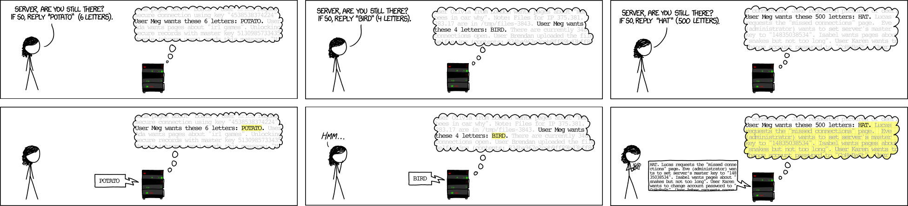
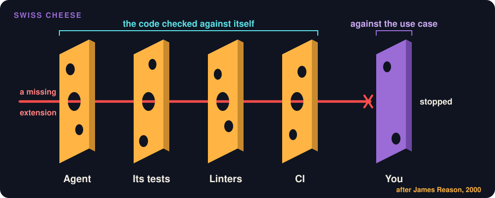

# Code Review

**Slides:** [Reviewing What the Agent Built](../slides/code-review.html) (the fast version).

> **Purpose (one line):** review a pull request against the use case and test list it claims to implement, reading each part as deeply as where it lands demands, so that an approval means someone checked the change and not only the diff.

!!! note "This module is still being written"
    The two agent review runs in [4.7](#47-the-agent-as-first-reviewer) are filled in after the instructor rehearses them. Design review is in [Design-of-Record](design-of-record.md#412-the-design-gate); this module is about code.

## 1. Learning objectives

By the end of this module, a student can:

1. Review a pull request against its use case and approved design (diagrams, API contract, decisions, test list), and find what the diff leaves out.
2. Set review depth by where the code lands (trunk, security rule, leaf) and write that decision into the review as a triage line.
3. Write labeled review comments, and approve by the standard of "better than before", not "perfect".
4. Write the author's half: a pull request description that says what was verified, what was not, and where to look.
5. Run a fresh-context agent review with the contract as its context, and decide what to do about each finding.
6. Say, from evidence, what review finds, what it is worth, and what a rubber stamp costs.

## 2. Where it fits

- **Prerequisites:** [AI-Assisted Implementation](implementation.md), which produces the trunk and leaf commits read here, and [Design-of-Record](design-of-record.md), whose test list is the reviewer's checklist.
- **Leads into:** testing in week 9 (whether a test checks the contract), static analysis in week 10 (handing style to linters), and CI/CD in week 11 (review as one of the gates).
- **How it's taught:** the Wednesday of week 8, on Project Pulse's reminder: the room reads the trunk commit from Monday's build, then reviews a seeded pull request, then watches the agent review the same pull request twice. Practiced in every later studio and in assignment 3.
- **Course outcome it delivers:** [conducting effective code and design reviews, and giving and receiving engineering feedback](../syllabus.md#learning-outcomes) (outcome 7).

## 3. Motivation

**A diff shows what was added, never what was left out.** On New Year's Eve 2011 a developer committed OpenSSL's new heartbeat feature, and a core maintainer reviewed and merged it. The code read a length from the incoming message and copied that many bytes back, without checking the length against the message it came with. The missing check was not in the diff, because it was never written. OpenSSL 1.0.1 shipped it in March 2012; it was disclosed as Heartbleed in April 2014, by which time any server running it could be asked for 64 KB of its own memory at a time, private keys included.



Randall Munroe, [xkcd 1354](https://xkcd.com/1354/), CC BY-NC 2.5, panels rearranged.

**The agent writes more than you can read.** Project Pulse's reminder is expected to arrive as a pull request about the size of [#76](https://github.com/Washingtonwei/project-pulse/pull/76), which added 884 lines across 23 files. A reviewer who tries to read all of it evenly reads none of it well, and one who skims approves whatever is there. Neither notices what is missing.

## 4. Core concepts

### 4.1 What review is for, and what it finds

Review began as **formal inspection**: planned meetings, prepared reviewers, a moderator (Fagan 1976). It found defects and was too slow for most teams; the pull request is its lightweight descendant. The evidence on what the descendant does:

| Finding | Source | What you do with it |
|---|---|---|
| Developers expect review to find defects; it finds fewer than they expect. Knowledge transfer and team awareness are major outcomes, and understanding the change is the reviewer's hardest part. | Bacchelli and Bird 2013 | Review your teammates' code even where a bot reviews it too: on a team of six, review is how anyone learns the parts they did not write. |
| About 75% of the defects reviews find are evolvability defects (readability, structure), not functional ones. | Mäntylä and Lassenius 2009 | Hand style to linters (week 10) and aim your attention at behavior and the contract. |
| Low review coverage and low participation are linked to up to two and five additional post-release defects per component. | McIntosh et al. 2014 | The rubber stamp has a measured cost. A review counts only if the reviewer took part. |
| At Google, the median change is 24 lines with one reviewer, reviewed in under four hours. | Sadowski et al. 2018 | Keep pull requests small; review the same day. |
| Effectiveness drops past about 400 lines in a session, above 500 lines an hour, and after 60 to 90 minutes. | Cohen 2006, a vendor study of Cisco, not peer reviewed | An 884-line agent pull request is not one sitting. Review it commit by commit. |
| Participants with an AI assistant wrote less secure code and were more likely to believe it was secure. | Perry et al. 2023 | The author's confidence is not evidence, and the agent's even less. |

**Review is one layer.** In Reason's Swiss cheese model, every defense has holes, and an accident happens when the holes line up. The agent, its tests, the linters, CI, and the human reviewer are separate slices; the reviewer's slice is the one that holds the contract, so that is where to look.



### 4.2 Two questions every review answers

1. **Does this change do what the contract says?** The contract is the use case (every extension, not only the main scenario), its business rules, and the approved design-of-record: its diagrams, API contract, key decisions, and test list. A reviewer reading only the diff cannot answer this. **A missing extension is invisible in the diff and visible in the test list.**
2. **How deep must I read this part, given where it lands?** Not every line deserves the same attention ([4.3](#43-how-deep-trunk-security-rule-leaf)).

**Read the design beside the diff.** The agent built from an approved design, so the first question is whether it built *that* design or one it preferred. For the reminder, the contract is `UC-NOT-remind-non-submitters` and [`not.md`](https://github.com/Washingtonwei/project-pulse/blob/main/docs/design/not.md). Walk its sections against the code:

| Design section | What to check in the code | In the reminder |
|---|---|---|
| **Class diagram** | Each class exists in the package the design names, with the methods it names; no class the design did not ask for; dependencies run only the way the arrows run | `SubmissionStatusService` sits in `notification` and calls `ActivityService` and `EvaluationService`, never their repositories |
| **Sequence diagrams** | The calls happen in the order drawn, and every `alt` and `opt` branch is in the code | On Confirm, `ReminderController` calls `findOwing` again before sending, so a student who submitted a minute ago is not emailed |
| **API contract** | Each route, request, success response, and error status, extension by extension | `POST /reminders` takes only `{ item }`; the server computes the week |
| **Key decisions** | The code took the chosen option, not one the design rejected | "Store nothing": no reminder table, no Flyway migration |
| **Tests** | Each row has a test, at the level the row names, asserting what the row says | "UC-NOT 6a" is a unit test in which one send throws and the others still go out |

**Review the tests, not only that they pass.** For each row of the test list, find the test that covers it or write that none does. Then read its assertion against the row: row "UC-NOT 4a" asks for a `400` *and* no email sent, so a test that checks only the status covers half the row. A test the agent wrote from its own code checks that the code does what the code does; the expected value has to come from the use case ([4.4](#44-a-checklist-short-enough-to-use), item 6).

**A deviation is not automatically wrong.** `/implement` tells the agent to shout when it sees a better way ([AI-Assisted Implementation 4.11](implementation.md#411-package-your-workflow-as-a-skill)). A deviation the pull request names, with the design updated in the same pull request, is a design change under review. A silent one is a defect even when the code works, because the design no longer describes the code ([Design-of-Record 6](design-of-record.md#6-risks-and-mitigations), the stale design).

### 4.3 How deep: trunk, security rule, leaf

The pull request arrives in the commits [AI-Assisted Implementation 4.6](implementation.md#46-size-the-step-to-the-review) asked for, and the commits set the depth:

| Commit | Depth |
|---|---|
| **Trunk**: code many paths depend on, that changes behavior users rely on, or that is hard to undo | Every line |
| **Security rule or migration** | Every line, and where it sits |
| **Leaf**: new code reached only through the new feature | Its tests' assertions against the test list; skim the rest |

**Write the triage into the review**, one line: "Trunk: `SubmissionStatusService`, read in full. Security: the two rules, read in full. Leaves: controller and dialog, checked tests against rows 1 to 11, skimmed the rest." A skim you wrote down is a decision a teammate can challenge; a skim you did not is a rubber stamp.

**Why the security rule reads alone.** Project Pulse's `SecurityConfiguration` holds one rule per route and ends its API rules with `.requestMatchers(this.baseUrl + "/**").denyAll()`, so a new endpoint "fails closed, loudly" until someone writes its rule. Spring applies the first rule that matches. The design fixes the reminder's rule: `AuthorizationManagers.anyOf(sectionInstructorAuthorizationManager, sectionOwnershipAuthorizationManager)`, before the catch-all. The failure to look for: the agent's integration test gets a `403`, and the quickest way to make it pass is a looser rule. `.authenticated()` in place of `.access(...)` is one word, and it lets any logged-in student email an entire course section. The proof is the test-list row "UC-NOT authorization": an unassigned instructor and a student get `403` on both routes.

### 4.4 A checklist, short enough to use

Checklists work when they are short and name what experts skip under pressure. When Peter Pronovost gave ICU staff at Johns Hopkins a five-step checklist for inserting central lines, the ten-day line infection rate fell from 11% to zero (Gawande 2007). A review checklist does the same for the steps a reviewer skips when a pull request looks fine:

1. **The test list.** Each row: covered by a test, or named as missing.
2. **The design.** Classes, calls, routes, and decisions match the design-of-record; every deviation is named and the design updated in the same pull request.
3. **The triage line.** Trunk and security commits read in full.
4. **The logic against the description.** Does the code do what the pull request says, and what the use case says?
5. **Each extension's error path.** What happens when it fails, and does every `catch` that does not rethrow log the exception ([AI-Assisted Implementation 4.9](implementation.md#49-log-what-the-person-at-2-am-will-need))?
6. **The tests check the contract.** An expected value taken from the use case, not echoed from a mock.

Style, formatting, unused variables, and duplication are real, and they are the linter's job from week 10. Leave them to a "Nit:" comment until then.

### 4.5 Writing the review

**Label every comment** with Conventional Comments: `issue`, `suggestion`, `question`, `nitpick`, `praise`, each marked blocking or non-blocking. A label tells the author what you need; a question with a specific answer is worth more than "looks odd".

```text
issue (blocking): test-list row "UC-NOT 4a" has no test. What does POST /reminders do for an inactive week?
nitpick (non-blocking): `cnt` → `sentCount`.
```

**Approve when the change makes the code better than it was**, even if it is not perfect; that is Google's standard. Holding out for perfect stalls the team, and approving what you did not check is the rubber stamp. Never approve with a blocking comment open.

### 4.6 The author's half

A reviewer can read less when the author brings proof. "Don't file pull requests with code you haven't reviewed yourself," and "Agents write convincing looking pull request descriptions. You need to review these too!" (Willison 2026). Your team's [pull request template](https://github.com/tcu-cosc-40943/course-templates/blob/main/.github/PULL_REQUEST_TEMPLATE.md) asks for four short sections:

| Section | What goes in it |
|---|---|
| **Why** | The problem, in one or two sentences, readable without opening the issue |
| **What changed** | A summary, not a narration of the diff; decisions the code does not show |
| **How it was verified** | **Verified:** tests mapped to test-list rows, what you ran end to end, a screenshot for a UI change. **Not verified:** what nobody checked |
| **Reviewer focus** | Which commit is the trunk, any security rule, where to start reading |

"Not verified: the email failure path" is the most useful line a description can carry, because it tells the reviewer where to look. It is never penalized. A self-rated "high confidence" is not evidence.

Google, the Linux kernel, and GitHub's own guidance agree on the shape: why, what changed, how it was verified, where to look, and a description short enough that a long one means the pull request should be split. In a study of 80,000 pull requests across 156 projects, only 13.7% explained their tests, and stating the type of feedback needed was associated with a 64 to 72% higher likelihood of merging (Pirouzkhah et al. 2026; a correlation, not a cause). Reviewer focus is that element.

### 4.7 The agent as first reviewer

Claude Code's `/code-review` runs in a fresh context: it does not see the conversation that wrote the code, so it cannot inherit the author's reasoning. Give it a pull request number (`/code-review 42`); `--comment` posts its findings on the pull request. Anthropic's managed reviewer is built so its check always ends neutral: it never approves or blocks. The person approves.

**By default it reviews the diff, not the change.** Its documentation says it "focuses on correctness... not formatting preferences or missing test coverage". A missing extension is missing test coverage, so an agent given only the diff will not find it. The fix is the week 5 lesson applied to review: give it the contract. Name the use case and the design's test list in the request, or put the rule in your `CLAUDE.md`.

**On the reminder's seeded pull request, run twice:**

| Run | Found | Missed |
|---|---|---|
| `/code-review <PR>` alone | _filled in after rehearsal_ | |
| With the use case and test list named | _filled in after rehearsal_ | |

**Triage its findings like a teammate's.** For each one: fix it, or reject it with a reason, and record which under How it was verified. Spot-check one thing it flagged and one thing it passed. If its review never mentions the test list, it reviewed the diff.

## 5. The AI-native lens

- **Delegate to AI:** a first pass by a fresh-context reviewer given the contract; style and formatting to linters.
- **Keep human:** the triage, the test-list check, every trunk and security line, and the decision to approve.
- **Context to supply:** the use case, its business rules, and the design-of-record with its test list. Never the author's conversation.
- **How to verify:** spot-check one finding and one pass; check that the review mentions the test list.

## 6. Risks & mitigations

| Risk (classic + AI-introduced) | Human judgment that catches it | Mitigation |
|---|---|---|
| **Classic, AI-amplified:** the rubber stamp, approval without reading a long, plausible pull request | A reviewer who writes the triage line and checks the test list | Triage line in every review; TAs sample review comments |
| **Classic:** reviewing the diff instead of the change, missing what was left out | Reading the test list beside the diff | Descriptions link the use case and design; comments cite test-list rows |
| **AI-introduced:** the author's agent reviews its own work and agrees with itself | Noticing the review shared the author's context | A fresh-context review; a teammate who did not write it approves |
| **AI-introduced:** an oversized pull request | Refusing to review past about 400 lines in one sitting | Commits cut along trunk and leaves; split before review |

## 7. Hands-on (studio + optional individual assignment)

**In class:** the reminder's seeded pull request carries planted defects of four kinds: one in the trunk or the security rule, one missing extension, one test that cannot fail, and several nits. Find what matters, label your comments, and decline to block on the nits. Then compare your list with the agent's two runs.

**Team, own project:** every proving-slice pull request gets a review from a teammate who did not write it, with the triage line, each test-list row marked covered or not, and labeled comments. The TA reads two reviews per team.

**Individual assignment:** in *Add a use case* (assignment 3, due Fri Oct 30), you review the agent's pull request before submitting: the triage line, each test-list row marked covered or not, at least one labeled comment on something you changed or rejected, and the findings of one `/code-review` run with what you did about each. Graded on whether the triage is right and the test-list check honest, not on how many comments there are.

## 8. Summary / key takeaways

- Review the change against its contract. The diff never shows what was left out; the test list does.
- Read the trunk and the security rule in full, the leaves through their tests, and write that triage down.
- Label comments, never block on nits, and approve what is better than before.
- The author brings proof, including what was not verified.
- An agent reviewer is a fresh pair of eyes only if it gets the contract, and it never approves.

## 9. Key papers & further reading

- Fagan, M. E. "Design and Code Inspections to Reduce Errors in Program Development." *IBM Systems Journal* 15(3), 1976.
- Bacchelli, A., and Bird, C. "Expectations, Outcomes, and Challenges of Modern Code Review." ICSE 2013.
- Mäntylä, M. V., and Lassenius, C. "What Types of Defects Are Really Discovered in Code Reviews?" *IEEE TSE* 35(3), 2009.
- McIntosh, S., Kamei, Y., Adams, B., and Hassan, A. E. "The Impact of Code Review Coverage and Code Review Participation on Software Quality." MSR 2014.
- Sadowski, C., Söderberg, E., Church, L., Sipko, M., and Bacchelli, A. "Modern Code Review: A Case Study at Google." ICSE-SEIP 2018.
- Cohen, J. *Best Kept Secrets of Peer Code Review.* SmartBear, 2006.
- Perry, N., Srivastava, M., Kumar, D., and Boneh, D. "Do Users Write More Insecure Code with AI Assistants?" CCS 2023.
- Reason, J. "Human Error: Models and Management." *BMJ* 320, 2000.
- Gawande, A. "The Checklist." *The New Yorker*, December 10, 2007. <https://www.newyorker.com/magazine/2007/12/10/the-checklist>
- Google. "The Standard of Code Review" and "Writing good CL descriptions," in *Google Engineering Practices*. <https://google.github.io/eng-practices/>
- Conventional Comments. <https://conventionalcomments.org>
- Pirouzkhah, S., Wurzel Gonçalves, P., and Bacchelli, A. "The Value of Effective Pull Request Description." 2026. <https://arxiv.org/abs/2602.14611>
- Willison, S. "Anti-patterns: things to avoid," in *Agentic Engineering Patterns*, 2026. <https://simonwillison.net/guides/agentic-engineering-patterns/anti-patterns/> Week 8 reading.
- Anthropic. "Code Review," Claude Code documentation, read 2026-10-05. <https://code.claude.com/docs/en/code-review>

## 10. Self-check

1. A diff adds a controller, a service method three controllers will call, a Vue dialog, and one line to `SecurityConfiguration`. Write the triage line.
2. Your teammate approved a 1,200-line agent pull request in six minutes. Name two findings from [4.1](#41-what-review-is-for-and-what-it-finds) that say what that review is worth.
3. Why is a missing use case extension easier to find from the test list than from the diff?
4. The agent's review passed the change. What do you still check yourself, and what would you add to its request next time?
5. A teammate's description says "Verified: all tests pass." What is missing?

## Related

- [AI-Assisted Implementation](implementation.md): where the trunk and leaf commits come from.
- [Design-of-Record](design-of-record.md#412-the-design-gate): reviewing a design, and the test list.
- [The Method](../method.md#phase-c-fan-out-per-use-case): Phase C, where every use case passes this review.
- [Schedule](../schedule.md): when this is taught.

<!--
## Drafting notes (raw: delete before `stable`)

### Facts to check before `stable`

- Project Pulse facts checked against `main` at `81b5a97` on 2026-10-11: `SecurityConfiguration.java` (380 lines; the `denyAll()` API catch-all and its "fails closed, loudly" comment; the actuator rules before `.anyRequest().permitAll()`); `not.md`'s authorization rule (`anyOf` of the section-instructor and section-ownership managers) and its 18-row test list, including "UC-NOT authorization" and "UC-NOT 4a". Re-check after the reminder is built.
- Heartbleed details (the 2011-12-31 commit, the review, OpenSSL 1.0.1 in March 2012, disclosure in April 2014, 64 KB per request) are from memory; check against the OpenSSL advisory and CVE-2014-0160.
- Gawande 2007: the Pronovost numbers (ten-day infection rate 11% to zero) are as recorded in `notes/cmu-17-313-notes.md`; check against the article. The five steps are not listed here on purpose.
- Reason 2000 is the Swiss cheese source; CMU 17-313's code-review lecture uses it.
- Cohen 2006 is the SmartBear book carrying the Cisco study; label as industry data.
- `/code-review` behavior (fresh context via `context: fork`, `--comment`, the managed reviewer's neutral check run, the "focuses on correctness" quotation) was read 2026-10-05; re-check before each offering. Exact commands belong on the Agent Setup page; move them there when that page gets a review section.
- The research row on agent-authored pull requests (Siddiq et al. 2026, arXiv 2601.00477) was in the earlier notes with its finding cut off; read it and decide whether it earns a row.

### Carried forward

- From the instructor's 2018 deck ("Agile Review and Metrics", slides 29 to 36): the "What to review?" list, kept as checklist items 4 and 5 (logic against the description, error handling), with syntax, duplication, and unused code handed to linters; and "review spreads knowledge", kept as the Bacchelli and Bird row.
- From CMU 17-313's code-review lecture: the Swiss cheese model and the checklist.

### Hand-offs

- `MODULE-testing` (Fri Oct 23): the seeded pull request's test that cannot fail is a candidate opening example of a test without an oracle.
- `MODULE-static-analysis` (week 10): the checklist's style items move to linters.
-->
