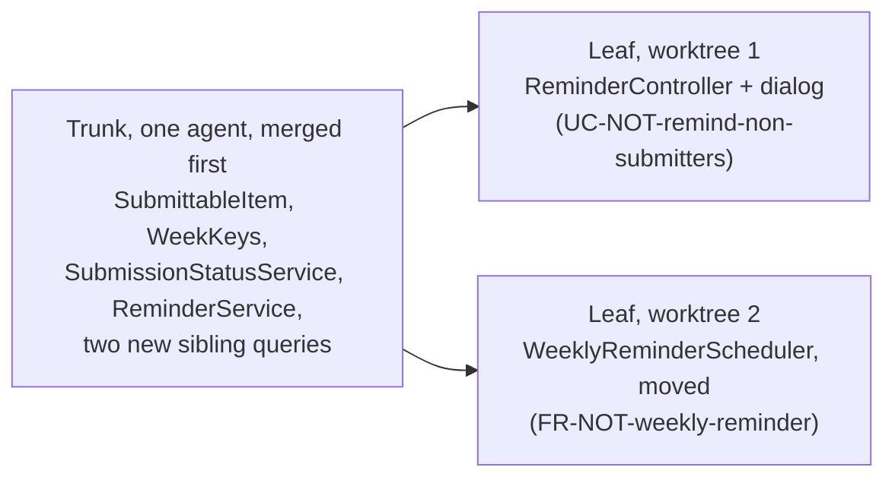

# AI-Assisted Implementation

**Slides:** [Building With the Agent](../slides/implementation.html) (the fast version).

> **Purpose (one line):** build an approved design with an agent in steps you can actually read, so that what gets merged is code your team understands, logs what someone will need at 2 AM, and was built on the existing code without mistaking it for the specification.

!!! note "This module is still being written"
    The first test, written from a use case, is taught with Testing in week 9. Code review, the other half of this week, has its own module.

## 1. Learning objectives

By the end of this module, a student can:

1. Open an agent session by running the existing tests, and say what that tells the agent.
2. Cut an implementation into a trunk commit and leaf commits along its design, and read the trunk before the leaves are built.
3. Define cognitive debt and apply the check that pays it down at each pause.
4. Treat existing code as evidence, never as authority, when an agent documents or designs from it.
5. Write a logging rule into the agent charter, and check in review what the agent logged as well as whether it logged.
6. Decide whether running several agents at once is safe for a given change, and fan out by leaf only after the trunk merges.

## 2. Where it fits

- **Prerequisites:** [Design-of-Record](design-of-record.md), whose class diagram already separates trunk from leaf, and [Context Engineering](context-engineering.md), whose build-context is what the agent builds from.
- **Leads into:** code review (the same week), which reads what this module produces; testing in week 9, which starts from the first test; observability in week 12, which reads the logs this module asks you to write.
- **How it's taught:** the Monday of week 8, as a live build of Project Pulse's reminder from its design, [`not.md`](https://github.com/Washingtonwei/project-pulse/blob/main/docs/design/not.md), stopped at the pause after the trunk commit. Section 4.6, on running several agents, is reading.
- **Course outcome it delivers:** [collaborating with AI across the lifecycle: delegating appropriately, supplying the context it cannot infer, and verifying its output](../syllabus.md#learning-outcomes) (outcome 6).

## 3. Motivation

**The agent writes faster than you read.** Project Pulse's reminder is a change of about the size of [pull request #76](https://github.com/Washingtonwei/project-pulse/pull/76), which added 884 lines across 23 files. An agent writes that in one session. If it arrives as one diff, the reviewer either reads it all (and the week's estimate is gone) or skims it (and approves code nobody on the team can explain).

**The agent copies the code it can see.** Of Project Pulse's 266 backend classes, 4 declare a logger, under two different names (`LOGGER` and `log`). The catch-all exception handler logs nothing. An agent asked to build a feature in that codebase writes code that does not log, because nothing near it does. Whatever your codebase does by habit, the agent does at speed.

## 4. Core concepts

### 4.1 First run the tests

Open every agent session by having it run the existing suite (`./mvnw test` in Project Pulse's `backend/`; `mvnw.cmd test` on Windows). It costs a few minutes and does three things: tells the agent a suite exists and how to run it, shows how big the project is, and makes testing the default for the session (Willison 2026). Put the command in your agent charter.

Then ask for the test first. The agent writes a test from the use case and **confirms that it fails** before writing the code; a test that passes before the change proves nothing about the change. The expected result comes from the use case's postcondition or extension outcome, never from what the agent's code happens to return, because an agent that writes both the test and the code can pass its own exam. Week 9 owns that question; this week only plants it.

### 4.2 Size the step to the review

**Cognitive debt** is code the team accepted without understanding it. Kosmyna et al. (2025) named it for essays written with an assistant; it fits code better, because an agent writes more than a person can read. Like technical debt, it compounds: the next session builds on code nobody can explain, and the first defect in it is debugged from scratch.

The defense is to commit in steps a reviewer can read, cut along the design:

| Step | What goes in it | Why |
|---|---|---|
| **Trunk**, one commit | Code many paths depend on, code that changes behavior existing users rely on, code hard to roll back | Everything else stands on it |
| **A security rule or a schema migration**, alone | One rule, one migration | Both are hard to undo, and a loosened rule is easy to miss beside other changes |
| **Each leaf**, one commit | New code reached only through the new feature | Small, and checked through its own tests |

**The agent pauses once, after the trunk commit,** and you read it before the leaves are built. Not after every step: a wrong trunk found late means rebuilding every leaf, and a wrong leaf does not. At the pause, check one thing: **can you say what changed and why without asking the agent?** If not, read until you can. That is the debt paid while it is small. All the commits still go in one pull request, read commit by commit.

**The reminder, in four commits** (from `not.md`'s class diagram):

1. The trunk: `SubmittableItem`, `WeekKeys`, `SubmissionStatusService`, `ReminderService`, and two new sibling queries. **The pause comes here.**
2. The two route rules in `SecurityConfiguration`, alone.
3. `ReminderController` and the dialog (`UC-NOT-remind-non-submitters`).
4. The moved `WeeklyReminderScheduler` (`FR-NOT-weekly-reminder`).

Project Pulse's [`/implement`](https://github.com/Washingtonwei/project-pulse/blob/main/.claude/commands/implement.md) commits this way and pauses after the trunk. A use case with no trunk is one commit and no pause, except that a security rule still goes alone.

### 4.3 Code you did not write

Some of your clients handed you a codebase with few documents. Asked to document or design from existing code, the agent writes down what the code does, defects included, so a missing check read back from the code arrives as a requirement nobody chose. **The code is evidence, never authority.** Your client calls each recovered statement intended, corrected, or a defect; defects go to `OPEN-ISSUES.md`, not into the specification. The method's [Starting from an existing codebase](../method.md#starting-from-an-existing-codebase) has the four steps. Project Pulse's `/design` calls its version "design-as-built".

### 4.4 Log what the person at 2 AM will need

The agent imitates the code around it, so the logging rule has to be written where the agent reads it: your charter. The rule, for Spring Boot (SLF4J):

| Rule | Example |
|---|---|
| One logger per class, one name across the codebase | `private static final Logger LOGGER = LoggerFactory.getLogger(ReminderService.class);` |
| Levels by audience: `error` someone must act, `warn` something degraded, `info` a business event, `debug` detail for development | `LOGGER.info("Sent {} of {} weekly reminders for section {}", sent, total, name);` |
| Parameterized messages, never string concatenation | `{}` placeholders, as above |
| Every `catch` that does not rethrow logs the exception object | `LOGGER.error("Could not send the weekly reminders for section {}", name, e);` |
| Never log secrets, tokens, passwords, or student records | Request bodies here carry peer evaluations (`CO-ferpa`) |

**The catch-all, before and after.** Project Pulse's last-resort handler today:

```java
@ExceptionHandler(Exception.class)
@ResponseStatus(HttpStatus.INTERNAL_SERVER_ERROR)
Result handleOtherException(Exception ex) {
    return new Result(false, StatusCode.INTERNAL_SERVER_ERROR, "A server internal error occurs.", ex.getMessage());
}
```

Spring does not log an exception a handler has already resolved, so an unexpected `NullPointerException` in production leaves no stack trace anywhere. The user sees "A server internal error occurs."; the operator, and the agent asked to debug it, see nothing. It also sends the raw exception message to the browser, which is a disclosure problem. After:

```java
@ExceptionHandler(Exception.class)
@ResponseStatus(HttpStatus.INTERNAL_SERVER_ERROR)
Result handleOtherException(Exception ex) {
    LOGGER.error("Unhandled exception", ex);
    return new Result(false, StatusCode.INTERNAL_SERVER_ERROR, "A server internal error occurs.");
}
```

**Review what was logged, not only whether.** Asked to "add logging", an agent can log everything. Project Pulse's `WeeklyReminderScheduler` gets the rule right (parameters, the exception object, a count at `info`) and also writes each failed student's email address into the log. Whether that is acceptable is your client's privacy constraint to decide, and the reviewer's job to ask.

### 4.5 Building the reminder: what Monday shows

The live build runs Project Pulse's `/implement` on `not.md` after `/clear`, so the session reads only the merged design. It shows 4.1 to 4.4 in order: the suite run first, the plan, the trunk commit, the pause where the room reads the trunk aloud, and the logging and security rules applied as the leaves begin. The build stops at the pause; the rest is finished afterward, and the result is the pull request reviewed on Wednesday.

### 4.6 One engineer, several agents

`claude --worktree <name>` in a second terminal starts a second session in its own checkout, on its own branch. Whether that helps turns on one question: **what will each agent decide that the others need to know?** Anthropic's multi-agent research system beat a single agent by fanning out searches, at about 15 times the tokens, and its authors note that "most coding tasks involve fewer truly parallelizable tasks than research" (Anthropic 2025). Cognition's reason fits in one line: "Actions carry implicit decisions, and conflicting decisions carry bad results" (Yan 2025). A design-of-record exists to turn implicit decisions into written ones, so **parallel agents are safe exactly where the decisions they would otherwise make silently are already on the record.**

| Pattern | What runs in parallel | What keeps it safe | On Project Pulse |
|---|---|---|---|
| **Side task** | A subagent searches, reads logs, or summarizes, and reports back | It edits nothing; your session keeps the decisions | Listing every caller of `EmailService` before changing it |
| **Writer and reviewer** | A fresh-context agent reviews the writer's diff against the use case and the test list | It did not make the decisions it is checking | `/code-review` on the reminder's pull request |
| **Fan-out by leaf** | Independent leaves of one design, each in its own worktree, branch, and pull request | The shared trunk merged first; the design names every class each leaf touches | The reminder, below |



Start both leaves before the trunk merges and each agent writes its own `SubmissionStatusService`; the two pull requests then disagree about what "has not submitted" means, the very contradiction the design's challenge loop removed. Merge the trunk first and both leaves call the same one.

**What does not work:** splitting one use case by layer across agents (the defect where the halves meet belongs to nobody, as with people: [What a branch should be](ai-augmented-team.md#46-what-a-branch-should-be)); two agents on the trunk at once; and Claude Code's experimental agent teams, which are off by default and do not isolate teammates in worktrees.

**The limit is you.** A worktree isolates files, not decisions and not the machine: two apps from two worktrees compete for the same port and database, and each worktree needs its own dependency install (add `.claude/worktrees/` to `.gitignore`). Every leaf is a pull request a person reads, and review time had already risen 91% in teams that adopted AI heavily ([Process and Planning](process-and-planning.md#3-motivation)). Run no more agents than pull requests you will review well today.

## 5. The AI-native lens

- **Delegate to AI:** writing the code and tests from an approved design, running the suite, committing along trunk and leaves, and side tasks that edit nothing.
- **Keep human:** reading the trunk at the pause, deciding what is trunk when the design is unclear, judging what may be logged, and calling recovered behavior intended or a defect.
- **Context to supply:** the merged design and use case only (start after `/clear`), the charter with the test command and the logging rule, and, when fanning out, the merged trunk.
- **How to verify:** at the pause, explain the trunk without asking the agent; read every new log line for what it writes out; confirm each new test failed before its code existed.

## 6. Risks & mitigations

| Risk (classic + AI-introduced) | Human judgment that catches it | Mitigation |
|---|---|---|
| **AI-introduced:** cognitive debt, code merged that nobody on the team can explain | The pause check: can you say what changed and why? | Trunk first, one pause, commits cut along the design |
| **AI-amplified:** the agent copies the codebase's habits, including not logging and not testing | Noticing the new code looks like its neighbors, gaps included | The test command and the logging rule in the charter |
| **AI-introduced:** a test written to pass the agent's own code | Asking where the expected value came from | Test first, seen to fail; expected values from the use case |
| **Classic, now faster:** recovered behavior turned into requirements | Asking the client, not the code | Code is evidence, never authority; defects to `OPEN-ISSUES.md` |
| **AI-introduced:** parallel agents making conflicting silent decisions | Asking what each agent will decide | Fan out by leaf, after the trunk merges |

## 7. Hands-on (studio + optional individual assignment)

**Team, own project:** before your agent builds the proving slice, add three lines to your agent charter: the command that runs your tests, "write the test first and show it failing", and your logging rule from 4.4. If you run more than one agent, add the four parallel-agent lines from [Agent Setup](../agent-setup.md#10-your-team-repository). Build the slice trunk first, and read the trunk before the leaves.

**Individual assignment:** *Add a use case* (assignment 3, due Fri Oct 30) takes one use case end to end on Project Pulse, trunk first.

## 8. Summary / key takeaways

- Start every session by running the tests; ask for the test first and see it fail.
- Commit the trunk, then any security rule or migration alone, then each leaf. Read the trunk before the leaves are built.
- Cognitive debt is code you accepted without understanding it. Pay it at the pause.
- Existing code is evidence, never authority.
- The agent logs the way your codebase logs. Write the rule down, and review what gets logged.
- Run several agents only where the decisions they would make are already written down, and no more than you can review.

## 9. Key papers & further reading

- Willison, S. "First run the tests" and "Red/green TDD," in *Agentic Engineering Patterns*, 2026. <https://simonwillison.net/guides/agentic-engineering-patterns/first-run-the-tests/>, <https://simonwillison.net/guides/agentic-engineering-patterns/red-green-tdd/>. Week 8 reading.
- Kosmyna, N., et al. "Your Brain on ChatGPT: Accumulation of Cognitive Debt when Using an AI Assistant for Essay Writing Task." arXiv:2506.08872, 2025. <https://arxiv.org/abs/2506.08872>
- Anthropic. "How We Built Our Multi-Agent Research System." June 13, 2025. <https://www.anthropic.com/engineering/multi-agent-research-system>
- Yan, W. "Don't Build Multi-Agents." Cognition, June 12, 2025. <https://cognition.com/blog/dont-build-multi-agents>
- Anthropic. "Run parallel sessions with worktrees," Claude Code documentation, read 2026-10-10. <https://code.claude.com/docs/en/worktrees>

## 10. Self-check

1. Your agent's first commit adds a new service three controllers will call, plus two new screens. Which part is trunk, and where should the pause be?
2. A teammate says the pause is a waste because the review comes later anyway. What does reading the trunk now save?
3. Your agent's new test passes on its first run, before any code was written. What does that tell you?
4. Your client's old system skips the permission check on one page, and the agent, documenting the system, writes that behavior into a use case. What should happen to it?
5. The agent adds `LOGGER.info("Saved evaluation {}", evaluation)`, and the class's `toString()` prints every score and comment. What is wrong, and where does the rule that prevents it belong?
6. Two leaves of your design both need a new query on `SectionRepository`. Can two agents build them in parallel? What would you do first?

## Related

- [Design-of-Record](design-of-record.md): where trunk and leaf come from.
- [Process and Planning](process-and-planning.md): why review, not building, is where the hours go.
- [The Method](../method.md#phase-c-fan-out-per-use-case): Phase C, steps 2 to 4.

<!--
## Drafting notes (raw: distribute into template sections, then delete before `stable`)

### Sources and facts to check before `stable`

- Project Pulse facts checked against `main` at `81b5a97` on 2026-10-11: 266 backend classes, 4 with a logger (`AuthController`, `WeeklyReminderScheduler`, and `UserInvitationService` as `LOGGER`; `DocumentTemplateRegistry` as `log`); `ExceptionHandlerAdvice.handleOtherException` returns `ex.getMessage()` and logs nothing; `WeeklyReminderScheduler` logs `student.getEmail()` on a failed send; `/implement` pauses after the trunk commit. Re-check after the reminder is built, because the build moves the scheduler.
- The four reminder commits follow `not.md`'s class diagram; re-check the class names against the merged code.
- `spring.mvc.log-resolved-exception` defaults to false: confirm against the Spring Boot 4 documentation.
- Willison's chapters have no per-chapter dates; read 2026-10-04.

### Hand-offs

- The first test, given/when/then read off a use case, moved to `MODULE-testing`'s drafting notes on 2026-10-11, taught Wed Oct 21.
- `MODULE-static-analysis` (week 10): PMD's `SystemPrintln` and `AvoidPrintStackTrace`. No analyzer flags missing logging, so that stays a review item for `MODULE-code-review`.
- `MODULE-observability` (week 12): reading logs, Actuator `/loggers`, correlation IDs with MDC, structured output, handing the log to the agent when debugging.
- Assignment 5 (*Hunt the bug*, Fri Nov 20): plant the bug so it surfaces as a 500 through the silent catch-all; the student fixes it and adds the regression test and the log line that would have localized it. **Blocking:** fix logging in Project Pulse `main` before that upstream is stamped. Course status open item 17 still applies.
- Assignment 3 (*Add a use case*, Fri Oct 30) requires trunk-first commits, ungraded this term; grading them is in `course-design/next-offering.md`. Optionally graded against the logging rule.
-->
