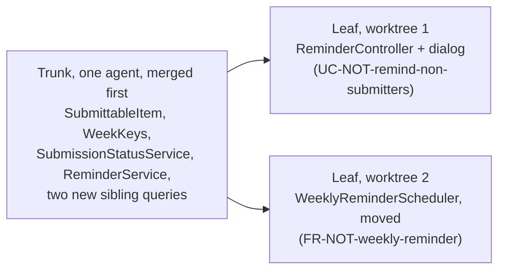

# AI-Assisted Implementation

> **Purpose (one line):** _to be written when authored._


!!! note "This module is still being written"
    The course is being revamped this term, so modules go up as they are written rather than all at once. What is here is usable; the rest is coming. Lectures and studio do not depend on the missing parts.

## Drafting notes (raw: distribute into template sections, then delete before `stable`)

### Logging: students do not log, and the running example taught them not to

**Code facts.** Project Pulse, `main` at `3a8c4688`, verified 2026-09-10. Re-check before `stable`, and quote the code in the module rather than linking the file, because the fix below changes `main`.

- A logger appears in **2 of 266** backend classes, under two names. `AuthController` declares `LOGGER` and logs once, at debug. `DocumentTemplateRegistry` declares `log` and uses info, debug, warn, and error. There is no `System.out.println` or `printStackTrace` anywhere: the codebase does not log badly, it mostly does not log.
- `system/exception/ExceptionHandlerAdvice.handleOtherException(Exception ex)` is the catch-all. It returns a 500 with `ex.getMessage()` in the body and logs nothing. Spring does not log an exception that an `@ExceptionHandler` has resolved (`spring.mvc.log-resolved-exception` defaults to false), so an unexpected `NullPointerException` in production leaves no stack trace anywhere. The client sees "A server internal error occurs." The operator, and the agent asked to debug it, see nothing. Returning the raw exception message to the client is also a disclosure issue for `MODULE-security`.

**The lesson is not "import `Logger`".** `System.out.println` in a container already reaches the Azure log stream. The lesson is deciding, while writing the code, what the person debugging it at 2 AM will need.

**The AI angle runs in two directions.**

- The agent imitates the code it can see, the same mechanism as the week 2 "reviewee" example in `MODULE-ai-augmented-team`. In a codebase that barely logs, it writes code that does not log.
- Asked to "add logging", it can log everything, request bodies included. In Project Pulse those carry peer evaluations and student records (`CO-ferpa`). Review what was logged, not only whether something was.

**Week 8 half (this module): the rule.** One short section. SLF4J as the API. The four levels and what each is for. Parameterized messages (`log.info("Loaded {} templates", count)`), not string concatenation. Log with the exception object in every catch block that does not rethrow. Never log secrets, tokens, passwords, or student data. Teams write the rule into their agent charter, so the agent logs on every use case from the first week of fan-out. Worked example: the catch-all handler above, before and after.

**Why week 8 and not only week 12.** Fan-out begins in week 8. Taught only in week 12, logging arrives after five weeks of code written without it, and Checkpoint 3 asks for "observability in place" on the Friday of the same week observability is taught.

**Hand-offs.** Move each into its module when that module is authored.

- `MODULE-static-analysis` (week 10): PMD's `SystemPrintln` and `AvoidPrintStackTrace` flag bad logging in student code. No analyzer flags missing logging, so that stays a review item for `MODULE-code-review`.
- `MODULE-observability` (week 12): reading logs, changing a level at runtime through Actuator `/loggers`, correlation IDs with MDC, structured output (Spring Boot's `logging.structured.format.console`), and handing the log to the agent when debugging.

**Assignments.**

- *Hunt the bug* (assignment 5, Fri Nov 20) already says "using logs, traces". Plant the bug so it surfaces as a 500 through the silent catch-all. The student localizes it, fixes it, adds the regression test, and adds the log line that would have localized it. The test stops the bug coming back; the log line localizes the next one nobody knows about yet. No sixth assignment.
- Optional: *Add a use case* (assignment 3, Fri Oct 16) is also graded against the logging rule, as a light week 8 touch.
- **Blocking for assignment 5:** fix logging in Project Pulse `main` before the `hunt-the-bug` upstream is stamped, or there are no logs to hunt with. Quote the current handler into this module first. Course status open item 17 (the planted bug is discoverable by `git diff`) still applies.

### The first test: given, when, then, read off the use case

**Why week 8.** Tests are used before they are taught. The week 8 studio ends at "trace it design to code to first test", and *Add a use case* (assignment 3, Fri Oct 16) asks for vetted AI-generated tests, both before `MODULE-testing` on Wed Oct 21. This module teaches enough to write the first test; week 9 owns the judgment.

**Frame: the use case is the scenario.** BDDMockito's `given`/`willReturn` is the vocabulary of behavior-driven development, not the practice. BDD proper writes Given/When/Then scenarios with the stakeholder and runs them with a tool such as Cucumber. The course already has that half: the use case template's trigger, `PRE-n`, `POST-n`, and extensions. Teach given/when/then as the executable form of a use case, and do not add Cucumber.

| Use case | Test |
|---|---|
| `PRE-n`, or the precondition an extension breaks | Given |
| Trigger or step | When |
| `POST-n`, or the extension's outcome | Then |

**Worked example: extension 1a of `UC-WAR-manage-activities`** (Project Pulse `docs/requirements/use-cases.md`). `PRE-2`: the student is assigned to a team (`BR-team-assignment-required`). Extension `1a1`: the system does not accept the activity and tells the student she must be assigned to a team. `ActivityServiceTest.testSaveActivityRejectsASubmitterWithNoTeam` tests exactly that against `ActivityService.saveActivity`. Rewritten in BDD form throughout:

```java
@Test
void testSaveActivityRejectsASubmitterWithNoTeam() {
    // Given: PRE-2 does not hold (extension 1a)
    Student tracy = new Student("t.nicholson@abc.edu", "Tracy", "Nicholson", "t.nicholson@abc.edu", "123456", true, "student");
    given(this.userUtils.hasRole("ROLE_student")).willReturn(true);
    given(this.userUtils.getStudent()).willReturn(tracy);

    // When
    Throwable thrown = catchThrowable(() -> this.activityService.saveActivity(new Activity()));

    // Then: 1a1, the activity is refused and nothing is saved
    assertThat(thrown)
            .isInstanceOf(ActivityIllegalArgumentException.class)
            .hasMessage("You must be assigned to a team before submitting a weekly activity report.");
    then(this.activityRepository).should(never()).save(any(Activity.class));
}
```

Two changes from the repository version, both worth a slide: `catchThrowable` separates When from Then, where the original wraps both in one "When and then" block around `assertThatThrownBy`; and `then(...).should(never())` replaces `verify(...)`. Imports: `org.mockito.BDDMockito.*`, which carries `never` and `any`, plus AssertJ's `assertThat` and `catchThrowable`. Studio: pick one extension from a use case your team wrote and write its test in this shape.

**Project Pulse writes half of it.** Across the 14 test files that import BDDMockito: `given(...)` 194 times and `when(...).thenReturn` never; `verify(...)` 22 times in 10 files and `then(...).should(...)` never; `doNothing().when(...)` 11 times and `willDoNothing()` never. The cause is one line. The testing section of `backend/CLAUDE.md` says only "Use BDDMockito: given(...).willReturn(...)", so the agent follows the convention for Given and falls back to classic Mockito for Then. Same mechanism as the logging gap above. Teams write both halves into their own agent charter.

**Two slide notes.** `doNothing()` on a void method of a mock is redundant, because doing nothing is already the default. AssertJ's `BDDAssertions.then` and BDDMockito's `then` collide when both are statically imported; use AssertJ's `assertThat` with BDDMockito's `then`.

**Hand-off.** `MODULE-testing` (week 9) takes the happy-path twin of this test, `testSaveActivity`, as its oracle example, and assumes students already write given/when/then from a use case.

### Two agent habits: first run the tests, then red/green

Source: Simon Willison, *Agentic Engineering Patterns* (living guide, read 2026-10-04), two chapters assigned as week 8 reading.

- **"First run the tests."** Open every agent session by having it run the existing suite (`./mvnw test` in `backend/`). It tells the agent a suite exists and how to run it, shows the project's size, and sets testing as the default for the session. His line for the slide: "If the code has never been executed it's pure luck if it actually works when deployed to production." Teams put the command in their agent charter. Demo it at the start of the live `/implement` run on `not.md`.
- **"Red/green TDD."** Tell the agent to write the test first and **confirm it fails** before implementing. A test that passes before the change proves nothing about the change. The extension 1a test above is the shape to write first.
- **What the guide does not say, and the course must:** if the agent writes both the test and the code, it can pass its own exam. The expected result in Then comes from the use case's `POST-n` or extension outcome, never from what the agent's code happens to return. That is the oracle question week 9 owns; week 8 only plants it.

### Size the step to the review

**The problem.** `/implement` reads the design, plans, builds back to front, tests, and commits once at the end (Project Pulse `.claude/commands/implement.md`, `main` at `8768a1d`, 2026-10-11). A use case arrives as one diff. `MODULE-code-review` tells the reviewer to read the trunk line by line, but in one diff the trunk is something the reviewer has to dig out.

**The name for what goes wrong: cognitive debt.** Code the team accepted without understanding it. Like technical debt it compounds: the next agent session builds on code nobody on the team can explain, and the first defect in it is debugged from scratch. Kosmyna et al. used the term for essays written with an assistant; it fits code better still, because an agent writes more than a person can read. Forward link to `MODULE-metrics-and-tech-debt`.

**The rule: commit in steps the reviewer can read, cut along the design.**

- **Trunk first, in its own commit.** The design's class diagram already separates trunk from leaf; the commits follow it. This is the parallel-agents rule ("merge the trunk first") at commit size, for one engineer and one agent.
- **Then one commit per leaf.**
- **Smaller steps where mistakes compound.** A security rule or a schema migration goes in a commit of its own, so the reviewer sees it alone. Both are hard to roll back, and a loosened security rule is exactly what the week 8 seeded pull request hides.
- **The agent pauses once, after the trunk commit,** and the engineer reads it before the leaves are built. Not after every step: the trunk is what everything else stands on, and a wrong trunk read late means rebuilding every leaf.
- **The check at each pause:** can you say what changed and why without asking the agent? If not, read until you can. That is the debt paid while it is small.
- **One pull request, several commits.** The reviewer reads commit by commit. A separate trunk pull request is only for fanning out to several agents (below).

**Worked example: the reminder** ([`not.md`](https://github.com/Washingtonwei/project-pulse/blob/main/docs/design/not.md)), in four commits: (1) the trunk, `SubmittableItem`, `WeekKeys`, `SubmissionStatusService`, `ReminderService`, and the two sibling queries; (2) the two route rules in `SecurityConfiguration`, alone; (3) `ReminderController` and the dialog (`UC-NOT-remind-non-submitters`); (4) the moved `WeeklyReminderScheduler` (`FR-NOT-weekly-reminder`). The pause comes after (1). Use the week 8 live `/implement` run to show it, and re-check the class names against the merged code before `stable`.

**Assignment 3 (*Add a use case*)** requires trunk-first commits and does not grade them this term; grading them is in `course-design/next-offering.md`.

**Source:** the step-size and cognitive-debt framing came from DeepLearning.AI's short course *Spec-Driven Development with Coding Agents* (2026), which implements in task groups and takes smaller steps "in areas where mistakes can compound, such as security or database management."

### Code you did not write

**Why here.** The live build is the first time students watch an agent build into code that already exists, and some teams' clients handed them a codebase with few documents. The rule is the method's, [Starting from an existing codebase](../method.md#starting-from-an-existing-codebase); `MODULE-open-source` carries the longer reading. This module states the judgment once and links there.

**The judgment.** An agent asked to document or design from existing code writes down what the code does, defects included. A missing check, read back, arrives as a requirement nobody chose. The code is evidence, never authority: the client (or the maintainer) calls each recovered statement intended, corrected, or a defect, and defects go to `OPEN-ISSUES`. Project Pulse's `/design` does the design half of this as "design-as-built" for areas coded before their design existed.

**The slide, for the implementation deck** (shown just before `/implement` runs):

```markdown
## Code you did not write

::: steps
- Asked to document existing code, the agent writes down what it does, bugs included.
- A missing check, read back, becomes a requirement nobody chose.
- The client calls each one intended, corrected, or a defect. Not you.
:::

::: key
The code is evidence, never authority.
:::

::: note
For teams whose client handed them a codebase. The method's section "Starting from an existing codebase" has the four steps; Project Pulse's /design calls its version "design-as-built".
:::
```

### Further reading (to verify links before `stable`)

- Simon Willison, "First run the tests" and "Red/green TDD," in *Agentic Engineering Patterns*, <https://simonwillison.net/guides/agentic-engineering-patterns/first-run-the-tests/> and <https://simonwillison.net/guides/agentic-engineering-patterns/red-green-tdd/>, read 2026-10-04.
- Kosmyna, N., et al. "Your Brain on ChatGPT: Accumulation of Cognitive Debt when Using an AI Assistant for Essay Writing Task." arXiv:2506.08872, June 2025. <https://arxiv.org/abs/2506.08872>

### Authored: one engineer, several agents (move into Core concepts when the module is written)

Finished prose (`DECISION-parallel-agents`). Renumber and link from the module's sections when it takes shape.

#### What each agent will decide

Running several agents at once is one command now: `claude --worktree <name>` in a second terminal starts a second session in its own checkout, on its own branch. Whether that helps turns on one question: **what will each agent decide that the others need to know?**

Two findings from the people who build these systems say the question is the whole game. Anthropic's multi-agent research system (June 2025) beat a single agent on research by fanning out searches, at about 15 times the tokens of a chat, and its authors note that "most coding tasks involve fewer truly parallelizable tasks than research." Cognition's "Don't Build Multi-Agents" (Yan, June 2025) puts the reason in one line: "Actions carry implicit decisions, and conflicting decisions carry bad results." Two subagents each asked for half of a Flappy Bird clone built a background from Super Mario and a bird that matched neither.

The course already has the answer to Cognition's objection. A design-of-record exists to turn implicit decisions into written ones, and the charter's crosscutting rules pin the rest. **Parallel agents are safe exactly where the decisions they would otherwise make silently are already on the record.**

#### Three patterns that work

| Pattern | What runs in parallel | What keeps it safe | On Project Pulse |
|---|---|---|---|
| **Side task** | A subagent searches, reads logs, or summarizes, and reports back | It edits nothing; your session keeps the decisions | Listing every caller of `EmailService` before changing it |
| **Writer and reviewer** | A fresh-context agent reviews the writer's diff against the use case and the test list | It did not make the decisions it is checking | `/code-review` on the reminder's pull request |
| **Fan-out by leaf** | Independent leaves of one design, each in its own worktree, branch, and pull request | The shared trunk is merged first; the design names every class each leaf touches | The reminder, below |

**The reminder, fanned out.** [`not.md`](https://github.com/Washingtonwei/project-pulse/blob/main/docs/design/not.md)'s class diagram shows a trunk both flows depend on and two leaves that touch nothing in common:



Start both leaves before the trunk merges and each agent writes its own `SubmissionStatusService`, and the two pull requests disagree about what "has not submitted" means, which is the contradiction (two definitions of the same rule) that the design's challenge loop found and removed. Merge the trunk first and both leaves call the same one.

#### What does not work

**Splitting one use case by layer across agents**, a front-end agent and a back-end agent each building half the reminder dialog. It fails for the reason it fails for people ([What a branch should be](ai-augmented-team.md#46-what-a-branch-should-be)): the defect where the halves meet belongs to nobody, and here neither agent even knows the other exists. **Two agents on the trunk at once**, for the same reason. **Agent teams**, Claude Code's lead-and-workers mode, are experimental, off by default, and do not isolate teammates in worktrees; leave them alone this term.

#### The limit is you

A worktree isolates files, not decisions, and not the machine: two apps started from two worktrees still compete for the same port and the same local database, and each worktree is a fresh checkout that needs its own dependency install. Add `.claude/worktrees/` to `.gitignore` so the checkouts do not show up as untracked files.

The real limit is review. Every leaf is a pull request a person reads against the design before it merges, and in teams that adopted AI heavily review time had already risen 91% before anyone ran agents in parallel (Faros AI, 2025; see [Process and Planning](process-and-planning.md#3-motivation)). Three agents finishing in an hour produce three reviews, not one. Run no more agents than pull requests you will review well today.

#### Your team's charter rule

Add these to the workflow section of your `AGENTS.md`:

- One agent per sub-issue, each in its own worktree and branch, each ending in its own pull request.
- Fan out only after the shared trunk the leaves depend on is merged.
- Never split one use case's layers across agents.
- No more agents running than pull requests you will review that day.

#### Sources for this section

- Anthropic. "How We Built Our Multi-Agent Research System." June 13, 2025. <https://www.anthropic.com/engineering/multi-agent-research-system>
- Yan, W. "Don't Build Multi-Agents." Cognition, June 12, 2025. <https://cognition.com/blog/dont-build-multi-agents>
- Anthropic. "Run agents in parallel" and "Run parallel sessions with worktrees," Claude Code documentation, read 2026-10-10. <https://code.claude.com/docs/en/agents>, <https://code.claude.com/docs/en/worktrees>
- Project Pulse `docs/design/not.md` class diagram, checked against `main` at `8768a1d` on 2026-10-10.
