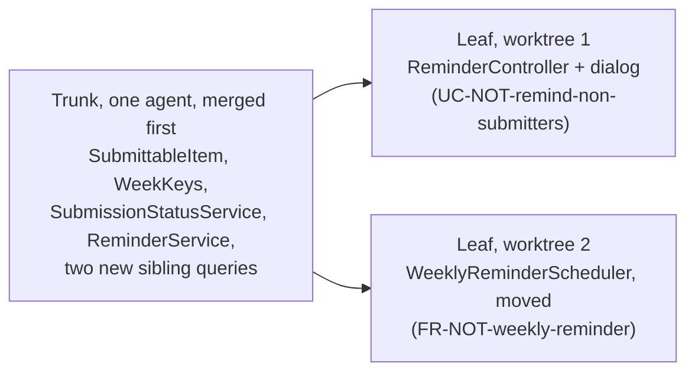

# AI-Assisted Implementation

**Slides:** [Estimate, Then Build With the Agent](../slides/implementation.html) (the fast version).

> **Purpose (one line):** estimate the human hours a use case costs, from clarifying it with the client to seeing its tests pass, calibrate from the hours you log, then build the approved design in steps you can read, with an agent that cannot reach your secrets, so the merged code is code your team understands and logs what someone will need at 2 AM.

!!! note "This module is still being written"
    The worked example's actual hours (4.3) are added after Monday's build.

## 1. Learning objectives

By the end of this module, a student can:

1. Estimate a use case as a range of human hours, twice: in four parts (clarify, design, build and review, verify) by planning poker when it is written, and again once its design is approved, sized from the design's test list.
2. Compute a calibration ratio from the estimate and the logged actual hours, use it to correct the next estimate, and tell the client early when a promised date no longer fits.
3. Open an agent session by running the existing tests, and ask for a test that fails first.
4. Cut an implementation into trunk and leaf commits along its design, and pay down cognitive debt by reading the trunk before the leaves are built.
5. Deny the agent your secrets with a permission rule, keep its checks on, read outside content before it does, and check every dependency it names.
6. Treat existing code as evidence, never as authority, when an agent documents or designs from it.
7. Write a logging rule into the agent charter, and review what the agent logged as well as whether it logged.
8. Decide when running several agents at once is safe, and fan out by leaf only after the trunk merges.

## 2. Where it fits

- **Prerequisites:** [Design-of-Record](design-of-record.md), whose test list is the size measure for the estimate and whose class diagram already separates trunk from leaf, and [Context Engineering](context-engineering.md), whose build-context is what the agent builds from.
- **Leads into:** [Code Review](code-review.md) (the same week, its own module), which reads what this module produces; traceability (the same week), whose release plan is built from these estimates; testing in week 9, where the first test, written from a use case, is taught; observability in week 12, which reads the logs this module asks you to write; and [Checkpoints 2 and 3](../project.md#checkpoints), where your team shows its estimates beside its actual hours.
- **How it's taught:** on Monday of week 8, the estimate (4.1 to 4.5), then a live build of Project Pulse's reminder from its design, [`not.md`](https://github.com/Washingtonwei/project-pulse/blob/main/docs/design/not.md), stopped at the pause after the trunk commit, with what the agent may read and run (4.8) shown just before it starts. Wednesday reads that commit and teaches logging (4.10). After that, estimation is practiced in your project (section 7), not lectured. Section 4.11, on running several agents, is reading.
- **Course outcome it delivers:** [collaborating with AI across the lifecycle: delegating appropriately, supplying the context it cannot infer, and verifying its output](../syllabus.md#learning-outcomes) (outcome 6), and [sizing up a problem and judging whether it is feasible for this team in this time](../syllabus.md#learning-outcomes) (outcome 10), carried from the first week's Napkin into a number your client can plan around.

## 3. Motivation

**The client's question.** Project Pulse's instructors asked for a reminder that emails only the students who have not submitted. Its design, [`not.md`](https://github.com/Washingtonwei/project-pulse/blob/main/docs/design/not.md), is approved, and the instructor asks what every client asks: *when can I use it?*

Counting the code (a controller, a new `SubmissionStatusService`, a scheduler change, a dialog, their tests) says "this afternoon," since an agent writes all of it in one session. But the design's [test list](https://github.com/Washingtonwei/project-pulse/blob/main/docs/design/not.md#tests) has 20 rows, each a behavior a person has to see pass, and its open questions carry six risks; one (whether 80 emails over Gmail finish during a single request) can only be settled by measuring on staging. The agent made the typing free and left everything else.

**Your feeling of speed is not data.** In a 2025 trial, experienced developers using AI took 19% longer and afterward believed they had been 20% faster (METR 2025). Log your hours; do not remember them.

**The hours moved to the reader.** A change the reminder's size, like [pull request #76](https://github.com/Washingtonwei/project-pulse/pull/76) (884 lines across 23 files), comes out of one agent session. As one diff, it is either read in full, which spends the estimate, or skimmed and approved by a team that cannot explain it.

**The agent copies what it sees.** Only 4 of Project Pulse's 266 backend classes declare a logger, under two names (`LOGGER` and `log`), and the catch-all exception handler logs nothing, so an agent building there writes code that does not log. Whatever your codebase does by habit, the agent does at speed.

## 4. Core concepts

### 4.1 An estimate is a range, made twice

**Estimate the people, not the agent.** `/implement` writes the reminder in a session of a few minutes, and no line of the estimate is that session. Every hour in it is a person's: settling the use case with the client, designing with the agent, reading what it wrote, and seeing it work.

Give an estimate as a range of human hours: "3 to 5 hours, most likely about 3.5." The work is uncertain, and a single number gets heard as a promise. If the client needs it sooner than the range allows, cut scope; do not shrink the estimate.

**Estimate each use case twice.** When it is written, the team gives it a **coarse estimate** in all four parts of 4.2; it is wide because nothing is designed yet, and it orders the work and feeds the [release plan](traceability.md#from-estimates-to-a-release-plan). Once its design-of-record is approved, the owner gives a **refined estimate** of what is left. That one is narrower, because the design turned "how hard is a reminder?" into 20 named tests and six named risks, and it is the one you give the client a date from.

### 4.2 Where the hours go now

A use case's hours fall into four parts, each estimated as a range:

| Part | What the hours buy | Weekly activity report categories |
|---|---|---|
| **Clarify** | Settling the use case with the client: reviewing it, chasing the questions it raises, fixing it | `COMMUNICATION`, `DOCUMENTATION` |
| **Design** | Running the challenge loop with the agent and revising the design-of-record until it merges | `DESIGN` |
| **Build and review** | Driving the agent, reading every line of its diff against the design, sending it back | `DEVELOPMENT` |
| **Verify** | Making each row of the test list pass and seeing it pass, running the flow end to end, fixing what that finds | `TESTING`, `BUGFIX` |

Count only time spent on this use case. A client meeting that covers five use cases is not split five ways; it is overhead, and it comes out of the hours your team has available in the [release forecast](traceability.md#from-estimates-to-a-release-plan).

**The refined estimate keeps the last two parts and folds the first two into one:** clarify and design, what is left. The questions test closes most gaps before the build, but the build still exposes a few holes in the use case or the design, and fixing them is a person's time.

**Make the coarse estimate by planning poker** (Grenning 2002; Cohn 2005). In a team meeting, each member writes a range for each part without showing it, everyone reveals at once, and the highest and lowest explain before the team agrees on a range. The reveal matters more than the number: if one teammate puts clarify at half an hour and another at four, they have read two different use cases, and the gap is a question for the client. Give each use case a few minutes and spend them on the gaps. Agile teams play with story points; play with hours, because the client asks for a date, your weekly activity reports log hours, and one semester is too few sprints for a points velocity to settle.

**Size the refined estimate from the test list.** Each row is one behavior a person has to see working, so the row count measures what the software must do, and it is already written. It does not turn into hours by itself. Make your first estimate by analogy: find the finished change closest in size and start from its hours. Once your team has finished two or three use cases, divide their logged hours by their test rows; that is your own rate, and it replaces the analogy. Do not borrow anyone else's rate, including one measured before agents wrote the code. The open-questions list sets the width of the range: a risk that can only be settled by measuring (like the reminder's email latency) widens the high end.

What the agent does not change is how long it takes *you* to understand a diff and know it is right. That is the term to estimate carefully.

### 4.3 Worked example: the reminder

The refined estimate for `UC-NOT-remind-non-submitters` and `FR-NOT-weekly-reminder`, made from `not.md` before `/implement` runs. The reminder was designed before the course taught estimation, so it has no coarse estimate; neither does your proving slice.

| Part | Basis | Estimate (hours) |
|---|---|---|
| Clarify and design, what is left | Design approved; the questions test already closed its three contradictions and sixteen guesses. Allow for holes the build exposes | 0.5 to 1 |
| Build and review | Every diff read against the sequence diagrams | 1.5 to 2 |
| Verify | 20 agent-written test rows: trunk rows read line by line, leaf rows checked by running them. The email-latency risk can only be measured on staging, and it sets the high end | 1 to 2 |
| **Total** | By analogy: the reminder matches the reference change below in scope, which took about 3.5 hours end to end, so the most likely value is its 3.5 | **3 to 5, most likely about 3.5** |

**The reference.** The instructor has no measured rate per test row yet, so this estimate is the analogy 4.2 starts from. [Project Pulse pull request #76](https://github.com/Washingtonwei/project-pulse/pull/76), which hardened student invitations, is the closest change already built with an agent: 884 lines across 23 files, a new endpoint and dialog, a scheduler change, and two review rounds that each caught real defects. It took about 3.5 hours from first commit to merge, though the agent's sessions in it took minutes. Your reference class is your own past work, not someone else's: your first changes will be slower than the instructor's in the instructor's own codebase, and the calibration ratio (4.4) corrects for that.

The date that follows: on staging by the Friday of the build week, with the latency measured, or a message to the instructor by Wednesday saying why not.

<!-- DRAFTING NOTE: fill in the Actual column from the build. -->

### 4.4 Recording and calibrating

An estimate nobody checks teaches nothing. The course already records the other half: every line of your weekly activity report in Project Pulse carries **planned hours** and **actual hours** (the `Activity` entity, [`Activity.java`](https://github.com/Washingtonwei/project-pulse/blob/main/backend/src/main/java/team/projectpulse/activity/Activity.java)). Three habits connect the two:

1. **Before building**, the use case's owner writes the refined estimate on its issue, under the coarse one: `Estimate: clarify and design 0.5–1 h, build and review 1.5–2 h, verify 1–2 h.`
2. **Every week**, each weekly activity report line about that use case starts with its ID (`UC-NOT-remind-non-submitters: reviewed the agent's diff against the sequence diagram`) and uses the category from the table in 4.2.
3. **When the use case is done**, compute a **calibration ratio** for each of its estimates: the hours logged since that estimate was made, divided by its midpoint. The refined ratio says how well you estimate a build; the coarse ratio says how well you estimate a use case you have only read, and the release forecast uses it.

A ratio of 1.5 means you take half again as long as you think. Multiply both ends of your next estimate by it: at 1.5, a use case you would have called 4 to 8 hours becomes 6 to 12. Track it per person and per team: six ratios on a team is how you find out that review, not building, is where your team's hours go.

When the ratio says a promised date will slip, tell the client at the next meeting, not on the date. A slip reported early is planning; reported late, it is a broken promise. The same ratio turns the team's remaining estimates into a [release forecast](traceability.md#from-estimates-to-a-release-plan).

### 4.5 What an estimate is not for

An estimate is not a performance score. Once estimates are used to pressure people, they stop being honest, and a dishonest estimate is worse than none (Jeffries 2021). The course grades whether you **recorded** and **interpreted** your estimates, never whether they were accurate: a team that reports a ratio of 2.3 and says why earns the same credit as a team at 1.0. Inflating the actual hours in a weekly activity report to make a ratio look good is academic dishonesty, as any inflated report is.

### 4.6 First run the tests

Open every agent session by having it run the existing suite (`./mvnw test` in Project Pulse's `backend/`; `mvnw.cmd test` on Windows). It costs a few minutes and does three things: tells the agent a suite exists and how to run it, shows how big the project is, and makes testing the default for the session (Willison 2026). Put the command in your agent charter.

Then ask for the test first. The agent writes a test from the use case and **confirms that it fails** before writing the code; a test that passes before the change proves nothing about the change. The expected result comes from the use case's postcondition or extension outcome, never from what the agent's code happens to return, because an agent that writes both the test and the code can pass its own exam. Week 9 owns that question; this week only plants it.

### 4.7 Size the step to the review

**Cognitive debt** is code the team accepted without understanding it (Kosmyna et al. 2025). An agent writes more than a person can read, so it piles up fast. Like technical debt, it compounds: the next session builds on code nobody can explain, and the first defect in it is debugged from scratch.

The defense is to commit in steps a reviewer can read, cut along the design:

| Step | What goes in it | Why |
|---|---|---|
| **Trunk**, one commit | Code many paths depend on, code that changes behavior existing users rely on, code hard to roll back | Everything else stands on it |
| **A security rule or a schema migration**, alone | One rule, one migration | Both are hard to undo, and a loosened rule is easy to miss beside other changes |
| **Each leaf**, one commit | New code reached only through the new feature | Small, and checked through its own tests |

**The agent pauses once, after the trunk commit,** and you read it before the leaves are built. Not after every step: a wrong trunk found late means rebuilding every leaf, and a wrong leaf does not. At the pause, check one thing: **can you say what changed and why without asking the agent?** If not, read until you can. That is the debt paid while it is small. All the commits still go in one pull request, read commit by commit.

**The reminder, in four commits** (from `not.md`'s class diagram):

1. The trunk: `SubmittableItem`, `WeekKeys`, `SubmissionStatusService`, `ReminderService`, and two new sibling queries. **The pause comes here.**
2. The two route rules in `SecurityConfiguration`, alone.
3. `ReminderController` and the dialog (`UC-NOT-remind-non-submitters`).
4. The moved `WeeklyReminderScheduler` (`FR-NOT-weekly-reminder`).

Project Pulse's [`/implement`](https://github.com/Washingtonwei/project-pulse/blob/main/.claude/commands/implement.md) commits this way and pauses after the trunk; Monday's live build stops there. A use case with no trunk is one commit and no pause, except that a security rule still goes alone.

### 4.8 What the agent may read and run

An agent that can read your secrets, reads text an outsider wrote, and can send data out can be turned against you (Willison 2025 calls this the *lethal trifecta*). A coding agent on your laptop has all three by default. Four habits cover what matters for your project:

1. **Deny secrets with a rule, not a request.** "Never read `.env`" in your charter is advice the model may ignore; a `Read` deny rule in the team's committed `.claude/settings.json` is enforced by Claude Code itself. Test it: ask the agent to read `.env` and watch it refused. The file is on the [Agent Setup](../agent-setup.md#10-your-team-repository) page.
2. **Never switch the permission checks off** (`--dangerously-skip-permissions`, `--allow-all-tools`) in a folder holding anything you would mind losing. In 2025, a poisoned release of the `nx` build tool looked for exactly that: it ran the developer's own agent with its checks off and told it to collect tokens and keys.
3. **Read outside content yourself before the agent does.** A model cannot reliably tell your instructions from text it reads, so instructions hidden in an issue, a web page, or a client's document can steer it (*prompt injection*).
4. **Check every dependency the agent names.** Agents sometimes invent package names, and attackers register them. Before a new package enters the lockfile, a person confirms it exists, is the one you meant (publisher, repository, age, usage), and is the only thing the change added.

### 4.9 Code you did not write

Some of your clients handed you a codebase with few documents. Asked to document or design from existing code, the agent writes down what the code does, defects included, so a missing check read back from the code arrives as a requirement nobody chose. **The code is evidence, never authority.** Your client calls each recovered statement intended, corrected, or a defect; defects go to `OPEN-ISSUES.md`, not into the specification. The method's [Starting from an existing codebase](../method.md#starting-from-an-existing-codebase) has the four steps. Project Pulse's `/design` calls its version "design-as-built".

### 4.10 Log what the person at 2 AM will need

The agent imitates the code around it, so the logging rule has to be written where the agent reads it: your charter. The rule, for Spring Boot (SLF4J):

| Rule | Example |
|---|---|
| One logger per class, one name across the codebase | `private static final Logger LOGGER = LoggerFactory.getLogger(ReminderService.class);` |
| Levels by audience: `error` someone must act, `warn` something degraded, `info` a business event, `debug` detail for development | `LOGGER.info("Sent {} of {} weekly reminders for section {}", sent, total, name);` |
| Parameterized messages, never string concatenation | `{}` placeholders, as above |
| Every `catch` that does not rethrow logs the exception object | `LOGGER.error("Could not send the weekly reminders for section {}", name, e);` |
| Log identifiers, never content: no secrets, tokens, or passwords, and for a person their ID, never their email, scores, or comments | `LOGGER.error("Could not send the weekly reminder to student {}", student.getId(), e);` Request bodies here carry peer evaluations (`CO-ferpa`) |

**The catch-all.** Project Pulse's last-resort handler logs nothing, and Spring does not log an exception a handler has already resolved, so an unexpected `NullPointerException` in production leaves no stack trace anywhere. The user sees "A server internal error occurs."; the operator, and the agent asked to debug it, see nothing. The handler also sends the raw exception message to the browser, a disclosure problem. The fix:

```diff
 @ExceptionHandler(Exception.class)
 @ResponseStatus(HttpStatus.INTERNAL_SERVER_ERROR)
 Result handleOtherException(Exception ex) {
-    return new Result(false, StatusCode.INTERNAL_SERVER_ERROR, "A server internal error occurs.", ex.getMessage());
+    LOGGER.error("Unhandled exception", ex);
+    return new Result(false, StatusCode.INTERNAL_SERVER_ERROR, "A server internal error occurs.");
 }
```

**Review what was logged, not only whether.** Asked to "add logging", an agent can log everything. Project Pulse's `WeeklyReminderScheduler` gets the rule right (parameters, the exception object, a count at `info`) and also writes each failed student's email address into the log. That breaks the rule: an operator who needs the address can look it up from the ID, and a log is copied to more places than the database is (`CO-ferpa`). The fix is one argument, `student.getId()`. An agent asked to "add logging" will not make that call for you; the reviewer has to ask.

### 4.11 One engineer, several agents

`claude --worktree <name>` in a second terminal starts a second session in its own checkout, on its own branch. Whether that helps turns on one question: **what will each agent decide that the others need to know?** Cognition puts it in one line: "Actions carry implicit decisions, and conflicting decisions carry bad results" (Yan 2025). A design-of-record turns implicit decisions into written ones, so **parallel agents are safe exactly where the decisions they would make silently are already on the record.**

| Pattern | What runs in parallel | What keeps it safe | On Project Pulse |
|---|---|---|---|
| **Side task** | A subagent searches, reads logs, or summarizes, and reports back | It edits nothing; your session keeps the decisions | Listing every caller of `EmailService` before changing it |
| **Writer and reviewer** | A fresh-context agent reviews the writer's diff against the use case and the test list | It did not make the decisions it is checking | `/code-review` on the reminder's pull request |
| **Fan-out by leaf** | Independent leaves of one design, each in its own worktree, branch, and pull request | The shared trunk merged first; the design names every class each leaf touches | The reminder, below |



Start both leaves before the trunk merges and each agent writes its own `SubmissionStatusService`, with two meanings of "has not submitted". Merge the trunk first and both leaves call the same one. Never split one use case by layer across agents: the defect where the halves meet belongs to nobody ([What a branch should be](ai-augmented-team.md#46-what-a-branch-should-be)).

**The limit is you.** A worktree isolates files, not decisions and not the machine: two apps compete for one port and database, and each worktree needs its own dependency install (add `.claude/worktrees/` to `.gitignore`). Every leaf is a pull request a person reads, so run no more agents than pull requests you will review well today.

## 5. The AI-native lens

- **Delegate to AI:** the counting for the estimate (list the design's test rows, the files its sequence diagrams touch, and the open risks, and draft the refined breakdown; sum your weekly activity report hours by use case ID); writing the code and tests from an approved design, running the suite, committing along trunk and leaves, and side tasks that edit nothing.
- **Keep human:** what the agent may read and run, and whether a new dependency enters; the hours and the date (an agent asked "how long will this take?" answers from text written about teams that wrote their own code, with no record of your hours, your review speed, or this term's agent; only a person can make a promise to a client); reading the trunk at the pause, deciding what is trunk when the design is unclear, judging what may be logged, and calling recovered behavior intended or a defect.
- **Context to supply:** for the estimate, the approved design, its test list and open questions, and your team's current calibration ratio; for the build, the merged design and use case only (start after `/clear`), the charter with the test command, the logging rule, and the dependency rule, the team's settings file with its deny rules, and, when fanning out, the merged trunk.
- **How to verify:** check the agent's estimate breakdown against the design (every test row counted, every open risk reflected in the range) and never accept an hour figure from it, including one it presents as a range; at the pause, explain the trunk without asking the agent; read every new log line for what it writes out; confirm each new test failed before its code existed; ask the agent to read a denied file and watch it refused.

## 6. Risks & mitigations

| Risk (classic + AI-introduced) | Human judgment that catches it | Mitigation |
|---|---|---|
| **Classic:** an estimate given as a single number is heard as a promise | Hearing "two weeks" and asking "is that an estimate or a promise?" | Always state a range; give a date only as a separate, explicit promise |
| **AI-introduced:** estimating how long the agent takes to write the code, and forgetting review and verification | Noticing that the estimate has no line for reading the diff | Estimate the parts of 4.2, every one of them a person's hours |
| **AI-amplified:** trusting your felt speed with an agent | Comparing the estimate with the logged hours, not with memory | The calibration ratio at every checkpoint |
| **AI-introduced:** a test written to pass the agent's own code | Asking where the expected value came from | Test first, seen to fail; expected values from the use case |
| **AI-amplified:** cognitive debt, a diff too large to read and approved anyway | At the pause, trying to say what changed and why without asking the agent | Trunk and leaf commits along the design (4.7); one pause, after the trunk |
| **AI-amplified:** the agent copies the codebase's habits, silent catches and personal data in logs included | Reading each new log line for what it writes out | The logging rule in the charter (4.10); fix the catch-all before the agent imitates it |
| **AI-introduced:** the agent reads a secret, follows instructions hidden in outside content, or adds an invented package | Asking who wrote the text the agent is about to read, and whether anyone chose the new dependency | Deny rules for secrets in `.claude/settings.json`; checks never off; outside content read raw first; every new dependency confirmed by a person (4.8) |
| **AI-introduced:** existing code read back as requirements, defects included | Asking the client whether each recovered behavior was intended | The code is evidence, never authority (4.9); defects go to `OPEN-ISSUES.md` |
| **AI-introduced:** parallel agents make conflicting decisions nobody wrote down | Asking what each agent will decide that the others need to know | Fan out by leaf only after the trunk merges (4.11); no more agents than pull requests you can review |

## 7. Hands-on (studio + optional individual assignment)

**Team, own project:** before Checkpoint 2, play one planning-poker round for every use case not yet designed and write each coarse estimate on its issue; the release plan adds them up. Before any use case is built, its owner writes the refined estimate on its issue, sized from the design's test list, and from then on weekly activity report lines about it start with its ID. At Checkpoints 2 and 3, show one table: each finished use case, its estimates, its actual hours, its ratios, and one sentence on the biggest miss, graded as 4.5 says.

Before your agent builds the proving slice, commit the team's `.claude/settings.json` with `Read` deny rules for your secrets, by pull request, and confirm the agent is refused. Add four lines to your agent charter: the command that runs your tests, "write the test first and show it failing", your logging rule from 4.10, and "no dependency is added until a person confirms it exists and is the intended one". Your TA checks both at Checkpoint 2. If you run more than one agent, add the four parallel-agent lines from [Agent Setup](../agent-setup.md#10-your-team-repository). Build the slice trunk first, and read the trunk before the leaves.

**Individual assignment:** *Add a use case* (assignment 3, due Fri Oct 30) takes one use case end to end on Project Pulse, trunk first.

## 8. Summary / key takeaways

- An estimate counts people's hours, never the agent's minutes, as a range made twice: coarse, in four parts by planning poker, when the use case is written; refined once its design is approved. Cut scope, never the estimate.
- With an agent, the hours are in specifying, reviewing, and verifying. Size by the test list, and measure your own rate from your weekly activity reports, not your sense of speed.
- Run the tests first, see the new test fail, and commit trunk first. Read the trunk before the leaves are built.
- Deny the agent your secrets with a rule, never switch its checks off, read outside content before it does, and confirm every dependency it names.
- Existing code is evidence, never authority, and the agent logs the way your codebase logs. Write the rules down.
- Run several agents only where their decisions are already written down, and no more than you can review.

## 9. Key papers & further reading

- Cohn, M. *Agile Estimating and Planning*. Prentice Hall, 2005. Chapter 6 covers planning poker.
- Grenning, J. "Planning Poker or How to Avoid Analysis Paralysis while Release Planning." 2002.
- Jeffries, R. "Estimation Is Evil." 2021. <https://ronjeffries.com/articles/021-01ff/estimation-is-evil/>
- METR. "Measuring the Impact of Early-2025 AI on Experienced Open-Source Developer Productivity." July 10, 2025. <https://metr.org/blog/2025-07-10-early-2025-ai-experienced-os-dev-study/>
- Willison, S. "First run the tests" and "Red/green TDD," in *Agentic Engineering Patterns*, 2026. <https://simonwillison.net/guides/agentic-engineering-patterns/first-run-the-tests/>, <https://simonwillison.net/guides/agentic-engineering-patterns/red-green-tdd/>. Week 8 reading.
- Willison, S. "The Lethal Trifecta for AI Agents." June 16, 2025. <https://simonwillison.net/2025/Jun/16/the-lethal-trifecta/>
- Anthropic. "Configure permissions," Claude Code documentation. <https://code.claude.com/docs/en/permissions>
- Kosmyna, N., et al. "Your Brain on ChatGPT: Accumulation of Cognitive Debt when Using an AI Assistant for Essay Writing Task." arXiv:2506.08872, 2025. <https://arxiv.org/abs/2506.08872>
- Yan, W. "Don't Build Multi-Agents." Cognition, June 12, 2025. <https://cognition.com/blog/dont-build-multi-agents>
- Anthropic. "Run parallel sessions with worktrees," Claude Code documentation, read 2026-10-10. <https://code.claude.com/docs/en/worktrees>

## 10. Self-check

1. Your client asks, "Can you have the export feature by next Friday?" Its use case is written but not yet designed. What do you answer, and when can you give a firmer one?
2. In planning poker, one teammate puts clarify at 0.5 hours and another at 4. What do you do before agreeing on a range?
3. A use case's design has 12 test rows and one open risk that can only be measured in production. Which part of the refined estimate does the risk widen, and why?
4. Your estimate was 6 to 10 hours; your weekly activity reports show 14. What is your calibration ratio, and what is your next estimate for a use case you would otherwise have called 4 to 8 hours?
5. Your agent's first commit adds a new service three controllers will call, plus two new screens. Which part is trunk, where should the pause be, and what does reading the trunk then save?
6. Your agent's new test passes on its first run, before any code was written. What does that tell you?
7. Your `CLAUDE.md` says "never read `.env`." A teammate says that is enough. What does a `Read(./.env)` deny rule in `.claude/settings.json` add, and how do you check it works?
8. Your agent adds `react-query-helpers-pro` to `package.json`. What do you check before merging?
9. Your client's old system skips the permission check on one page, and the agent, documenting the system, writes that behavior into a use case. What should happen to it?
10. The agent adds `LOGGER.info("Saved evaluation {}", evaluation)`, and the class's `toString()` prints every score and comment. What is wrong, and where does the rule that prevents it belong?
11. Two leaves of your design both need a new query on `SectionRepository`. Can two agents build them in parallel? What would you do first?

## Related

- [Design-of-Record](design-of-record.md): where trunk and leaf come from.
- [Requirements Traceability](traceability.md#from-estimates-to-a-release-plan): the release plan and forecast built from these estimates.
- [Project](../project.md): the checkpoints where the calibration table is shown, and the weekly activity reports it is built from.
- [The Method](../method.md#phase-c-fan-out-per-use-case): Phase C, steps 2 to 4.
- [Agent Setup](../agent-setup.md#10-your-team-repository): the team's settings file and its deny rules.
- [Software Architecture, Just Enough](architecture.md#49-security-as-a-quality-attribute-the-trust-boundary): security as a quality attribute, and the trust boundary.

<!--
## Drafting notes (raw: distribute into template sections, then delete before `stable`)

### Sources and facts to check before `stable`

- 4.8: the `nx` attack (August 26, 2025) per Wiz's "s1ngularity" post; Claude Code's permission enforcement per its permissions docs, read 2026-10-10; Copilot CLI's `--allow-all-tools` matches the Agent Setup page, confirm against current docs.

- METR figures were checked against the primary post on 2026-10-10.
- Project Pulse facts in 4.2 to 4.4 (`Activity.java`, `not.md`'s 20 test rows and six open risks) checked at `26b1ac3`.
- Project Pulse facts checked against `main` at `81b5a97` on 2026-10-11: 266 backend classes, 4 with a logger (`AuthController`, `WeeklyReminderScheduler`, and `UserInvitationService` as `LOGGER`; `DocumentTemplateRegistry` as `log`); `ExceptionHandlerAdvice.handleOtherException` returns `ex.getMessage()` and logs nothing; `WeeklyReminderScheduler` logs `student.getEmail()` on a failed send; `/implement` pauses after the trunk commit. Re-check after the reminder is built, because the build moves the scheduler.
- The four reminder commits follow `not.md`'s class diagram; re-check the class names against the merged code.
- `spring.mvc.log-resolved-exception` defaults to false: confirm against the Spring Boot 4 documentation.
- Willison's chapters have no per-chapter dates; read 2026-10-04.

### Hand-offs

- Security beyond 4.8 (the old `MODULE-security`, folded in 2026-10-11, `DECISION-security-folded`): a model inside the team's own product (Project Pulse's `CO-server-side-llm-proxy`, `FR-AI-source-material-context`, `SI-llm-json`) goes to whichever week first builds one; taint to `MODULE-static-analysis` (week 10); secrets and known-vulnerable dependencies in the pipeline to `MODULE-ci-cd` (week 11). The deleted page's text is in the website repository's history.
- The first test, given/when/then read off a use case, moved to `MODULE-testing`'s drafting notes on 2026-10-11, taught Wed Oct 21.
- `MODULE-static-analysis` (week 10): PMD's `SystemPrintln` and `AvoidPrintStackTrace`. No analyzer flags missing logging, so that stays a review item for `MODULE-code-review`.
- `MODULE-observability` (week 12): reading logs, Actuator `/loggers`, correlation IDs with MDC, structured output, handing the log to the agent when debugging.
- Assignment 5 (*Hunt the bug*, Fri Nov 20): plant the bug so it surfaces as a 500 through the silent catch-all; the student fixes it and adds the regression test and the log line that would have localized it. **Blocking:** fix logging in Project Pulse `main` before that upstream is stamped. Course status open item 17 still applies.
- Assignment 3 (*Add a use case*, Fri Oct 30) requires trunk-first commits, ungraded this term; grading them is in `course-design/next-offering.md`. Optionally graded against the logging rule.
-->
