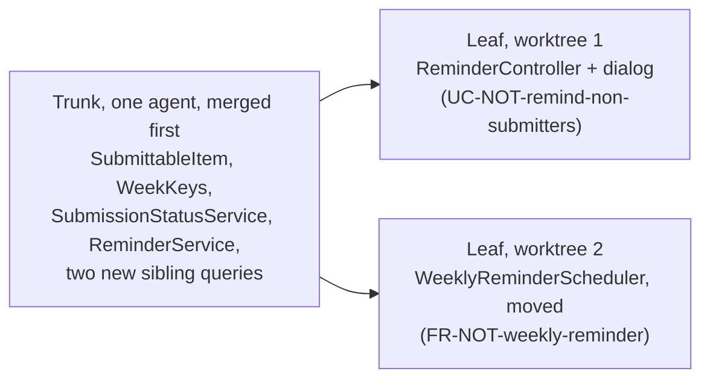

# AI-Assisted Implementation

**Slides:** [Estimate, Then Build With the Agent](../slides/implementation.html) (the fast version).

> **Purpose (one line):** estimate a use case in human hours before your agent builds it and calibrate the next estimate from the hours you log, then build the approved design with an agent in steps you can actually read, so that what gets merged is code your team understands, logs what someone will need at 2 AM, and was built on the existing code without mistaking it for the specification.

!!! note "This module is still being written"
    The first test, written from a use case, is taught with Testing in week 9. Code review, the other half of this week, has its own module.

## 1. Learning objectives

By the end of this module, a student can:

1. Tell an estimate from a target and a commitment, and say which one a client is asking for.
2. Name the assumption behind each classical estimation technique and say whether it still holds when an agent writes the code.
3. Estimate a use case as a range of human hours, split into specify, build and review, and verify, sized from its design's test list.
4. Record the estimate before the build and the actual hours in the weekly activity report, and compute a calibration ratio from the two.
5. Use a calibration ratio to correct the next estimate, and tell the client early when a commitment no longer fits.
6. Open an agent session by running the existing tests, and say what that tells the agent.
7. Cut an implementation into a trunk commit and leaf commits along its design, and read the trunk before the leaves are built.
8. Define cognitive debt and apply the check that pays it down at each pause.
9. Treat existing code as evidence, never as authority, when an agent documents or designs from it.
10. Write a logging rule into the agent charter, and check in review what the agent logged as well as whether it logged.
11. Decide whether running several agents at once is safe for a given change, and fan out by leaf only after the trunk merges.

## 2. Where it fits

- **Prerequisites:** [Design-of-Record](design-of-record.md), whose test list is the size measure for the estimate and whose class diagram already separates trunk from leaf, and [Context Engineering](context-engineering.md), whose build-context is what the agent builds from.
- **Leads into:** code review (the same week), which reads what this module produces; traceability (the same week), whose release plan is built from these estimates; testing in week 9, which starts from the first test; observability in week 12, which reads the logs this module asks you to write; and [Checkpoints 2 and 3](../project.md#checkpoints), where your team shows its estimates beside its actual hours.
- **How it's taught:** the Monday of week 8, in two parts. First the estimate (4.1 to 4.6), committed before the build; from then on it is practiced, not lectured: an estimate on every use-case issue, the use case ID on every weekly activity report line, and a calibration table at each checkpoint. Then a live build of Project Pulse's reminder from its design, [`not.md`](https://github.com/Washingtonwei/project-pulse/blob/main/docs/design/not.md), stopped at the pause after the trunk commit. Section 4.12, on running several agents, is reading.
- **Course outcome it delivers:** [collaborating with AI across the lifecycle: delegating appropriately, supplying the context it cannot infer, and verifying its output](../syllabus.md#learning-outcomes) (outcome 6), and [sizing up a problem and judging whether it is feasible for this team in this time](../syllabus.md#learning-outcomes) (outcome 10), carried from the first week's Napkin into a number your client can plan around.

## 3. Motivation

**The client's question.** Project Pulse's instructors asked for a reminder that emails only the students who have not submitted. Its design, [`not.md`](https://github.com/Washingtonwei/project-pulse/blob/main/docs/design/not.md), is approved. Before anyone runs `/implement`, the instructor asks the question every client asks: *when can I use it?*

The old way to answer counts the code: a controller, a new `SubmissionStatusService`, changes to the scheduler, a dialog, their tests, then hours per unit of code. An agent will write all of that in one session. If the code were the cost, the answer would be "this afternoon."

It is not this afternoon. The design's [test list](https://github.com/Washingtonwei/project-pulse/blob/main/docs/design/not.md#tests) has 20 rows, and each one is a behavior a person has to see pass: a student who reported is not emailed, an unassigned instructor gets `403`, a first name containing `<b>` is escaped. Its open-questions list carries six risks, one of which (whether 80 emails over Gmail sent during the request finish in a comfortable time) cannot be settled until it is measured on staging. The hours are in specifying, reviewing, and verifying. The agent made the typing free and left everything else.

**Your feeling of speed is not data.** In 2025, METR ran a randomized controlled trial with 16 experienced open-source developers on 246 issues from their own repositories. Before starting, they expected AI tools to make them 24% faster. With the tools they took 19% longer. Afterward, they still believed the tools had made them 20% faster. METR's 2026 follow-up suggests later tools probably do speed developers up, but its confidence intervals include no change at all, and METR calls its own data "very weak evidence" for the size of the effect. Either way, the lesson for estimation holds: a developer's sense of how long agent-assisted work took was wrong by about 40 points, in the flattering direction.

**The hours moved; they did not vanish.** Faros AI's telemetry from more than 10,000 developers on 1,255 teams (June 2025) found that teams with high AI adoption merged 98% more pull requests, while pull requests grew 154% larger and review time rose 91%. It is a vendor's correlational data, not an experiment, but it points the same way: generation got cheap, and the cost moved to the person reading the result.

**The agent writes faster than you read.** Project Pulse's reminder is a change of about the size of [pull request #76](https://github.com/Washingtonwei/project-pulse/pull/76), which added 884 lines across 23 files. An agent writes that in one session. If it arrives as one diff, the reviewer either reads it all (and the week's estimate is gone) or skims it (and approves code nobody on the team can explain).

**The agent copies the code it can see.** Of Project Pulse's 266 backend classes, 4 declare a logger, under two different names (`LOGGER` and `log`). The catch-all exception handler logs nothing. An agent asked to build a feature in that codebase writes code that does not log, because nothing near it does. Whatever your codebase does by habit, the agent does at speed.

## 4. Core concepts

### 4.1 Estimate, target, commitment

Three different things share one sentence ("it'll take two weeks"), and confusing them is the oldest failure in planning (McConnell 2006):

| | What it is | Who owns it | Example |
|---|---|---|---|
| **Estimate** | A prediction, with a range | The person doing the work | "3 to 5 hours of work, most likely about 3.5" |
| **Target** | A wish about the date | The client or the business | "We'd like it before the midterm" |
| **Commitment** | A promise to deliver by a date | The team, after comparing the two | "It will be on staging by Friday, Oct 23" |

An estimate is a range because it is uncertain. A commitment is a single date because someone will plan around it. When the target and the estimate do not fit, you change the scope, not the estimate.

The range narrows as decisions get made. Boehm (1981) measured it: at the concept stage an estimate can be off by a factor of four in either direction, and the spread shrinks as requirements, then design, are settled; McConnell (2006) named the shape the *cone of uncertainty*. So a use case is estimated twice. When it is written, you give it a **coarse range** from its main scenario and extensions, wide because nothing is designed yet; that range orders the work and feeds the [release plan](traceability.md#from-estimates-to-a-release-plan). Once its design-of-record is approved, the **three-part estimate** (4.3) replaces it, narrower because the design turned "how hard is a reminder?" into 20 named tests and six named risks; that one backs a commitment. Agile teams make the same two passes: story points when the backlog is refined, then task hours at sprint planning, after the team has broken the story into tasks.

### 4.2 The classical techniques, and what each one assumed

| Technique | Origin | What it sizes | The assumption | With an agent writing the code |
|---|---|---|---|---|
| **Expert judgment** | The oldest; the most used in practice (Jørgensen 2004) | Whatever the expert compares it to | The expert has done comparable work | Holds only if "comparable" includes doing it *with an agent*; experience from before agents is the wrong reference |
| **Wideband Delphi**, then **planning poker** | Boehm 1981; Grenning 2002 | Same, but several people estimate independently, then discuss the gap | Independent estimates beat one anchored voice | Holds. Nothing about agents makes anchoring less dangerous |
| **Story points and velocity** | Extreme Programming, popularized by Cohn 2005 | Relative size, converted to time by the team's measured pace | The pace is stable from one iteration to the next | Breaks while the tools are changing every few months; a velocity measured in September describes September's agent |
| **Function points** | Albrecht 1979 | What the software does for its users: inputs, outputs, inquiries, files, interfaces | Effort per function point is stable for a team | The *size* still holds; the hours per function point, measured when people wrote the code, do not |
| **COCOMO** | Boehm 1981 | Effort as a function of thousands of lines of code, scaled by cost drivers | A line of code costs roughly the same to produce | Breaks. An agent produces lines at almost no cost; the cost is in reading them |

Read down the last column and one pattern appears: every model converts a **size** into **hours** through a **rate measured when people wrote the code**. The size measures mostly survive. The rate is what agents changed. So the course keeps a size measure (the test list), throws away the borrowed rate, and measures its own (4.5).

### 4.3 Where the hours go now

Estimate a use case in three parts, each as a range of human hours:

| Part | What the hours buy | Weekly activity report categories |
|---|---|---|
| **Specify** | Closing the gaps the agent would otherwise guess at: fixing the use case, the design, or the build-context when the questions test or the build exposes a hole | `DESIGN`, `DOCUMENTATION` |
| **Build and review** | Driving the agent, reading every line of its diff against the design, sending it back | `DEVELOPMENT` |
| **Verify** | Making each row of the test list pass and seeing it pass, running the flow end to end, fixing what that finds | `TESTING`, `BUGFIX` |

**Size it from the test list.** Each row is one behavior a person has to see working, so the row count is the closest thing the course has to a function-point count: it measures what the software must do, and it is already written. The open-questions list sets the width of the range: a risk that can only be settled by measuring (like the reminder's email latency) widens the high end.

What the agent does not change is how long it takes *you* to understand a diff and know it is right. That is the term to estimate carefully.

### 4.4 Worked example: the reminder

The estimate for `UC-NOT-remind-non-submitters` and `FR-NOT-weekly-reminder`, made from `not.md` before `/implement` runs:

| Part | Basis | Estimate (hours) |
|---|---|---|
| Specify | Design approved; the questions test already closed its three contradictions and sixteen guesses. Allow for holes the build exposes | 0.5 to 1 |
| Build and review | Every diff read against the sequence diagrams | 1.5 to 2 |
| Verify | 20 agent-written test rows: trunk rows read line by line, leaf rows checked by running them. The email-latency risk can only be measured on staging, and it sets the high end | 1 to 2 |
| **Total** | The same size as the reference change below, which took about 3.5 hours end to end | **3 to 5, most likely about 3.5** |

**The reference.** [Project Pulse pull request #76](https://github.com/Washingtonwei/project-pulse/pull/76), which hardened student invitations, is the closest change already built with an agent: 884 lines added across 23 files, a new endpoint and dialog, a scheduler change, and two review rounds that each caught real defects. It took about 3.5 hours from first commit to merge, so the reminder, a change of the same size, should take about the same. A reference class is your own past work, not someone else's; your first ones will be slower than the instructor's in a codebase the instructor wrote, and the calibration ratio in 4.5 is what corrects for that.

The commitment that follows: on staging by the Friday of the build week, with the latency measured, or a message to the instructor by Wednesday saying why not.

The actual hours are recorded after the build, and this table gains an *Actual* column.

<!-- DRAFTING NOTE: fill in the Actual column from the build. -->

### 4.5 Recording and calibrating

An estimate nobody checks teaches nothing. The course already records the other half: every line of your weekly activity report in Project Pulse carries **planned hours** and **actual hours** (the `Activity` entity, [`Activity.java`](https://github.com/Washingtonwei/project-pulse/blob/main/backend/src/main/java/team/projectpulse/activity/Activity.java)). Three habits connect the two:

1. **Before building**, the use case's owner writes the estimate on its issue: `Estimate: specify 0.5–1 h, build and review 1.5–2 h, verify 1–2 h.`
2. **Every week**, each weekly activity report line about that use case starts with its ID (`UC-NOT-remind-non-submitters: reviewed the agent's diff against the sequence diagram`) and uses the category from the table in 4.3.
3. **When the use case is done**, sum the actual hours across weeks and compute the **calibration ratio**: actual hours divided by the midpoint of the estimate.

A ratio of 1.5 means you take half again as long as you think. Multiply your next midpoint by it, and keep the range. Track it per person and per team: six ratios on a team is how you find out that review, not building, is where your team's hours go.

When the ratio says a commitment will slip, tell the client at the next meeting, not on the date. A slipped commitment reported early is planning; reported late, it is a broken promise. The same ratio turns the team's remaining estimates into a [release forecast](traceability.md#from-estimates-to-a-release-plan).

### 4.6 What an estimate is not for

An estimate is not a performance score. Once estimates are used to pressure people, they stop being honest, and a dishonest estimate is worse than none (Jeffries 2021). The course grades whether you **recorded** and **interpreted** your estimates, never whether they were accurate: a team that reports a ratio of 2.3 and says why earns the same credit as a team at 1.0. Inflating the actual hours in a weekly activity report to make a ratio look good is academic dishonesty, as any inflated report is.

### 4.7 First run the tests

Open every agent session by having it run the existing suite (`./mvnw test` in Project Pulse's `backend/`; `mvnw.cmd test` on Windows). It costs a few minutes and does three things: tells the agent a suite exists and how to run it, shows how big the project is, and makes testing the default for the session (Willison 2026). Put the command in your agent charter.

Then ask for the test first. The agent writes a test from the use case and **confirms that it fails** before writing the code; a test that passes before the change proves nothing about the change. The expected result comes from the use case's postcondition or extension outcome, never from what the agent's code happens to return, because an agent that writes both the test and the code can pass its own exam. Week 9 owns that question; this week only plants it.

### 4.8 Size the step to the review

**Cognitive debt** is code the team accepted without understanding it. Kosmyna et al. (2025) named it for essays written with an assistant; it fits code better, because an agent writes more than a person can read. Like technical debt, it compounds: the next session builds on code nobody can explain, and the first defect in it is debugged from scratch.

The defense is to commit in steps a reviewer can read, cut along the design:

| Step | What goes in it | Why |
|---|---|---|
| **Trunk**, one commit | Code many paths depend on, code that changes behavior existing users rely on, code hard to roll back | Everything else stands on it |
| **A security rule or a schema migration**, alone | One rule, one migration | Both are hard to undo, and a loosened rule is easy to miss beside other changes |
| **Each leaf**, one commit | New code reached only through the new feature | Small, and checked through its own tests |

**The agent pauses once, after the trunk commit,** and you read it before the leaves are built. Not after every step: a wrong trunk found late means rebuilding every leaf, and a wrong leaf does not. At the pause, check one thing: **can you say what changed and why without asking the agent?** If not, read until you can. That is the debt paid while it is small. All the commits still go in one pull request, read commit by commit.

**The reminder, in four commits** (from `not.md`'s class diagram):

1. The trunk: `SubmittableItem`, `WeekKeys`, `SubmissionStatusService`, `ReminderService`, and two new sibling queries. **The pause comes here.**
2. The two route rules in `SecurityConfiguration`, alone.
3. `ReminderController` and the dialog (`UC-NOT-remind-non-submitters`).
4. The moved `WeeklyReminderScheduler` (`FR-NOT-weekly-reminder`).

Project Pulse's [`/implement`](https://github.com/Washingtonwei/project-pulse/blob/main/.claude/commands/implement.md) commits this way and pauses after the trunk. A use case with no trunk is one commit and no pause, except that a security rule still goes alone.

### 4.9 Code you did not write

Some of your clients handed you a codebase with few documents. Asked to document or design from existing code, the agent writes down what the code does, defects included, so a missing check read back from the code arrives as a requirement nobody chose. **The code is evidence, never authority.** Your client calls each recovered statement intended, corrected, or a defect; defects go to `OPEN-ISSUES.md`, not into the specification. The method's [Starting from an existing codebase](../method.md#starting-from-an-existing-codebase) has the four steps. Project Pulse's `/design` calls its version "design-as-built".

### 4.10 Log what the person at 2 AM will need

The agent imitates the code around it, so the logging rule has to be written where the agent reads it: your charter. The rule, for Spring Boot (SLF4J):

| Rule | Example |
|---|---|
| One logger per class, one name across the codebase | `private static final Logger LOGGER = LoggerFactory.getLogger(ReminderService.class);` |
| Levels by audience: `error` someone must act, `warn` something degraded, `info` a business event, `debug` detail for development | `LOGGER.info("Sent {} of {} weekly reminders for section {}", sent, total, name);` |
| Parameterized messages, never string concatenation | `{}` placeholders, as above |
| Every `catch` that does not rethrow logs the exception object | `LOGGER.error("Could not send the weekly reminders for section {}", name, e);` |
| Never log secrets, tokens, passwords, or student records | Request bodies here carry peer evaluations (`CO-ferpa`) |

**The catch-all, before and after.** Project Pulse's last-resort handler today:

```java
@ExceptionHandler(Exception.class)
@ResponseStatus(HttpStatus.INTERNAL_SERVER_ERROR)
Result handleOtherException(Exception ex) {
    return new Result(false, StatusCode.INTERNAL_SERVER_ERROR, "A server internal error occurs.", ex.getMessage());
}
```

Spring does not log an exception a handler has already resolved, so an unexpected `NullPointerException` in production leaves no stack trace anywhere. The user sees "A server internal error occurs."; the operator, and the agent asked to debug it, see nothing. It also sends the raw exception message to the browser, which is a disclosure problem. After:

```java
@ExceptionHandler(Exception.class)
@ResponseStatus(HttpStatus.INTERNAL_SERVER_ERROR)
Result handleOtherException(Exception ex) {
    LOGGER.error("Unhandled exception", ex);
    return new Result(false, StatusCode.INTERNAL_SERVER_ERROR, "A server internal error occurs.");
}
```

**Review what was logged, not only whether.** Asked to "add logging", an agent can log everything. Project Pulse's `WeeklyReminderScheduler` gets the rule right (parameters, the exception object, a count at `info`) and also writes each failed student's email address into the log. Whether that is acceptable is your client's privacy constraint to decide, and the reviewer's job to ask.

### 4.11 Building the reminder: what Monday shows

The live build runs Project Pulse's `/implement` on `not.md` after `/clear`, so the session reads only the merged design. It shows 4.7 and 4.8 in order: the suite run first, the plan, the trunk commit, and the pause where the room reads the trunk aloud. The live build stops at the pause. The full reminder, all four commits, is built beforehand on a separate branch; Wednesday's review exercise is a copy of that pull request.

### 4.12 One engineer, several agents

`claude --worktree <name>` in a second terminal starts a second session in its own checkout, on its own branch. Whether that helps turns on one question: **what will each agent decide that the others need to know?** Anthropic's multi-agent research system beat a single agent by fanning out searches, at about 15 times the tokens, and its authors note that "most coding tasks involve fewer truly parallelizable tasks than research" (Anthropic 2025). Cognition's reason fits in one line: "Actions carry implicit decisions, and conflicting decisions carry bad results" (Yan 2025). A design-of-record exists to turn implicit decisions into written ones, so **parallel agents are safe exactly where the decisions they would otherwise make silently are already on the record.**

| Pattern | What runs in parallel | What keeps it safe | On Project Pulse |
|---|---|---|---|
| **Side task** | A subagent searches, reads logs, or summarizes, and reports back | It edits nothing; your session keeps the decisions | Listing every caller of `EmailService` before changing it |
| **Writer and reviewer** | A fresh-context agent reviews the writer's diff against the use case and the test list | It did not make the decisions it is checking | `/code-review` on the reminder's pull request |
| **Fan-out by leaf** | Independent leaves of one design, each in its own worktree, branch, and pull request | The shared trunk merged first; the design names every class each leaf touches | The reminder, below |



Start both leaves before the trunk merges and each agent writes its own `SubmissionStatusService`; the two pull requests then disagree about what "has not submitted" means, the very contradiction the design's challenge loop removed. Merge the trunk first and both leaves call the same one.

**What does not work:** splitting one use case by layer across agents (the defect where the halves meet belongs to nobody, as with people: [What a branch should be](ai-augmented-team.md#46-what-a-branch-should-be)); two agents on the trunk at once; and Claude Code's experimental agent teams, which are off by default and do not isolate teammates in worktrees.

**The limit is you.** A worktree isolates files, not decisions and not the machine: two apps from two worktrees compete for the same port and database, and each worktree needs its own dependency install (add `.claude/worktrees/` to `.gitignore`). Every leaf is a pull request a person reads, and review time had already risen 91% in teams that adopted AI heavily ([Motivation](#3-motivation)). Run no more agents than pull requests you will review well today.

## 5. The AI-native lens

- **Delegate to AI:** the counting for the estimate (list the design's test rows, the files its sequence diagrams touch, and the open risks, and draft the three-part breakdown; sum your weekly activity report hours by use case ID); writing the code and tests from an approved design, running the suite, committing along trunk and leaves, and side tasks that edit nothing.
- **Keep human:** the hours and the commitment (an agent asked "how long will this take?" answers from text written about teams that wrote their own code, with no record of your hours, your review speed, or this term's agent; only a person can make a promise to a client); reading the trunk at the pause, deciding what is trunk when the design is unclear, judging what may be logged, and calling recovered behavior intended or a defect.
- **Context to supply:** for the estimate, the approved design, its test list and open questions, and your team's current calibration ratio; for the build, the merged design and use case only (start after `/clear`), the charter with the test command and the logging rule, and, when fanning out, the merged trunk.
- **How to verify:** check the agent's estimate breakdown against the design (every test row counted, every open risk reflected in the range) and never accept an hour figure from it, including one it presents as a range; at the pause, explain the trunk without asking the agent; read every new log line for what it writes out; confirm each new test failed before its code existed.

## 6. Risks & mitigations

| Risk (classic + AI-introduced) | Human judgment that catches it | Mitigation |
|---|---|---|
| **Classic:** an estimate given as a single number becomes a commitment nobody made | Hearing "two weeks" and asking "is that an estimate or a promise?" | Always state a range; make the commitment a separate, explicit sentence |
| **AI-introduced:** estimating how long the agent takes to write the code, and forgetting review and verification | Noticing that the estimate has no line for reading the diff | Estimate in the three parts of 4.3; size from the test list, not the code |
| **AI-amplified:** trusting your felt speed with an agent, which runs fast and flattering | Comparing the estimate with the logged hours, not with memory | The calibration ratio, computed from weekly activity reports, at every checkpoint |
| **AI-introduced:** cognitive debt, code merged that nobody on the team can explain | The pause check: can you say what changed and why? | Trunk first, one pause, commits cut along the design |
| **AI-amplified:** the agent copies the codebase's habits, including not logging and not testing | Noticing the new code looks like its neighbors, gaps included | The test command and the logging rule in the charter |
| **AI-introduced:** a test written to pass the agent's own code | Asking where the expected value came from | Test first, seen to fail; expected values from the use case |
| **Classic, now faster:** recovered behavior turned into requirements | Asking the client, not the code | Code is evidence, never authority; defects to `OPEN-ISSUES.md` |
| **AI-introduced:** parallel agents making conflicting silent decisions | Asking what each agent will decide | Fan out by leaf, after the trunk merges |

## 7. Hands-on (studio + optional individual assignment)

**Team, own project:** before any use case is built, its owner writes the three-part estimate on its issue, sized from the design's test list, and from then on weekly activity report lines about it start with its ID. At Checkpoints 2 and 3, show one table: each finished use case, its estimate, its actual hours, its ratio, and one sentence on the biggest miss. It is assessed on completeness and honest interpretation, never on accuracy.

Before your agent builds the proving slice, add three lines to your agent charter: the command that runs your tests, "write the test first and show it failing", and your logging rule from 4.10. If you run more than one agent, add the four parallel-agent lines from [Agent Setup](../agent-setup.md#10-your-team-repository). Build the slice trunk first, and read the trunk before the leaves.

**Individual assignment:** *Add a use case* (assignment 3, due Fri Oct 30) takes one use case end to end on Project Pulse, trunk first.

## 8. Summary / key takeaways

- An estimate is a range you own; a commitment is a date you promise; a target is what the client wishes. Keep the three apart.
- Classical models convert size to hours through a rate measured when people wrote the code. Keep the size; measure your own rate.
- With an agent, the hours are in specifying, reviewing, and verifying. Size a use case by its test list.
- Your sense of how fast you work with an agent is unreliable. Your weekly activity reports are not. Estimates are graded on honesty, never on accuracy.
- Start every session by running the tests; ask for the test first and see it fail.
- Commit the trunk, then any security rule or migration alone, then each leaf. Read the trunk before the leaves are built.
- Cognitive debt is code you accepted without understanding it. Pay it at the pause.
- Existing code is evidence, never authority.
- The agent logs the way your codebase logs. Write the rule down, and review what gets logged.
- Run several agents only where the decisions they would make are already written down, and no more than you can review.

## 9. Key papers & further reading

- Albrecht, A. J. "Measuring Application Development Productivity." *Proceedings of the Joint SHARE/GUIDE/IBM Application Development Symposium*, Monterey, CA, October 1979, 83–92. The origin of function points.
- Boehm, B. W. *Software Engineering Economics*. Prentice-Hall, 1981. COCOMO, Wideband Delphi, and the measurements behind the cone of uncertainty.
- Grenning, J. "Planning Poker, or How to Avoid Analysis Paralysis While Release Planning." 2002.
- Cohn, M. *Agile Estimating and Planning*. Prentice Hall, 2005.
- Jørgensen, M. "A Review of Studies on Expert Estimation of Software Development Effort." *Journal of Systems and Software* 70, no. 1–2 (2004): 37–60. Expert judgment is the most used technique, and no worse on average than the models.
- McConnell, S. *Software Estimation: Demystifying the Black Art*. Microsoft Press, 2006. Estimates, targets, and commitments; the cone of uncertainty.
- Jeffries, R. "Estimation Is Evil." 2021. <https://ronjeffries.com/articles/021-01ff/estimation-is-evil/>
- METR. "Measuring the Impact of Early-2025 AI on Experienced Open-Source Developer Productivity." July 10, 2025. <https://metr.org/blog/2025-07-10-early-2025-ai-experienced-os-dev-study/>
- METR. "We Are Changing Our Developer Productivity Experiment Design." February 24, 2026. <https://metr.org/blog/2026-02-24-uplift-update/>
- Faros AI. "The AI Productivity Paradox." July 23, 2025. <https://www.faros.ai/blog/ai-software-engineering>
- Willison, S. "First run the tests" and "Red/green TDD," in *Agentic Engineering Patterns*, 2026. <https://simonwillison.net/guides/agentic-engineering-patterns/first-run-the-tests/>, <https://simonwillison.net/guides/agentic-engineering-patterns/red-green-tdd/>. Week 8 reading.
- Kosmyna, N., et al. "Your Brain on ChatGPT: Accumulation of Cognitive Debt when Using an AI Assistant for Essay Writing Task." arXiv:2506.08872, 2025. <https://arxiv.org/abs/2506.08872>
- Anthropic. "How We Built Our Multi-Agent Research System." June 13, 2025. <https://www.anthropic.com/engineering/multi-agent-research-system>
- Yan, W. "Don't Build Multi-Agents." Cognition, June 12, 2025. <https://cognition.com/blog/dont-build-multi-agents>
- Anthropic. "Run parallel sessions with worktrees," Claude Code documentation, read 2026-10-10. <https://code.claude.com/docs/en/worktrees>

## 10. Self-check

1. Your client says, "Can you have the export feature by next Friday?" Is that an estimate, a target, or a commitment? What do you need before you can turn it into a commitment?
2. COCOMO and function points both convert size to effort. Which half of each still works when an agent writes the code, and which half does not?
3. A use case's design has 12 test rows and one open risk that can only be measured in production. Which part of the three-part estimate does the risk widen, and why?
4. Your estimate was 6 to 10 hours; your weekly activity reports show 14. What is your calibration ratio, and what is your next estimate for a use case you would otherwise have called 4 to 8 hours?
5. A teammate logs fewer actual hours than they worked so the team's ratio looks better. What has the team lost?
6. Your agent's first commit adds a new service three controllers will call, plus two new screens. Which part is trunk, and where should the pause be?
7. A teammate says the pause is a waste because the review comes later anyway. What does reading the trunk now save?
8. Your agent's new test passes on its first run, before any code was written. What does that tell you?
9. Your client's old system skips the permission check on one page, and the agent, documenting the system, writes that behavior into a use case. What should happen to it?
10. The agent adds `LOGGER.info("Saved evaluation {}", evaluation)`, and the class's `toString()` prints every score and comment. What is wrong, and where does the rule that prevents it belong?
11. Two leaves of your design both need a new query on `SectionRepository`. Can two agents build them in parallel? What would you do first?

## Related

- [Design-of-Record](design-of-record.md): where trunk and leaf come from.
- [Requirements Traceability](traceability.md#from-estimates-to-a-release-plan): the release plan and forecast built from these estimates.
- [Project](../project.md): the checkpoints where the calibration table is shown, and the weekly activity reports it is built from.
- [The Method](../method.md#phase-c-fan-out-per-use-case): Phase C, steps 2 to 4.

<!--
## Drafting notes (raw: distribute into template sections, then delete before `stable`)

### Sources and facts to check before `stable`

- Jørgensen 2004: confirm volume, issue, and pages against the published version.
- Boehm 1981: confirm the factor-of-four figure and the chapter on Wideband Delphi against the book.
- Grenning 2002: find the primary copy and confirm the exact title.
- McConnell 2006: confirm the estimate/target/commitment chapter.
- METR and Faros figures were checked against the primary posts on 2026-10-10.
- Project Pulse facts in 4.3 to 4.5 (`Activity.java`, `not.md`'s 20 test rows and six open risks) checked at `26b1ac3`.
- Project Pulse facts checked against `main` at `81b5a97` on 2026-10-11: 266 backend classes, 4 with a logger (`AuthController`, `WeeklyReminderScheduler`, and `UserInvitationService` as `LOGGER`; `DocumentTemplateRegistry` as `log`); `ExceptionHandlerAdvice.handleOtherException` returns `ex.getMessage()` and logs nothing; `WeeklyReminderScheduler` logs `student.getEmail()` on a failed send; `/implement` pauses after the trunk commit. Re-check after the reminder is built, because the build moves the scheduler.
- The four reminder commits follow `not.md`'s class diagram; re-check the class names against the merged code.
- `spring.mvc.log-resolved-exception` defaults to false: confirm against the Spring Boot 4 documentation.
- Willison's chapters have no per-chapter dates; read 2026-10-04.

### Hand-offs

- The first test, given/when/then read off a use case, moved to `MODULE-testing`'s drafting notes on 2026-10-11, taught Wed Oct 21.
- `MODULE-static-analysis` (week 10): PMD's `SystemPrintln` and `AvoidPrintStackTrace`. No analyzer flags missing logging, so that stays a review item for `MODULE-code-review`.
- `MODULE-observability` (week 12): reading logs, Actuator `/loggers`, correlation IDs with MDC, structured output, handing the log to the agent when debugging.
- Assignment 5 (*Hunt the bug*, Fri Nov 20): plant the bug so it surfaces as a 500 through the silent catch-all; the student fixes it and adds the regression test and the log line that would have localized it. **Blocking:** fix logging in Project Pulse `main` before that upstream is stamped. Course status open item 17 still applies.
- Assignment 3 (*Add a use case*, Fri Oct 30) requires trunk-first commits, ungraded this term; grading them is in `course-design/next-offering.md`. Optionally graded against the logging rule.
-->
