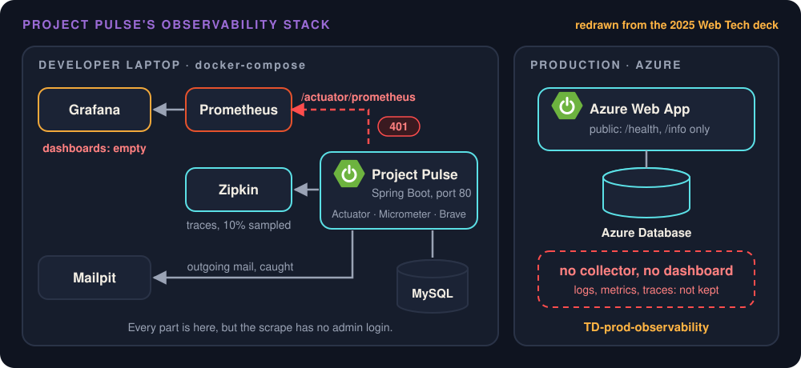
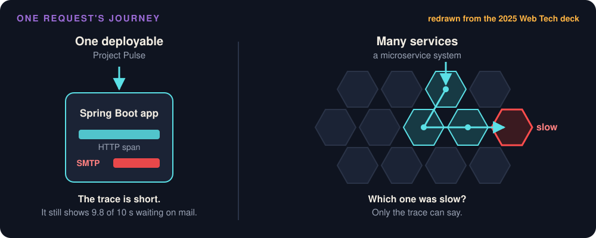

# Observability and Debugging

<!-- **Slides:** [Observability](../slides/observability.html) (the fast version). Restore when the deck exists. -->

> **Purpose (one line):** see inside your running system well enough to answer a question you did not plan for, measure the objective you promised your client, and debug a production failure from evidence rather than guesses, with an agent doing the legwork.

## 1. Learning objectives

By the end of this module, a student can:

1. Say what monitoring answers and what observability adds, and pick the signal (log, metric, or trace) that answers a given question.
2. Get a log line out of a deployed system and find every line for one failed request by its trace ID.
3. Read a metric from Spring Boot Actuator, say what it actually counts, and choose the four golden signals for a service.
4. Turn an SLO into a measured value: name where the indicator comes from and what it misses.
5. Expose management endpoints safely, and design a health check that reports what its caller needs to know.
6. Debug a production failure with an agent by giving it evidence first, then a failing test, then the fix.

## 2. Where it fits

- **Prerequisites:** [Implementation](implementation.md#49-log-what-the-person-at-2-am-will-need), where your charter got its logging rule; [CI/CD](ci-cd.md), which ships the build this module watches; [Reliability](reliability.md#43-from-requirement-to-measurement-sli-slo-error-budget), read as background, where a requirement became an SLO.
- **Leads into:** dynamic analysis, which turns watching into checking ([4.8](#48-from-watching-to-checking)), and [Checkpoint 3](../project.md#checkpoints), where your team shows its SLO with a measured value.
- **How it's taught:** both lecture days of week 12. Monday is a lecture on [4.1](#41-deployment-is-not-the-end) to [4.6](#46-management-endpoints-are-attack-surface). Wednesday is a live lab on Project Pulse ([section 7](#7-hands-on-studio-optional-individual-assignment)), which works through [4.7](#47-debugging-from-evidence-with-an-agent) on a running system and ends with the SLO your team measures for Checkpoint 3. [Reliability](reliability.md) is reading this week; the lab runs one of its degradation tests ([4.4 there](reliability.md#44-failing-well-timeout-retry-isolation-degradation)). Friday is work time on your own project.
- **Course outcome it delivers:** [building, testing, and shipping a working MVP](../syllabus.md#learning-outcomes) (outcome 4); shipping includes seeing what the system does once it is live. Also verifying AI output without lowering the bar (outcome 6), here an agent's diagnosis checked against evidence.

## 3. Motivation

**The site was down, and nobody could see why.** HealthCare.gov, the federal website for buying health insurance under the Affordable Care Act, launched on October 1, 2013, and broke under its first traffic. By mid-October about 3 in 10 visitors could get on at all, and only 26,794 people enrolled through it that month. Many contractors had built it for over $300 million, and no one could see the whole running system. When a small White House rescue team arrived in late October, they found that the people running the site "had no 'dashboard,' no quick way for engineers to measure what was going on at the website, such as how many people were using it." A White House adviser put it more plainly: "Nobody could even tell us if the system was up." People checked by opening a laptop and trying it.

The team stayed up until about 2:30 a.m. building that dashboard. Mikey Dickerson, a site reliability engineer on leave from Google, started stand-ups on October 24, twice a day including weekends, in a room lined with screens showing its graphs. His posted rules began: "The war room and the meetings are for solving problems. There are plenty of other venues where people devote their creative energies to shifting blame." Once the team could see the system, they could rank the problems. By December 1 the site handled 50,000 simultaneous users, uptime had gone from 43% to 95%, and the error rate had dropped from 6% to 0.5% (Brill 2014).

The rescue left an idea behind. The Google engineers on the team needed a way to explain how a service becomes reliable, and the answer became the *service reliability hierarchy* (Beyer et al. 2016, Part III). Monitoring is its bottom layer, under incident response, postmortems, testing, capacity planning, development, and the product itself: "Without monitoring, you have no way to tell whether the service is even working."


**Project Pulse would not know either.** Its architecture document lists production telemetry as "not collected anywhere yet" (`TD-prod-observability`). It has the parts: Actuator, Micrometer, Brave tracing, and a Prometheus, Grafana, and Zipkin stack in `docker-compose.yml`. But that stack runs only on a developer's laptop, and even there the Prometheus scrape returns 404, because Spring Boot 4 moved the endpoint into a module that is not on the classpath. The dashboard is quietly empty, and nothing reports that it is empty.



Then there is the silent 500. An unexpected exception reaches `ExceptionHandlerAdvice.handleOtherException`, which logs nothing ([Implementation 4.9](implementation.md#49-log-what-the-person-at-2-am-will-need)). A student sees "A server internal error occurs." and you see nothing at all. Fixing the handler gives you a log line. This module is about everything after that: where the line goes, how you find it among thousands, and how you know it happened before the student emails you.

## 4. Core concepts

### 4.1 Deployment is not the end

Your code passed its tests and its gate, and it is running on Azure. Now the database can go offline, a release can carry a defect, a page can get slow, and CPU, memory, or disk can run out. None of that shows up in your test suite, because none of it happens there.


**Monitoring** answers questions you decided on in advance: is it up, how many errors, how slow. **Observability** is the property of a system that lets you answer a question you did not anticipate, from the outside, without shipping new code to ask it (Majors, Fong-Jones, and Miranda 2022). A dashboard of the five numbers you thought of is monitoring. Being able to ask "why did only the students in this course section get a 500 on Monday at 9 a.m.?" and get an answer from what the system already emits is observability.

The analogy from the car: the dashboard tells you the engine is hot (monitoring), and the mechanic's diagnostic port tells you why (observability). You need both, and you install the port before the breakdown, not during it.


### 4.2 Three signals

| Signal | What it is | The question it answers | In Project Pulse |
|---|---|---|---|
| **Log** | A timestamped record of one event, written by the code | What happened, to which request, and why? | SLF4J and Logback to standard output |
| **Metric** | A number aggregated over time, cheap to store | How much, how often, how slow, and is it getting worse? | Micrometer, read through Actuator's `/actuator/metrics` |
| **Trace** | The path of one request through the system, as timed spans | Where did this request spend its time, and where did it fail? | Micrometer Tracing with Brave, exported to Zipkin |

Use them in that order of cost and the reverse order of detail. A metric tells you something is wrong (error rate up since the last deploy). A trace tells you where (the invitation route, in the mail call). A log tells you why (the SMTP server rejected the address). Each one is worth less without the others: a metric with no logs says "something is wrong" and stops.

### 4.3 Logs in production

[Implementation 4.9](implementation.md#49-log-what-the-person-at-2-am-will-need) owns what to log: levels by audience, the exception object in every `catch`, identifiers and never content. This section is what happens to the line after the code writes it.

**Where it goes.** A container should write logs to standard output and let the platform collect them (Wiggins 2011, factor XI). Project Pulse does: Logback's default console output, nothing written to a file. On Azure App Service, standard output appears in the app's log stream once application logging is turned on. Find out where your platform puts it before the first incident, not during it.

**Structured, so a machine can search it.** A plain line (`ERROR ... Could not send the invitation email to ...`) is for a person reading one line. Production has thousands, and you will search them by field: every error for this route, in the last hour, with this trace ID. Spring Boot writes JSON logs with one property:

```yaml
logging:
  structured:
    format:
      console: ecs   # Elastic Common Schema; logstash and gelf also work
```

Project Pulse does not set it yet. Turn it on in the deployed profiles only; plain lines are easier to read on a laptop.

**One ID per request.** When tracing is on, Spring Boot adds the trace ID and span ID to every log line (logging correlation). Every line a request writes, in every class, carries the same ID, so one search returns the whole story of one request. This is what makes a single failure findable among many. Sampling ([4.5](#45-traces-following-one-request)) decides which traces are exported, not which requests get an ID.

**Change the level without a deploy.** The `loggers` endpoint reads and sets log levels at runtime. In development:

```bash
curl -X POST localhost/actuator/loggers/team.projectpulse.user \
  -H 'Content-Type: application/json' -d '{"configuredLevel":"DEBUG"}'
```

Turn `debug` on for one package while you reproduce the problem, then turn it back off. In Project Pulse's deployed profiles, `loggers` is not exposed at all ([4.6](#46-management-endpoints-are-attack-surface)), which is the right default and means this is a development tool there.

### 4.4 Metrics: what the numbers count

Actuator exposes Micrometer's meters at `/actuator/metrics`. A metric has a name and **tags**, so one metric answers many questions:

```text
/actuator/metrics/http.server.requests
/actuator/metrics/http.server.requests?tag=uri:/api/v1/students&tag=status:500
/actuator/metrics/jvm.memory.used
```

Spring Boot records `http.server.requests` for every route with no code from you. Three kinds of meter cover most needs: a **counter** only goes up (invitations sent), a **gauge** reads a current value (live threads), and a **timer** records how long something took and how often (`@Timed` on a method, or `MeterRegistry.timer(...)` in code).

**Which numbers to watch.** Google's site reliability engineers name four golden signals for any service that answers requests (Beyer et al. 2016, chapter 6):

| Signal | Project Pulse metric |
|---|---|
| **Latency**, of successes and failures separately | `http.server.requests`, by `uri` and `status` |
| **Traffic** | `http.server.requests` count |
| **Errors** | `http.server.requests` with `status:5xx`, plus requests that returned the wrong thing |
| **Saturation** | `jvm.memory.used`, `jvm.threads.live`, the database connection pool's `hikaricp.connections.pending` |

Machine metrics (memory, threads) tell you the system is struggling. **Business metrics** tell you whether it is doing its job: weekly activity reports submitted before Monday's deadline, reminders that reached their student. A business metric is a counter you add yourself, and it is often the first to show a problem the machine metrics miss.

!!! question "What does this number measure?"
    Before you trust a metric, say what it counts and what it cannot see. `http.server.requests` counts requests that reached the application. It misses every request that failed before it arrived (DNS, the platform, a crashed container), which is exactly when users are hurting most. Actuator's counts start at zero when the application starts, so every deploy and every restart resets them. And once a number becomes a target, people improve the number instead of the thing (Goodhart's law): a team graded on error rate learns to return `200` with an error inside.

**Your SLO, measured.** [Reliability 4.3](reliability.md#43-from-requirement-to-measurement-sli-slo-error-budget) turns a requirement into an SLI, an SLO, and an error budget. The SLI is a metric you have chosen to make a promise about, so this is where it gets measured. Project Pulse's `AVL-uptime` promises 99% of each term, which leaves about 27 hours of downtime. Three ways to get a measured value, cheapest first:

| Source | What it measures | What it misses |
|---|---|---|
| **The platform's metrics** (Azure App Service's request and HTTP 5xx counts, kept for you) | Requests and server errors the platform saw | Wrong answers returned with a `200` |
| **An outside probe** of the health endpoint, every minute, from somewhere that is not your app | Whether the app answers at all, including when the platform is down | Everything the health check does not check |
| **The application's own metric** (`http.server.requests` by status, over the window) | Success ratio of real requests, per route | Requests that never arrived; resets on every restart |

Project Pulse's `PER-report-load` is already SLO-shaped: dashboard and report views within 500 milliseconds at the 95th percentile. A 95th percentile needs a histogram, which Spring Boot records when asked:

```yaml
management:
  metrics:
    distribution:
      percentiles-histogram:
        http.server.requests: true
```

Whichever source you choose, write it under the requirement in your specification, with what it misses. A probe that only checks the status code reports "up" for a path that does not exist, because Project Pulse answers unknown paths with its single-page app and `200 text/html`. Check the content type, too. An SLI that cannot fail measures nothing.

### 4.5 Traces: following one request

A **trace** is one request's journey; each step is a **span**, with a start, a duration, and its parent. In a system of many services, a request can cross five of them, and the trace is the only thing that shows which one was slow. Project Pulse is one deployable, so its traces are short: the HTTP request, plus a span for each call that leaves the process through an instrumented client. They still earn their keep the moment the app calls something slow (a mail server, an LLM): the trace shows the request spent 9.8 of its 10 seconds waiting on SMTP.



Project Pulse sends traces through Brave to Zipkin, sampling 10% of them:

```yaml
management:
  tracing:
    sampling:
      probability: 0.1 # Sample 10% of traces to bound trace volume
```

That is a tradeoff to make deliberately. At 10%, nine of ten failed requests have no trace in Zipkin. Their log lines still carry a trace ID ([4.3](#43-logs-in-production)), so the logs still tie together; only the timing picture is missing. Raise the rate in development and for a demo; keep it bounded in production, where every trace costs storage.

### 4.6 Management endpoints are attack surface

Actuator can show your configuration (`env`, `configprops`), your beans and routes (`beans`, `mappings`), a heap dump of live memory (`heapdump`), and can change log levels (`loggers`). That is the diagnostic port from [4.1](#41-deployment-is-not-the-end), and it is also a port for anyone else. On September 6, 2026, Project Pulse's `/actuator/env` returned its database and mail passwords to any anonymous caller on the internet; the settings came from a local development tutorial and applied to every profile ([the case study](https://github.com/Washingtonwei/project-pulse/blob/main/docs/design/architectural-design.md#observability--operations)). The fix is in [`application.yml`](https://github.com/Washingtonwei/project-pulse/blob/main/backend/src/main/resources/application.yml):

| Setting | Why |
|---|---|
| `exposure.include: health,info` as the base for every profile | A profile that forgets to override it gets the safe set, not the full one |
| `health.show-details: when-authorized` | An anonymous probe sees `{"status":"UP"}`; an admin sees each check |
| `info.git.mode: simple`, `java` and `os` off | The deployed commit is public; the exact JVM version, which tells an attacker which CVEs to try, is not |
| Every other endpoint requires `ROLE_admin` (`EndpointRequest` rules in `SecurityConfiguration`) | The management port has its own rules, because the API's deny-by-default does not cover `/actuator/**` |

**A health check is a design decision.** `/actuator/health` combines one check per dependency (database, mail, disk), and if any is `DOWN`, the whole app is `DOWN` and answers `503`. In November 2026, Project Pulse's staging slot reported `DOWN` because its mail check could not log in: staging's Key Vault still held the Gmail credentials rotated out in September. The check was right that mail was broken. Whether that makes the whole app "down" is a question for your platform: Azure App Service can take an instance out of rotation when its health check fails, which would turn a broken mail server into an unreachable site. Spring Boot separates the two questions: **liveness** (is this process stuck, should it be restarted?) and **readiness** (can it serve traffic now?). Put a dependency in readiness only if the app is useless without it.

### 4.7 Debugging from evidence, with an agent

A production bug report says "it broke." The agent can read every log line faster than you can, but only if you hand it the lines. Work in this order:

1. **Bound it with a metric.** When did the error rate change, on which route? A change that lines up with a deploy points at the deploy.
2. **Find one failing request.** Its log lines by trace ID, with the stack trace the fixed catch-all now writes.
3. **Give the agent the evidence, not the symptom.** "Here is the stack trace, the request, and the commit that deployed at 9:02. Explain the failure and propose a test that reproduces it." An agent given only "users get a 500 on the report page" will guess, fluently.
4. **Reproduce it with a failing test** before any fix, and watch it fail ([Testing](testing.md)).
5. **Fix, then confirm in production**: the metric from step 1 goes back to normal.

Code the agent wrote needs this order most. You did not reason through it line by line, so your intuition about where it breaks is weaker, and its plausibility makes a wrong explanation easy to accept. Ask the agent for a hypothesis you can check against the evidence, then check it.

!!! info "Where this work lives: site reliability engineering"

    Everything in this module is daily work for a **site reliability engineer** (SRE). The role grew out of the seven-engineer production team Ben Treynor Sloss took over when he joined Google in 2003. He calls it "what happens when you ask a software engineer to design an operations team" (Beyer et al. 2016, chapter 1). SREs own production: they choose what to watch, carry the pager, run incidents, write the blameless postmortem, and set the SLOs and error budgets you met in [Reliability](reliability.md#43-from-requirement-to-measurement-sli-slo-error-budget). They also write code to remove repetitive manual work; Google caps an SRE's operations work at about half their time. Job ads also say DevOps engineer, platform engineer, or production engineer, and the work overlaps. Some companies hire new graduates into SRE; more people arrive from backend work plus time on call. Your team project is practice already: you deploy, you will measure an SLO, and the next thing that breaks can get a postmortem.

### 4.8 From watching to checking

Observability watches the real system with real users, after the fact. **Dynamic analysis** runs the program on purpose to check a property while it runs: an assertion inside the code that every execution must satisfy, a fuzzer that tries inputs nobody wrote a test for, a tool that watches memory or threads. The same instinct carries over. A log line says "this happened"; an in-code invariant says "this must never happen" and stops the run when it does. Dynamic analysis comes next in the course.

## 5. The AI-native lens

- **Delegate to AI:** reading. An agent can scan thousands of log lines for a pattern, correlate a spike with a deploy, draft the configuration for structured logs or a percentile histogram, and add a counter where you tell it to.
- **Keep human:** what to watch and what to promise. Which business events matter, which dependencies belong in the health check, and what the client can tolerate are decisions about the product, not the code. So is what may never appear in a log (`CO-ferpa`).
- **Context to supply:** the SLO and where its indicator comes from, what "normal" looks like (traffic is near zero on Saturday and peaks Monday before the report deadline), and the deploy history. An agent that does not know a deploy happened at 9:02 will not look there.
- **How to verify:** check the agent's explanation against evidence it did not write: the trace, the timestamp, a test that fails before the fix. For telemetry the agent adds, break the thing on purpose and see the signal move. A dashboard nobody has seen go red is decoration.

## 6. Risks & mitigations

| Risk (classic + AI-introduced) | Human judgment that catches it | Mitigation |
|---|---|---|
| **Classic:** telemetry that silently collects nothing (Project Pulse's 404ing Prometheus scrape) | Asking "when did I last see this number change?" | Break something on purpose once and watch the signal move |
| **Classic:** management endpoints exposed to the internet | Asking of every endpoint "what does this do on the public internet?" | Expose `health` and `info` by default; everything else behind a role |
| **AI-amplified:** an agent asked to "add logging" or "add monitoring" logs request bodies, emails, or tokens | Reviewing what was logged, not only whether | The charter's logging rule ([Implementation 4.9](implementation.md#49-log-what-the-person-at-2-am-will-need)); grep the logs for an email address |
| **AI-introduced:** a fluent diagnosis from a symptom, with no evidence | Asking "which log line or trace shows that?" | Give the agent evidence first; reproduce with a failing test before the fix |

## 7. Hands-on (studio + optional individual assignment)

**Studio (team, own project)**

- **Goal:** your team's SLO has a measured value, and you can find one failed request in your logs.
- **In class, Wednesday's lab:** the instructor runs Project Pulse's dev stack live, and you call out what to check next. One storyline, five steps:
    1. **Tour the Actuator.** Open `/actuator`, `/actuator/health`, and `/actuator/metrics/http.server.requests`. Then raise one logger to `DEBUG` through `/actuator/loggers` without a restart ([4.3](#43-logs-in-production)).
    2. **Fix the empty dashboard.** Prometheus scrapes `/actuator/prometheus` and gets a 404, so Grafana shows nothing. Find why, fix it, and watch the panels fill. Then ask of one panel what the number measures ([4.4](#44-metrics-what-the-numbers-count)).
    3. **Stop the mail server mid-request.** Stop the Mailpit container, then send a request that sends mail. Does Project Pulse degrade or hang? Read the answer in the latency metric and the Zipkin trace ([4.5](#45-traces-following-one-request)). This is a degradation test seen live ([Reliability 4.4](reliability.md#44-failing-well-timeout-retry-isolation-degradation)).
    4. **Find the silent 500.** Trigger the catch-all handler, which logs nothing. Bound the failure with a metric, find the request, then give the agent the evidence and ask for a failing test before any fix ([4.7](#47-debugging-from-evidence-with-an-agent)).
    5. **Turn one metric into an SLO.** Pick the indicator, the target, and the window, the way your team will for Checkpoint 3.
- **On your own project, out of class:** take the SLO your team wrote for Checkpoint 3 ([Reliability](reliability.md#7-hands-on-studio-optional-individual-assignment)) and choose its source from the table in [4.4](#44-metrics-what-the-numbers-count). Write the source and what it misses under the requirement. Then make one request fail on purpose in your deployed system and find its log line from outside the code: the platform's log stream, not your terminal.
- **Adapt to your stack:** Project Pulse's signals come from Spring Boot Actuator and Micrometer. Run the [adapt step](../studio.md#adapt) for where your stack's logs go, how it exposes a health check and metrics, and where your SLI can come from. A mobile app or a game measures from the client and its backend service, not from Actuator.
- **Deliverable & assessment:** at [Checkpoint 3](../project.md#checkpoints), show the SLO with its current measured value and say where the number comes from and what it misses.

**Individual assignment (Project Pulse):** none.

## 8. Summary / key takeaways

- Monitoring answers the questions you planned; observability lets you answer the one you did not.
- A metric says something is wrong, a trace says where, a log says why.
- Logs go to standard output, structured, with a trace ID on every line, so one search finds one request.
- Before you trust a number, say what it counts and what it cannot see.
- An SLO is only measured when you can name its source; a probe that cannot fail measures nothing.
- Management endpoints are attack surface, and a health check is a design decision.
- Debug from evidence: give the agent the trace, not the symptom, and reproduce with a failing test before the fix.

## 9. Key papers & further reading

- Beyer, B., Jones, C., Petoff, J., and Murphy, N. R., eds. *Site Reliability Engineering: How Google Runs Production Systems*. O'Reilly, 2016. Chapter 6, "Monitoring Distributed Systems" (the four golden signals). Free at <https://sre.google/sre-book/monitoring-distributed-systems/>.
- Majors, C., Fong-Jones, L., and Miranda, G. *Observability Engineering*. O'Reilly, 2022. Chapter 1 on observability versus monitoring.
- Brill, S. "Obama's Trauma Team." *Time*, February 27, 2014. <https://time.com/10228/obamas-trauma-team/>. The HealthCare.gov rescue, from the first dashboard to the December 1 report card.
- Beyer et al., *Site Reliability Engineering*, Part III introduction, "Practices," for the service reliability hierarchy and where it came from. <https://sre.google/sre-book/part-III-practices/>
- Wiggins, A. "The Twelve-Factor App," factor XI, Logs. 2011. <https://12factor.net/logs>
- Spring Boot reference, Actuator: <https://docs.spring.io/spring-boot/reference/actuator/index.html>. Endpoints, metrics, tracing, and observability.
- Harrison, R. "Gathering Metrics with Micrometer and Spring Boot Actuator." 2021. <https://ryanharrison.co.uk/2021/01/06/gathering-metrics-micrometer-spring-boot-actuator.html>
- Sigelman, B. H., et al. "Dapper, a Large-Scale Distributed Systems Tracing Infrastructure." Google Technical Report, 2010. Where modern tracing comes from.

## 10. Self-check

1. Your team's error rate doubled at 9:05 on Monday. Which signal do you open first, which second, and what does each tell you?
2. A teammate's dashboard shows 99.9% success for the week. Name two ways it could be true while users could not reach the site.
3. Why does Project Pulse's catch-all exception handler need a log line before any trace or dashboard can help you debug a 500?
4. With 10% trace sampling, a student reports one failed request. What can you still find, and what is missing?
5. Your agent added `LOGGER.info("Request: {}", requestBody)` to every controller. What do you say in review?
6. Your mail server's password expired, and your health endpoint now returns `503`. Should it? What would you change?
7. An agent says the 500s are caused by a race condition in the scheduler. What do you ask for before you accept that?

## Related

- [Implementation](implementation.md): the logging rule and the catch-all fix.
- [Reliability](reliability.md): the SLO, the error budget, and failing well.
- [CI/CD](ci-cd.md): the deploy whose effect you are watching.
- [Project](../project.md): Checkpoint 3, where the SLO is shown measured.
- [Schedule](../schedule.md): when this is taught.

<!--
## Drafting notes (raw: distribute into template sections, then delete before `stable`)

### Sources and facts to check before `stable`

- HealthCare.gov: checked 2026-11-08 against Brill at time.com/10228 (published online February 27, 2014): the October 1 launch, 3 in 10 visitors getting on as of October 17, 26,794 October enrollments, over $300 million spent, the "no 'dashboard'" and "Nobody could even tell us if the system was up" quotes, the dashboard built until about 2:30 a.m., stand-ups from October 24, rule 1, and the December 1 numbers (50,000 users, uptime 43% to 95%, errors 6% to 0.5%). The article gives no contractor count and does not name New Relic. The print issue date was not confirmed.
- SRE box: checked 2026-11-08 against sre.google/sre-book/introduction/ (the Treynor Sloss quote; "a 50% cap on the aggregate 'ops' work for all SREs"; joining Google in 2003 with a seven-engineer production team). Next offering, when reliability has its own lecture, consider moving the box there.
- Service reliability hierarchy: sre.google Part III introduction credits "a number of Google SREs, including our former colleague Mikey Dickerson" on HealthCare.gov in 2013–14; the "Without monitoring" quote is from the same page. Layer names follow the page's section order; the figure's own labels were not read. The book is CC BY-NC-ND 4.0, so the SVG is our own drawing, not an adaptation of the figure.
- Spring Boot 4: `logging.structured.format.console` values (ecs, logstash, gelf); trace and span IDs added to log lines by default when Micrometer Tracing is present (logging correlation); `management.metrics.distribution.percentiles-histogram`; `hikaricp.connections.pending` metric name.
- Brave: unsampled requests still carry a trace ID in the logging context. Confirm on Project Pulse dev with sampling at 0.1.
- Azure App Service: standard output in the log stream with application logging on; built-in Requests and Http 5xx metrics; the health check feature removing an unhealthy instance (only matters with more than one instance).
- Majors et al. 2022 chapter 1; Beyer et al. chapter 6 title; Sigelman et al. 2010.
- Project Pulse facts checked against `main` at `75340e1` on 2026-11-08: Actuator, micrometer-registry-prometheus, micrometer-tracing-bridge-brave, zipkin-reporter-brave (backend/pom.xml); exposure, show-details, info, sampling 0.1 (backend/src/main/resources/application.yml); Logback to stdout, no structured logging, the Prometheus endpoint not resolving under Spring Boot 4, TD-prod-observability (docs/design/architectural-design.md, Observability & operations); the 404ing scrape (docker/prometheus/prometheus.yml); mysql, mailpit, prometheus, grafana, zipkin (docker-compose.yml); handleOtherException at ExceptionHandlerAdvice.java line 214 logs nothing; loggers declared in 5 of 278 main Java files; AVL-uptime and PER-report-load (software-requirements-specification.md lines 768 and 738).
- Wednesday's lab, to confirm in rehearsal on Project Pulse dev: the cause and fix of the `/actuator/prometheus` 404 (the dev profile already exposes `prometheus` at application-dev.yml line 29, so exposure is not the cause); what a mail-sending request does with Mailpit stopped (degrades, errors, or hangs, and for how long); which request reaches `handleOtherException`. Rewrite lab steps 2 to 4 in section 7 to match what rehearsal finds.
- Staging health DOWN from the mail check, fixed 2026-11-04 (course status.md, week 11).
- The case-study link points at the architecture document's Observability & operations section, which records the incident; the course's own write-up is notes/case-study-actuator-leak.md (not published).

### Instructor's Web Tech material carried forward

From reference/previous-slides/2025/observability.docx and .pptx: deployment is not the end; the car dashboard; the request crossing many services; business metrics versus machine metrics; dimensional metrics with tags; counter, gauge, timer, `@Timed`; runtime log levels through `loggers`; securing endpoints with `EndpointRequest`; the Prometheus, Grafana, and Zipkin stack. Endpoint-by-endpoint walkthroughs, custom endpoints, and custom health indicators stay in Web Tech (DECISION-web-tech-boundary).
-->
