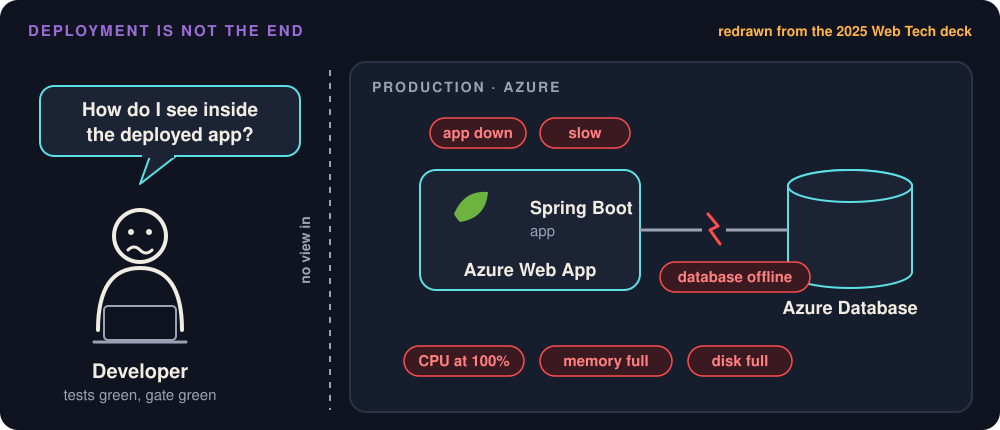
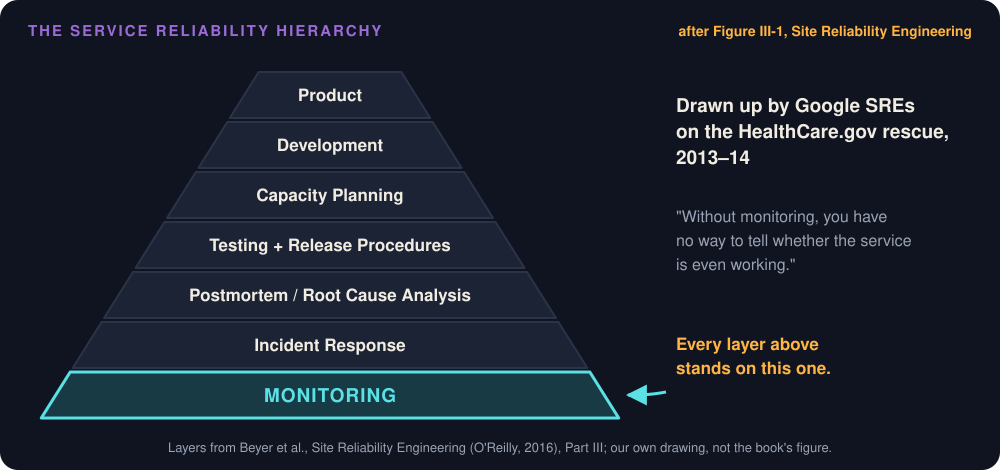
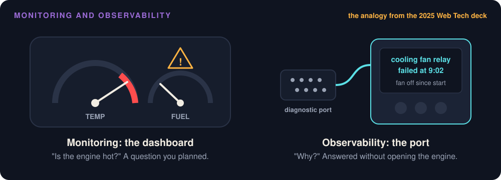

# Observability and Debugging

**Slides:** [Observability](../slides/observability.html) (the fast version).

> **Purpose (one line):** see inside your running system well enough to answer a question you did not plan for, measure the objective you promised your client, and debug a production failure from evidence rather than guesses, with an agent doing the legwork.

## 1. Learning objectives

By the end of this module, a student can:

1. Say what monitoring answers and what observability adds, pick the kind of telemetry (log, metric, or trace) that answers a given question, and say what each tool in Project Pulse's stack (Actuator, Prometheus, Grafana, Zipkin) does.
2. Get a log line out of a deployed system and find every line for one failed request by its trace ID.
3. Read a metric from Spring Boot Actuator, say what it actually counts, and choose the four golden signals for a service.
4. Turn an SLO into a measured value: name where the indicator comes from and what it misses.
5. Expose management endpoints safely, and design a health check that reports what its caller needs to know.
6. Debug a production failure with an agent by giving it evidence first, then a failing test, then the fix.

## 2. Where it fits

- **Prerequisites:** [Implementation](implementation.md#49-log-what-the-person-at-2-am-will-need), where your charter got its logging rule; [CI/CD](ci-cd.md), which ships the build this module watches; [Reliability](reliability.md#43-from-requirement-to-measurement-sli-slo-error-budget), read as background, where a requirement became an SLO.
- **Leads into:** dynamic analysis, which turns watching into checking ([4.9](#49-from-watching-to-checking)), and [Checkpoint 3](../project.md#checkpoints), where your team shows its SLO with a measured value.
- **How it's taught:** both lecture days of week 12. Monday is a lecture on [4.1](#41-monitoring-and-observability) to [4.7](#47-management-endpoints-are-attack-surface). Wednesday is a live lab on Project Pulse ([section 7](#7-hands-on-studio-optional-individual-assignment)), which works through [4.8](#48-debugging-from-evidence-with-an-agent) on a running system and ends with the SLO your team measures for Checkpoint 3. [Reliability](reliability.md) is reading this week; the lab runs one of its degradation tests ([4.4 there](reliability.md#44-failing-well-timeout-retry-isolation-degradation)). Friday is work time on your own project.
- **Course outcome it delivers:** [building, testing, and shipping a working MVP](../syllabus.md#learning-outcomes) (outcome 4); shipping includes seeing what the system does once it is live. Also verifying AI output without lowering the bar (outcome 6), here an agent's diagnosis checked against evidence.

## 3. Motivation

**Deployment is not the end.** Your code passed its tests and its gate, and it is running on Azure. Now the database can go offline, a release can carry a defect, a page can get slow, and CPU, memory, or disk can run out. None of that shows up in your test suite, because none of it happens there.



**The site was down, and nobody could see why.** HealthCare.gov, the federal website for buying health insurance, launched on October 1, 2013, and broke under its first traffic. By mid-October only about 3 in 10 visitors could get on at all. When a small rescue team arrived later that month, they found that the people running the site "had no 'dashboard,' no quick way for engineers to measure what was going on at the website." A White House adviser put it more plainly: "Nobody could even tell us if the system was up."

The team's first job was to build that dashboard. Once they could see the system, they could rank the problems and fix the worst ones first. By December 1, uptime had gone from 43% to 95%, and the error rate had dropped from 6% to 0.5% (Brill 2014).

The rescue left an idea behind. Google engineers on the team, Mikey Dickerson among them, used the *service reliability hierarchy* to explain how a service becomes reliable (Beyer et al. 2016, Part III). Monitoring is its bottom layer: "Without monitoring, you have no way to tell whether the service is even working."



**Project Pulse would not have known either.** Until November 9, 2026, its architecture document listed the gap among its technical debts: production telemetry was "not collected anywhere yet" ([`TD-prod-observability`](https://github.com/Washingtonwei/project-pulse/blob/main/docs/design/architectural-design.md#risks-and-technical-debt)). It had the parts: Actuator, Micrometer, Brave tracing, and a Prometheus, Grafana, and Zipkin stack in `docker-compose.yml` ([4.3](#43-the-tools-spring-boot-actuator-and-project-pulses-stack) explains each, and how production sends its telemetry now). But that stack ran only on a developer's laptop, and even there part of it stopped working without a word. When Project Pulse moved from Spring Boot 3 to 4 in January 2026, tracing switched off: Spring Boot 4 sets tracing up only through its own modules, and the build still named the old libraries. Every test passed. For more than nine months no log line carried a trace ID and no trace reached Zipkin, and nothing reported it. [Pull request #112](https://github.com/Washingtonwei/project-pulse/pull/112) restores it.

Then there was the silent 500. Until November 2026, an unexpected exception reached `ExceptionHandlerAdvice.handleOtherException`, which logged nothing. A student saw "A server internal error occurs." and you saw nothing at all. [Pull request #110](https://github.com/Washingtonwei/project-pulse/pull/110) added the log line ([Implementation 4.9](implementation.md#49-log-what-the-person-at-2-am-will-need)). This module is about everything after that: where the line goes, how you find it among thousands, and how you know it happened before the student emails you.

## 4. Core concepts

### 4.1 Monitoring and observability

**Monitoring** is watching a few numbers you picked in advance. You decide ahead of time that you care whether the site is up, how many requests fail, and how long pages take, and you put those numbers on a dashboard. When one turns red, you know *that* something is wrong.

**Observability** is being able to find out *why*, even when the problem is one you never imagined (Majors, Fong-Jones, and Miranda 2022). Say the error count jumps on Monday at 9 a.m. You keep asking questions of what the system already records: Which page fails? For everyone, or only students in one course section? Since when? If you can answer those from the logs, metrics, and traces you have, without adding code and redeploying just to find out, your system is observable. If all you can say is "errors are up," it is not.

A car works the same way. The temperature gauge on the dashboard tells you the engine is hot (monitoring). The mechanic plugs a scanner into the diagnostic port and reads out why (observability). You need both, and the port has to be installed before the breakdown, not during it.



### 4.2 Three kinds of telemetry

**Telemetry** is the data a running system sends out about itself, so you can see what it is doing without standing next to it. The word means "measuring from far away": a spacecraft radios its temperature and fuel back to Earth the same way. Software telemetry comes in three kinds.

| Kind | What it is | The question it answers | In Project Pulse |
|---|---|---|---|
| **Metric** | A number measured over and over, such as requests per minute | How many, how fast, and is it getting worse? | Micrometer, read through Actuator's `/actuator/metrics` |
| **Trace** | The path of one request through the system, with how long each step took | Where did this request spend its time, and where did it fail? | Micrometer Tracing with Brave, sent to Zipkin |
| **Log** | A line of text the code writes when something happens | What happened, to which request, and why? | SLF4J and Logback to standard output |

Three of each, all from Project Pulse:

| Kind | Examples |
|---|---|
| **Metric** | `http.server.requests`: how many requests, how long each took, by URL and status. `jvm.memory.used`: memory in use right now. `hikaricp.connections.pending`: requests waiting for a database connection. |
| **Trace** | An instructor invites two students, and each gets an email ([4.6](#46-traces-following-one-request)). A user logs in (`POST /api/v1/users/login`). A student adds an activity to a weekly activity report (`POST /api/v1/activities`). |
| **Log** | `INFO Sent {} of {} weekly reminders for section {}` (`WeeklyReminderScheduler`). `ERROR Could not send the invitation email to {}` (`UserInvitationService`). `ERROR Unhandled exception`, with the stack trace (`ExceptionHandlerAdvice`). |

Each `{}` is filled in when the line is written: the counts, the section, the address.

Use them in that order. A metric is the cheapest to keep, and it tells you *that* something is wrong: the error rate went up after the last deploy. A trace tells you *where*: the invitation request spent its time sending email, if someone instrumented the email step ([4.6](#46-traces-following-one-request)). A log tells you *why*: the mail server rejected the address. Each needs the others. A metric with no logs can say "something is wrong" and nothing more.

### 4.3 The tools: Spring Boot Actuator and Project Pulse's stack

The telemetry has to come from somewhere. In Project Pulse, a handful of tools produce it, collect it, and show it. Your stack has its own; this is the map for Project Pulse.

**Spring Boot Actuator** is the diagnostic port from [4.1](#41-monitoring-and-observability). It is a Spring Boot module that adds ready-made web endpoints under `/actuator`, each one reporting on the running app. You add one dependency (`spring-boot-starter-actuator`) and write no code. An endpoint answers only once configuration exposes it, and Project Pulse exposes a different set in each profile:

| Endpoint | What it tells you | Production | Your laptop (dev) | More in |
|---|---|---|---|---|
| `health` | Is the app up, and is each thing it depends on (database, mail, disk) up? | Status only | Each check | [4.7](#47-management-endpoints-are-attack-surface) |
| `info` | Which app, which version, and which Git commit is deployed | Yes | Plus Java and OS versions | |
| `metrics` | Every number the app counts: requests, memory, threads, database connections | No | Admin only | [4.5](#45-metrics-what-the-numbers-count) |
| `prometheus` | The same numbers, in the format Prometheus reads | No | Admin only, so an anonymous scrape gets 401 | Wednesday's lab |
| `loggers` | Each logger's level, and a way to change it without a restart | No | Admin only | [4.4](#44-logs-in-production) |
| `env`, `configprops` | Every configuration value, and where it came from | No | Admin only, values shown | [4.7](#47-management-endpoints-are-attack-surface) |
| `beans`, `mappings` | Every Spring bean, and every URL the app answers | No | Admin only | |
| `heapdump` | A file holding everything in the app's memory right now | No | Listed, but answers 404 | [4.7](#47-management-endpoints-are-attack-surface) |

`/actuator` on its own lists the endpoints that are exposed. In every profile, everything except `health` and `info` requires an admin login; [4.7](#47-management-endpoints-are-attack-surface) explains why.

!!! example "Try it"

    **On production**, from any terminal:

    ```bash
    curl https://projectpulse.team/actuator/health
    curl https://projectpulse.team/actuator/info
    curl https://projectpulse.team/actuator/metrics
    ```

    The first answers `{"groups":["liveness","readiness"],"status":"UP"}`. The second names the app, its version, and the Git commit running right now. The third answers 404, because production does not expose `metrics` at all, not even to an admin: an endpoint that is not exposed has no URL to protect.

    **On your laptop**, start Project Pulse in development ([Starting the Project](https://github.com/Washingtonwei/project-pulse/blob/main/CLAUDE.md#starting-the-project)). Log in as the seeded admin, and copy `data.token` from the answer:

    ```bash
    curl -X POST -u b.wei@abc.edu:123456 localhost/api/v1/users/login
    TOKEN=<paste the token here>
    curl -H "Authorization: Bearer $TOKEN" localhost/actuator
    curl -H "Authorization: Bearer $TOKEN" localhost/actuator/metrics/http.server.requests
    ```

    Follow the links `/actuator` lists. Which endpoint would you least want a stranger to reach?

**The rest of the stack.** Actuator answers one question at a time, when you ask it. To watch a number change over a week, or to look at a request after it has finished, other tools collect what the app sends out and keep it. Project Pulse's `docker-compose.yml` runs them next to the app on a laptop:


| Tool | Its job | On a laptop |
|---|---|---|
| **Logback** | Inside the app. Formats each log line and writes it to standard output. Your code never calls it directly: it calls **SLF4J** (`LoggerFactory.getLogger(...)`), an interface, and Spring Boot puts Logback behind it by default. | your terminal |
| **Micrometer** | Inside the app. Counts and times things, and hands the numbers to Actuator. It works like SLF4J does for logs: the code records a number once, and any monitoring tool can read it. | |
| **Micrometer Tracing and Brave** | Inside the app. Gives each request a trace ID, times each step as a span, writes the ID into every log line, and sends finished spans to Zipkin. Micrometer Tracing is the interface Spring calls; Brave is the engine underneath. | |
| **Prometheus** | A database for numbers over time. Every 15 seconds it asks the app's `/actuator/prometheus` for the current values (a *scrape*) and stores them, so you can ask "what was the error rate last Monday?" | `localhost:9090` |
| **Grafana** | Draws dashboards and sends alerts. It stores no metrics itself; it asks Prometheus for them. | `localhost:3000` |
| **Zipkin** | Stores traces and shows each one as a timeline of its spans. | `localhost:9411` |

Logback comes with Spring Boot. Each of the other tools inside the app is one dependency in Project Pulse's [`backend/pom.xml`](https://github.com/Washingtonwei/project-pulse/blob/main/backend/pom.xml), and none needs code to start working:

```xml
<dependency> <!-- Actuator: the /actuator endpoints -->
    <groupId>org.springframework.boot</groupId>
    <artifactId>spring-boot-starter-actuator</artifactId>
</dependency>
<dependency> <!-- Micrometer: counts and times -->
    <groupId>org.springframework.boot</groupId>
    <artifactId>spring-boot-starter-micrometer-metrics</artifactId>
</dependency>
<dependency> <!-- serves the numbers at /actuator/prometheus -->
    <groupId>io.micrometer</groupId>
    <artifactId>micrometer-registry-prometheus</artifactId>
    <scope>runtime</scope>
</dependency>
<dependency> <!-- Micrometer Tracing with Brave: trace IDs and spans -->
    <groupId>org.springframework.boot</groupId>
    <artifactId>spring-boot-micrometer-tracing-brave</artifactId>
</dependency>
<dependency> <!-- sends finished spans to Zipkin -->
    <groupId>org.springframework.boot</groupId>
    <artifactId>spring-boot-starter-zipkin</artifactId>
</dependency>
```

Notice the two directions. Prometheus *pulls* metrics from the app; the app *pushes* spans to Zipkin. These collectors run only on a laptop, which is why Wednesday's lab runs on one. Production sends its telemetry somewhere else.

**A dashboard reads a collector, not `/actuator/metrics`.** That endpoint is a window for a person's spot check, not a history. A production dashboard needs a collector that keeps the history, and the collector gets the numbers one of the same two ways. Either it *pulls* them from an endpoint that only machines inside the network can reach, or the app *pushes* them to a monitoring service and exposes nothing. Either way, the public site does not serve its metrics.

Which way depends on where the app runs. Pull-based Prometheus fits Kubernetes and virtual machines, where the scraper sits inside the same private network as the app. On a PaaS (platform as a service) such as Azure App Service, the app gets one public port and no private network to share, so pushing is the standard pattern. Project Pulse pushes to **Azure Application Insights**, Azure's monitoring service, on staging and production since November 9, 2026 ([`KD-push-telemetry`](https://github.com/Washingtonwei/project-pulse/blob/main/docs/design/architectural-design.md#architecture-decisions)). App Service attaches a monitoring agent to the container, so no code changed, and production still serves no metrics endpoint: `/actuator/prometheus` stays closed.


Two settings matter on the first day. **Turn on the daily cap.** Application Insights bills by the gigabyte it takes in, and Azure leaves the daily cap off, so a log flood or a bot storm can run up the bill; Project Pulse caps its workspace at 1 GB a day. **Turn off exporters with nowhere to send.** Spring Boot's Zipkin exporter sends to `localhost:9411` unless told otherwise. On a laptop, Docker Compose runs Zipkin there. In the Azure container, `localhost` is the container itself, nothing listens on 9411, and every span was dropped after one warning, so Project Pulse's deployed profiles set `management.tracing.export.zipkin.enabled: false`.

**Other stacks.** Every major stack has the same pieces under other names. The most common today is **OpenTelemetry**, an open standard with libraries for Java, Python, JavaScript, .NET, and more, which produces all three kinds (it calls them *signals*) and sends them to tools like these. You may choose different tools; know what each one in Project Pulse does, and let the [adapt step](../studio.md#adapt) map them onto yours.

No other stack bundles as much as Actuator does in one dependency. In Python and JavaScript you assemble the same pieces:

| Job | Python | JavaScript (Node.js) |
|---|---|---|
| Health and readiness | `django-health-check`, or a `/health` route in FastAPI or Flask | `@nestjs/terminus`, or `lightship` for Express |
| Metrics for Prometheus | `prometheus_client`, `django-prometheus`, `prometheus-fastapi-instrumentator` | `prom-client` |
| Traces | OpenTelemetry Python, with auto-instrumentation for Django, FastAPI, and Flask | OpenTelemetry JS, with `@opentelemetry/auto-instrumentations-node` |
| Structured logs | `structlog`, `python-json-logger` | `pino`, `winston` |

Actuator's `loggers`, `env`, and `mappings` have no common equivalent, so changing a log level usually means a configuration change and a restart. The danger in [4.7](#47-management-endpoints-are-attack-surface) carries over unchanged: a public `/metrics` route, or Django's `DEBUG = True` in production, leaks the way `/actuator/env` did.

### 4.4 Logs in production

[Implementation 4.9](implementation.md#49-log-what-the-person-at-2-am-will-need) covers what to log: levels by audience, the exception object in every `catch`, identifiers and never content. This section is what happens to the line after the code writes it.

**Where it goes.** A container should write logs to standard output and let the platform collect them (Wiggins 2011, *The Twelve-Factor App*). Project Pulse does: Logback's default console output, nothing written to a file. On Azure App Service, standard output appears in the app's log stream once application logging is turned on. Find out where your platform puts it before the first incident, not during it.

**Structured, so a machine can search it.** A plain line is written for a person reading one line:

```text
2026-11-09T09:02:14 ERROR [6af11fb6455b81a0d269388fabd85224-0860298ded65bb60] t.p.system.EmailService : Could not send the invitation email
```

Production has thousands of lines, and you will search them by field: every error, from this class, in the last hour, with this trace ID. A structured line is the same event as JSON, with each piece in a named field (shortened here):

```json
{"@timestamp":"2026-11-09T09:02:14Z", "log.level":"ERROR",
 "log.logger":"team.projectpulse.system.EmailService",
 "message":"Could not send the invitation email", "traceId":"6af11fb6455b81a0d269388fabd85224"}
```

Spring Boot writes JSON logs with one property:

```yaml
logging:
  structured:
    format:
      console: ecs   # Elastic Common Schema; logstash and gelf also work
```

Project Pulse does not set it yet. Turn it on in the deployed profiles only; plain lines are easier to read on a laptop.

**One ID per request.** When a request arrives, Brave gives it a trace ID ([4.3](#43-the-tools-spring-boot-actuator-and-project-pulses-stack)) and stamps that ID on every log line the request writes, in every class (Spring Boot calls this logging correlation). One search for the ID returns the whole story of one request. That is how you find a single failure among thousands of lines.

**On Azure, one request has two IDs.** Brave stamps its trace ID on each log line, and the Application Insights agent files the request under an ID of its own, `operation_Id`. For a request from a browser, the two differ. The agent copies Brave's ID into each log row it stores, so the ID from a log line still finds everything, in two steps: look up the agent's ID, then fetch all it filed under that ID.

```kusto
let id = "6af28f6712a4f55e9332020fa5b29907";  // from the log line
let op = toscalar(traces | where tostring(customDimensions.traceId) == id | take 1 | project operation_Id);
union requests, dependencies, exceptions, traces
| where operation_Id == op
| order by timestamp asc
```

On production, on November 10, 2026, that ID returned a `POST /api/v1/activities/search`, its three database queries, and the one warning it logged. A single tracer would give a single ID; Project Pulse has not made that change yet (`TD-prod-observability`).

**Change the level without a deploy.** The `loggers` endpoint reads and sets log levels while the app runs. In development, with the admin token from [4.3](#43-the-tools-spring-boot-actuator-and-project-pulses-stack):

```bash
curl -X POST localhost/actuator/loggers/team.projectpulse.user \
  -H "Authorization: Bearer $TOKEN" \
  -H 'Content-Type: application/json' -d '{"configuredLevel":"DEBUG"}'
```

Turn `debug` on for one package while you reproduce the problem, then turn it back off. In Project Pulse's deployed profiles, `loggers` is not exposed at all ([4.7](#47-management-endpoints-are-attack-surface)). That is the right default, so use this in development only.

### 4.5 Metrics: what the numbers count

Micrometer counts things for you, and Actuator shows them at `/actuator/metrics` (with the admin token from [4.3](#43-the-tools-spring-boot-actuator-and-project-pulses-stack)). Each metric has a name and a set of **tags**, labels that let you slice it. The same request count can be filtered to one page, or to failed requests only:

```text
/actuator/metrics/http.server.requests
/actuator/metrics/http.server.requests?tag=uri:/api/v1/students&tag=status:500
/actuator/metrics/jvm.memory.used
```

Spring Boot records `http.server.requests` for every route with no code from you. When you add a metric of your own, three kinds cover most needs:

- **Counter:** only goes up (invitations sent).
- **Gauge:** reads a value right now (threads alive).
- **Timer:** records how long something took, and how often (`@Timed` on a method, or `MeterRegistry.timer(...)` in code).

**Which numbers to watch.** Google's site reliability engineers name four golden signals for any service that answers requests (Beyer et al. 2016, chapter 6):

| Signal | In plain words | Project Pulse metric |
|---|---|---|
| **Latency** | How long requests take; count successes and failures separately | `http.server.requests`, by `uri` and `status` |
| **Traffic** | How many requests arrive | `http.server.requests` count |
| **Errors** | How many requests fail | `http.server.requests` with `outcome:SERVER_ERROR`, plus requests that returned the wrong thing |
| **Saturation** | How full the system is | `jvm.memory.used`, `jvm.threads.live`, the database connection pool's `hikaricp.connections.pending` |

Machine metrics (memory, threads) tell you the system is struggling. **Business metrics** tell you whether it is doing its job: weekly activity reports submitted before Monday's deadline, reminders that reached their student. A business metric is a counter you add yourself, and it is often the first to show a problem the machine metrics miss.

Here is one for Project Pulse, a sketch that is not in the repository: count each invitation email by outcome, in the loop of `UserInvitationService.sendEmailInvitations`. The `try` and `catch` are the real code; the two counter lines are new, and `MeterRegistry` comes in through the constructor like any other bean.

```java
try {
    this.emailService.sendInvitationEmail(userInvitation);
    invitedEmails.add(email);
    meterRegistry.counter("invitations.sent", "outcome", "success").increment();
} catch (RuntimeException e) {
    LOGGER.error("Could not send the invitation email to {}", email, e);
    failedEmails.add(email);
    meterRegistry.counter("invitations.sent", "outcome", "failure").increment();
}
```

The count appears at `/actuator/metrics/invitations.sent?tag=outcome:failure`, and in Prometheus as `invitations_sent_total`. With the mail server down, memory and threads look fine; this number climbs.

!!! question "What does this number measure?"
    Before you trust a metric, say what it counts and what it cannot see. Take `http.server.requests`:

    - **It counts only requests that reached the application.** A request that failed before it arrived (DNS, the platform, a crashed container) is not in it, and that is exactly when users are hurting most.
    - **It starts at zero whenever the application starts.** Every deploy and every restart resets it.
    - **Once a number becomes a target, people improve the number instead of the thing** (Goodhart's law). A team graded on error rate learns to return `200` with an error message inside.

**Your SLO, measured.** An **SLO** (service level objective) is a promise you make about the system, such as "up 99% of the term." The **SLI** (service level indicator) is the number that checks the promise. [Reliability 4.3](reliability.md#43-from-requirement-to-measurement-sli-slo-error-budget) shows how a requirement becomes both; this is where the SLI gets measured. Project Pulse's `AVL-uptime` promises 99% of each term, which leaves about 27 hours of downtime. Three ways to get a measured value, cheapest first:

| Source | What it measures | What it misses |
|---|---|---|
| **The platform's metrics** (Azure App Service's request and HTTP 5xx counts, kept for you) | Requests and server errors the platform saw | Wrong answers returned with a `200` |
| **An outside probe** of the health endpoint, every minute, from somewhere that is not your app | Whether the app answers at all, including when the platform is down | Everything the health check does not check |
| **The application's own metric** (`http.server.requests` by status, over the window) | Success ratio of real requests, per route | Requests that never arrived; resets on every restart |

Project Pulse's `PER-report-load` is already SLO-shaped: dashboard and report views within 500 milliseconds at the 95th percentile, which means 95 of every 100 views load within 500 milliseconds. Spring Boot computes a 95th percentile in the application when asked, and `/actuator/metrics/http.server.requests` then shows it:

```yaml
management:
  metrics:
    distribution:
      percentiles:
        http.server.requests: 0.95
```

That percentile is per instance and cannot be averaged across instances. With Prometheus ([4.3](#43-the-tools-spring-boot-actuator-and-project-pulses-stack)), set `percentiles-histogram` instead: the application publishes histogram buckets, and the backend computes the percentile from all of them.

Whichever source you choose, write it under the requirement in your specification, with what it misses. A probe that checks only the status code can report "up" from the wrong page: `https://projectpulse.team/health`, with `/actuator` left off, answers `200 text/html` from the single-page app. Check the content type, too. An SLI that cannot fail measures nothing.

**Reading the numbers on staging.** The afternoon Application Insights went on, staging's overview showed 190 failed requests out of 263, about 72 percent. Three questions got to the truth, each answered with a query in **KQL** (Kusto Query Language), Azure Monitor's query language: a table, then a pipeline of steps.

1. **Rows or requests?** When requests arrive in a burst, the agent keeps a sample and marks each kept row with `itemCount`, the number of requests it stands for. Counting rows gave 38 failures out of 148. Summing `itemCount` gave 221 out of 374 (the overview's count plus the traffic since). Always sum `itemCount`.
2. **What failed?** Application Insights counts every `4xx` as a failure. Grouped by URL, nearly all the failures were bots asking for secrets that are not there ([4.7](#47-management-endpoints-are-attack-surface)).
3. **What should the SLI count?** The errors that are ours, the `5xx` answers:

```kusto
requests
| where timestamp > ago(7d)
| summarize availability = 100.0 * sumif(itemCount, toint(resultCode) < 500) / sum(itemCount)
```

It still misses an invitation whose email fails while the request returns `200`.

### 4.6 Traces: following one request

A **trace** is one request's journey. Each step inside it is a **span**: when it started, how long it took, and which step called it. In a system of many services, a request can cross five of them, and the trace is the only thing that shows which one was slow.

Project Pulse runs as one application, so its traces are short. Here is a real one, twice: an instructor invites two students, and Project Pulse saves the invitations and emails each student a registration link.


The top trace is what Project Pulse records today. Spring Boot times the web request, and Spring Security times its own steps (checking the token, checking the authorization rule). Then comes one 165-millisecond span, `secured request`, that holds everything else: the database work and both emails. Nothing inside it is timed. **A trace shows only what someone instrumented.** Spring Boot does not time database queries or sending mail on its own. On Azure, the Application Insights agent adds instrumentation of its own, database queries included, which is why the production request in [4.4](#44-logs-in-production) shows its three queries.

One annotation on the email method adds the bottom trace's two spans:

```java
@Observed(name = "email.send", contextualName = "send invitation email")
public void sendInvitationEmail(UserInvitation userInvitation) {
```

The annotation does nothing on its own. It needs one property:

```yaml
management:
  observations:
    annotations:
      enabled: true
```

It also needs the `spring-boot-starter-aspectj` dependency, which Project Pulse already declares: Spring makes the span by wrapping the method in an aspect, code that runs before and after it. Then each call becomes a span. Now the trace says where the time went: the first email took 105 milliseconds and the second 15, after about 50 milliseconds of database work that still has no span. If the mail server ever slows down, this is the span that grows.

Sampling means keeping only some of the traces, and Project Pulse keeps 10%:

```yaml
management:
  tracing:
    sampling:
      probability: 0.1 # Sample 10% of traces to bound trace volume
```

That is a tradeoff to make deliberately. At 10%, nine of ten failed requests have no trace in Zipkin. Their log lines still carry a trace ID ([4.4](#44-logs-in-production)), so the logs still tie together; only the timing picture is missing. Raise the rate in development and for a demo; keep it bounded in production, where every trace costs storage.

### 4.7 Management endpoints are attack surface

The endpoints in [4.3](#43-the-tools-spring-boot-actuator-and-project-pulses-stack) can show your configuration, your routes, and everything in memory, and they can change log levels. That is the diagnostic port from [4.1](#41-monitoring-and-observability), and it is also a port for anyone else. On September 6, 2026, Project Pulse's `/actuator/env` returned its database and mail passwords to any anonymous caller on the internet; the settings came from a local development tutorial and applied to every profile ([the case study](https://github.com/Washingtonwei/project-pulse/blob/main/docs/design/architectural-design.md#observability--operations)). The fix is in [`application.yml`](https://github.com/Washingtonwei/project-pulse/blob/main/backend/src/main/resources/application.yml) (abridged):

```yaml
management:
  endpoints:
    web:
      exposure:
        include: health,info
  endpoint:
    health:
      show-details: when-authorized
      roles: admin
  info:
    git:
      mode: simple
    java:
      enabled: false
    os:
      enabled: false
```

| Setting | Why |
|---|---|
| `exposure.include: health,info` as the base for every profile | A profile that forgets to override it gets the safe set, not the full one |
| `health.show-details: when-authorized` | An anonymous caller sees only the overall status; an admin sees each check |
| `info.git.mode: simple`, `java` and `os` off | The deployed commit is public; the exact JVM version, which tells an attacker which CVEs to try, is not |
| Every other endpoint requires `ROLE_admin` (`EndpointRequest` rules in `SecurityConfiguration`) | The Actuator endpoints have their own rules, because the API's deny-by-default does not cover `/actuator/**` |

**Who is asking?** Nobody announced Project Pulse's staging site, and bots found it anyway. In the first afternoon of its Application Insights data (November 9, 2026), the failed requests grouped by URL looked like this:

| Path | Requests | What the bot hoped to find |
|---|---|---|
| `/v2/.env`, `/backend/.env`, `/admin/.env`, `/.env.local`, `/public/.env`, `/.env.anthropic` | 85 | Passwords and API keys |
| `/.gitlab-ci.yml`, `/.github/workflows/deploy.yml`, `/serverless.yml` | 30 | Secrets in pipeline files |
| `/.git/config` | 18 | The repository and its history |
| `/actuator/env` | 17 | Every configuration value, the September 6 leak |
| `/actuator/heapdump` | 12 | The app's memory, passwords included |
| `/serviceAccountKey.json`, `/keys.json` | 9 | Cloud credentials |

Every one of them failed. An endpoint you did not expose cannot leak, and within hours of going online, something will check whether you exposed it.

**A health check is a design decision.** `/actuator/health` combines one check per dependency (database, mail, disk). If any one is `DOWN`, the whole app reports `DOWN` and answers `503`.

In November 2026, Project Pulse's staging slot reported `DOWN` because its mail check could not log in: staging's Key Vault still held the Gmail credentials rotated out in September. The check was right that mail was broken. But should a broken mail server make the whole app "down"? Here nothing acted on it, because Azure App Service's *Health check* feature, which calls one URL every minute and restarts an app that keeps failing, is turned off for Project Pulse. Turn it on with `/actuator/health` as its path, and Azure would treat a broken mail server as a sick app and could restart it, though everything except email still worked.

Spring Boot splits "healthy" into two questions:

- **Liveness:** is the process stuck? If so, restart it.
- **Readiness:** can it serve traffic right now? If not, send requests elsewhere until it can.

Each has its own URL, `/actuator/health/liveness` and `/actuator/health/readiness`, and by default neither one includes the database or mail checks. Project Pulse's both answer `UP` in production; neither checks mail. Point a platform's health check at one of them, never at `/actuator/health`. Add a dependency to readiness only if the app is useless without it.

### 4.8 Debugging from evidence, with an agent

A production bug report says "it broke." The agent can read every log line faster than you can, but only if you hand it the lines. Work in this order:

1. **Narrow it down with a metric.** When did the error rate change, on which route? A change that lines up with a deploy points at the deploy.
2. **Find one failing request.** Search the logs for its trace ID, and read its stack trace.
3. **Give the agent the evidence, not the symptom.** "Here is the stack trace, the request, and the commit that deployed at 9:02. Explain the failure and propose a test that reproduces it." An agent given only "users get a 500 on the report page" will guess, fluently.
4. **Reproduce it with a failing test** before any fix, and watch it fail ([Testing](testing.md)).
5. **Fix, then confirm in production**: the metric from step 1 goes back to normal.

Code the agent wrote needs this order most. You did not reason through it line by line, so your intuition about where it breaks is weaker, and its plausibility makes a wrong explanation easy to accept. Ask the agent for a hypothesis you can check against the evidence, then check it.

!!! info "Where this work lives: site reliability engineering"

    Everything in this module is daily work for a **site reliability engineer** (SRE). The role grew out of the seven-engineer production team Ben Treynor Sloss took over when he joined Google in 2003. He calls it "what happens when you ask a software engineer to design an operations team" (Beyer et al. 2016, chapter 1). SREs own production: they choose what to watch, carry the pager, run incidents, write the blameless postmortem, and set the SLOs and error budgets you met in [Reliability](reliability.md#43-from-requirement-to-measurement-sli-slo-error-budget). They also write code to remove repetitive manual work; Google caps an SRE's operations work at about half their time. Job ads also say DevOps engineer, platform engineer, or production engineer, and the work overlaps. Some companies hire new graduates into SRE; more people arrive from backend work plus time on call. Your team project is practice already: you deploy, you will measure an SLO, and the next thing that breaks can get a postmortem.

### 4.9 From watching to checking

Observability watches the real system with real users, after the fact. **Dynamic analysis** runs the program on purpose to check a property while it runs: an assertion inside the code that every execution must satisfy, a fuzzer that tries inputs nobody wrote a test for, a tool that watches memory or threads. The same instinct carries over. A log line says "this happened"; an assertion in the code says "this must never happen" and stops the run when it does. Dynamic analysis comes next in the course.

## 5. The AI-native lens

- **Delegate to AI:** reading. An agent can scan thousands of log lines for a pattern, correlate a spike with a deploy, draft the configuration for structured logs or a percentile histogram, and add a counter where you tell it to.
- **Keep human:** what to watch and what to promise. Which business events matter, which dependencies belong in the health check, and what the client can tolerate are decisions about the product, not the code. So is what may never appear in a log (`CO-ferpa`).
- **Context to supply:** the SLO and where its indicator comes from, what "normal" looks like (traffic is near zero on Saturday and peaks Monday before the report deadline), and the deploy history. An agent that does not know a deploy happened at 9:02 will not look there.
- **How to verify:** check the agent's explanation against evidence it did not write: the trace, the timestamp, a test that fails before the fix. For telemetry the agent adds, break the thing on purpose and see it show up. A dashboard nobody has seen go red is decoration.

## 6. Risks & mitigations

| Risk (classic + AI-introduced) | Human judgment that catches it | Mitigation |
|---|---|---|
| **Classic:** telemetry that silently collects nothing (Project Pulse's tracing, off for nine months after a framework upgrade) | Asking "when did I last see this number change?" | Break something on purpose once and check that the telemetry shows it; after every framework upgrade, check that a log line still carries a trace ID |
| **Classic:** management endpoints exposed to the internet | Asking of every endpoint "what does this do on the public internet?" | Expose `health` and `info` by default; everything else behind a role |
| **AI-amplified:** an agent asked to "add logging" or "add monitoring" logs request bodies, emails, or tokens | Reviewing what was logged, not only whether | The charter's logging rule ([Implementation 4.9](implementation.md#49-log-what-the-person-at-2-am-will-need)); grep the logs for an email address |
| **AI-introduced:** a fluent diagnosis from a symptom, with no evidence | Asking "which log line or trace shows that?" | Give the agent evidence first; reproduce with a failing test before the fix |

## 7. Hands-on (studio + optional individual assignment)

**Studio (team, own project)**

- **Goal:** your team's SLO has a measured value, and you can find one failed request in your logs.
- **In class, Wednesday's lab:** the instructor runs Project Pulse's dev stack live, and you call out what to check next. One storyline, five steps:
    1. **Tour Actuator.** Log in as an admin, then open `/actuator`, `/actuator/health`, and `/actuator/metrics/http.server.requests` ([4.3](#43-the-tools-spring-boot-actuator-and-project-pulses-stack)). Then raise one logger to `DEBUG` through `/actuator/loggers` without a restart ([4.4](#44-logs-in-production)).
    2. **Fix the empty dashboard.** Grafana shows nothing, for two reasons. First, it has no data source: add Prometheus at `http://prometheus:9090`, since Grafana stores no numbers itself ([4.3](#43-the-tools-spring-boot-actuator-and-project-pulses-stack)). Still nothing: Prometheus's targets page (`localhost:9090/targets`) shows the scrape of `/actuator/prometheus` getting a 401. Say why the endpoint refuses it ([4.7](#47-management-endpoints-are-attack-surface)), paste an admin token into `docker/prometheus/prometheus.yml`, and restart Prometheus. Then build one panel, requests per second by status, `sum by (status) (rate(http_server_requests_seconds_count[1m]))`, and ask what that number measures ([4.5](#45-metrics-what-the-numbers-count)). Then the same idea in production, pushed instead of pulled: open Application Insights' **Live Metrics** for Project Pulse, send one request from a browser, and watch it arrive within seconds ([4.3](#43-the-tools-spring-boot-actuator-and-project-pulses-stack)).
    3. **Stop the mail server mid-request.** First add the `@Observed` line and its property from [4.6](#46-traces-following-one-request), raise sampling to `1.0` so every request is traced, and send an invitation: the trace now shows each email. Then stop the Mailpit container and send another. Does Project Pulse degrade or hang? Read the answer in the latency metric and in the email span. This is a degradation test seen live ([Reliability 4.4](reliability.md#44-failing-well-timeout-retry-isolation-degradation)).
    4. **Find the 500 from its log line.** Trigger an unexpected exception, which the catch-all handler now logs. Narrow it down with a metric, find the request's stack trace by its trace ID, then give the agent the evidence and ask for a failing test before any fix ([4.8](#48-debugging-from-evidence-with-an-agent)).
    5. **Turn one metric into an SLO.** Pick the indicator, the target, and the window, the way your team will for Checkpoint 3.
- **On your own project, out of class:** take the SLO your team wrote for Checkpoint 3 ([Reliability](reliability.md#7-hands-on-studio-optional-individual-assignment)) and choose its source from the table in [4.5](#45-metrics-what-the-numbers-count). Write the source and what it misses under the requirement. Then make one request fail on purpose in your deployed system and find its log line from outside the code: the platform's log stream, not your terminal.
- **Adapt to your stack:** Project Pulse's telemetry comes from the stack in [4.3](#43-the-tools-spring-boot-actuator-and-project-pulses-stack). Run the [adapt step](../studio.md#adapt) for where your stack's logs go, how it exposes a health check and metrics, and where your SLI can come from. A mobile app or a game measures from the client and its backend service, not from Actuator.
- **Deliverable & assessment:** at [Checkpoint 3](../project.md#checkpoints), show the SLO with its current measured value and say where the number comes from and what it misses.

**Individual assignment (Project Pulse):** none.

## 8. Summary / key takeaways

- Monitoring answers the questions you planned; observability lets you answer the one you did not.
- A metric says something is wrong, a trace says where, a log says why.
- Actuator is the app's diagnostic port. Prometheus keeps the numbers, Grafana draws them, and Zipkin keeps the traces.
- Inside a private network, a collector pulls; on a PaaS with one public port, the app pushes. Either way, the public site serves no metrics.
- Logs go to standard output, structured, with a trace ID on every line, so one search finds one request.
- A trace shows only what someone instrumented.
- Before you trust a number, say what it counts and what it cannot see.
- An SLO is only measured when you can name its source; a probe that cannot fail measures nothing.
- Management endpoints are attack surface, and a health check is a design decision.
- Debug from evidence: give the agent the trace, not the symptom, and reproduce with a failing test before the fix.

## 9. Key papers & further reading

- Beyer, B., Jones, C., Petoff, J., and Murphy, N. R., eds. *Site Reliability Engineering: How Google Runs Production Systems*. O'Reilly, 2016. Chapter 6, "Monitoring Distributed Systems" (the four golden signals). Free at <https://sre.google/sre-book/monitoring-distributed-systems/>.
- Majors, C., Fong-Jones, L., and Miranda, G. *Observability Engineering*. O'Reilly, 2022. Chapter 1 on observability versus monitoring.
- Brill, S. "Obama's Trauma Team." *Time*, February 27, 2014. <https://time.com/10228/obamas-trauma-team/>. The HealthCare.gov rescue, from the first dashboard to the December 1 report card.
- Beyer et al., *Site Reliability Engineering*, Part III introduction, "Practices," for the service reliability hierarchy and where it came from. <https://sre.google/sre-book/part-III-practices/>
- Wiggins, A. "The Twelve-Factor App," factor XI, Logs. 2011. <https://12factor.net/logs>
- Spring Boot reference, Actuator: <https://docs.spring.io/spring-boot/reference/actuator/index.html>. Endpoints, metrics, tracing, and observability.
- Harrison, R. "Gathering Metrics with Micrometer and Spring Boot Actuator." 2021. <https://ryanharrison.co.uk/2021/01/06/gathering-metrics-micrometer-spring-boot-actuator.html>
- Sigelman, B. H., et al. "Dapper, a Large-Scale Distributed Systems Tracing Infrastructure." Google Technical Report, 2010. Where modern tracing comes from.

## 10. Self-check

1. Your team's error rate doubled at 9:05 on Monday. Which kind of telemetry do you open first, which second, and what does each tell you?
2. `curl https://projectpulse.team/actuator/metrics` answers 404. Is something broken? Why might that be the right answer?
3. A teammate's dashboard shows 99.9% success for the week. Name two ways it could be true while users could not reach the site.
4. Before November 2026, Project Pulse's catch-all exception handler logged nothing. Why could no trace or dashboard tell you what caused a 500?
5. With 10% trace sampling, a student reports one failed request. What can you still find, and what is missing?
6. Your agent added `LOGGER.info("Request: {}", requestBody)` to every controller. What do you say in review?
7. Your mail server's password expired, and your health endpoint now returns `503`. Should it? What would you change?
8. An agent says the 500s are caused by a race condition in the scheduler. What do you ask for before you accept that?
9. A dashboard says 59% of your requests failed this afternoon. What do you check before you believe it?
10. Your team deploys to a PaaS with one public port, and a teammate proposes opening `/actuator/prometheus` with a password so a Prometheus server can scrape it. What do you suggest instead, and why?

## Related

- [Implementation](implementation.md): the logging rule and the catch-all fix.
- [Reliability](reliability.md): the SLO, the error budget, and failing well.
- [CI/CD](ci-cd.md): the deploy whose effect you are watching.
- [Project](../project.md): Checkpoint 3, where the SLO is shown measured.
- [Schedule](../schedule.md): when this is taught.

<!--
## Drafting notes (raw: distribute into template sections, then delete before `stable`)

### Sources and facts to check before `stable`

- HealthCare.gov: checked 2026-11-08 against Brill at time.com/10228 (published online February 27, 2014): the October 1 launch, 3 in 10 visitors getting on as of October 17, 26,794 October enrollments, over $300 million spent, the "no 'dashboard'" and "Nobody could even tell us if the system was up" quotes, the dashboard built until about 2:30 a.m., stand-ups from October 24, rule 1, and the December 1 numbers (50,000 users, uptime 43% to 95%, errors 6% to 0.5%). The article gives no contractor count and does not name New Relic. The print issue date was not confirmed.
- SRE box: checked 2026-11-08 against sre.google/sre-book/introduction/ (the Treynor Sloss quote; "a 50% cap on the aggregate 'ops' work for all SREs"; joining Google in 2003 with a seven-engineer production team). Next offering, when reliability has its own lecture, consider moving the box there.
- Service reliability hierarchy: sre.google Part III introduction credits "a number of Google SREs, including our former colleague Mikey Dickerson" on HealthCare.gov in 2013–14; the "Without monitoring" quote is from the same page. Layer names follow the page's section order; the figure's own labels were not read. The book is CC BY-NC-ND 4.0, so the SVG is our own drawing, not an adaptation of the figure.
- Spring Boot 4: `logging.structured.format.console` values (ecs, logstash, gelf); trace and span IDs added to log lines by default when Micrometer Tracing is present (logging correlation); `management.metrics.distribution.percentiles-histogram`; `hikaricp.connections.pending` metric name.
- 4.3's production outputs checked 2026-11-08 with curl: `/actuator/health` gave `{"groups":["liveness","readiness"],"status":"UP"}`, `/actuator/info` gave version 2.0.0 and commit `7090c7f`, `/actuator/metrics` gave 404. Dev also lists `httpexchanges` and `custom-beans` in its exposure, but neither is registered at `30ad565` (no `HttpExchangeRepository` bean, no custom `@Endpoint`), so the table leaves them out. Dev checked 2026-11-08 at `bac7efe`: `/actuator` lists beans, configprops, env, health, info, loggers, mappings, metrics, prometheus; `heapdump` and `httpexchanges` answer 404 (heapdump's cause not found); `/actuator/prometheus` gives 401 anonymous and 200 to the admin. Ports from docker-compose.yml: Prometheus 9090, Grafana 3000, Zipkin 9411; the scrape interval is 15 s in docker/prometheus/prometheus.yml. Seeded admin login from Project Pulse's CLAUDE.md, Dev Credentials.
- 4.4's sample plain and JSON log lines are illustrative. In rehearsal, turn on `logging.structured.format.console: ecs`, capture a real line, and match the sample's field names (especially the trace ID key) and the plain line's layout to it.
- Application Insights on staging (enabled 2026-11-09 from the slot's Application Insights page; resource `peer-evaluation-tool-staging`, East US): overview 190 failed of 263; `count()` 38 of 148 rows; `sum(itemCount)` 221 of 374, queried later the same evening. The "Who is asking?" table sums the URL query's top results by group. Not yet checked: the status code the bots got for `/actuator/env` and `/actuator/heapdump` (expected 404; query `requests | where url has "actuator" | summarize sum(itemCount) by resultCode, url`). Production enabled the evening of 2026-11-09 (resource `peer-evaluation-tool`, same workspace; swap first, then the agent), with a 1 GB daily cap on the shared workspace. Checked by KQL: requests arriving, the `prod` profile line, no Zipkin warning, no email address in `traces`; startup logs `publishing metrics for AzureMonitorMeterRegistry every 1m`. Two IDs, checked 2026-11-10 on production: for `POST /api/v1/activities/search`, `customDimensions.traceId` `6af28f67...` vs `operation_Id` `16897a2c...`; for App Service's `robots933456.txt` ping both were `87d55623...` (probably an incoming `traceparent` header both tracers adopt; not checked). The 4.4 join query returned the request, three `SELECT` dependencies, and the PageImpl warning. Live Metrics not yet opened. The Zipkin default `localhost:9411` and its drop warning ("Spans were dropped due to exceptions") seen on staging 2026-11-09 before Project Pulse #114.
- Brave: unsampled requests still carry a trace ID in the logging context. Supported 2026-11-08: on dev with sampling at 0.1, every request log line seen carried `[traceId-spanId]`; not proven, since those requests may have been sampled.
- Azure App Service: standard output in the log stream with application logging on; built-in Requests and Http 5xx metrics; the Health check feature's behavior (calls the path about once a minute, restarts or replaces an instance that keeps failing; with one instance it is not taken out of rotation). The instructor confirmed 2026-11-08 that Health check is disabled for Project Pulse. Production `/actuator/health/liveness` and `/readiness` both gave `{"status":"UP"}` on 2026-11-08; that they exclude db and mail is Spring Boot's default group membership, not observed during the staging outage.
- Majors et al. 2022 chapter 1; Beyer et al. chapter 6 title; Sigelman et al. 2010.
- Project Pulse facts checked against `main` at `75340e1` on 2026-11-08: Actuator, micrometer-registry-prometheus, micrometer-tracing-bridge-brave, zipkin-reporter-brave (backend/pom.xml; #112 replaces the last two with spring-boot-micrometer-tracing-brave and spring-boot-starter-zipkin and declares spring-boot-starter-micrometer-metrics); exposure, show-details, info, sampling 0.1 (backend/src/main/resources/application.yml); Logback to stdout, no structured logging, TD-prod-observability (docs/design/architectural-design.md, Observability & operations); the anonymous scrape and the commented admin-token block (docker/prometheus/prometheus.yml, #112); mysql, mailpit, prometheus, grafana, zipkin (docker-compose.yml); handleOtherException logged nothing at `75340e1` and logs the exception since pull request #110 (`30ad565`); loggers declared in 5 of 278 main Java files; AVL-uptime and PER-report-load (software-requirements-specification.md lines 768 and 738).
- Code excerpts checked against `main` at `64559aa` on 2026-11-09: the five dependencies in 4.3 and `spring-boot-starter-aspectj` (backend/pom.xml); the abridged `management` block in 4.7 (application.yml lines 32 to 60); the `try`/`catch` around `sendInvitationEmail` in `UserInvitationService.sendEmailInvitations`. The `invitations.sent` counter in 4.5 is a sketch, not in the repository; `management.observations.annotations.enabled` is not set in the repository either (the lab adds it). 4.2's log examples are the format strings in WeeklyReminderScheduler, UserInvitationService, and ExceptionHandlerAdvice.handleOtherException; the trace examples use the invitation request from 4.6, the login endpoint, and ActivityController's POST. 4.3's Python and JavaScript libraries checked on PyPI and npm 2026-11-09: each released in 2025 or 2026 except prom-client (15.1.3, 2024-06-27, still the standard Node client); @godaddy/terminus left out (last release 2023).
- Wednesday's lab, to confirm in rehearsal on Project Pulse dev: the Prometheus scrape with a pasted admin token; Grafana has no data source and no dashboard (the repository provisions neither, and the instructor's laptop showed none on 2026-11-08), so step 2 adds the data source and builds one panel live; confirm the panel query renders; what a mail-sending request does with Mailpit stopped (degrades, errors, or hangs, and for how long); which request reaches `handleOtherException`. Rewrite lab steps 2 to 4 in section 7 to match what rehearsal finds. Tracing was off from the Spring Boot 4 upgrade (`d5b67b2`, 2026-01-24) until #112 (merged 2026-11-09 as `64559aa`): no Tracer bean, no trace ID in log lines (observed 2026-11-08 before and after the change; trace IDs are 32 hex characters, shown as `[traceId-spanId]`); spans reach Zipkin with #112. Observed 2026-11-08 with #112 and sampling 1.0 on dev: the invitation trace (POST /api/v1/sections/2/students/email-invitations?courseId=1, two addresses, Mailpit up) has an HTTP span, Spring Security's spans, and one secured request span with no database or SMTP child (174.8 ms); with @Observed(name = "email.send", contextualName = "send invitation email") on EmailService.sendInvitationEmail and management.observations.annotations.enabled=true, two email spans appear (105.1 ms, 15.4 ms) in a 207.1 ms request. Both runs drawn in observability-trace-invitation.svg. Not yet seen: the trace with Mailpit stopped (step 3, which now adds the annotation live). Production probe check 2026-11-08: `/actuator/helth` 404, `/helth` 200 text/html, `/api/v1/helth` 401. observability-request-journey.svg is no longer used by the module; its left panel claims an SMTP span, so redraw it before any deck reuses it.
- Staging health DOWN from the mail check, fixed 2026-11-04 (course status.md, week 11).
- The case-study link points at the architecture document's Observability & operations section, which records the incident; the course's own write-up is notes/case-study-actuator-leak.md (not published).

### Instructor's Web Tech material carried forward

From reference/previous-slides/2025/observability.docx and .pptx: deployment is not the end; the car dashboard; the request crossing many services; business metrics versus machine metrics; dimensional metrics with tags; counter, gauge, timer, `@Timed`; runtime log levels through `loggers`; securing endpoints with `EndpointRequest`; the Prometheus, Grafana, and Zipkin stack. Endpoint-by-endpoint walkthroughs, custom endpoints, and custom health indicators stay in Web Tech (DECISION-web-tech-boundary).
-->
