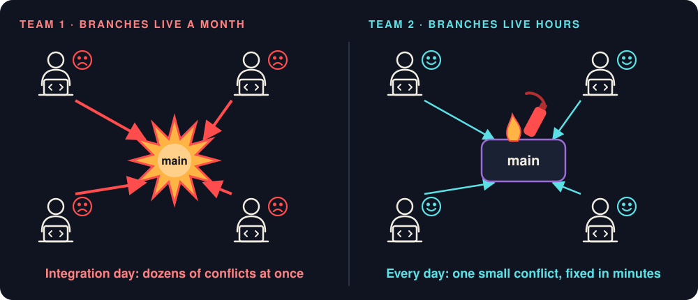
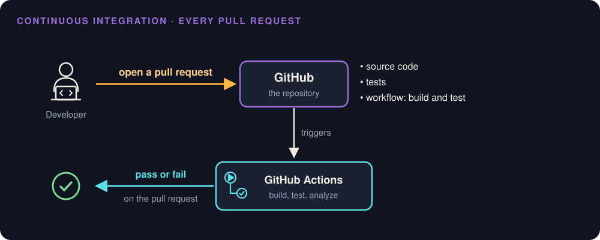
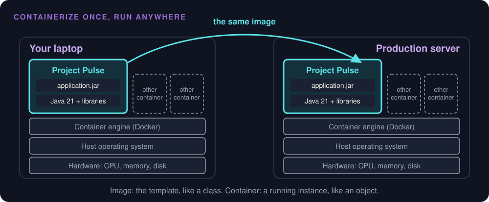
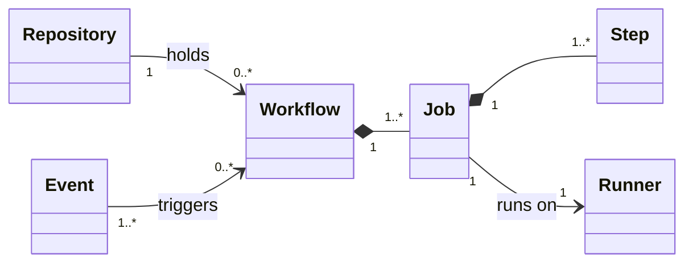
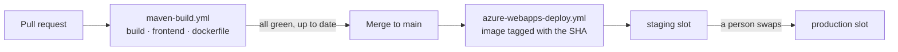
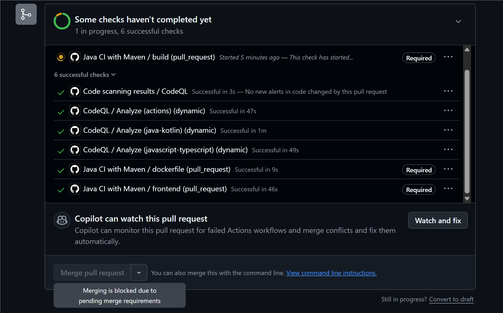
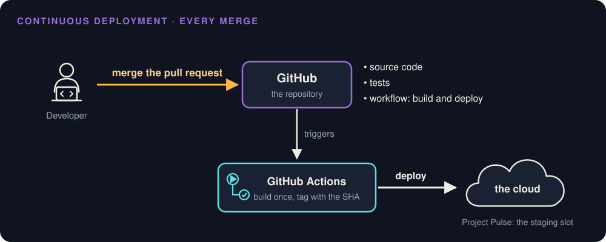
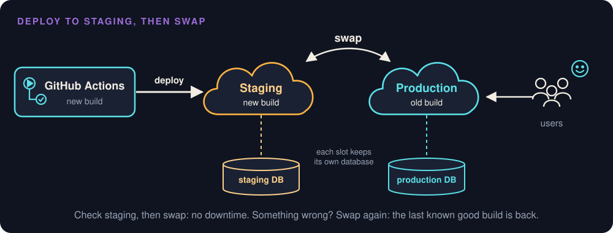

# CI/CD and Continuous Deployment

Week 11 · From a pull request to production, on Project Pulse

::: note
**Say:** Monday we put analyzers on Project Pulse. Today we follow one change from your laptop to the server your client uses: who checks it, what stops it, how it gets there, and how you take it back. Everything is Project Pulse as it stands this week, including one thing I fixed on Tuesday, the day before this lecture. I'll show you what it was.
:::

## Two teams, one repository {.center}



::: ask
Same people, same project. Which team would you rather be on?
:::

::: note
**Say:** Team 1 gives everyone a big feature. A month on a branch, then integration day: dozens of conflicts, and bugs that interact, so each one is harder to find because fifty arrived together. Team 2 splits the work small. Branches live hours. There are still conflicts and bugs, but each is small, the code is still in its author's head, and it's fixed in minutes. Team 2 doesn't write better code. It integrates more often, so each integration is small.
:::

## A small breakdown every Tuesday

> "Instead of heading for a big integration breakdown, I decided to have a small breakdown every Tuesday evening."

Adapted from Graham Parke, No Hope for Gomez!

::: key
Integration should be a routine, not a drama.
:::

::: note
**Say:** That's the whole idea of continuous integration in one sentence. If something hurts, do it more often, in smaller pieces.
:::

## Knight Capital, 1 August 2012

::: steps
- A technician copies new code to the order router's servers and misses one of eight
- The eighth still holds Power Peg, code unused since 2003
- The new code reuses Power Peg's old flag
- The flag goes live: 4 million executions, 397 million shares, about 45 minutes
- More than $460 million lost
:::

::: note
**Say:** Nothing here is exotic. A manual deploy that no second person checked, dead code left in, and a flag reused for new code. The SEC order says a simple double-check of the deployment could have caught it. A pipeline puts the same artifact on every server, or on none. We'll come back to the flag later.

One more twist, and it's the scariest part. While the team was trying to stop it, they rolled back: they removed the new code from the seven servers that had it right. That put the old code back on those seven, still receiving the reused flag, so Power Peg started firing on all eight. The rollback made it worse. Keep that in mind when we get to rolling back: know what a rollback actually restores before the day you need it.
:::

## More pull requests, same hours

::: ai
An agent multiplies the pull requests your team produces. It doesn't multiply the hours anyone has to review them.
:::

::: key
The pipeline is the one reviewer that checks every pull request the same way.
:::

::: note
**Say:** This is why CI/CD matters more this year than it did five years ago. Your team can open twenty pull requests a day now. You can't read twenty pull requests a day carefully. The machine can check all of them, the same way, every time, and leave you the judgment calls.
:::

## Continuous integration is a habit

::: steps
- Merge small changes, at least daily
- Every change runs the same checks
- A red main gets fixed before anything else
:::

::: key
Actions configured and three-week branches is not CI.
:::

::: note
**Say:** Fowler's definition: everyone merges into main at least daily, and every change is built and tested automatically, so a broken main is found within minutes. On GitHub that means a short-lived branch and a pull request. You already work this way: one sub-issue, one branch, one pull request. The tool is the easy part. The habit is the practice.
:::

## Every pull request, checked {.center}



::: note
**Say:** Here's the shape. You open a pull request. GitHub sees the event and starts GitHub Actions. Actions reads a script from your repository, the workflow, runs it on a fresh machine, and reports pass or fail right on the pull request. You've seen the green check and the red X. Today we look at what's behind them.
:::

## What gets shipped

::: steps
- Source code goes in
- ./mvnw package builds one executable JAR: your classes, every dependency, an embedded Tomcat
- Project Pulse also builds the Vue frontend into that same JAR
- java -jar starts it anywhere Java 21 is installed
:::

::: note
**Say:** Building turns source into an artifact, the thing that actually runs. For Spring Boot it's a "fat JAR." Project Pulse's deploy workflow builds the Vue frontend first and copies it into Spring Boot's static folder, so one JAR serves the API and the pages. But notice the last line: "anywhere Java 21 is installed." That's the catch.
:::

## It works on my machine



::: joke
"It works on my machine." "Fine, then we'll ship your machine." That's a container.
:::

::: note
**Say:** A JAR still depends on the machine it lands on: the Java version, libraries, settings. A container packages the application with the runtime it needs, so the server only has to run containers. Project Pulse's Dockerfile starts from eclipse-temurin 21, so Java 21 travels with the app. Containers share the host's operating system kernel, so they're much lighter than virtual machines. Containerize once, run anywhere.
:::

## Image and container

::: cols
**Image**

A read-only template. Like a class.
|||
**Container**

A running instance. Like an object.
:::

::: key
The image is the artifact the pipeline ships.
:::

::: note
**Say:** People mix these up. You build one image, and you can start as many containers from it as you like, the way you create objects from a class. How the Dockerfile layers the JAR for faster rebuilds is Web Tech material and in the Spring Boot docs; today the image is just the thing we ship.
:::

## GitHub Actions in five words



::: note
**Say:** You know UML, so here's Actions as a class diagram. A repository holds any number of workflows, each one a YAML file in .github/workflows. Events trigger them: a pull request, a push, a schedule. A workflow has jobs; jobs run in parallel unless one needs another. A job has steps, and each job runs on its own runner. Five words: event, workflow, job, step, runner.
:::

## Project Pulse: maven-build.yml

```yaml
on:
  pull_request:
    branches: [main]
jobs:
  build:
    runs-on: ubuntu-latest
    steps:
      - uses: actions/checkout@11d5960a...   # v4.4.0
      - uses: actions/setup-java@cf277c60... # v4.9.1
        with: { java-version: "21", distribution: "temurin", cache: maven }
      - run: mvn --batch-mode verify
        working-directory: ./backend
  frontend:   # npm ci, ESLint, type check, Prettier
  dockerfile: # Hadolint
```

::: ask
Point at the event, a job, a step that uses an action, and a step that runs a command.
:::

::: note
**Say:** Event: pull_request to main. Jobs: build, frontend, dockerfile, in parallel. Steps: "uses" runs someone's action, like checkout; "run" runs a shell command, like mvn verify, the same gate command you run before you push. Runner: ubuntu-latest. The Actions are pinned to SHAs, Monday's story.
:::

## The runner starts empty

::: steps
- No local database
- No file you forgot to commit
- No library you installed by hand last month
:::

::: key
Red in CI and green in your IDE means CI found something real.
:::

::: note
**Say:** Every job gets a fresh virtual machine, thrown away afterward. That's the point. If a test passes in IntelliJ and fails on the runner, don't blame GitHub. Your laptop has something the project doesn't declare. CI just told you before your teammate found out.
:::

## Keep it fast

::: steps
- Three jobs in parallel: the slowest sets the wait
- Wait half an hour, and people stop waiting
- Aim for Extreme Programming's ten-minute build
:::

::: note
**Say:** Fowler calls the ten-minute build "perfectly within reason" for most projects. Past that, people start merging before the checks finish, or batching changes so they wait less often, and that's Team 1 again.
:::

## Two workflows, one path



::: note
**Say:** Project Pulse has two workflows. The pull request one checks. When a pull request merges, a push to main starts the deploy workflow: build the frontend and the JAR, wrap them in an image tagged with the commit SHA, deploy to staging. Then a person swaps staging into production. Hold on to the arrow that says "all green, up to date." Until Tuesday, it wasn't true.
:::

## The checks ran. Nothing listened.

::: steps
- Every pull request ran build, frontend, and dockerfile
- No ruleset on main: Merge stayed clickable next to a red X
- After merge, the deploy built with -DskipTests
- Trusting tests that might never have passed
:::

::: warn
Project Pulse, until 3 November 2026.
:::

::: note
**Say:** Honest moment. My own project. Every pull request ran three checks, and nothing required them to pass. You could click Merge on a red pull request, and the deploy workflow would then skip the tests, assuming they'd passed. Nobody did this on purpose. But "nobody did it" isn't a gate. I fixed it on Tuesday, the day before this lecture. Here's the fix.
:::

## Demo: the gate {.center}



::: note
**Do:** Project Pulse, Settings, Rules, Rulesets, open "Protect main." Walk the rules (next slide). Then this screenshot: pull request #108, the first one through the ruleset, blocked while build was still running. Point at the three "Required" labels, and at the CodeQL checks without one: they run, but they don't gate. Then point at "Copilot can watch this pull request... and fix them automatically": that's exactly the agent the "Red made green" slide warns about.

**Say:** This one was blocked because a check was still running. Now imagine Monday's planted bug, isAdmin with role == "admin", in a pull request. Java compiles it. A unit test that passes the literal "admin" even passes, because Java shares one copy of each literal. But a role that arrives in a request is a different object with the same text, so the real request fails. SpotBugs flags it, build turns red, and this button stays gray for good. Until Tuesday, it would have been clickable. Friday you'll plant one in your own repository and watch it happen.

**Say:** This took five minutes. Settings, Rules, Rulesets, a new branch ruleset, target the default branch, four rules.
:::

## Protect main

| Rule | What it stops |
|---|---|
| Restrict deletions | Deleting main |
| Block force pushes | Rewriting history; a released SHA always exists |
| Require a pull request | Pushing around the checks |
| Require status checks: build, frontend, dockerfile | Merging red or still running |
| Require branches up to date | Merging what was tested against an old main |

::: note
**Say:** Approvals: zero on Project Pulse, because I'm the only maintainer and GitHub won't let me approve my own pull request. Your team sets one. Pick each check from the GitHub Actions source, so a status with the same name from somewhere else doesn't count.
:::

## Leave the bypass list empty

::: key
A gate the maintainer can walk around is not a gate.
:::

::: joke
"I'll just bypass it this once." Famous last words, and a famous first incident report.
:::

::: note
**Say:** Including me. If I ever need an emergency fix, I add myself, do it, and take myself off again, and it shows in the ruleset's history.
:::

## Green alone, broken together

::: steps
- Monday: your pull request goes green against Monday's main
- Tuesday: a teammate merges something else
- Your green check tested a main that no longer exists
- Both changes pass alone and break together
:::

::: key
Require branches to be up to date: the checks rerun on what will actually merge.
:::

::: note
**Say:** This is the subtle one. With the rule on, GitHub shows "Update branch," which merges the new main into your branch, and the checks run again on the real combination. That's what makes skipping tests at deploy time defensible. Large teams use a merge queue for the same job: each pull request is tested together with the ones ahead of it.
:::

## Know what each check checks

```yaml
- name: ESLint (report only)
  continue-on-error: true
  run: npm run lint:check
```

::: warn
Required "frontend" blocks a broken npm ci, and nothing else yet.
:::

::: note
**Say:** Honest again. ESLint, the type check, and Prettier don't pass on main yet: 130, 18, and 75 findings. So they run with continue-on-error, report only. Requiring "frontend" today stops a broken install and nothing more. Each step turns blocking when its findings are fixed or baselined, Monday's ratchet applied to the gate itself.
:::

## Flaky checks destroy the gate

::: steps
- A test fails at random
- Everyone learns to press Re-run
- A real failure gets re-run too
:::

::: joke
"It passed on the third try" is not a test result. It's a slot machine.
:::

::: note
**Say:** Fix a flaky test, or quarantine it with an issue, the day you see it. Once people stop believing red, the gate is decoration.
:::

## CD means two things

| | What's automatic | Who decides production |
|---|---|---|
| Continuous integration | Build and test every change | Not about production |
| Continuous delivery | Every green merge becomes a release that could ship | A person presses the button |
| Continuous deployment | Every green merge ships | The pipeline |

::: note
**Say:** People say "CI/CD" and mean either one. Delivery: always ready, a person decides when. Deployment: no person in the loop. Neither is better in general. Decide what your client needs.
:::

## Every merge, deployed {.center}



::: note
**Say:** Same shape as CI, different event. Merge a pull request, Actions builds and deploys. Notice what's missing: no test step. The tests ran on the pull request. That's only safe because of the gate we just turned on.
:::

## Project Pulse does both

::: cols
**To staging**

Every merge to main, automatically.

Continuous deployment.
|||
**To production**

When a person swaps the slots.

Continuous delivery.
:::

::: ask
Which would you want for your client's MVP, and why?
:::

::: note
**Say:** For a client project, a person deciding when users see a change is a sound choice. The client can look at staging first. Get a couple of answers from the room.
:::

## Build once, promote that build

```yaml
tags: ghcr.io/${{ env.REPO }}:${{ github.sha }}
```

::: steps
- The image is built once, tagged with the commit SHA
- Staging runs that image; the swap moves that same image
- Nothing is rebuilt for production
:::

::: key
A rebuild is a new artifact nobody tested.
:::

::: note
**Say:** And the SHA tag answers the question every incident starts with: which commit is production running? Not a version number someone forgot to bump. The commit.
:::

## When is -DskipTests safe?

::: ask
The deploy workflow skips the tests. When is that OK?
:::

::: key
Only when the tests passed on exactly the code being merged: required, and up to date.
:::

::: note
**Say:** Since Tuesday, that's enforced on Project Pulse. Before, it was trust. That's the difference between a pipeline that checks and one that hopes.
:::

## Bad changes ship fast too

::: steps
- 18 November 2025: a permissions change makes a query return duplicates
- A generated config file doubles; it passes a hardcoded limit of 200 (normal: about 60)
- Rust code calls unwrap() on the error; the proxy panics
- The file is "rapidly propagated across the network"
- Errors from 11:20 UTC; normal again at 17:06
:::

> "Hardening ingestion of Cloudflare-generated configuration files in the same way we would for user-generated input."

::: note
**Say:** Cloudflare's own postmortem, and it's a model of how to write one. The lesson for us: a pipeline delivers a bad change exactly as fast as a good one. Their first fix treats their own generated config like untrusted user input. Anything the pipeline ships, configuration included, goes through the gate and through staging.
:::

## Deploy to staging, then swap {.center}



::: note
**Say:** Deploying straight into production costs a minute or two of errors while the container starts, and your users meet the new build first. A staging slot is a second copy with its own URL. Deploy there, smoke test it by hand: log in, open the pages you changed, submit one form. Then swap. Azure warms the new build up before routing users to it, so nobody sees downtime. Slots need App Service's Standard tier or higher.
:::

## Each slot keeps its own database

::: steps
- Database address and password live in Azure Key Vault
- SPRING_PROFILES_ACTIVE picks application-staging.yml or application-prod.yml
- AZURE_KEY_VAULT_ENDPOINT picks the vault
- Both are deployment slot settings: they stay with the slot, not the code
:::

::: note
**Say:** This is how Project Pulse keeps staging away from real student data. The code is identical in both slots; two app settings, marked as slot settings, decide which profile and which vault. One consequence: during a swap, Azure restarts the new build with production's settings, and that's when Flyway runs the new migration on production's database, while the old build is still serving users. Remember that for two slides from now.
:::

## Rolling back

::: cols
**Code**

Swap back. Seconds. No rebuild.
|||
**Data**

Migrations run forward only. The old build meets the new schema.
:::

::: key
A schema change the previous build can't live with is a release you can't roll back.
:::

::: note
**Say:** Next week's reliability module calls the swap a repair-time decision: you can't make failures rare, but you can make repair fast. Code rolls back in seconds. Data doesn't roll back at all. Flyway runs V1 through V6 forward, and a swap brings back old code, not the old schema.
:::

## V5 and V6

::: cols
**V5: safe**

Code stopped writing nulls first. Columns checked: zero nulls in staging and prod. Then NOT NULL.
|||
**V6: not**

Pull request #99: category stored as a name, not a number. Code and column changed together. The old build expects a number and finds a name.
:::

::: note
**Say:** Both are mine. V5 is the textbook: code first, data checked, schema last. V6 was a good change; numbers would have silently relabeled old rows when the category list grew. But once it runs, swapping back brings back a build that can't read the activity table, and even during a normal swap the old build briefly reads the new column. For a change like that, the plan is roll forward: fix it and deploy again. That's legitimate. Just know it before you merge, not during the outage.
:::

## Expand and contract

::: steps
- Expand: add the new column, nullable, used by nothing
- Write: ship code that writes both
- Read: ship code that reads the new one, handling empty rows
- Contract: once every running build uses it, remove the old one
:::

::: note
**Say:** When a change must stay reversible, split it so every step keeps both builds working. Four small releases instead of one. It's more work, which is why you choose it on purpose.
:::

## Secrets in the pipeline

| Secret | What it can do |
|---|---|
| AZURE_WEBAPP_PUBLISH_PROFILE | Deploy anything to staging |
| CLAUDE_CODE_OAUTH_TOKEN | Run Claude Code on my account |
| GITHUB_TOKEN | Fresh per job; push the image |

::: key
Least privilege: maven-build.yml asks for contents: read and nothing else.
:::

::: note
**Say:** A pipeline needs credentials. They live in Settings, Secrets and variables, Actions. GitHub masks them in logs, and a workflow only gets a secret it names. Each workflow also declares what its GITHUB_TOKEN may do; the deploy adds packages: write because it pushes an image.
:::

## Forks get no secrets

::: steps
- A pull request from a fork runs with no secrets and a read-only token
- That's why Project Pulse's checks need none
:::

::: warn
Never "fix" a fork's workflow with pull_request_target: it runs with your secrets, and a stranger's code can run with them.
:::

::: note
**Say:** This matters on a public repository like Project Pulse, where anyone can fork and open a pull request. If someone suggests pull_request_target to make a failing fork build work, the answer is no.
:::

## Short-lived beats long-lived

::: cols
**Publish profile**

A password that works until someone regenerates it.
|||
**OIDC**

Azure trusts GitHub's token for this workflow and returns a credential that lasts minutes.
:::

::: warn
Project Pulse's deploy workflow holds the publish profile. Until #108, it named its Actions by tag.
:::

::: note
**Say:** OIDC means there's no stored password to steal. Project Pulse still uses the publish profile; OIDC is its next step. And Monday's story applies most to this file: it holds the deploy credential, and until this week its seven Actions were tags. Pull request #108 pinned them to the exact commits those tags pointed at, so nothing changed except that nobody can change it under us.
:::

## An agent in CI

::: ai
claude.yml runs Claude Code when someone writes @claude in an issue or a comment. It holds a secret, reads text anyone can write, and can reach the network.
:::

::: steps
- Guard: it acts only for people with write access (leave that default on)
- Guard: a read-only GITHUB_TOKEN
- Guard: Actions pinned to SHAs
:::

::: key
An agent in CI never acts on text from someone outside the team.
:::

::: note
**Say:** Week 8's lethal trifecta, on a server: private data, untrusted content, a way out. All three are here. The guards are what keep it safe, and the action's own docs call turning off the write-access check a significant security risk.
:::

## Same commit, same build

::: cols
**npm ci**

Installs exactly what package-lock.json says. Fails if it disagrees.
|||
**npm install**

May update the lockfile within package.json's ranges.
:::

::: warn
Project Pulse, until #108: the pull request workflow ran npm ci; the deploy workflow ran npm install.
:::

::: note
**Say:** So the build that shipped wasn't quite the build that was checked, and two deploys of one commit could differ. The fix was one word, in pull request #108, this week. It also dropped Maven's --update-snapshots, which did nothing yet because Project Pulse has no snapshot dependencies, and would have mattered the day someone added one. A pipeline line spreads exactly like code, so review it like code.
:::

## Versions and tags

::: steps
- A tag marks a baseline: this commit is what we released
- MAJOR.MINOR.PATCH: breaks, adds, fixes
- v1.4.2: a patch about thirteen hours after v1.4.1, notes naming the bug and issue #28
- Today: last tag v1.5.0, 61 merged pull requests ago; pom.xml says 2.0.0
:::

::: joke
v1.0.0-final-FINAL-really-final is not Semantic Versioning.
:::

::: note
**Say:** v1.4.2 is the model: a regression found, a patch the same day, release notes that name the problem. The rest is the counterexample, also mine. Sixty-one pull requests since the last tag, and a pom.xml version no tag names. Only the SHA-tagged image tells the truth about what runs.
:::

## Tag your Checkpoint 2

```bash
git tag -a v0.1.0 -m "Checkpoint 2: proving slice"
git push origin v0.1.0
```

Then: Releases, Draft a new release, choose the tag, Generate release notes.

::: key
v0.1.0 at Checkpoint 2, v0.2.0 at Checkpoint 3, v1.0.0 for the MVP.
:::

::: note
**Say:** This week. GitHub drafts notes from the merged pull request titles; an agent can rewrite them for your client. Then you check them against what users will notice, because a pull request title describes the code, not what the client sees.
:::

## Feature flags rot

::: steps
- A flag ships code switched off: on and off without a deploy
- Project Pulse: app.reminders.enabled (off in staging)
- Knight Capital: a reused flag woke Power Peg
:::

::: key
Every flag gets an owner and a removal date. A retired flag is deleted, never repurposed.
:::

::: note
**Say:** Notice staging has the reminders flag off, so staging never emails real students their Monday reminder. Flags are useful, and they're configuration items that rot. Knight's loss started with one reused.
:::

## Where will your project run?

::: steps
- Whose account hosts it, and who can turn it off?
- Who pays, and what happens when a credit runs out?
- Who owns it after December, and after May?
- What is staging for you?
- What data will it hold?
:::

::: warn
A cloud account bills by the hour. Set a cost alert the day you create it.
:::

::: note
**Say:** You don't decide this week. You start asking. Write the open question into section 7 of your architecture-of-record, the deployment view, with an owner, and settle it by Checkpoint 3, when that view is due. And from experience, mine and former students': turn off what you're not using, or the bill arrives before the grade does.
:::

## Over the wall

::: cols
**Developers**

Write features. Rewarded for change. Hand the release over the wall.
|||
**Operations**

Keep production up. Rewarded for stability. Catch what comes over.
:::

::: ask
Every release is a negotiation, every outage a search for someone to blame. What would you change?
:::

::: note
**Say:** Until the late 2000s, this was most companies. Two groups with opposite incentives. In 2009 at the Velocity conference, John Allspaw and Paul Hammond showed how Flickr deployed more than ten times a day: "Dev and Ops Cooperation at Flickr." Same year, Patrick Debois started DevOpsDays in Ghent, Belgium, and the movement got its name.
:::

## DevOps: you build it, you run it

> "You build it, you run it."
>
> Werner Vogels, Amazon

::: key
One team owns a change from commit to production.
:::

::: note
**Say:** DevOps is a culture first and a toolkit second. Everything we did today is the toolkit: the pipeline, the gate, staging, the swap. The culture is that the team that wrote it is the team that gets the call when it breaks. You already live this: your team deploys what it builds.
:::

## CALMS

| | Means | You've done it |
|---|---|---|
| **C**ulture | One team, commit to production | You deploy what you build |
| **A**utomation | Done twice by hand? Pipeline step | Today's workflows |
| **L**ean | Small batches, flowing | Team 2 |
| **M**easurement | Numbers, not opinions | DORA; observability, week 12 |
| **S**haring | Dashboards, knowledge, blameless postmortems | Reliability |

::: note
**Say:** John Willis, Damon Edwards, and Jez Humble summed DevOps up as CALMS. If an interviewer asks what DevOps is, this is the skeleton of a good answer. Notice the last column: none of it is new to you.
:::

## How DevOps measures itself

::: cols
**Speed**

Deployment frequency. Change lead time, commit to production. Recovery time after a failed deploy.
|||
**Stability**

Change fail rate. Deployment rework rate.
:::

::: key
DORA: "speed and stability are not tradeoffs."
:::

::: note
**Say:** The DORA research, written up in Accelerate, started with four metrics; DORA tracks five now. Recovery time used to be called time to restore service, and you'll still hear that name. The finding that surprises people: the fastest teams are also the most stable. Small automated changes are both faster and safer. That's Team 2 from the start of the hour.
:::

## DevOps and SRE

```java
class SRE implements DevOps { }
```

::: joke
Google's own summary, from The Site Reliability Workbook: "class SRE implements interface DevOps."
:::

::: note
**Say:** DevOps is the interface: what to do. Site reliability engineering is Google's implementation: SLOs, error budgets, and a cap on how much of an engineer's time goes to operations work. You'll meet SRE properly in week 12. And on a job ad, "DevOps engineer" usually means the person who builds and runs the pipeline and the cloud infrastructure.
:::

## In an interview: "What is DevOps?"

::: steps
- What: one team owns software from commit to production, instead of handing releases to operations
- How: automation and small, frequent changes, so each failure is small and quick to fix
- How you know: the DORA metrics
- Then one example from your project: your pipeline, your gate, your rollback
:::

::: note
**Say:** Three sentences and one story. The story is what gets you the job: "On my senior design team, every pull request ran our tests and the merge button locked when they failed." And the follow-up is often "and SRE?" You now have the joke for that.
:::

## Red made green

::: ai
Asked to fix a failing build, an agent can add @Disabled, set continue-on-error, grow a baseline, or regenerate the lockfile. Each one turns the check green.
:::

::: key
Ask of every such diff: does this make red green without fixing anything?
:::

::: note
**Say:** Read any pull request that touches .github/workflows, a test annotation, a baseline, a lockfile, or a migration as code, with that one question. Monday's charter line was "a baseline only shrinks." Widen it: never weaken a check to make it pass without saying so in the pull request.
:::

## The agent and the pipeline

::: cols
**Delegate**

Draft a workflow. Explain a failed run's log. Draft release notes. Split a migration into expand and contract. Spot unpinned Actions.
|||
**Keep**

What's required on main, and who may bypass it. When production changes. Which secrets exist. Whether a schema change can roll back.
:::

::: note
**Say:** The agent is good at YAML and at reading logs. The decisions that decide what reaches users stay with you.
:::

## Your week

::: steps
- Friday studio: the gate on your repository, the Protect main rules, your charter line, and an open deployment question in section 7
- Checkpoint 2, by Friday: demo from a tagged v0.1.0 with release notes
- Assignment 4, Triage the analyzers: out today; your pull request leaves the pipeline green
:::

::: key
Checked on every pull request, blocked when red, deployed from what was checked, undoable when it goes wrong.
:::

::: note
**Say:** Friday you finish what Monday started: the workflow, the ruleset with every rule we saw today, one pull request that should fail so you watch the merge button lock. Tag v0.1.0 for your Checkpoint 2 demo. And assignment 4's page is up today.
:::
