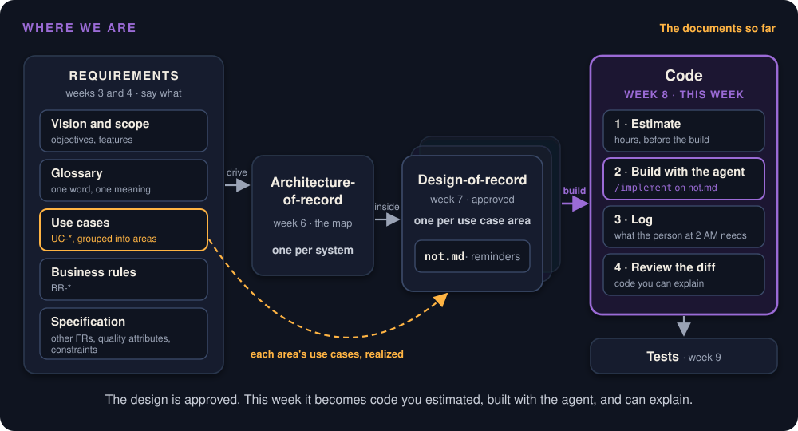

# Estimate, Then Build With the Agent

Week 8 · From an approved design to an estimate you can defend and code you can explain

::: note
**Say:** *[0:00]* Welcome back from fall break. Two halves today. First we estimate the reminder we designed last week, then we start building it with the agent, live. By the end of the hour you should be able to put a range on a use case and defend it.
:::

## Where we are

{ height="480" }

Today's build: [`not.md`, the approved design](https://github.com/Washingtonwei/project-pulse/blob/main/docs/design/not.md)

::: note
**Say:** Every document so far, left to right. Requirements in weeks 3 and 4, the architecture in week 6, a design-of-record per use case area last week; Project Pulse's first is not.md. This week is the code box: estimate it, then build it from not.md. Next week we test it.

*[Open the not.md link. Two or three minutes, scrolling, no reading line by line.]* **Say:** A quick reminder of what we approved. The Overview: one question, which students still owe which item for a week, a weekly activity report or a peer evaluation, and a reminder to exactly those students, on a schedule and on an instructor's demand. Components and classes: that's the trunk we build first. Tests: 20 rows, which is what we estimate from in a minute. Open questions and risks at the bottom, including the 80 emails in one request. Everything the agent builds today comes from this file and nothing else.
:::

## When can I use it? {.center}

::: ask
The reminder's design is approved. The instructor asks: when can I use it? What do you answer?
:::

::: note
**Say:** Pretend I'm the client. The reminder's design was approved last week. When can I use it? Give me a number. *[Write two or three on the board, no comment.]* Hold on to those; we come back to them.

**Background:** the design is Project Pulse's docs/design/not.md, from week 7.
:::

## Count the code?

::: steps
- A controller, a `SubmissionStatusService`, a scheduler change, a dialog, their tests.
- Lines of code, times hours per line.
:::

::: ai
The agent writes all of it in one session. By that arithmetic, the answer is "this afternoon."
:::

::: note
**Say:** One way to answer: count the code. not.md asks for a controller, a service, a scheduler change, a dialog, and tests. Lines times hours per line. But the agent writes all of that in one session, so by that arithmetic it's ready this afternoon.
:::

## It is not this afternoon

::: cols
**20**
rows in the test list. Each one is a behavior a person has to see pass.
|||
**6**
open risks. One (80 emails during one request) can only be settled by measuring on staging.
:::

::: key
The agent made the typing free and left everything else.
:::

::: note
**Say:** It isn't. The design has 20 rows in its test list, and a person has to see each one pass. It has 6 open risks, and one of them, 80 emails sent during one request, we can only settle by measuring on staging. The agent made the typing free. Everything else is still there.
:::

## Your feeling of speed is not data

::: steps
- Before: developers expected AI to make them **24% faster**.
- Measured: they took **19% longer**.
- After: they still believed they had been **20% faster**.
:::

::: note
**Say:** And don't trust how fast it feels. *[Click through.]* Expected 24% faster, measured 19% slower, and afterwards they still believed 20% faster. These were experienced developers on their own code. So log your hours; don't remember them.

**Background:** METR's randomized trial, July 2025, 16 experienced developers on their own repositories. Felt speed was off by about 40 points.
:::

## The hours moved

::: cols
**Pull requests**
154% larger, 98% more of them.
|||
**Review time**
up 91%.
:::

::: note
**Say:** Where did the time go? Teams that use AI heavily open far more pull requests, and much bigger ones, and review time went up 91%. Generating got cheap. Reading did not.

**Background:** Faros AI telemetry, June 2025, teams with high AI adoption.
:::

## People's hours, not the agent's {.center}

::: key
`/implement` writes the reminder in a few minutes. None of the estimate is those minutes.
:::

::: note
**Say:** Now look at the board. How many of those numbers were pricing the agent's session? /implement writes the reminder in minutes, and none of the estimate is those minutes. Every hour is a person's: settling the use case with the client, designing, reading what the agent wrote, seeing it work. Pull request #76 was agent-written and still took about three and a half hours from first commit to merge.
:::

## A skill the agent cannot take {.center}

::: key
When anyone can generate the code, the engineer a client trusts is the one whose dates hold.
:::

::: note
**Say:** So estimation is worth building as a skill, on purpose. The agent can count test rows and draft a breakdown. It can't know how fast your team reads a diff, how slowly your client answers, or which risk will bite, and it can't promise a date. When anyone can generate code, the engineer a client trusts is the one whose dates hold. Every use case this term is a repetition, and every miss is data about your own judgment.
:::

## A range, made twice

::: steps
- Always a range: "3 to 5 hours, most likely about 3.5."
- When the use case is written: a coarse estimate, by the team, for ordering and the release plan.
- When its design is approved: the refined estimate, the one you give a date from.
:::

::: warn
Client needs it sooner? Cut scope, not the estimate.
:::

::: note
**Say:** Two rules. Always a range, because one number gets heard as a promise. And estimate twice: coarse when the use case is written, narrower once the design is approved, because the design turns unknowns into named tests and risks. If the client needs it sooner, cut scope. Never shrink the estimate.
:::

## Where the hours go now

::: steps
- **Clarify:** settling the use case with the client.
- **Design:** the challenge loop and the design-of-record, until it merges.
- **Build and review:** driving the agent, reading every line of the diff.
- **Verify:** seeing each test row pass, end to end.
:::

::: joke
The first 90 percent of the code takes the first 90 percent of the time. The remaining 10 percent takes the other 90 percent. (Tom Cargill, Bell Labs)
:::

::: note
**Say:** Four buckets: clarify, design, build and review, verify. *[Read the joke.]* That used to be an exaggeration. Now it's literal: the agent does the first 90 percent of the code in minutes, and the other 90 percent of the time is review and verification. The buckets match your weekly activity report categories.

**Background:** clarify is REQUIREMENTS or COMMUNICATION, design is DESIGN, build and review is DEVELOPMENT or REVIEW (a teammate's review of the pull request included), verify is TESTING or BUGFIX. Count only time spent on this use case; a client meeting about five use cases is overhead, not split five ways. The refined estimate folds clarify and design into one part, what is left of them: the holes the build exposes.
:::

## Planning poker, in hours

::: steps
- Each teammate writes a range per part, privately.
- Reveal at once.
- Highest and lowest explain.
- Agree on a range.
:::

::: key
The gap is the finding. Clarify at 0.5 hours and at 4 means two people read two different use cases.
:::

::: ask
`UC-AI-critique`, not yet designed. Your range for clarify?
:::

::: note
**Say:** How does a team agree on a range? Planning poker, in hours. Write privately, reveal together, highest and lowest explain. Try it: UC-AI-critique, not designed yet. Clarify: under an hour? One to three? More than three? *[Hands; get the two extremes to explain. Short on time: skip the hands and say the key line.]* That gap is the finding: two people read two different use cases. Hours, not story points, because the client asks for a date.

**Background:** Grenning 2002, popularized by Cohn. A few minutes per use case, spent on the gaps; a gap on clarify is a question for the client. Points also fail here because weekly activity reports log hours and a semester is too few sprints for a points velocity to settle.
:::

## Size it by the test list

::: steps
- Each row is one behavior a person has to see working.
- It counts what the software must do. It is not yet hours.
- First estimate: by analogy to a finished change of the same size.
- After two or three use cases: your own hours per row.
- The open risks set the width of the range.
:::

::: note
**Say:** What do you estimate from? The test list. Each row is a behavior someone has to watch work. Rows aren't hours yet, so the first estimate is by analogy to a finished change of the same size. After two or three use cases you'll have your own hours per row. The open risks set the width.
:::

## The reminder, estimated

| Part | Basis | Hours |
|---|---|---|
| Clarify and design, left | Questions test already run | 0.5 to 1 |
| Build and review | Every diff read against the diagrams | 1.5 to 2 |
| Verify | 20 rows, latency on staging | 1 to 2 |
| **Total** | By analogy: #76, 3.5 h | **3 to 5** |

::: note
**Say:** Let's commit to one now, before the agent runs. Clarify and design are mostly done: half an hour to an hour. Build and review, 1.5 to 2. Verify, 20 rows plus latency on staging, 1 to 2. Total 3 to 5, most likely 3.5, the same as #76, which was about this size. Compare the board: those were coarse guesses without a design, the job planning poker does. This one is made with it. On staging by Friday with the latency measured, or a message by Wednesday saying why not.

**Background:** no measured rate yet, so this is an analogy. Pull request #76 is the invitation hardening: 884 lines, 23 files, two review rounds, about 3.5 hours from first commit to merge. The reminder was designed before estimation was taught, so it has no coarse estimate, and neither do the teams' proving slices.
:::

## Write it down before you build

On the issue:

```text
Estimate: clarify and design 0.5–1 h, build and review 1.5–2 h, verify 1–2 h
```

In every weekly activity report line about it:

```text
UC-NOT-remind-non-submitters: reviewed the agent's diff against the sequence diagram
```

::: note
**Say:** Write it on the issue before you build, not after. And every weekly activity report line about this use case starts with its ID. That's what lets you add up the actual hours later.

**Background:** Project Pulse already stores planned and actual hours on every activity line (the Activity entity).
:::

## Calibrate

::: key
Calibration ratio = hours logged since the estimate ÷ its midpoint.
:::

::: steps
- Estimated 8 to 16, logged 18: ratio 1.5.
- Next use case you would call 4 to 8: say 6 to 12.
- A slip you see coming goes to the client at the next meeting, not on the date.
:::

::: joke
Hofstadter's Law: it always takes longer than you expect, even when you take into account Hofstadter's Law.
:::

::: note
**Say:** Then compare. Hours logged divided by the estimate's midpoint. Estimated 8 to 16, logged 18: ratio 1.5. Next time you'd say 4 to 8, say 6 to 12. And a slip you see coming goes to the client at the next meeting, not on the date. *[Read the joke.]* The ratio is how you actually take that law into account.

**Background:** one ratio per estimate. The refined ratio says how well you estimate a build, the coarse ratio how well you estimate a use case you have only read, and the release forecast uses the coarse one. Tracked per person and per team, six ratios is how a team finds out that review, not building, is where its hours go.
:::

## Then look back

::: steps
- Which part missed most?
- What did you not know when you estimated?
- What will you do differently next time?
:::

::: key
The ratio corrects your bias. The retrospective improves your judgment.
:::

::: note
**Say:** The ratio corrects your bias. A retrospective improves your judgment. Five minutes, by the owner, the day the use case closes and before the next one starts. *[Click through the three questions.]* The answer becomes that use case's biggest-miss sentence in the calibration table. Written then, it's evidence. Written at the checkpoint weeks later, it's a guess.
:::

## Graded on honesty, not accuracy {.center}

::: key
A ratio of 2.3 with a reason earns the same as a ratio of 1.0.
:::

::: warn
Logging fewer hours to look accurate is inflating a weekly activity report, and it is academic dishonesty.
:::

::: note
**Say:** How is this graded? Honesty, not accuracy. A ratio of 2.3 with a reason earns the same as 1.0. Shaving your logged hours to look accurate is inflating a report, and that's academic dishonesty. I'd much rather see a bad estimate honestly reported.
:::

## In your team meeting, by Sunday

::: steps
- Your build-context issue gets a refined estimate before the agent builds.
- Before Checkpoint 2: planning poker for every use case not yet designed, its coarse estimate on its issue.
- Your weekly activity report lines carry the use case ID.
- Checkpoints 2 and 3: estimate, actual, ratio, and one sentence on the biggest miss.
:::

::: note
**Say:** *[About minute 22.]* By Sunday, in your team meeting: a refined estimate on your build-context issue before the agent builds; planning poker for every use case you haven't designed, coarse ranges on their issues; use case IDs on your report lines. The calibration table shows up at Checkpoints 2 and 3. Now let's build.
:::

## The agent copies what it sees {.center}

::: key
4 of Project Pulse's 266 backend classes declare a logger.
:::

::: ai
Ask the agent for a feature there, and it writes code that does not log. Whatever your codebase does by habit, the agent does at speed.
:::

::: note
**Say:** Before the agent touches anything, one fact about Project Pulse. Of 266 backend classes, 4 declare a logger, and they don't agree on its name. Ask the agent for a feature here and it copies what it sees. Whatever your code does by habit, the agent does at speed. We'll check whether today's build logs. That's why rules go in the charter, not in a prompt.

**Background:** the two names are LOGGER and log. The catch-all exception handler logs nothing either. Same mechanism as week 2's reviewee example.
:::

## Cognitive debt {.center}

::: key
Code your team accepted without understanding it.
:::

::: note
**Say:** The risk of going fast has a name. Cognitive debt: code your team accepted without understanding it. It compounds like technical debt. The next session builds on code nobody can explain, and the first bug in it gets debugged from scratch.

**Background:** Kosmyna et al. named it for essays written with an assistant; it fits code better, because an agent writes more than a person can read.
:::

## Size the step to the review

| Commit | What goes in it |
|---|---|
| **Trunk** | What many paths depend on, or existing users rely on, or is hard to undo |
| **Security rule or migration** | Alone |
| **Each leaf** | New code reached only through the new feature |

::: key
The agent pauses once, after the trunk. You read it before the leaves are built.
:::

::: note
**Say:** How do you keep up without reading after every line? Size the steps. The trunk, what many paths depend on or is hard to undo, goes first, and the agent stops once so you read it. A security rule or migration goes alone. Leaves come after. A wrong trunk found late means rebuilding every leaf; a wrong leaf is cheap. All the commits still go in one pull request, read commit by commit.
:::

## The pause check {.center}

::: ask
Can you say what changed and why, without asking the agent?
:::

::: note
**Say:** At the pause, one question. *[Read it.]* If you can't answer it, keep reading until you can. That's paying the debt while it's small.
:::

## The reminder, in four commits

::: steps
- Trunk: SubmittableItem, WeekKeys, SubmissionStatusService, ReminderService, two new queries. **Pause.**
- The two route rules in SecurityConfiguration, alone.
- ReminderController and the dialog.
- The moved WeeklyReminderScheduler.
:::

::: joke
The trunk commit message the agent wanted: "Add some stuff." The one you merge: "Add SubmissionStatusService: who owes what this week."
:::

::: note
**Say:** Here's the reminder in those terms, from not.md's class diagram. Trunk first: the service that knows who owes what this week, and its helpers. Pause. The two route rules, alone. Then the controller and dialog, then the moved scheduler. Project Pulse's /implement commits exactly this way, and it's what we start live today. *[Read the joke.]* You write the commit message that says what the code is for.
:::

## The team's settings file

```json
{
  "permissions": {
    "deny": [
      "Bash(git push --force *)",
      "Bash(gh pr merge *)",
      "Bash(gh repo delete *)",
      "Read(**/.env)",
      "Read(**/.env.*)",
      "Read(**/secrets/**)",
      "Read(**/*.pem)",
      "Read(**/*.key)"
    ]
  }
}
```

::: note
**Say:** *[About minute 36.]* Before the agent gets the keys: what it may not do. This is the team's settings file. No force push, no merge, no deleting the repository, and, new this week, no reading your secrets. Anything the agent reads goes to the model provider. Commit it once by pull request so the team reviews it. Project Pulse doesn't have one, so test the refusal on your own repository.

**Background:** the file is .claude/settings.json. The full version, with the PowerShell twins and the short force-push spelling, is on the Agent Setup page, section 10. The TA opens it at Checkpoint 2.
:::

## Before Friday

::: steps
- `Read` deny rules for your secrets in the team's `.claude/settings.json`, by pull request.
- Ask the agent to read `.env`. Watch it refused.
- Charter line: no dependency without a person's check.
- Checked at Checkpoint 2.
:::

::: note
**Say:** Before Friday: the Read deny rules, by pull request. Ask the agent to read .env and watch it refuse. A charter line: no new dependency without a person's check. Your TA checks it at Checkpoint 2.

*[Minute 39, the build.]* Tab A: `git switch -c not-reminder`. Tab B: `claude`, then `/clear`, then `/implement UC-NOT-remind-non-submitters`. Say: I clear on purpose, so it reads only the merged design, not a conversation. While it reads: "It reads only merged documents." While it plans: "No approval gate, the design was approved last week." Read every permission prompt aloud and choose Yes once, never "don't ask again". During phase 1 or 2, open `.claude/commands/implement.md` for a minute: "This file is what is executing. Wednesday we take it apart." Then show "Code you did not write". At the pause, do not answer it: `git log --oneline -3`, `git show --stat HEAD`, and stop. "Reading the trunk is how we open Wednesday." If it hasn't paused by 10:50, leave it running. If it fails, say so: a failed run is also a lesson.
:::

## Code you did not write

::: steps
- Asked to document existing code, the agent writes down what it does, bugs included.
- A missing check, read back, becomes a requirement nobody chose.
- The client calls each one intended, corrected, or a defect. Not you.
:::

::: key
The code is evidence, never authority.
:::

::: note
**Say:** *[While the agent runs.]* For teams whose client handed you existing code. Ask the agent to document it and it writes down what the code does, bugs included. A missing check, read back, becomes a requirement nobody chose. Only your client decides whether each one is intended, corrected, or a defect. The code is evidence, never authority. Module 4.8 has the steps.

**Background:** Project Pulse's /design calls its version "design-as-built". Defects go to OPEN-ISSUES.md, not into the specification.
:::

## The catch-all logs nothing

```java
@ExceptionHandler(Exception.class)
Result handleOtherException(Exception ex) {
    return new Result(false, INTERNAL_SERVER_ERROR,
        "A server internal error occurs.", ex.getMessage());
}
```

::: warn
A NullPointerException in production: the user sees one sentence, the operator sees nothing, and the browser gets the raw exception message.
:::

::: note
Abridged from ExceptionHandlerAdvice; the module, 4.9, quotes it in full. Spring does not log an exception a handler has resolved. The fix is one line, LOGGER.error("Unhandled exception", ex), and dropping ex.getMessage() from the response. The full before and after is in the module, 4.9.
:::

## The logging rule, for your charter

::: steps
- One logger per class, one name.
- error: someone must act. warn: degraded. info: a business event. debug: development.
- Parameterized: "Sent {} of {} reminders", never concatenation.
- Every catch that does not rethrow logs the exception object.
- Identifiers, never content: no secrets or passwords; a person's ID, not their email or scores.
:::

## Review what was logged, not only whether

```java
LOGGER.error("Could not send the weekly reminder to {} in section {}",
        student.getEmail(), section.getSectionName(), e);
```

::: ask
Right level, parameters, the exception object. And every failed student's email address in the log. Acceptable?
:::

::: note
From Project Pulse's WeeklyReminderScheduler today. It follows four of the rules and breaks the fifth: every failed student's email address goes into the log. Fix: `student.getId()`; the operator looks the address up. CO-ferpa. Catching this is the reviewer's job, because the agent copied it from the code around it.
:::

## Several agents at once

::: key
Safe exactly where the decisions they would make are already written down.
:::

::: steps
- Side task: it searches and reports; it edits nothing.
- Writer and reviewer: a fresh session reviews the diff.
- Fan-out by leaf: after the trunk merges.
:::

::: warn
No more agents than pull requests you will review well today.
:::

::: note
Reading: module 4.10. Start both reminder leaves before the trunk merges and each agent writes its own SubmissionStatusService, with two definitions of "has not submitted". Never split one use case's layers across agents.
:::

## `/implement` is a file

| Part | In `/implement` |
|---|---|
| Front matter | `argument-hint: <UC-ID>` |
| The argument | `$ARGUMENTS`, the use case ID |
| Preconditions | No design? Stop. Old conversation? `/clear` |
| Standing rule | "When in doubt, or when you see a better way, shout." |
| Phases | Read first; then plan, build, test, trace, open the pull request |
| Stop | Once, after the trunk |

::: note
Project Pulse's .claude/commands/implement.md, 88 lines; design.md has the same skeleton and stops earlier, before writing the design doc, until you accept its shape. Claude Code turns .claude/commands/name.md into /name. The stop is the most important line: a command with no stop hands your judgment to the agent. Module 4.11.
:::

## Write your own

::: steps
- Package what your team has done by hand twice.
- Copy the skeleton, not Project Pulse's paths. About 20 lines.
- `/design` and `/implement` for your repository.
- `/close-use-case`: the closing checklist and the three retrospective questions.
- `/estimate`: count the rows and risks; leave the hours blank for a person.
:::

::: joke
A good programmer is someone who looks both ways before crossing a one-way street. A good command checks its preconditions anyway.
:::

::: note
Optional, not graded. Commit it by pull request, like the charter, because the whole team runs it. On a tool other than Claude Code, keep the same file as a prompt and paste it in.
:::

## Before your agent builds the slice

::: steps
- Charter: your logging rule.
- Build trunk first; read it before the leaves.
:::

## Checkpoint 2: Oct 23

::: steps
- The slice runs from a tagged release, `v0.1.0`, with release notes.
- `.claude/settings.json` denies reads of your secrets.
- The charter: the dependency rule, and never remove the `Co-Authored-By` trailer.
- The calibration table.
- The release plan: a Release value on every traceability row.
:::

::: note
The full checklist is on the Project page, under Checkpoint 2. The tag and the trailer rule come from week 2's "Knowing exactly what you built"; the settings file is on the Agent Setup page, section 10. Teams leave Checkpoint 2 with Checkpoint 3's two reliability items, one measured SLO and one degradation test, and start them that week.
:::
