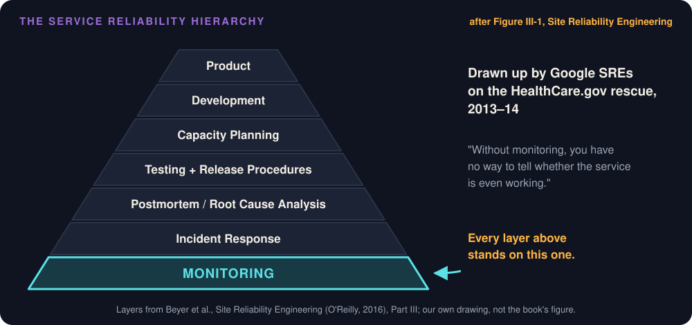
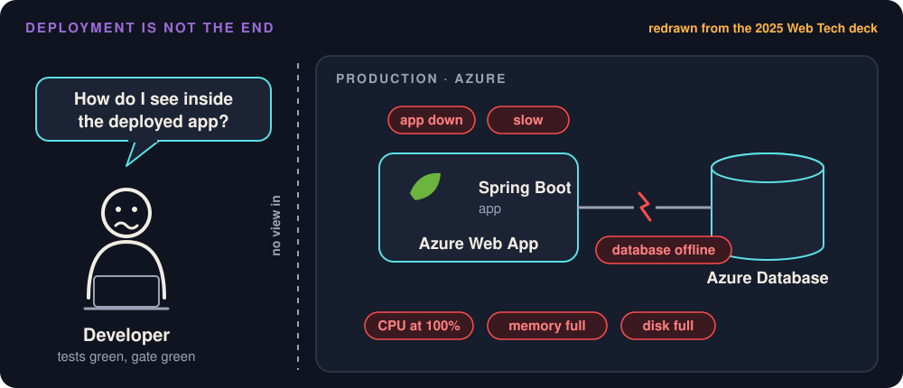
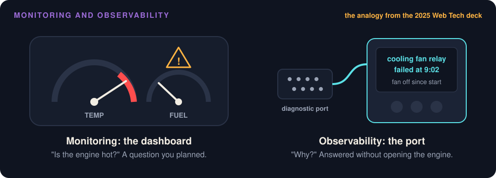

# Observability and Debugging

Week 12 · Seeing inside Project Pulse after it ships

::: note
**Say:** Two weeks ago we shipped. The pipeline builds it, checks it, and puts it on Azure. Today's question: once it's running, how do you know what it's doing? Monday is the lecture. Wednesday I run Project Pulse on my laptop, break it on purpose, and you tell me where to look.
:::

## Nobody could tell if it was up

::: steps
- October 1, 2013: HealthCare.gov launches and breaks under its first traffic
- Mid-October: about 3 in 10 visitors can get on at all
- The rescue team finds no dashboard, "no quick way for engineers to measure what was going on"
- "Nobody could even tell us if the system was up."
:::

::: note
**Say:** This is the federal website for buying health insurance. A White House adviser said that last line. People checked whether the site was up by opening a laptop and trying it. Source: Steven Brill, Time, February 2014.
:::

## The first fix was a dashboard

::: steps
- The rescue team built the dashboard first
- Then they could rank the problems and fix the worst ones first
- By December 1: uptime from 43% to 95%, errors from 6% to 0.5%
:::

::: key
You cannot fix what you cannot see.
:::

::: note
**Say:** Not a rewrite, not a new architecture. A dashboard. Once they could see the system, the work became a list in priority order.
:::

## Monitoring is the base {.center}



::: note
**Say:** Google engineers on that rescue team, Mikey Dickerson among them, used this pyramid to explain how a service becomes reliable. It's in the SRE book. Everything sits on monitoring: "Without monitoring, you have no way to tell whether the service is even working."
:::

## Project Pulse would not know either {.center}


::: note
**Say:** Project Pulse has all the parts. On my laptop, Docker Compose runs Prometheus, Grafana, and Zipkin beside the app. In production on Azure, nothing collects anything. The architecture document says so honestly: TD-prod-observability, production telemetry "not collected anywhere yet."
:::

## Nine months without a trace

::: steps
- January 2026: I upgrade Project Pulse from Spring Boot 3 to 4
- Spring Boot 4 sets up tracing only through its own modules
- Every test passes, and tracing is off
- No trace IDs, nothing in Zipkin, for nine months
:::

::: ask
How would you have noticed?
:::

::: note
**Say:** This one is mine. The build still named the old tracing libraries; they were on the classpath and nothing wired them up. Nothing failed, nothing logged a warning. I found it this weekend while writing this lecture. Pull request 112 fixes it. The answer to the question: you look at the signal once in a while, or you break something on purpose and check that it shows up.
:::

## Deployment is not the end {.center}



::: note
**Say:** Your code passed its tests and its gate. Now the database can go offline, a release can carry a defect, a page can get slow, the disk can fill. None of that happens in your test suite.
:::

## That, then why

::: cols
**Monitoring**

A few numbers you picked in advance. Tells you that something is wrong.
|||
**Observability**

Asking new questions of what the system already records. Tells you why, even for a problem you never imagined.
:::

::: note
**Say:** The error count jumps Monday at 9. Which page? Everyone, or one course section? Since when? If you can answer from what you already record, without adding code and redeploying, the system is observable. If all you can say is "errors are up," it isn't. The definition is from Majors, Fong-Jones, and Miranda.
:::

## The gauge and the port {.center}



::: key
Install the port before the breakdown, not during it.
:::

::: note
**Say:** The gauge is monitoring. The mechanic's scanner on the diagnostic port is observability. You need both.
:::

## Three kinds of telemetry

::: steps
- Metric: a number measured over and over. Tells you that something is wrong
- Trace: one request's path, step by step. Tells you where
- Log: a line of text about one event. Tells you why
:::

::: note
**Say:** Telemetry is the data a running system sends out about itself, the way a spacecraft radios its temperature home. Use them in that order. The error rate went up after the deploy: metric. The invitation request spent its time sending email: trace. The mail server rejected the address: log. OpenTelemetry calls these three "signals"; careful, Google's "golden signals" later today mean something else.
:::

## How do you know?

::: joke
"We have no errors in production." "How do you know?" "We don't log."
:::

::: note
**Say:** No evidence of errors is not evidence of no errors. Project Pulse's catch-all exception handler logged nothing until last week, pull request 110. A student saw "A server internal error occurs." and I saw nothing at all.
:::

## Actuator: the diagnostic port

| Endpoint | Production | Your laptop |
|---|---|---|
| health | status only | each check |
| info | version and commit | plus Java and OS |
| metrics, prometheus | not exposed | admin only |
| loggers, env, beans | not exposed | admin only |

::: note
**Say:** Spring Boot Actuator adds ready-made endpoints under /actuator. One dependency, no code. An endpoint answers only if configuration exposes it, and Project Pulse exposes a different set per profile. In every profile, everything except health and info needs an admin login. The full table is in the module, 4.3.
:::

## Try it on production

```bash
curl https://projectpulse.team/actuator/health
curl https://projectpulse.team/actuator/info
curl https://projectpulse.team/actuator/metrics
```

::: ask
The third one answers 404. Is something broken?
:::

::: note
**Say:** Run these now if you have a laptop open. Health says UP. Info names the version and the Git commit running right now. Metrics answers 404, even with my admin token, because production doesn't expose it at all. An endpoint that isn't exposed has no URL to protect. That's on purpose; we'll see why on September 6.
:::

## Where the telemetry goes {.center}


::: note
**Say:** Inside the app: Micrometer counts, Micrometer Tracing with Brave gives each request a trace ID, Logback writes the lines. Outside: Prometheus stores numbers over time, Grafana draws them, Zipkin stores traces. Notice the two directions. Prometheus pulls; the app pushes spans. Your stack has its own names for all of this; OpenTelemetry is the common one. Your agent maps it in the adapt step.
:::

## A dashboard reads a collector

::: cols
**/actuator/metrics**

A window for one person's spot check. No history.
|||
**A collector**

Keeps the history. Pulls from a private endpoint, or the app pushes to it.
:::

::: key
The public site does not serve its metrics.
:::

::: note
**Say:** So how would production get a dashboard? Not by opening /actuator/metrics to the internet. A collector either scrapes an endpoint only the inside of the network can reach, or the app pushes to a monitoring service. On Azure App Service, with one public port, pushing fits. Project Pulse hasn't picked a service yet; it's on my list for after the semester.
:::

## Logs go to standard output

::: steps
- The app writes to standard output; the platform collects it
- Project Pulse: Logback's console output, no log files
- Azure App Service: the log stream
:::

::: key
Find your platform's log stream before the first incident.
:::

::: note
**Say:** That's factor eleven of the Twelve-Factor App. Your code calls SLF4J, LoggerFactory.getLogger. SLF4J is the wall socket; Logback is the power plant behind it, and Spring Boot plugs it in by default. What to log, the levels, never logging content: Implementation 4.9.
:::

## Written for a machine

```text
09:02:14 ERROR [6af11fb6...-0860298d...] EmailService : Could not send the invitation email
```

```json
{"log.level":"ERROR", "log.logger":"team.projectpulse.system.EmailService",
 "message":"Could not send the invitation email", "traceId":"6af11fb6..."}
```

::: note
**Say:** The first line is for a person reading one line. Production has thousands, and you search by field: every error, from this class, in the last hour. JSON puts each piece in a named field. In Spring Boot it's one property, logging.structured.format.console: ecs. Turn it on in the deployed profiles only.
:::

## One ID per request

::: steps
- A request arrives; Brave gives it a trace ID
- Every log line that request writes carries the ID, in every class
- One search for the ID returns the whole story
:::

::: key
That is how you find one failure among thousands of lines.
:::

::: note
**Say:** Spring Boot calls it logging correlation. It's exactly what was missing for nine months. Look at the bracket in a log line on your own machine after you pull main.
:::

## Change the level, no redeploy

```bash
curl -X POST localhost/actuator/loggers/team.projectpulse.user \
  -H "Authorization: Bearer $TOKEN" \
  -H 'Content-Type: application/json' -d '{"configuredLevel":"DEBUG"}'
```

::: note
**Say:** Turn DEBUG on for one package while you reproduce a problem, then off again. Development only: production doesn't expose loggers. You'll see this live on Wednesday.
:::

## Metrics have tags

```text
/actuator/metrics/http.server.requests
/actuator/metrics/http.server.requests?tag=uri:/api/v1/students&tag=status:500
```

::: cols
**Counter**

Only goes up: invitations sent
|||
**Gauge**

A value right now: threads alive
|||
**Timer**

How long, and how often: @Timed
:::

::: note
**Say:** Spring Boot records http.server.requests for every route with no code from you. Tags slice it: one page, or failures only. When you add your own metric, these three kinds cover most needs.
:::

## The four golden signals

| Signal | Project Pulse metric |
|---|---|
| Latency | http.server.requests, by uri and status |
| Traffic | http.server.requests count |
| Errors | outcome SERVER_ERROR, plus wrong answers |
| Saturation | memory, threads, pending database connections |

::: note
**Say:** From Google's SRE book, chapter 6: the four numbers to watch first for any service that answers requests. All four are metrics. Count latency for successes and failures separately; a fast error is not good news.
:::

## Machines and business

::: cols
**Machine metrics**

Memory, threads. Is the system struggling?
|||
**Business metrics**

Reports submitted before Monday's deadline. Is it doing its job?
:::

::: note
**Say:** A business metric is a counter you add yourself, and it's often the first to show a problem the machine metrics miss. If reminders stop reaching students, memory looks perfectly healthy.
:::

## What does this number measure?

::: steps
- Only requests that reached the application
- Starts at zero on every deploy and restart
- Once it becomes a target, people improve the number instead of the thing
:::

::: joke
HTTP 200 OK, body `{"error": "database on fire"}`. Error rate: 0%.
:::

::: note
**Say:** Take http.server.requests. A request that died before it arrived, DNS or a crashed container, isn't in it, and that's exactly when users hurt most. The last point is Goodhart's law. A team graded on error rate learns to return 200 with the error inside.
:::

## Your SLO, measured

| Source | Misses |
|---|---|
| The platform's request and 5xx counts | wrong answers with a 200 |
| An outside probe, every minute | what the health check doesn't check |
| The app's own metric | requests that never arrived; restarts |

::: note
**Say:** The objective is the promise; the indicator is the number that checks it. Reliability 4.3 got you both. Project Pulse's AVL-uptime promises 99% of each term, about 27 hours of downtime. Here's where the number can come from, cheapest first. Whichever you pick, write it under the requirement, with what it misses.
:::

## 95 of every 100 views

```yaml
management:
  metrics:
    distribution:
      percentiles:
        http.server.requests: 0.95
```

::: warn
A percentile cannot be averaged across instances.
:::

::: note
**Say:** PER-report-load: report views within 500 milliseconds at the 95th percentile. This makes Spring Boot compute p95 in the app. It's per instance, so with Prometheus set percentiles-histogram instead and let the backend compute it from every instance's buckets.
:::

## A probe that cannot fail

```bash
curl -s -o /dev/null -w '%{http_code} %{content_type}' https://projectpulse.team/health
```

200 text/html: the single-page app, not the health check.

::: key
Check the content type, too. An SLI that cannot fail measures nothing.
:::

::: note
**Say:** I left out /actuator. The site still answers 200, because unknown paths get the Vue app. A probe that checks only the status code reports "up" from the wrong page, forever.
:::

## Traces and spans

::: steps
- A trace is one request's journey
- A span is one step: when it started, how long it took, which step called it
- Across five services, only the trace shows which one was slow
:::

::: note
**Say:** Project Pulse is one application, so its traces are short. Let me show you a real one.
:::

## One invitation request, traced {.center}


::: ask
In the top trace, where did the 165 milliseconds go?
:::

::: note
**Say:** An instructor invites two students. Top: what Project Pulse records today. Spring times the request and Spring Security's steps, then one 165-millisecond box with the database work and both emails inside, and no detail. Bottom: the same request after one annotation. Now each email is its own span: 105 milliseconds, then 15. Both runs are real, from my laptop, this weekend.
:::

## A trace shows what someone instrumented

```java
@Observed(name = "email.send", contextualName = "send invitation email")
public void sendInvitationEmail(UserInvitation userInvitation) {
```

::: key
No span, no answer. Spring Boot does not time queries or mail on its own.
:::

::: joke
The outage is always in the span you didn't add.
:::

::: note
**Say:** Plus one property, management.observations.annotations.enabled: true. If the mail server ever slows down, this is the span that grows. We'll make it grow on Wednesday.
:::

## Keep one in ten

```yaml
management:
  tracing:
    sampling:
      probability: 0.1
```

::: ask
A student reports one failed request. What can you still find?
:::

::: note
**Say:** Project Pulse keeps 10% of traces, so nine of ten failed requests have no trace in Zipkin. Their log lines still carry the trace ID, so the logs still tie together; only the timing picture is missing. Raise it in development and for a demo; keep it bounded in production, where every trace costs storage.
:::

## September 6, 2026

::: steps
- Project Pulse's /actuator/env answers any anonymous caller
- It returns the database and mail passwords
- The settings came from a local development tutorial and applied to every profile
:::

::: warn
The diagnostic port is a port for anyone else, too.
:::

::: joke
/actuator/env: the most helpful endpoint on the internet. It answers every question, for everyone.
:::

::: note
**Say:** Same endpoints we just met. env shows configuration, heapdump would hand over everything in memory, loggers changes behavior. The fix went out that evening and both passwords were rotated. The full record is in Project Pulse's architecture document.
:::

## The fix, in application.yml

::: steps
- Expose health and info as the base for every profile
- Show health details only to an admin
- Publish the commit, not the JVM version
- Every other endpoint requires ROLE_admin
:::

::: note
**Say:** The base is the safe set, so a profile that forgets to override it gets the safe set, not the full one. The JVM version tells an attacker which CVEs to try. And the Actuator paths need their own security rules, because the API's deny-by-default covers only /api/v1.
:::

## Is the app down?

::: steps
- November: staging's health says DOWN
- The cause: a stale mail password in staging's Key Vault
- Mail was broken. Everything else worked
:::

::: ask
Should a broken mail server make the whole app "down"?
:::

::: note
**Say:** /actuator/health combines one check per dependency: database, mail, disk. One DOWN makes the whole thing DOWN, with a 503. Here nothing acted on it, because Azure's Health check feature is off for Project Pulse. Turn it on with /actuator/health as the path, and Azure would treat a broken mail server as a sick app and could restart it.
:::

## Liveness and readiness

::: cols
**Liveness**

Is the process stuck? Restart it.

/actuator/health/liveness
|||
**Readiness**

Can it serve traffic now? Send requests elsewhere until it can.

/actuator/health/readiness
:::

::: key
Point a platform's probe at one of these, never at /actuator/health.
:::

::: joke
Alive but not ready: me at 8 a.m. before coffee. Don't restart me, just wait.
:::

::: note
**Say:** By default neither group includes the database or mail checks; Project Pulse's both answer UP in production. Add a dependency to readiness only if the app is useless without it. A health check is a design decision.
:::

## Monday's takeaways

::: steps
- A metric says something is wrong, a trace says where, a log says why
- Logs to standard output, with a trace ID on every line
- Before you trust a number, say what it misses
- A trace shows only what someone instrumented
- Management endpoints are attack surface
:::

::: note
**Say:** Wednesday we stop talking and break things. Pull Project Pulse main before you come if you want to follow along on your own machine.
:::

## Wednesday: the lab {.center}

Project Pulse on a laptop · you call out where to look

::: note
**Say:** Everything today runs locally: Project Pulse in the dev profile, plus Docker Compose. Nothing touches production. One storyline, five steps, and the agent comes in at step four.
:::

## Debugging from evidence

::: steps
- Narrow it down with a metric: when, and which route?
- Find one failing request by its trace ID
- Give the agent the evidence, not the symptom
- Reproduce it with a failing test
- Fix, then watch the metric return to normal
:::

::: note
**Say:** This is the order. Step one often points at a deploy: a change in the error rate that lines up with one points straight at it. Step four comes before any fix, and you watch the test fail first.
:::

## Evidence, not the symptom

::: ai
"Users get a 500 on the report page." The agent will guess, fluently.
:::

::: key
Give it the stack trace, the request, and the commit that deployed at 9:02.
:::

::: note
**Say:** Code the agent wrote needs this most. You didn't reason through it line by line, so your intuition about where it breaks is weaker, and a plausible explanation is easy to accept. Ask for a hypothesis you can check against the evidence. Then check it.
:::

## Where this work lives

::: cols
**Site reliability engineer**

Chooses what to watch, carries the pager, runs incidents, writes the blameless postmortem, sets SLOs.
|||
**Also called**

DevOps engineer, platform engineer, production engineer.
:::

::: note
**Say:** Ben Treynor Sloss: "what happens when you ask a software engineer to design an operations team." Google caps an SRE's operations work at about half their time; the rest is code that removes repetitive work. Some companies hire new graduates into SRE. Your team project is practice already.
:::

## The agent and your telemetry

::: cols
**Delegate**

Scan thousands of log lines. Correlate a spike with a deploy. Draft the structured-logging config.
|||
**Keep**

What to watch, what to promise the client, what may never appear in a log.
:::

::: ai
Asked to "add logging," an agent logs request bodies, emails, and tokens. Grep your logs for an email address.
:::

::: note
**Say:** Review what was logged, not only whether. And for any telemetry the agent adds, break the thing on purpose and see it show up. A dashboard nobody has seen go red is decoration.
:::

## 1. Tour Actuator

::: steps
- Log in as the seeded admin, copy the token
- /actuator, /actuator/health, /actuator/metrics/http.server.requests
- Raise one logger to DEBUG, no restart
:::

::: note
**Do:** curl -X POST -u b.wei@abc.edu:123456 localhost/api/v1/users/login, then the three GETs with the bearer token. Ask: which endpoint would you least want a stranger to reach? Then the loggers POST from Monday on team.projectpulse.user, and show the DEBUG lines appear.
:::

## 2. The empty dashboard

::: steps
- Grafana shows nothing: no data source. Add Prometheus
- Still nothing: Prometheus's targets page says 401. Why?
- Paste an admin token into prometheus.yml, restart Prometheus
- Build one panel, then ask what it measures
:::

::: note
**Do:** Data source URL http://prometheus:9090. Targets page localhost:9090/targets. The 401 is the ROLE_admin rule from Monday; the token goes in the commented authorization block. Panel query: sum by (status) (rate(http_server_requests_seconds_count[1m])). Ask the room what the number counts and what it misses.
:::

## 3. Stop the mail server

::: steps
- Add the @Observed line, sampling to 1.0, send an invitation
- Stop the Mailpit container
- Send another. Does Project Pulse degrade, error, or hang?
:::

::: joke
Chaos engineering, student edition: stop a container and see who emails first.
:::

::: note
**Do:** docker compose stop mailpit. Read the answer in the latency metric and the email span in Zipkin, localhost:9411. This is a degradation test from Reliability 4.4, seen live. Restart Mailpit afterward.
:::

## 4. Find the 500 from its log line

::: steps
- Trigger an unexpected exception
- Narrow it down with the metric
- Find its stack trace by trace ID
- Hand the agent the evidence; ask for a failing test first
:::

::: note
**Do:** The catch-all handler logs it since pull request 110. Search the terminal output for the trace ID in the error line. Paste the stack trace, the request, and the commit into the agent, and ask for a hypothesis and a test that reproduces it, not a fix.
:::

## 5. Turn one metric into an SLO

::: ask
Pick the indicator, the target, and the window. What does your number miss?
:::

::: note
**Say:** The way your team will for Checkpoint 3. Use the panel from step 2. Then name what it can't see: requests that never arrived, restarts, wrong answers with a 200.
:::

## Your week

::: steps
- Choose your SLO's source and write what it misses under the requirement
- Make one request fail on purpose in your deployed system
- Find its log line in the platform's log stream, not your terminal
:::

::: key
Checkpoint 3 next week: your SLO with a measured value, and where the number comes from.
:::

::: note
**Say:** Run the adapt step for your stack: where your logs go, how you expose a health check, where your SLI can come from. A mobile app or a game measures from the client and its backend, not from Actuator. Next week, dynamic analysis turns watching into checking.
:::
