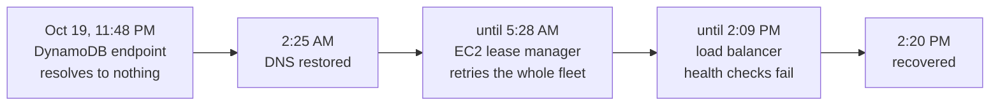
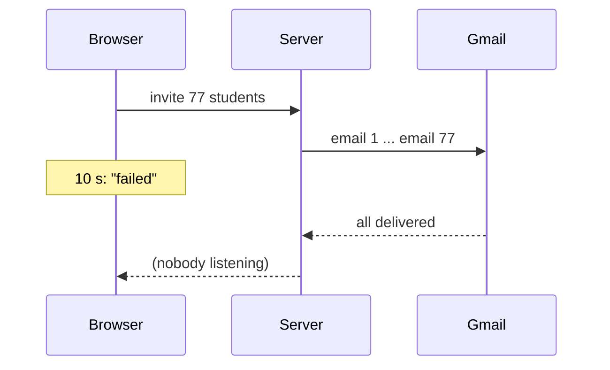

# Reliability

Week 12 · Promises you can measure

## Fourteen hours and thirty-two minutes



::: ask
The defect was fixed at 2:25 AM. Why did the outage last until the afternoon?
:::

::: note
AWS us-east-1, October 2025. Two copies of DynamoDB's DNS automation raced, and the clean-up step deleted the plan still in use, leaving the regional endpoint with no IP addresses. Take answers before the next slide. The lease manager depended on DynamoDB; once DynamoDB came back, every server tried to renew its lease at once, and the leases timed out before they completed. AWS called it congestive collapse.
:::

## Recovery is a behavior

::: key
You design it, or you discover it.
:::

::: steps
- Two and a half hours: the defect.
- Twelve hours: a dependency nobody drew, and a retry every server ran at once.
:::

## Project Pulse promises 99%

::: cols
**The requirement**
Available at least 99% of each term, deadlines prioritized.
|||
**Its own architecture document**
"No alerting rules or SLOs." Production telemetry not collected.
:::

::: ask
If Project Pulse were down every Monday at 9 AM, what would notice?
:::

::: note
Nothing in the system. Students would, then the instructor. A requirement nobody measures is a wish with an identifier.
:::

## Fault, error, failure

| | Project Pulse invitations, before Sept 10 |
|---|---|
| Fault | One bad address throws out of the batch |
| Error | The transaction rolls back rows already emailed |
| Failure | A student is invited, then told they were not |

::: note
Avižienis, Laprie, Randell, and Landwehr, 2004. A fault that never reaches an error is harmless; an error caught before a user sees it is handled. Reliability work puts catches in the chain.
:::

## Availability = MTBF / (MTBF + MTTR)

::: steps
- You cannot make Azure fail less often.
- You can make repair fast.
- Project Pulse's staging slot: a bad release is undone in seconds.
:::

::: joke
Everything fails, all the time. (Werner Vogels, Amazon CTO)
:::

::: note
MTBF is mean time between failures, MTTR mean time to repair. For a team of students, MTTR is the lever. Reliability and availability differ: a system that crashes for one second every minute is highly available and not reliable.
:::

## Indicator, objective, budget

| | AVL-uptime, measurable |
|---|---|
| SLI | Share of one-minute health probes that pass |
| SLO | At least 99% over the term |
| Error budget | 112 days × 24 h × 1% ≈ 27 hours |

::: note
Beyer et al., Site Reliability Engineering, 2016, chapter 4. Deadlines prioritized is a second, stricter objective over the windows that matter, such as Monday mornings before reports are due.
:::

## Twenty-seven hours is one weekend

::: warn
A Friday deploy that breaks until Monday spends two-thirds of the term.
:::

::: key
Budget left: ship risky changes. Budget gone: the next release is a reliability fix.
:::

## A probe that cannot fail measures nothing

::: ai
Project Pulse answers unknown paths with its app page and 200. A probe that checks only the status says "up" for an endpoint that does not exist.
:::

::: note
From Project Pulse's architecture document, Known gaps. Only the content type distinguishes the real health response.
:::

## Every network call needs four decisions

::: steps
- **Timeout:** how long to wait.
- **Retry:** whether to try again.
- **Isolation:** how far one failure spreads.
- **Degradation:** what the user sees instead.
:::

::: ai
The agent writes the happy path. It makes none of these four unless you specify them.
:::

## Timeouts have to agree



::: note
Project Pulse's browser gives every request 10 seconds. The invite route sends one email per student before answering. The admin saw a failure toast for a batch that had gone out in full. And the server side has no SMTP timeout at all: Jakarta Mail's default is infinite.
:::

## Then the admin clicks Send again

::: steps
- Each re-invite minted a fresh token.
- Every link already delivered stopped working.
- The fix: reuse the token. Re-inviting became idempotent.
:::

::: key
Retry only what is safe to repeat. Then space the retries out, with backoff and jitter.
:::

::: note
Commit 40cf96d also gave the invite routes their own 180-second timeout. Backoff and jitter: Brooker, AWS Architecture Blog, 2015. Without them you get the EC2 lease manager from the first slide, a metastable failure (Bronson et al., 2021).
:::

## Isolation: one bad address, one bad section

```java
for (Section section : sections) {
  try {
    for (Student student : section.getStudents()) {
      try { send(student); }
      catch (RuntimeException e) { log(student, e); }
    }
  } catch (RuntimeException e) { log(section, e); }
}
```

::: note
Simplified from WeeklyReminderScheduler. The inner catch exists because one rejected address "used to abort the whole morning at the first bad one." The outer one keeps one unreadable section from skipping every section after it. Nygard calls this a bulkhead. Right for an unattended run; wrong for a payment.
:::

## Degradation is a requirement

::: cols
**Specified**
LLM down: everything else works; the AI features say so, within 15 seconds.
|||
**Not specified**
Whatever the agent happened to write.
:::

::: note
AVL-llm-degradation and PER-ai-response-time in Project Pulse's specification. The AI proxy is specified but not yet built. An LLM can also fail quietly, fast and plausible and wrong: Project Pulse requires structured JSON responses so a malformed one is a detectable failure, and an instructor switch that turns an assistant off without a deploy.
:::

## Blameless postmortems

::: steps
- What happened, and to whom.
- Timeline.
- What about the system let a reasonable person do this.
- Actions that change the system.
:::

::: warn
"Be more careful" is not an action.
:::

::: note
Allspaw, 2012; Beyer et al., chapter 15. Project Pulse's invitation chain is written up as a postmortem in the module, section 4.6. Review of the agent-written first fix caught the timeout and the token defects.
:::

## Checkpoint 3

::: steps
- One requirement turned into an SLO: indicator, window, target, budget, measured.
- One test that makes a dependency fail and checks the specified degradation.
- Shown red against the code with the handling removed, green against yours.
:::
