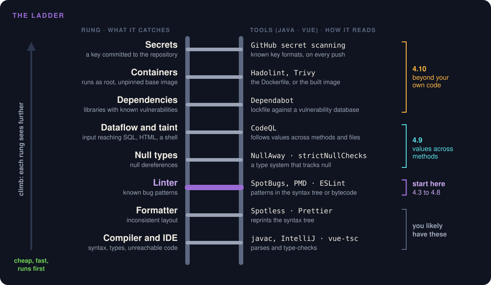
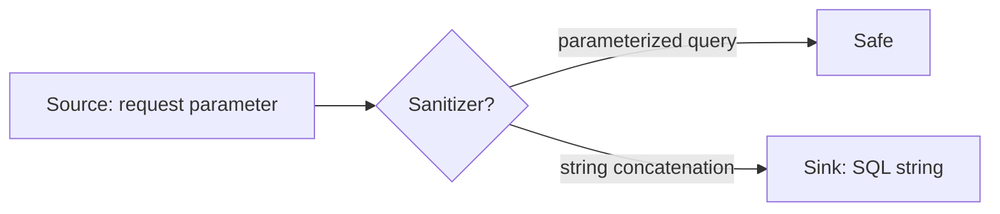

# Static Analysis

Week 11 · Adding analyzers to Project Pulse, a codebase that never had them

::: note
**Say:** Good morning. Two weeks ago we tested code by running it. Today a tool reads the code without running it, every line, every time, the same way. I added these tools to Project Pulse in fall 2026, so everything you see today is real output from my own code as it stood then, warts included. Wednesday we put these checks in a pipeline, and Friday you add them to your own repository.
:::

## One method from Project Pulse

```java
public Result addActivityComment(...) {
    String comment = commentMap.get("comment");
    Activity updatedActivity = this.activityService.addActivityComment(activityId, comment);
    ActivityDto updatedActivityDto = this.activityToActivityDtoConverter.convert(updatedActivity);
    return new Result(true, StatusCode.SUCCESS, "Add comment successfully", null);
}
```

::: ask
It compiled, and it sat on main from 2024 into 2026. What's wrong with it?
:::

::: note
**Say:** Real code from my own project, on main from its first commit in 2024 into fall 2026. Take thirty seconds. *[Wait for "updatedActivityDto is never used".]* Right: it builds a DTO and throws it away, then returns null. Two tools found that in a few seconds, without running a single test. SpotBugs called it a dead store; PMD called it an unused local variable. Keep the question "should it have returned the DTO?" in your pocket; we come back to it.
:::

## You've seen one already

| Where you saw it | The analyzer |
|---|---|
| Gray "variable is never used" | IntelliJ, VS Code |
| Red squiggle in a .js file | ESLint |
| "Object is possibly 'undefined'" | TypeScript |
| GitHub email: vulnerable library | Dependabot, CodeQL |
| "Quality gate failed" at your internship | SonarQube |

::: key
Static analysis: a program that reads your code without running it.
:::

::: note
**Say:** That's static analysis: a program reads your code, never runs it, and points at likely mistakes. You've met them without the name. Who has seen a SonarQube quality gate at an internship? *[Hands.]* The unused variable is the small end. The same idea finds user input flowing into a SQL query, a password pushed to GitHub, a library with a known hole.
:::

## So why doesn't everyone run them?

::: steps
- They add no feature
- An afternoon to set up
- First run: hundreds of warnings, most on code that works
:::

Developers give up on them over the noise. Johnson et al., ICSE 2013

::: note
**Say:** Let me make the case against today's topic, because some of you are already making it. No feature for the client, an afternoon of setup, and a first run that is a wall of warnings. Plenty of developers try them and quit. So why bother?
:::

## goto fail

```c
if ((err = SSLHashSHA1.update(&hashCtx, &signedParams)) != 0)
    goto fail;
    goto fail;
if ((err = SSLHashSHA1.final(&hashCtx, &hashOut)) != 0)
    goto fail;
```

CVE-2014-1266, iOS and macOS, February 2014

::: key
Some mistakes are too boring for people to catch. A tool does not get bored.
:::

::: note
**Say:** Apple, 2014. One line copied twice. The second goto always runs, so the code jumps past the security check, and anyone on your coffee-shop Wi-Fi could pretend to be your bank. In plain sight, in security code, shipped on millions of iPhones and Macs. Your eyes slide right over it. Clang even had a warning for this, unreachable code, but it is not in `-Wall`, so a build with "all" warnings on said nothing.
:::

## Project Pulse shipped type errors

::: steps
- vue-tsc: in Project Pulse since its first commit, October 2024
- Fall 2026: 18 type errors on every deploy
- The deploy ran build-only, which skips the checker
:::

::: key
A tool that does not fail the build is decoration.
:::

::: note
**Say:** Not only Apple. Confession: my frontend had a type checker from its first commit, and in fall 2026 every deploy shipped 18 type errors, because the deploy called the script that skips it. Nothing failed, so nobody looked, including me. The linter and formatter were the same story; the lint script didn't even start.

*[Ask: does your team's repository have a linter installed? Does anything fail when it complains?]*
:::

## AI: more need, less cost

::: cols
**The need went up**

The agent writes faster than you can read, and makes these mistakes too.
|||
**The cost went down**

The tool flags it; the agent fixes it and runs the check again.
:::

::: ai
Veracode, 2025: 100+ AI models, 45% of their code failed security tests.
:::

::: note
**Say:** AI makes this matter more. An agent writes in ten minutes what you'd read in an hour, and in Veracode's test nearly half of what the models wrote failed security checks. The good news: the tedious part of static analysis was always fixing hundreds of small findings, and that's what an agent is good at. It reads the warning, fixes the line, runs the check again, without you.
:::

## Fail fast

::: steps
- Static analysis: seconds, and the program never runs
- Tests: minutes
- A reviewer: an hour
:::

::: key
If a cheap check can reject the change, don't spend the expensive one.
:::

::: note
**Say:** So the tool goes first. Why first? Because it's cheap and fast, and it doesn't need the program running. If a few seconds of analysis can reject a change, there's no reason to spend ten minutes on tests or an hour of a reviewer's time. That's "fail fast." Notice it's an order of cost, not of importance. The most important question, does this do what the client needs, goes last, so a person gets to ask it with nothing boring in the way.
:::

## Three checks, three kinds of problem

| | Asks | Cannot see | The story |
|---|---|---|---|
| **Static analysis** | Does any path break a known rule? | What the code is for | goto fail |
| **Testing** | Does it do what we checked, on the inputs we ran? | Cases nobody wrote | CrowdStrike |
| **Code review** | Is this what the use case asks for? | Line 600 of a tired afternoon | Heartbleed |

::: key
Each one is blind where another looks.
:::

::: note
**Say:** You've now met all three: review in week 8, testing last week, analysis today. They don't compete; each one is blind where another one looks. And each has its story: goto fail today, CrowdStrike's green suite in testing, Heartbleed's approved review. The analyzer checks every path, run or not, but has no idea what the code is for. The reviewer knows what it's for, and gets tired. Put the cheap, tireless slice first, the Swiss cheese from code review, and a person never spends review time on a missing brace.
:::

## Why not just ask your coding agent?

::: cols
**Analyzer**

Same code, same findings, every run.

Every file, in seconds, no tokens.

Blind to intent.
|||
**Model**

Ask twice, get two answers.

Reads what fits in context, paid per run.

Can judge intent.
:::

::: key
One loop: the analyzer finds, the agent fixes, the analyzer checks again.
:::

::: note
**Say:** Ask first: "We have a coding agent, Claude Code or Codex. Why bother with an analyzer?" Let someone make the case; it's half right. A model can find these bugs, and it can judge things no analyzer can. But run SpotBugs a hundred times and you get the same report a hundred times, in seconds, for free, on every file. Ask a model twice and you may get two reviews, and an agent can argue its way past a model reviewer. Nobody argues with an analyzer. So don't pick one. The automated checks a change must pass before it can merge are called the gate; more on it later today. The analyzer belongs in the gate, the agent reads its report and fixes, the analyzer checks again, and you decide only what needs judgment.
:::

## Why every analyzer guesses

::: steps
- Can this line ever run? Undecidable: the halting problem reduces to it
- Rice's theorem: every nontrivial question about what a program does is undecidable
- So an analyzer that always finishes must approximate
:::

::: key
No analyzer is both sound and complete. One that claims to be is claiming to solve the halting problem.
:::

::: note
**Say:** Theory of computation, cashing in. Can this null ever be dereferenced? Can this input ever reach that query? Those are questions about what the program does, and Rice's theorem says every nontrivial one is undecidable. So a tool that finishes in seconds has to guess. Sound means it never misses a real bug; complete means it never cries wolf. You can't have both. Think airport security: a sound scanner flags every bag that might hold a knife, so umbrellas set it off; a complete one flags only bags that certainly do, so a well-hidden knife gets through. Every tool you use today picks a trade-off. SpotBugs, PMD, and ESLint lean toward complete: they would rather miss a bug than cry wolf.
:::

## Two ways to be wrong

::: cols
**False positive**

A warning on code that is fine. Costs trust.

Not complete.
|||
**False negative**

A bug the tool never mentions. A clean report is not proof.

Not sound.

Heartbleed: Coverity missed it too.
:::

::: key
Google's target: under 10% of warnings ignored by developers.
:::

::: note
**Say:** So the guesses go wrong in two directions. Remember Heartbleed from code review? The reviewer missed it, and so did Coverity, one of the best commercial analyzers; they added a heuristic for it weeks later. The holes lined up. The expensive error day to day, though, is the false positive, because it spends trust. Google found developers act on a tool only if most of what it says is worth acting on. Their bar: fewer than one in ten warnings ignored. Every rule you turn on spends some of that trust.
:::

## {.center}

::: joke
An analyzer that flags every line has zero false negatives.
:::

::: note
**Say:** Perfect recall. Nobody reads it. This is the trade-off every tool makes, and the reason "turn on all the rules" is the wrong first move.
:::

## Climb the ladder {.center}



::: note
**Say:** Here's the whole climb on one picture. Bottom rungs are cheap and run first; you probably already have the compiler and maybe a formatter. Today we start on the linter rung, where the findings are. Then we climb: null types and dataflow follow values across methods, and the top three look past your own code, at your libraries, your container, and your secrets. Next slide has the tools for each rung.
:::

## The ladder

| Rung | Catches | Reads | Java | Vue |
|---|---|---|---|---|
| Compiler | types, unreachable code | parse, types | javac | vue-tsc |
| Formatter | layout | syntax tree | Spotless | Prettier |
| Linter | known bug patterns | syntax tree, bytecode | SpotBugs, PMD | ESLint |
| Null types | null dereferences | a type system | NullAway | strictNullChecks |
| Dataflow | input reaching SQL, HTML | values across methods | CodeQL | CodeQL |
| Dependencies | known CVEs | lockfile vs. database | Dependabot | Dependabot |
| Containers | root user, bad images | Dockerfile, image | Hadolint, Trivy | |

::: note
**Say:** Each rung catches a different class of problem and needs its own tool. Cheap rungs at the top run first. SonarQube bundles several rungs in one product and is common in industry; we use separate free tools that run in your own build with no account. Look at the Reads column: each rung is a course you took. Parsing and the syntax tree from compilers, type systems from programming languages, dataflow from compilers again. Today we start on the linter rung, where the findings are, then climb.
:::

## Demo: the first run {.center}

::: cols
**Backend**

`./mvnw compile`

`./mvnw ...spotbugs-maven-plugin:4.10.5.0:spotbugs`

`./mvnw ...maven-pmd-plugin:3.28.0:pmd`
|||
**Frontend**

`npx eslint . --ignore-path ../.gitignore`

`npm run type-check`

`npx prettier --check src/`
:::

::: note
**Demo** (run from the scratch clone at `b9d21b0`, before #104; full commands in the week 11 lecture plan).

**Say:** On a codebase you just joined, look before you change anything. Maven runs any plugin by its coordinates, so I don't touch pom.xml. And on the frontend, no `--fix`: I want to see, not change.

**No time to run it?** Open the saved reports instead: [SpotBugs](../assets/static-analysis/spotbugs.html) (237), [PMD, default rules](../assets/static-analysis/pmd.html) (5), [PMD, quickstart](../assets/static-analysis/pmd-quickstart.html) (130).

*[Show `target/spotbugsXml.xml` count: 237. PMD: only 5. That's the plugin's tiny default ruleset. Defaults decide what you see; #104 switches to PMD's quickstart rules, and those find 130.]*
:::

## Read by rule, not by file

| Rule | What it means | Findings |
|---|---|---|
| EI_EXPOSE_REP2 | a setter keeps a mutable object, not a copy | 117 |
| EI_EXPOSE_REP | a getter hands out a mutable object | 102 |
| NP_NULL_ON_SOME_PATH... | uses a result that may be null | 14 |
| CT_CONSTRUCTOR_THROW | a constructor can throw halfway | 3 |
| DLS_DEAD_LOCAL_STORE | a value stored, never used | 1 |

::: key
The big rules are one decision. The bug is the one line at the bottom.
:::

::: note
**Say:** A report comes in file order, 237 lines, and you'd judge the same warning over and over. But every finding names its rule. Count by rule and it's five lines. The top two are 219 findings about one design: JPA entities and Spring beans share objects on purpose. That's one team decision, not 219 fixes. Now look at the bottom: one dead store. That's the `addActivityComment` bug from the start of class. Read by file, you'd have met it after 200 warnings about getters, if you hadn't given up. That shape is typical: the big rules are decisions, the small ones hide the bugs.
:::

## EI_EXPOSE_REP: sharing a mutable list

```java
public List<Rating> getRatings() {
    return ratings;            // REP: hands out its own list
}

public void setRatings(List<Rating> ratings) {
    this.ratings = ratings;    // REP2: keeps the caller's list
    ...
    calculateTotalScore();
}
```

::: key
The caller adds a rating to the list. The total never changes.
:::

::: note
**Say:** Here's what 219 of those findings mean, on real code: `PeerEvaluation`. The setter keeps the very list you hand it; the getter hands out its own list. Anyone holding that list can change it. And here's why it's not just pedantry: the setter computes the total score once. Add a rating to the list later, or call `getRatings().clear()`, and the ratings change but the total doesn't. The textbook fix is a copy. But Hibernate tracks changes through the entity's own collection, and our code edits entities through getters, so copying everywhere would break things. About 27 of the 219 are just Spring injecting a service into a controller. So: one decision about the rule, not 219 edits. Which decision is your assignment.
:::

## CT_CONSTRUCTOR_THROW: a half-built object

```java
public class Account {
    private final long balance;

    public Account(long balance) {
        if (balance < 0) throw new IllegalArgumentException();
        this.balance = balance;
    }
}
```

::: key
A subclass can rescue the half-built object. `final` closes the hole.
:::

::: note
**Say:** A made-up example, because Project Pulse's three are in your assignment. When the check throws, the object already exists; the constructor just didn't finish. And Java calls `finalize()` before garbage-collecting it, even then. So an attacker subclasses Account, overrides `finalize()` to stash `this` in a static field, and now holds an Account whose check never passed. That only matters for a class untrusted code can extend, like a library's public class. Declare it final and the hole closes. Finalizers are deprecated since Java 18, but they still run in 21. The other two rules you've met: the null one is coming in triage, and the dead store was our opening slide.
:::

## PMD, read the same way

| Rule | What it means | Findings |
|---|---|---|
| UncommentedEmptyConstructor | empty constructor, no comment why | 30 |
| ControlStatementBraces | an if with no braces | 30 |
| UseLocaleWithCaseConversions | toLowerCase() without a Locale | 18 |
| InstantiableUtilityClass | static-only class you can new | 12 |
| UnnecessaryConstructor | a constructor Java writes anyway | 10 |
| 10 more rules | literals first, == on objects, style... | 30 |

::: key
74 of 130 are four project decisions. The bugs are in the small rules.
:::

::: note
**Say:** Same trick on PMD, with the quickstart rules #104 turns on: 130 findings, fifteen rules. The top of the list is style and constructors: whether an empty constructor needs a comment, whether every if needs braces. Those are team decisions, and four of them are Part 1 of your assignment. The bugs hide below: toLowerCase without a Locale, a comparison that throws on null, == on objects, a private method nobody calls. The module walks every one of the fifteen with its line in Project Pulse.
:::

## Braces: goto fail, waiting

```java
if (!this.enabled) return; // Reminders are disabled
```

::: key
Correct today. The next person adds a second line under it.
:::

::: note
**Say:** This is from the reminder scheduler, and it's correct. PMD flags it anyway. Why? Because of the next edit: someone adds a line under the if, indents it, and it runs every single time. That's goto fail, from the start of class. Whether your team wants braces everywhere is a decision you make once.
:::

## toLowerCase and the Turkish i

```java
"%" + providedFirstName.toLowerCase() + "%"
```

::: steps
- In Turkish, uppercase I lowercases to a dotless ı
- A search for "Ivan" becomes "ıvan"; the database says "ivan"
- No match. toLowerCase(Locale.ROOT) fixes it
:::

::: note
**Say:** The student search lowercases what you type with the server's default language. Put that server in Turkey and capital I becomes a dotless i, so "Ivan" never matches. Eighteen of PMD's findings are this. It's the kind of bug nobody finds in testing, because every test machine speaks English.
:::

## Empty constructors: JPA needs them

```java
public Activity() {
}
```

::: steps
- JPA builds every entity through a no-argument constructor
- UncommentedEmptyConstructor: say why it is empty (30)
- UnnecessaryConstructor: Java writes it for you if it is the only one (10)
:::

::: note
**Say:** Here's 40 of PMD's 130. Every JPA entity needs a constructor with no arguments, because Hibernate creates the object first and fills in the fields after. So Activity has this empty one next to its real constructors. One rule wants a comment saying why it's empty. The other fires when the empty one is the only constructor, because Java would have written it for you. Should Project Pulse enforce either? That's one of the four decisions in your assignment, so I'm not answering it.
:::

## Two tools, one worry

```java
.anyMatch(grantedAuthority -> grantedAuthority.getAuthority().equals("ROLE_instructor"));
```

::: cols
**PMD: LiteralsFirstInComparisons**

Write `"ROLE_instructor".equals(...)`: it returns false on null instead of throwing.
|||
**SpotBugs: NP_NULL_ON_SOME_PATH**

`getAuthority()` is marked `@Nullable`, and nothing checks it.
:::

::: key
Same line, two tools, two directions. When they agree, look.
:::

::: note
**Say:** This is UserUtils, the method that works out your course. PMD reads the source and says: put the literal first, so a null just gives you false. SpotBugs reads the bytecode and says: this method may return null and you never check. Two tools that read code completely differently, pointing at the same line. Whether that null can actually happen is the triage question we'll do in a few minutes.
:::

## A private method nobody calls

```java
private <T> void updateCollection(Set<T> oldCollection, Set<T> newCollection) {
    oldCollection.clear();
    ...
}
```

::: steps
- UseCaseService.updateCollection: private, and no caller anywhere
- Dead code? Delete it
- Or a call someone forgot? That is a bug
:::

::: key
The tool sees the method is unused. Only the history says why.
:::

::: note
**Say:** PMD found one private method nobody calls. Two stories fit. Maybe it was used once, the caller changed, and it's dead: delete it. Or someone wrote it for an update and then forgot to call it, and use cases have been saved wrong ever since. The tool can't tell those apart. git log and git blame can. Who wants to be the detective on this one?
:::

## A log message built for nobody

```java
LOGGER.error("Could not send a submission reminder to {} in section {}",
        student.getEmail(), section.getSectionName(), e);
```

::: steps
- The arguments are evaluated before the logger checks its level
- GuardLogStatement wants `if (LOGGER.isErrorEnabled())` around it
- SLF4J's `{}` already skips building the message when the level is off
:::

::: note
**Say:** ReminderService logs a reminder that failed to send. Java evaluates `student.getEmail()` and `section.getSectionName()` before the logger even looks at whether error logging is on. PMD wants a guard. But with SLF4J's curly-brace placeholders, the expensive part, building the string, already only happens when the level is on, so what's left is two getters. Worth a rule? Another one of your four assignment decisions.
:::

## Style, in one slide

| Rule | Before | After |
|---|---|---|
| SimplifyBooleanReturns | `if (x == null) { return false; } return ok(x);` | `return x != null && ok(x);` |
| LambdaCanBeMethodReference | `a -> a.getAuthority()` | `GrantedAuthority::getAuthority` |
| UselessParentheses | `(MyUserPrincipal) (auth.getPrincipal())` | `(MyUserPrincipal) auth.getPrincipal()` |
| UnnecessaryImport | `import ...UserDetails;` (unused) | delete it |
| InstantiableUtilityClass | `new StudentSpecs()` compiles | `private StudentSpecs() {}` |

::: key
All true, all harmless. A team decides once, then a formatter or the agent does the rest.
:::

::: note
**Say:** The rest of PMD's list is style, all from real Project Pulse lines. Every one is technically right and none of them is a bug. Is the "after" always clearer? Not always: the one-line boolean return is shorter, but some people read the if faster. That's the point of style rules: the team picks once, writes it in the configuration, and then nobody argues in code review again. And this is exactly the kind of fix an agent should make for you.
:::

## Two tools, one overlap

::: cols
**SpotBugs reads bytecode: 237**

Null paths, casts, comparisons, mutable objects escaping
|||
**PMD reads source: 130**

Locale bugs, unused code, risky idioms, style
:::

::: key
Found by both: 1 of 367, the dead store.
:::

::: note
**Say:** Why two tools? Isn't that duplication? Look at the numbers: of 367 findings, exactly one came from both, the dead store we'll read in a minute. SpotBugs works on compiled bytecode, so it can follow a value through a method and read Spring's @Nullable annotations; that's how it found the null paths. PMD works on source, so it sees what compilation throws away: braces, a private method nobody calls, `toLowerCase()` without a locale, which breaks search on a server whose default locale is Turkish.

The cost is one more config file and part of a minute of build time. And when two tools that work this differently flag the same line, believe it. If you could keep only one, keep SpotBugs; but the better answer is to keep PMD and turn off the rules that don't fit, which is part of assignment 4.
:::

## Three verdicts

| Verdict | Record it as |
|---|---|
| Real | A fix, and a test if you can show the bug |
| False positive | A suppression at the site, with the reason |
| Not worth it | A suppression, or the rule off, with the reason |

::: warn
A verdict in your head gets made again, by the next person or the agent.
:::

::: note
**Say:** Every finding ends one of three ways, and every verdict is written down where the next reader sees it. If you decide in your head that a warning is fine, the agent will "fix" it tomorrow. Let's triage five real findings from Project Pulse.
:::

## Real, but the fix needs a decision

```java
@PatchMapping("/{activityId}/comments")
public Result addActivityComment(...) {
    String comment = commentMap.get("comment");
    Activity updatedActivity = this.activityService.addActivityComment(activityId, comment);
    ActivityDto updatedActivityDto = this.activityToActivityDtoConverter.convert(updatedActivity);
    return new Result(true, StatusCode.SUCCESS, "Add comment successfully", null);
}
```

::: ask
Delete the line, or return the DTO? Who decides?
:::

::: note
**Say:** Our first slide, back again. The DTO is built and thrown away, and the response carries null. Wasted work for sure. But the fix? The frontend's type for this response says `data: null`. The use case says whether the caller needs the updated activity. The tool found the inconsistency; the specification settles it.

*[Take two answers. Point out that both are defensible and the spec is the tiebreaker.]*
:::

## True by contract, false in context

```java
Authentication authentication = SecurityContextHolder.getContext().getAuthentication();
boolean hasInstructorRole = authentication.getAuthorities().stream() ...
```

Spring Security 7: `@Nullable Authentication getAuthentication();`

::: ask
Behind the security filter chain it's never null. Is every caller behind it?
:::

::: note
**Say:** Twelve of these. Spring Boot 4 annotates `getAuthentication()` as nullable, and SpotBugs reads the annotation. Inside an authenticated request it's never null. But a scheduled job or a test calling the same method has no authentication. The honest suppression names the assumption: "only called on authenticated routes". That's a sentence a reviewer can check.
:::

## Deliberate, and the rule can't know

```java
public void transferTeam(Team team, Section from, Section to) {
    if (team.getSection() != from) {
        throw new IllegalStateException("Team is not in the expected old section.");
    }
```

::: warn
"Fix" this to .equals() and you change what it means.
:::

::: note
**Say:** PMD says: use equals, not ==. Usually right. But these are JPA entities from one persistence context, which guarantees one Java object per row, so identity is exactly the intended check. Suppress it with that reason, or the next agent will helpfully change the meaning to quiet a warning.
:::

## Same rule, different verdict

```ts
try {
  const result = await searchRequirementArtifacts(...)
  glossaryTerms.value = result.data.content
} catch {
}
```

The Axios interceptor already showed the error.

::: note
**Say:** ESLint: empty block. In Java an empty catch usually hides a failure. Here, the shared request interceptor has already shown the user a toast. The page has nothing left to do. A one-line comment inside the block, "error already shown by the request interceptor", satisfies the rule and tells the reader why. Same rule, opposite verdict, because of context the tool can't see.
:::

## Fix the configuration, not the code

::: steps
- 117 of ESLint's 130 problems: no-undef on cy, it, describe
- The Cypress tests are fine; the linter was never told they are Cypress
- One override in the ESLint configuration: 130 problems become 13
:::

::: note
**Say:** When one rule floods a report, ask first whether the tool is configured for this codebase. I tried it: one override, and 117 problems vanish without touching a test.
:::

## True, but not worth it

::: steps
- PMD's LocalVariableCouldBeFinal: right about every local it flags
- Adding final everywhere changes no behavior if nobody reassigns locals
- PMD's own quickstart ruleset ships it commented out
:::

::: key
"Not worth it" needs a reason about this codebase, or it is a false positive nobody checked.
:::

::: note
**Say:** The third verdict. The tool is right, and the fix still isn't worth it here. The reason has to say what makes the risk small in this codebase, not "too noisy." And when the verdict fits every finding of a rule, it's one decision for the whole project, in the configuration. Your assignment opens with four of those, so I'm not answering them today.
:::

## Suppress with a reason

```java
@SuppressFBWarnings(value = "NP_NULL_ON_SOME_PATH_FROM_RETURN_VALUE",
    justification = "Only called on authenticated routes")
```

```ts
// eslint-disable-next-line no-empty -- error already shown by the interceptor
```

::: key
A suppression without a reason is a bug report you deleted.
:::

::: note
**Say:** Each tool has a site-level suppression; PMD's is `// NOPMD - reason`. Review suppressions like code. "False positive" is not a reason. "Both entities come from one persistence context" is a reason, because someone can check it.
:::

## Make it a gate: where the checks run

| Where | What | Why |
|---|---|---|
| Editor | IntelliJ, SonarQube for IDE, ESLint | Seconds |
| Pull request | mvn verify, ESLint, Hadolint, CodeQL | The gate |
| Schedule | Dependabot, CodeQL on main | New CVEs, old code |

::: key
Shift left: the earlier the check, the cheaper the fix.
:::

::: note
**Say:** Editor is fastest. A pre-commit hook is optional and skippable, so never your only gate. The pull request is the gate: nothing merges red. And the gate is a productivity tool: it lets you read an agent's 800-line pull request for intent, not for null checks. And some things change while your code doesn't: a vulnerability published tomorrow in a library you use today. That's what scheduled scans are for. A verdict means nothing unless the build enforces it. Wednesday we wire all this into the pipeline.
:::

## Check in CI, fix on your machine

::: steps
- Locally: eslint --fix, prettier --write
- In CI: eslint, prettier --check, npm run type-check
- Deploy with the checks too: build, never build-only
:::

::: key
A CI job that fixes the code changes what it was asked to check.
:::

::: note
**Say:** Fixing variants on your laptop, checking variants in the gate. And the deploy has to run the same checks: Project Pulse deployed with build-only, which skips the type checker, and that's how 18 type errors reached production. Keep the gate fast and the rules few; a ten-minute check gets skipped. And watch it fail once before you trust it.
:::

## Red has to block

::: steps
- A failing check stops a merge only if main requires it
- GitHub: a ruleset (or branch protection) lists the required status checks
- Without it, the merge button stays enabled
:::

::: key
A red check nobody is required to fix is advice.
:::

::: note
**Say:** "Nothing merges red" isn't automatic. GitHub shows the red X and still lets you click merge, unless main has a ruleset that marks the check as required. Friday, make yours required. Wednesday we set it up.
:::

## {.center}

::: joke
"My code has zero warnings." "How?" "I turned them off."
:::

::: note
**Say:** We've all met this repository. The joke is the baseline problem in one line: you can always get to zero by hiding things. Next slide is how to get to zero honestly.
:::

## Baseline, then ratchet

::: steps
- Record what exists today as a baseline, untriaged
- Fail the build only on findings outside it
- Fix or suppress an old one, delete its entry
- Never add to the baseline. It only shrinks
:::

::: note
**Say:** You can't fix 367 findings before turning the checks on, and every day you wait adds more. So: baseline everything that exists, gate everything new. New code meets the bar from day one, and old code isn't blocked. The baseline only ever gets smaller. That's the ratchet. Most teams you join will already have one.
:::

## Project Pulse #104

::: cols
**backend/pom.xml**

SpotBugs and PMD `check` in `mvn verify`
|||
**backend/config/**

`spotbugs-baseline.xml`: 237 matches

`pmd-baseline.properties`: 130 findings, 68 classes
:::

Frontend checks: report only, for now. Actions pinned to commit SHAs.

::: note
**Say:** This is the pull request that added them, #104. Two plugins in the pom, two baseline files, a workflow that runs verify on every pull request. The frontend checks run but don't block yet, because none of them passes; each becomes blocking once its findings are fixed or baselined. Warn first, then block, and don't stay at warn.
:::

## Demo: watch the gate fail {.center}

```java
public boolean isAdmin(String role) {
    return role == "admin";
}
```

::: note
**Demo:** on the #104 branch, `./mvnw verify -DskipTests` passes. Add this method to `UserUtils`, run again: build fails with `ES_COMPARING_PARAMETER_STRING_WITH_EQ`, priority High. Revert.

**Say:** A gate you've never seen fail is a gate you're only hoping works. Always plant one bug.

*[Ask first: will it fail? Which tool catches it?]*
:::

## Know your baseline's grain

::: cols
**SpotBugs**

Class, method, rule. A new finding in another method fails.
|||
**PMD**

Class and rule. A new empty catch in a class that had one passes.
:::

::: warn
Upgrading PMD renamed a rule: 12 baselined findings came back as new.
:::

::: note
**Say:** Two lessons from my own pull request. Coarse baselines leak: PMD's only names the class and the rule. And when I upgraded PMD to the current release, the findings were identical, but one rule had been renamed, so 12 old findings failed the build as if new. Upgrade an analyzer in its own pull request and compare counts.
:::

## Upgrade, and format once

::: steps
- ESLint 8: end of life October 2024. An outdated analyzer is a finding too
- Upgrade an analyzer in its own pull request; compare counts by rule
- Format the whole codebase in one commit, alone, early
- List that commit in .git-blame-ignore-revs, then gate prettier --check
:::

::: note
**Say:** Analyzers age like any dependency. Project Pulse still ran ESLint 8 in fall 2026, two years past end of life. Upgrade it on its own pull request, because, as you just saw with PMD, an upgrade can change what the baseline means. Formatting is a decision made once: one big commit, listed in .git-blame-ignore-revs so blame skips it, and from then on the formatter is part of the gate.
:::

## Your project: gate first

::: steps
- Turn the gate on before the first feature
- Triage the handful of findings a skeleton has
- From then on, every finding is new, and fails
:::

::: key
On new code, the best baseline is the one you never need.
:::

::: note
**Say:** Project Pulse had 367 findings before it had a gate, so it needed a baseline. Your repository is weeks old. Turn the gate on now, triage the few findings you have, and you never carry a baseline at all. In the method this belongs with the proving slice, the first code your agent writes. The team that waits until the tenth feature ends up doing what I just did on Project Pulse.
:::

## Write it down where it lives

| What you decided | Where |
|---|---|
| Tools, gate command, how findings are settled | Architecture-of-record, section 8.2 |
| The rule the agent obeys | Your charter, one line citing 8.2 |
| A rule turned off, and why | The tool's config, as a comment |
| A baseline | Section 11, as debt |

::: warn
Not the specification, and not a key decision.
:::

::: note
**Say:** No new document. Setting up analyzers is a convention every component follows, so it goes where your other conventions live: section 8.2. The charter carries the one-liner, because the charter is what your agent always reads. A rule you turn off goes in the tool's configuration, next to the exclusion, because that's where the tool enforces it. Why not the specification? The spec says what the product does for your client, and your client did not ask for SpotBugs. Why not a key decision? You can swap an analyzer in an afternoon. Project Pulse's entry is in its architecture-of-record now, pull request 107.
:::

## A convention no tool ships

```java
@ExceptionHandler(Exception.class)
@ResponseStatus(HttpStatus.INTERNAL_SERVER_ERROR)
Result handleOtherException(Exception ex) {
    return new Result(false, StatusCode.INTERNAL_SERVER_ERROR,
        "A server internal error occurs.", ex.getMessage());
}
```

::: ask
Every unexpected exception ends here. What's missing?
:::

::: note
**Say:** Every rule so far was written by strangers: the SpotBugs and PMD authors. They know Java's common mistakes; they don't know your conventions. Project Pulse's last-resort handler turns any unexpected exception into a 500, and logs nothing. *[Wait for "no log".]* Right: at 2 a.m. there's no stack trace anywhere. Nothing here is wrong as Java. It's wrong as Project Pulse. And code review's checklist asks about it on every error path, so reviewers keep writing the same comment.
:::

## The rule: a query over the syntax tree

```xpath
//MethodDeclaration
  [ModifierList/Annotation[@SimpleName = 'ExceptionHandler']]
  [ModifierList/Annotation[@SimpleName = 'ResponseStatus']
     //FieldAccess[@Name = 'INTERNAL_SERVER_ERROR']]
  [not(.//MethodCall[@MethodName = ('error', 'warn')]
                    [*[1][matches(@Name, '^(log|logger|LOG|LOGGER)$')]])]
```

PMD custom rule, in backend/config/pmd-ruleset.xml

::: note
**Say:** PMD parses every file into an abstract syntax tree, the tree you built in compilers. A custom rule is an XPath query over that tree; every node it returns is a finding. Read it aloud: a method that handles an exception, answers 500, and never calls error or warn on a logger. It goes in the team's ruleset, so mvn verify runs it with everything else. On Project Pulse it finds exactly one method.
:::

## Demo: the rule, both ways {.center}

`./mvnw verify -DskipTests`: fails on handleOtherException

Add a logger and `LOGGER.error("Unhandled exception", ex);`: passes

::: key
A rule is code. Test it with one example it must flag and one it must pass.
:::

::: note
**Say:** *[Run state 4 from the plan.]* Red, one finding, the handler. Now I add the log line. Green. Without the passing example I can't tell a rule that works from one that matches everything; without the failing one, from one that matches nothing. Keep both as the rule's test.
:::

## {.center}

::: joke
A reviewer who writes the same comment three times is a linter with feelings.
:::

::: note
**Say:** Third time you type "this swallows the exception", stop typing it. Write the rule.
:::

## Your own rules need triage too

::: steps
- First draft: "every catch that does not rethrow must log"
- It flagged 1 of Project Pulse's 11 catch blocks: PathVariables.readId
- That catch returns null on purpose: unresolvable means access denied
:::

::: key
Narrow the rule, or suppress that site with its reason.
:::

::: note
**Say:** My first draft was broader, and it fired on a catch that is correct by design. Same three verdicts as any shipped rule. Your own rules are approximations too; Rice's theorem doesn't exempt you.
:::

## Same idea, other tools

| Tool | The rule is | Good for |
|---|---|---|
| PMD | XPath over the Java syntax tree | Conventions, in your build |
| Semgrep | A pattern that looks like the code | Many languages |
| ArchUnit | A JUnit test over packages | "No controller calls a repository" |
| ESLint | An AST selector in the config | Frontend conventions |

::: note
**Say:** Semgrep is the friendliest: the rule looks like the code, with placeholders. ArchUnit writes architecture rules as ordinary tests. ESLint's no-restricted-syntax takes a selector over the tree, no plugin needed. Same idea everywhere: a convention, written as a query, run on every pull request.
:::

## The agent drafts, you specify

::: cols
**The agent**

Drafts the XPath or Semgrep rule in a minute.
|||
**You**

Choose the convention. Write the two examples.
:::

::: ai
Writing a rule used to cost more than repeating the comment. Now it doesn't.
:::

::: note
**Say:** This is where agents change the economics. Teams used to repeat the review comment because writing a rule took an afternoon. An agent drafts it in a minute. The two examples are the rule's specification, so they're yours, and so is the choice of which convention deserves a rule. Then the rule holds the agent's next thousand lines to it, without anyone repeating the comment. Pattern rules see one method at a time, though. Some bugs travel.
:::

## Null safety: JSpecify and NullAway

::: steps
- @NullMarked on a package: everything is non-null by default
- @Nullable marks where null is legal
- NullAway checks it at compile time, and fails the build
- Spring Boot 4 is already annotated this way
:::

::: note
**Say:** The null pointer exception is among the most common Java crashes, and a type checker can prevent most of them. This is the approach the Spring team chose for Spring Framework 7 and Boot 4. JSpecify annotations say where null is legal, NullAway, a compiler plugin from Uber, enforces them. You've already seen it pay off: SpotBugs flagged getAuthentication because Spring annotated it.
:::

## Demo: NullAway on one package

```java
public Integer getUserId() {
    Authentication auth = SecurityContextHolder.getContext().getAuthentication();
    if (auth == null || !auth.isAuthenticated()) return null;
    ...
    return null;
}
```

NullAway: 14 errors in team.projectpulse.system

::: note
**Demo:** on the `demo/nullaway` branch (scratch clone; the patch is listed in the lecture plan), `./mvnw clean compile`. Show the 14 errors; open `UserUtils.getUserId`.

**Say:** Declared to return Integer. Returns null on four paths, and nothing in the signature says so. Its callers trust it: `canAccessActivity` hands it straight to `findById`, which throws on null, and the package documentation promises "a denial, never an exception". Does any real request get there? That's a question for a test. NullAway's contribution is that the question can't hide anymore. Mark it `@Nullable` and the compiler walks you to every caller.

Adopt it one package at a time. Error Prone needs a recent JDK; my early JDK 21 build needed older versions of the tools.
:::

## {.center}

::: joke
Tony Hoare called null "my billion-dollar mistake." NullAway is the refund desk.
:::

::: note
**Say:** Hoare invented the null reference in 1965 and apologized for it in 2009. Annotations plus a checker are how we stop paying the interest.
:::

## Dataflow: source, sanitizer, sink



CodeQL default setup: free on public repositories, Java needs no build.

::: note
**Say:** CodeQL turns your code into a database and queries it in QL, a Datalog-style language: databases, applied to programs. The query is a dataflow analysis, from compilers. CodeQL follows untrusted data. From a source, like a request parameter, to a sink, like a SQL string, and asks whether it passed a sanitizer. Project Pulse's search code goes through the JPA Criteria API, and Hibernate binds the text as a parameter, so no SQL string is built from input. That's the sanitizer CodeQL looks for. Turning it on is a checkbox in Settings, Code security.
:::

## CodeQL's one finding

```java
.csrf(csrf -> csrf.disable())
```

java/spring-disabled-csrf-protection · High · SecurityConfiguration

::: ask
Is Project Pulse open to cross-site request forgery?
:::

::: note
**Say:** I turned CodeQL on in fall 2026. One alert, rated high, and the same triage as this morning: we disabled CSRF protection. CSRF works by tricking your browser into sending a request with credentials the browser attaches by itself, usually a session cookie.

*[Take answers. Then:]* Project Pulse has no cookie to borrow. The token travels in an Authorization header that our own code sets, and the server keeps no session at all: it's stateless. So this is the standard setup for a token API, and the alert is a false positive in context. Same lesson as getAuthentication: the tool is right about the code and wrong about the system.

*[Dismiss it live, as "false positive", typing the reason.]* And the reason is a condition to recheck: the day someone moves the token into a cookie, this alert becomes true.
:::

## Most of your code is other people's

::: steps
- Project Pulse declares 26 dependencies; Maven resolves 263
- Log4Shell, December 2021: the bug was in a library, not in anyone's own code
- Dependabot: alerts on known CVEs, opens the update pull requests
:::

::: note
**Say:** 26 in the pom, 263 on the classpath. When Log4Shell hit, almost every Java application was vulnerable through a logging library nobody had chosen directly. Dependabot reads your pom and lockfile and tells you. Project Pulse holds off for now: its frontend job doesn't build the app yet, so a broken update would still show green. Turn it on when CI can catch the break.
:::

## A clean report can miss the point

```dockerfile
FROM eclipse-temurin:21-jre
WORKDIR /application
COPY --from=builder /builder/extracted/application/ ./
ENTRYPOINT ["java", "-jar", "application.jar"]
```

Hadolint: no findings. The app ran as root (fall 2026).

::: note
**Say:** Hadolint checks the instructions you wrote. A missing USER line isn't an instruction, so it's invisible. An image scanner like Trivy checks the built image, user included. Every tool has a blind spot; know which rung covers what.
:::

## Your scanner is in your supply chain

::: warn
March 2026: 75 of 76 trivy-action tags moved to code that stole pipeline secrets.
:::

Nobody's workflow file changed. About twelve hours.

::: note
**Say:** Trivy is one of the most popular security scanners, and this is its official GitHub Action. Attackers had credentials from an earlier breach of the project. They didn't touch anyone's workflow. They moved the version tags to their own code, so every pipeline that said "use Trivy, version such-and-such" ran the attackers' code on its next run, inside the CI job, with the job's secrets: deploy keys, cloud credentials. The step teams added to be more secure was the way in.

*[Ask: which pipelines were safe?]* The ones that didn't name a tag. Next slide.
:::

## A tag is a promise, a SHA is a fact

::: cols
**Tag: the owner can move it**

`uses: actions/checkout@v4`
|||
**SHA: nobody can**

`uses: actions/checkout@11d5960a... # v4.4.0`
:::

Dependabot proposes the next SHA; a person reviews it.

::: joke
The best way into a secure pipeline is through its security scanner.
:::

::: note
**Say:** A tag is a label pointing at a commit, and whoever controls the repository can move it. A SHA is a fingerprint of the exact code; change a byte and it's a different SHA. So pin the SHA, keep the version in a comment for humans, and let Dependabot open the pull request when there's a new version. #104 does this for every Action. On Project Pulse it matters: the deploy workflow holds the Azure publish profile.

Two limits, if there's time: a SHA pinned during the attack pins the attack, so read action updates, never auto-merge them; and an action can fetch other code by tag inside itself.
:::

## The agent and the analyzer

::: cols
**Delegate**

Explain a rule. Fix the obvious ones. Group the report. Write the test for a real one. Draft a custom rule.
|||
**Keep**

Every suppression, every rule turned off, every baseline entry kept. Which conventions get a rule.
:::

::: ai
Charter: run ./mvnw verify; baselines only shrink; no suppression without a reason in the pull request.
:::

::: note
**Say:** Agents are good at the mechanical fixes and at explaining rules. They are also very good at making warnings go away: a suppression, a baseline entry, a changed comparison. Each of those is a claim about the codebase that a human has to be able to defend. Project Pulse's CLAUDE.md now says exactly this. Put the same lines in yours.
:::

## Your week

::: steps
- Wednesday: CI/CD, these checks in the pipeline
- Friday studio: first run on your repository, gate, plant one bug, write it in 8.2; optional: one rule of your own
- Assignment 4, Triage the analyzers: released Wednesday, due date on the schedule
:::

::: key
Fix it, suppress it with a reason, or turn the rule off with a reason. Never just hide it.
:::

::: note
**Say:** Friday you do on your own repository what we did on Project Pulse today, gate first, and write it down in section 8.2 and your charter. Assignment 4 starts from Project Pulse with #104's baselines: take a slice, triage each finding, fix the real ones with a test, suppress the rest with reasons, and shrink the baseline. The triage is the assignment, not the tool setup. The page goes up Wednesday.
:::
