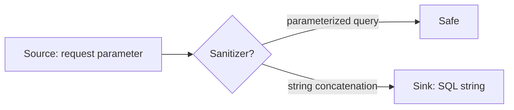

# Static Analysis

Week 11 · Adding analyzers to Project Pulse, a codebase that never had them

::: note
**Say:** Good morning. Two weeks ago we tested code by running it. Today a tool reads the code without running it, every line, every time, the same way. I added these tools to Project Pulse this weekend, so everything you see today is real output from my own code, warts included. Wednesday we put these checks in a pipeline, and Friday you add them to your own repository.
:::

## Installed is not running

::: steps
- ESLint, Prettier, vue-tsc: in Project Pulse since its first commit, October 2024
- ESLint: 130 problems. vue-tsc: 18 type errors. Prettier: 75 files
- npm run lint did not even start
:::

::: key
A tool that does not fail the build is decoration.
:::

::: note
**Say:** Confession first. The frontend has had a linter, a formatter, and a type checker for two years. None of them passes. The lint script points at a file that does not exist, so it crashed on start, and nobody noticed for two years, including me. Why? Because nothing ran them. No pipeline step, no gate. The backend was simpler: no analyzer at all.

*[Ask: does your team's repository have a linter installed? Does anything fail when it complains?]*
:::

## goto fail

```c
if ((err = SSLHashSHA1.update(&hashCtx, &signedParams)) != 0)
    goto fail;
    goto fail;
if ((err = SSLHashSHA1.final(&hashCtx, &hashOut)) != 0)
    goto fail;
```

CVE-2014-1266, iOS and macOS, February 2014

::: note
**Say:** Apple, 2014. One line copied twice. The second goto always runs, so the function jumps past the signature check, and anyone on your coffee-shop Wi-Fi could impersonate your bank. The lines after the second goto can never run. That is exactly what an unreachable-code warning reports. The compiler had the warning. The build did not turn it on.
:::

## Agents write the same bugs, faster

::: ai
Copilot completed 89 security scenarios: 1,689 programs, about 40% vulnerable.
:::

Pearce et al., IEEE S&P 2022. Found with CodeQL.

::: note
**Say:** This study checked Copilot's code with CodeQL, the same tool you will turn on this week. An agent writes your feature in ten minutes, and it writes the null dereference and the unescaped query in the same ten minutes, then tells you it's done. The analyzer is the reviewer that reads all of it.
:::

## Two ways to be wrong

::: cols
**False positive**

A warning on code that is fine. Costs trust.
|||
**False negative**

A bug the tool never mentions. A clean report is not proof.
:::

::: key
Google's target: under 10% of warnings ignored by developers.
:::

::: note
**Say:** The tool reasons about every path without running any, so it approximates, and approximations err both ways. The expensive error is the false positive, because it spends trust. Google found developers act on a tool only if most of what it says is worth acting on. Their bar: fewer than one in ten warnings ignored. Every rule you turn on spends some of that trust.
:::

## {.center}

::: joke
An analyzer that flags every line has zero false negatives.
:::

::: note
**Say:** Perfect recall. Nobody reads it. This is the trade-off every tool makes, and the reason "turn on all the rules" is the wrong first move.
:::

## The ladder

| Rung | Catches | Java | Vue |
|---|---|---|---|
| Compiler | types, unreachable code | javac | vue-tsc |
| Formatter | layout | Spotless | Prettier |
| Linter | known bug patterns | SpotBugs, PMD | ESLint |
| Null types | null dereferences | NullAway | strictNullChecks |
| Dataflow | input reaching SQL, HTML | CodeQL | CodeQL |
| Dependencies | known CVEs | Dependabot | Dependabot |
| Containers | root user, bad images | Hadolint, Trivy | |

::: note
**Say:** Each rung catches a different class of problem and needs its own tool. Cheap rungs at the top run first. SonarQube bundles several rungs in one product and is common in industry; we use separate free tools that run in your own build with no account. Today we climb this ladder on Project Pulse.
:::

## Demo: the first run {.center}

::: cols
**Backend**

`./mvnw compile`

`./mvnw ...spotbugs-maven-plugin:4.10.5.0:spotbugs`

`./mvnw ...maven-pmd-plugin:3.28.0:pmd`
|||
**Frontend**

`npx eslint . --ignore-path ../.gitignore`

`npm run type-check`

`npx prettier --check src/`
:::

::: note
**Demo** (run from the scratch clone at `b9d21b0`, before #104; full commands in the week 11 lecture plan).

**Say:** On a codebase you just joined, look before you change anything. Maven runs any plugin by its coordinates, so I don't touch pom.xml. And on the frontend, no `--fix`: I want to see, not change.

*[Show `target/spotbugsXml.xml` count: 237. PMD: 130 with the quickstart rules.]*
:::

## Read by rule, not by file

| Rule | Findings |
|---|---|
| EI_EXPOSE_REP, EI_EXPOSE_REP2 | 219 |
| NP_NULL_ON_SOME_PATH_FROM_RETURN_VALUE | 14 |
| CT_CONSTRUCTOR_THROW | 3 |
| DLS_DEAD_LOCAL_STORE | 1 |

::: key
92% is one rule family. The bug is the one line at the bottom.
:::

::: note
**Say:** 237 findings is a wall. Grouped by rule it's four lines. 219 say "this getter returns a mutable object". In JPA entities and Spring beans that's by design, so that's probably one decision for the whole rule, not 219 fixes. The single dead store at the bottom is the one to read first. That shape is typical of a first run.
:::

## Three verdicts

| Verdict | Record it as |
|---|---|
| Real | A fix, and a test if you can show the bug |
| False positive | A suppression at the site, with the reason |
| Not worth it | A suppression, or the rule off, with the reason |

::: warn
A verdict in your head gets made again, by the next person or the agent.
:::

::: note
**Say:** Every finding ends one of three ways, and every verdict is written down where the next reader sees it. If you decide in your head that a warning is fine, the agent will "fix" it tomorrow. Let's triage five real findings from Project Pulse.
:::

## Real, but the fix needs a decision

```java
@PatchMapping("/{activityId}/comments")
public Result addActivityComment(...) {
    String comment = commentMap.get("comment");
    Activity updatedActivity = this.activityService.addActivityComment(activityId, comment);
    ActivityDto updatedActivityDto = this.activityToActivityDtoConverter.convert(updatedActivity);
    return new Result(true, StatusCode.SUCCESS, "Add comment successfully", null);
}
```

::: ask
Delete the line, or return the DTO? Who decides?
:::

::: note
**Say:** SpotBugs and PMD both flag this: a DTO is built and thrown away, and the response carries null. Wasted work for sure. But the fix? The frontend's type for this response says `data: null`. The use case says whether the caller needs the updated activity. The tool found the inconsistency; the specification settles it.

*[Take two answers. Point out that both are defensible and the spec is the tiebreaker.]*
:::

## True by contract, false in context

```java
Authentication authentication = SecurityContextHolder.getContext().getAuthentication();
boolean hasInstructorRole = authentication.getAuthorities().stream() ...
```

Spring Security 7: `@Nullable Authentication getAuthentication();`

::: ask
Behind the security filter chain it's never null. Is every caller behind it?
:::

::: note
**Say:** Twelve of these. Spring Boot 4 annotates `getAuthentication()` as nullable, and SpotBugs reads the annotation. Inside an authenticated request it's never null. But a scheduled job or a test calling the same method has no authentication. The honest suppression names the assumption: "only called on authenticated routes". That's a sentence a reviewer can check.
:::

## Deliberate, and the rule can't know

```java
public void transferTeam(Team team, Section from, Section to) {
    if (team.getSection() != from) {
        throw new IllegalStateException("Team is not in the expected old section.");
    }
```

::: warn
"Fix" this to .equals() and you change what it means.
:::

::: note
**Say:** PMD says: use equals, not ==. Usually right. But these are JPA entities from one persistence context, which guarantees one Java object per row, so identity is exactly the intended check. Suppress it with that reason, or the next agent will helpfully change the meaning to quiet a warning.
:::

## Same rule, different verdict

```ts
try {
  const result = await searchRequirementArtifacts(...)
  glossaryTerms.value = result.data.content
} catch {
}
```

The Axios interceptor already showed the error.

::: note
**Say:** ESLint: empty block. In Java an empty catch usually hides a failure. Here, the shared request interceptor has already shown the user a toast. The page has nothing left to do. A one-line comment inside the block, "error already shown by the request interceptor", satisfies the rule and tells the reader why. Same rule, opposite verdict, because of context the tool can't see.
:::

## Fix the configuration, not the code

::: steps
- 117 of ESLint's 130 problems: no-undef on cy, it, describe
- The Cypress tests are fine; the linter was never told they are Cypress
- One override in the ESLint configuration: 130 problems become 13
:::

::: note
**Say:** When one rule floods a report, ask first whether the tool is configured for this codebase. I tried it: one override, and 117 problems vanish without touching a test.
:::

## Suppress with a reason

```java
@SuppressFBWarnings(value = "NP_NULL_ON_SOME_PATH_FROM_RETURN_VALUE",
    justification = "Only called on authenticated routes")
```

```ts
// eslint-disable-next-line no-empty -- error already shown by the interceptor
```

::: key
A suppression without a reason is a bug report you deleted.
:::

::: note
**Say:** Each tool has a site-level suppression; PMD's is `// NOPMD - reason`. Review suppressions like code. "False positive" is not a reason. "Both entities come from one persistence context" is a reason, because someone can check it.
:::

## {.center}

::: joke
"My code has zero warnings." "How?" "I turned them off."
:::

::: note
**Say:** We've all met this repository. The joke is the baseline problem in one line: you can always get to zero by hiding things. Next slide is how to get to zero honestly.
:::

## Baseline, then ratchet

::: steps
- Record what exists today as a baseline, untriaged
- Fail the build only on findings outside it
- Fix or suppress an old one, delete its entry
- Never add to the baseline. It only shrinks
:::

::: note
**Say:** You can't fix 367 findings before turning the checks on, and every day you wait adds more. So: baseline everything that exists, gate everything new. New code meets the bar from day one, and old code isn't blocked. The baseline only ever gets smaller. That's the ratchet. Most teams you join will already have one.
:::

## Project Pulse #104

::: cols
**backend/pom.xml**

SpotBugs and PMD `check` in `mvn verify`
|||
**backend/config/**

`spotbugs-baseline.xml`: 237 matches

`pmd-baseline.properties`: 130 findings, 68 classes
:::

Frontend checks: report only, for now. Actions pinned to commit SHAs.

::: note
**Say:** This is the pull request I opened this weekend. Two plugins in the pom, two baseline files, a workflow that runs verify on every pull request. The frontend checks run but don't block yet, because none of them passes; each becomes blocking once its findings are fixed or baselined. Warn first, then block, and don't stay at warn.
:::

## Demo: watch the gate fail {.center}

```java
public boolean isAdmin(String role) {
    return role == "admin";
}
```

::: note
**Demo:** on the #104 branch, `./mvnw verify -DskipTests` passes. Add this method to `UserUtils`, run again: build fails with `ES_COMPARING_PARAMETER_STRING_WITH_EQ`, priority High. Revert.

**Say:** A gate you've never seen fail is a gate you're only hoping works. Always plant one bug.

*[Ask first: will it fail? Which tool catches it?]*
:::

## Know your baseline's grain

::: cols
**SpotBugs**

Class, method, rule. A new finding in another method fails.
|||
**PMD**

Class and rule. A new empty catch in a class that had one passes.
:::

::: warn
Upgrading PMD renamed a rule: 12 baselined findings came back as new.
:::

::: note
**Say:** Two lessons from my own pull request. Coarse baselines leak: PMD's only names the class and the rule. And when I upgraded PMD to the current release, the findings were identical, but one rule had been renamed, so 12 old findings failed the build as if new. Upgrade an analyzer in its own pull request and compare counts.
:::

## Where the checks run

| Where | What | Why |
|---|---|---|
| Editor | IntelliJ, SonarQube for IDE, ESLint | Seconds |
| Pull request | mvn verify, ESLint, Hadolint, CodeQL | The gate |
| Schedule | Dependabot, CodeQL on main | New CVEs, old code |

::: key
Shift left: the earlier the check, the cheaper the fix.
:::

::: note
**Say:** Editor is fastest. A pre-commit hook is optional and skippable, so never your only gate. The pull request is the gate: nothing merges red. And some things change while your code doesn't: a vulnerability published tomorrow in a library you use today. That's what scheduled scans are for. Wednesday we wire all this into the pipeline.
:::

## Null safety: JSpecify and NullAway

::: steps
- @NullMarked on a package: everything is non-null by default
- @Nullable marks where null is legal
- NullAway checks it at compile time, and fails the build
- Spring Boot 4 is already annotated this way
:::

::: note
**Say:** The null pointer exception is among the most common Java crashes, and a type checker can prevent most of them. This is the approach the Spring team chose for Spring Framework 7 and Boot 4. JSpecify annotations say where null is legal, NullAway, a compiler plugin from Uber, enforces them. You've already seen it pay off: SpotBugs flagged getAuthentication because Spring annotated it.
:::

## Demo: NullAway on one package

```java
public Integer getUserId() {
    Authentication auth = SecurityContextHolder.getContext().getAuthentication();
    if (auth == null || !auth.isAuthenticated()) return null;
    ...
    return null;
}
```

NullAway: 14 errors in team.projectpulse.system

::: note
**Demo:** on the `demo/nullaway` branch (scratch clone; the patch is listed in the lecture plan), `./mvnw clean compile`. Show the 14 errors; open `UserUtils.getUserId`.

**Say:** Declared to return Integer. Returns null on four paths, and nothing in the signature says so. Its callers trust it: `canAccessActivity` hands it straight to `findById`, which throws on null, and the package documentation promises "a denial, never an exception". Does any real request get there? That's a question for a test. NullAway's contribution is that the question can't hide anymore. Mark it `@Nullable` and the compiler walks you to every caller.

Adopt it one package at a time. Error Prone needs a recent JDK; my early JDK 21 build needed older versions of the tools.
:::

## {.center}

::: joke
Tony Hoare called null "my billion-dollar mistake." NullAway is the refund desk.
:::

::: note
**Say:** Hoare invented the null reference in 1965 and apologized for it in 2009. Annotations plus a checker are how we stop paying the interest.
:::

## Dataflow: source, sanitizer, sink



CodeQL default setup: free on public repositories, Java needs no build.

::: note
**Say:** CodeQL follows untrusted data. From a source, like a request parameter, to a sink, like a SQL string, and asks whether it passed a sanitizer. Project Pulse's search code goes through the JPA Criteria API, and Hibernate binds the text as a parameter, so no SQL string is built from input. That's the sanitizer CodeQL looks for. Turning it on is a checkbox in Settings, Code security.
:::

## CodeQL's one finding

```java
.csrf(csrf -> csrf.disable())
```

java/spring-disabled-csrf-protection · High · SecurityConfiguration

::: ask
Is Project Pulse open to cross-site request forgery?
:::

::: note
**Say:** I turned CodeQL on this weekend. One alert, rated high: we disabled CSRF protection. CSRF works by tricking your browser into sending a request with credentials the browser attaches by itself, usually a session cookie.

*[Take answers. Then:]* Project Pulse has no cookie to borrow. The token travels in an Authorization header that our own code sets, and the server keeps no session at all: it's stateless. So this is the standard setup for a token API, and the alert is a false positive in context. Same lesson as getAuthentication: the tool is right about the code and wrong about the system.

*[Dismiss it live, as "false positive", typing the reason.]* And the reason is a condition to recheck: the day someone moves the token into a cookie, this alert becomes true.
:::

## Most of your code is other people's

::: steps
- Project Pulse declares 26 dependencies; Maven resolves 263
- Log4Shell, December 2021: the bug was in a library, not in anyone's own code
- Dependabot: alerts on known CVEs, opens the update pull requests
:::

::: note
**Say:** 26 in the pom, 263 on the classpath. When Log4Shell hit, almost every Java application was vulnerable through a logging library nobody had chosen directly. Dependabot reads your pom and lockfile and tells you. Project Pulse holds off for now: its frontend job doesn't build the app yet, so a broken update would still show green. Turn it on when CI can catch the break.
:::

## A clean report can miss the point

```dockerfile
FROM eclipse-temurin:21-jre
WORKDIR /application
COPY --from=builder /builder/extracted/application/ ./
ENTRYPOINT ["java", "-jar", "application.jar"]
```

Hadolint: no findings. The app runs as root.

::: note
**Say:** Hadolint checks the instructions you wrote. A missing USER line isn't an instruction, so it's invisible. An image scanner like Trivy checks the built image, user included. Every tool has a blind spot; know which rung covers what.
:::

## Your scanner is in your supply chain

::: warn
March 2026: 75 of 76 trivy-action tags moved to code that stole pipeline secrets.
:::

Nobody's workflow file changed. About twelve hours.

::: note
**Say:** Trivy is one of the most popular security scanners, and this is its official GitHub Action. Attackers had credentials from an earlier breach of the project. They didn't touch anyone's workflow. They moved the version tags to their own code, so every pipeline that said "use Trivy, version such-and-such" ran the attackers' code on its next run, inside the CI job, with the job's secrets: deploy keys, cloud credentials. The step teams added to be more secure was the way in.

*[Ask: which pipelines were safe?]* The ones that didn't name a tag. Next slide.
:::

## A tag is a promise, a SHA is a fact

::: cols
**Tag: the owner can move it**

`uses: actions/checkout@v4`
|||
**SHA: nobody can**

`uses: actions/checkout@11d5960a... # v4.4.0`
:::

Dependabot proposes the next SHA; a person reviews it.

::: joke
The best way into a secure pipeline is through its security scanner.
:::

::: note
**Say:** A tag is a label pointing at a commit, and whoever controls the repository can move it. A SHA is a fingerprint of the exact code; change a byte and it's a different SHA. So pin the SHA, keep the version in a comment for humans, and let Dependabot open the pull request when there's a new version. #104 does this for every Action. On Project Pulse it matters: the deploy workflow holds the publish profile for production.

Two limits, if there's time: a SHA pinned during the attack pins the attack, so read action updates, never auto-merge them; and an action can fetch other code by tag inside itself.
:::

## The frontend

::: steps
- ESLint 8: end of life since October 2024. Flat config in ESLint 9
- vue-tsc: 18 errors, and the deploy runs build-only, which skips it
- Prettier: format everything once, in one commit, then gate it
- CI runs the checking flags, never --fix
:::

::: note
**Say:** An outdated analyzer is a finding too; the upgrade is its own pull request. The type checker is the frontend's compiler, and the deploy skips it, so type errors ship. Formatting is a decision made once; list that big reformat commit in `.git-blame-ignore-revs`. And in CI, check, don't fix: a job that changes the code isn't checking it.
:::

## The agent and the analyzer

::: cols
**Delegate**

Explain a rule. Fix the obvious ones. Group the report. Write the test for a real one.
|||
**Keep**

Every suppression, every rule turned off, every baseline entry kept.
:::

::: ai
Charter: run ./mvnw verify; baselines only shrink; no suppression without a reason in the pull request.
:::

::: note
**Say:** Agents are good at the mechanical fixes and at explaining rules. They are also very good at making warnings go away: a suppression, a baseline entry, a changed comparison. Each of those is a claim about the codebase that a human has to be able to defend. Project Pulse's CLAUDE.md now says exactly this. Put the same lines in yours.
:::

## Your week

::: steps
- Wednesday: CI/CD, these checks in the pipeline
- Friday studio: first run on your repository, baseline, gate, plant one bug
- Assignment 4, Triage the analyzers: due Fri Nov 13, released Wednesday
:::

::: key
Fix it, suppress it with a reason, or turn the rule off with a reason. Never just hide it.
:::

::: note
**Say:** Friday you do on your own repository what we did on Project Pulse today. Assignment 4 starts from Project Pulse with #104's baselines: take a slice, triage each finding, fix the real ones with a test, suppress the rest with reasons, and shrink the baseline. The triage is the assignment, not the tool setup. The page goes up Wednesday.
:::
