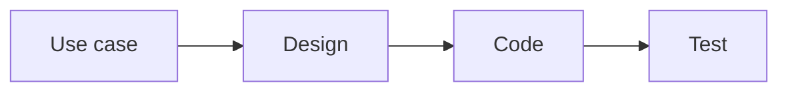

# Requirements Traceability

Week 9 · Forward, backward, and what a change will touch

::: note
Good morning, and welcome back from the midterm. Today is lighter on your nerves and heavier on your repository.

Here is the week. Today: the spine of your traceability matrix, how to read it in both directions, the three ways your specification and your code drift apart, and the release plan. Friday: what a change will touch before you make it, and then testing.

The subtitle is the arc. Forward, backward, and what a change will touch.
:::

## Why does this class exist? {.center}

::: key
The agent does not remember why it wrote the code. The matrix has to.
:::

::: joke
`git blame` says you wrote it. You do not remember. Neither does the agent: that was a different session.
:::

::: note
Picture your repository in December. Two hundred files, most of them written by an agent, in sessions nobody kept. Someone opens a class and asks: why does this exist? Which use case asked for it? Can I delete it?

When a person writes code, the why lives in their head, at least for a while. An agent keeps nothing between sessions. And it writes plausible code faster than any of us can read it. So code nobody can explain piles up faster than it ever did on a human team.

Read the joke. That is not exaggeration. That is your team in week 14 unless you write the why down somewhere that lasts. That somewhere is your traceability matrix.
:::

## Does it pay? It was measured

::: cols
**Without traceability**

About 50% of maintenance tasks solved correctly.
|||
**With traceability**

About 24% faster, and about 50% more correct solutions.
:::

Mäder and Egyed, *Empirical Software Engineering*, 2015: 71 developers, real maintenance tasks on unfamiliar systems.
{: .small }

::: note
For years, traceability was something textbooks prescribed and practitioners doubted. Then Patrick Mäder and Alexander Egyed measured it. Seventy-one developers did real maintenance tasks on systems they had never seen. Half the tasks with traceability, half without.

With traceability, they were about a quarter faster. And they were right about half again as often.

A second study, by Rempel and Mäder, looked at twenty-four open-source projects. Components with more complete traceability had fewer defects.

So the question is not whether it pays. The question is why almost nobody did it.
:::

## Why teams skipped it, and why you won't

::: cols
**Then**

Tedious, error-prone upkeep. In six open-source projects, about 40% of commits did not even name their issue.
|||
**Now**

The upkeep is text work, and an agent does text work without getting bored.
:::

::: key
When the cost of a discarded practice collapses, bring it back.
:::

::: note
Why did teams skip it? Not because it was useless. Because keeping the matrix up to date was miserable. Tedious, error-prone, and nobody ever got promoted for it. Writing code was more fun.

Rath and colleagues, ICSE 2018, looked at six open-source projects. About forty percent of commits did not even say which issue they worked on. If people will not type an issue number, they will not maintain a matrix.

The research community has a name for the dream: ubiquitous traceability. Links that appear as a by-product of the work, not as a separate chore. An agent gets us most of the way there. Updating a row is text work, and the agent does it in the same pull request as the code, every time, without complaint.

So the old objection, "a stale matrix is worse than none", flips. It used to be a reason to skip traceability. Now it is a reason to delegate the upkeep.
:::

## The honesty rule

::: cols
**The agent**

Does the upkeep.
|||
**A tool**

Checks it: do the IDs resolve, does every row name a test?
|||
**You**

Keep the meaning: what should trace to what.
:::

::: warn
An agent that judges its own links gives you confident, false assurance.
:::

::: note
Cheap to maintain is not the same as safe to trust.

Language models are now better at recovering trace links than the older tools. The LiSSA paper at ICSE 2025 shows it. And its own authors say it is not ready for practice. Some share of the links are wrong, and a wrong link looks exactly like a right one.

So the work splits three ways. The agent does the upkeep. A deterministic tool does the checking: do the IDs resolve, does every requirement have a test. And a human keeps the meaning: what should trace to what, and whether a piece of untraced code is dead or a missing requirement.

If the agent writes the links and also tells you the links are fine, you have the drift back, now with a confident report on top.
:::

## The spine



::: trace Trace: use case to design to code to test
One row per use case in table 3 of `docs/traceability.md`, added the day the use case is written.
:::

::: note
Here is the part you keep. Four links: use case, design, code, test. One row per use case in table three of your traceability file. Plus one row per functional requirement that no single use case owns, like a reminder that runs on a timer.

The row goes in the day the use case is written. Not the day it is built. A row that exists before the code is how you see work that is promised and not done.

You already have tables one and two from week four: feature to use case area, and business rule to what enforces it. This is the third table, and the one that lives longest.
:::

## Two columns, never one "done"

::: cols
**Build**

`❌ Not started` · `📐 Designed` · `🟡 In progress` · `✅ Built`
|||
**Verify**

`✅ Verified` · `🟡 Partial` · `🔎 None`
:::

::: key
Built and tested are two facts. Keep them in two cells.
:::

::: note
Each row carries its state in two columns, on purpose.

Build says how far the code got. Designed means the design pull request merged. Built means the code is in.

Verify says whether tests prove it. Verified, Partial, or None. Partial means the Tests cell names the gap.

Why two columns and not one "done"? Because "done" is where built and tested blur together, and the untested half hides inside it. Two cells, two facts.
:::

## Forward and backward

::: cols
**Forward: is it built and tested?**

Start at `UC-EVA-submit-evaluation`. Its row names `SubmitTeamsEvaluations.vue`, `EvaluationService.addPeerEvaluation`, and the tests. ✅ Built, ✅ Verified.
|||
**Backward: why does this code exist?**

Start at `WeeklyReminderScheduler`. It traces to `FR-NOT-weekly-reminder`, a row of its own: no use case owns a timer.
:::

::: note
The same row answers two questions, starting from opposite ends.

Forward: start at a requirement and ask, is it built and tested? Project Pulse's submit-evaluation row names the Vue page, the service method, and the tests that pin each extension. Built, Verified. A requirement with no row, or a row that stops at Design, is promised scope that does not exist yet.

Backward: start at a piece of code and ask, who asked for this? The weekly reminder scheduler traces to a functional requirement, not a use case, because no actor starts a job that runs on a timer.

Forward finds work that is missing. Backward finds work nobody asked for. The ISO requirements standard, 29148, asks for both.
:::

## Hands up {.center}

::: ask
`ExportService.java` appears in no row of your matrix. What could it be, and who decides?
:::

::: note
Put it to the room. Take two or three answers.

What you are fishing for: it is either dead code, or it is a decision nobody wrote down. Maybe the client asked for an export in a meeting and nobody added a use case.

And who decides which? Not the agent. The agent will happily tell you it is "used by the reporting feature". A human decides, and if it is a missing requirement, it goes to the client.
:::

## No test, not traced

::: key
A row reads ✅ Verified only when you can name a test that exercises the main flow and every extension, and it passes.
:::

::: joke
Verify: ✅ Verified. Tests: `EvaluationServiceTest`. The test: `assertTrue(true)`.
:::

::: note
The last link, test back to use case, closes the loop. It is also the one teams fake.

A row is Verified only when you can name the test that exercises the main flow and every extension, and that test passes. Project Pulse's WAR report use case is Built and Partial, and the Tests cell says why: no dedicated integration test for the period search. That is an honest row.

Read the joke. A row that says Verified because a test file exists is not verified. It is decorated.

The check is mechanical, so an agent can do the opening and the reporting. But the agent that wrote the row cannot be the only one who checks it. Spot-check one row yourself, both ends, every time a use case closes.
:::

## The rest of the graph

::: steps
- Quality attribute → quality scenario `QS-<slug>` → test, a second axis.
- Business objective → success metric: was it achieved, not just built?
- The business-rule index, generated, never hand-edited.
:::

::: key
Recognise these. You keep the spine and your two week 4 tables.
:::

::: note
Project Pulse's matrix carries more than the spine, and you will meet all of it in industry.

A second axis for quality attributes, because a response-time requirement is never verified through a use case. It goes quality attribute, quality scenario, test.

Each business objective traces to a success metric. Not "did we build it", but "did it work".

And a business-rule index that lists every requirement citing each rule. It is generated from the use cases, never edited by hand. We will use it on Friday.

You recognise these. You maintain the spine and your two week four tables. That is plenty.
:::

## Three ways they drift apart

| Shape | What you see | Repair |
|---|---|---|
| Specification right, code behind | A rule is written; the code does not enforce it | Conform the code |
| Code right, specification stale | The document describes behavior the system no longer has | Amend the document |
| Neither says anything | The code made a decision no document records | Decide it, then write it down |

::: note
When you ask the backward question, the answer is often "none". And "none" comes in three shapes, each repaired differently.

One: the specification is right and the code is behind. Fix the code.

Two: the code is right and the document is stale. Fix the document.

Three: neither says anything. The code made a decision, and nobody wrote it down. Here you do not fix anything yet. You decide, and then you write it down.

Two real examples from Project Pulse, next.
:::

## Specification right, code behind

::: cols
**`FR-NOT-weekly-reminder`, amended 2026-10-03**

Remind only the students who still owe something (`BR-submission-owed`).
|||
**`WeeklyReminderScheduler.sendWeeklyReminders`**

Still emails every student in the section, and its tests check that it does.
:::

::: key
The row reads 📐 Designed, not ✅ Built. The gap is traced, not hidden.
:::

::: note
In early October the client amended the weekly reminder: remind only the students who still owe something. The scheduler still emails everybody, and its tests happily confirm that it emails everybody.

The tests pass. The code is wrong. Because the tests predate the rule.

What makes this fine, for now, is the row. It reads Designed, not Built, and its Code cell says the code predates the amendment. The gap is known and written down. It is scheduled for the next release.
:::

## Neither says anything

```java
peerEvaluationAverage.setAverageTotalScore(
    evaluations.stream().mapToDouble(PeerEvaluation::getTotalScore)
               .average().orElse(0.0));
```

::: ask
A student nobody evaluated, and a student rated zero by everyone. What does the weekly report show for each?
:::

::: note
This is from Project Pulse's EvaluationService, on main today.

Ask the question on the slide. Let them work it out: both show zero point zero.

No business rule covers the empty case. Trace backward from that zero and you arrive nowhere. It is not a violation, because there is nothing to violate. Someone decided, in code, that "not evaluated" and "rated zero" are the same number. No document records it, and an instructor reading the weekly report cannot tell the two students apart.
:::

## The shape that scales badly {.center}

::: ai
Hand an agent an under-specified use case and it always picks something, in seconds, in code that looks exactly like a decision you made.
:::

::: key
The first two shapes are inconsistencies a machine can find. The third leaves nothing to compare.
:::

::: note
Why does the third shape get its own slide? Because it is the one that grows with an agent.

The first two are inconsistencies. Two artifacts exist, and they disagree, so a checker can find them. The third produces no disagreement at all. Only one artifact ever spoke: the code.

And an agent handed a gap never says "I don't know". It picks something, in seconds, and the code looks exactly like code implementing a decision you made. That is how an implementation quietly becomes the specification.

So you ask the backward question out loud. You do not assume the forward map covers you.
:::

## Neither artifact is true by default

::: cols
**"Docs lie; read the code."**

Good advice for an unfamiliar codebase.
|||
**"The spec is the contract."**

Good advice for this course.
:::

::: joke
"The code is the documentation," said the developer who left in May.
:::

::: note
You will hear the opposite advice, and it is good advice. Guides to reading an unfamiliar codebase say: treat the docs as a starting point, not the truth, because they are often out of date.

That is not the opposite of what we teach. It is the other half. A contract can be behind the system. A system can be wrong about the contract. Neither is true by default.

Read the joke. The code tells you what it does. It never tells you what was intended, and the person who knew has left.

Which of the two is wrong gets decided item by item. Deciding it, and writing the decision down, is what a register is for.
:::

## Keep a register

::: steps
- Each entry: the rule, the `file:method` that diverges, and which side will change.
- Not a bug list: several entries close by fixing the document.
- OI-24: edits ignored the submission window. Held 82 days, fixed 2026-09-10.
:::

::: key
A divergence you decided not to fix yet is traced. One nobody noticed is not.
:::

::: note
Project Pulse keeps its register in the open issues file, under "Doc to Code Gap Analysis". Each entry names the rule, the method that diverges, and which side will change.

It is not a bug list. Each entry is a claim about which of the two artifacts is currently wrong, and several close by changing the document, not the code.

OI-24 shows the whole cycle. In June the client decided the submission window binds edits too, not only first submissions. The update method checked nothing, so a student could rewrite an old evaluation forever. The register held that gap for eighty-two days, until both paths went through one check in September, and the entry closed.

That is what honest looks like: not zero gaps, but every gap written down.
:::

## "What will I have in December?" {.center}

::: key
A release plan: every use case placed in the release it ships in.
:::

::: note
Last topic for today. The estimate answers "when can I use this one?" Your client's next question is about the whole term: what will I have in December?

Agile teams have always planned releases with stories and velocity. Beck and Fowler, Cohn. We keep the idea and change the units.
:::

## A column, not a document

| UC | Build | Verify | **Release** |
|---|---|---|---|
| `UC-NOT-remind-non-submitters` | 📐 Designed |  | `v1.6.0` |
| `UC-AI-critique` | ❌ Not started |  | `v1.8.0` |
| `UC-AI-draft-skeleton` | ❌ Not started |  | `Later` |

::: steps
- Yours: `v0.1.0` slice, `v0.2.0` Checkpoint 3, `v1.0.0` December, `Spring`, `Out`.
- Order: risk first, then what the client needs, then dependencies.
- An empty cell is work nobody planned.
:::

::: note
These rows are from Project Pulse's traceability matrix. The release plan is one more column on the table you already keep. Plan and progress share a row, so they cannot disagree.

Your values: v0.1.0 is the proving slice, v0.2.0 is Checkpoint 3, v1.0.0 is the December MVP, then Spring or Out.

Order them risk first, for the same reason your proving slice went first. A wrong decision found in week nine is cheap. In week fourteen it is not. Then what the client needs first, then dependencies.

Project Pulse is an example of breaking that order on purpose. Risk alone would put the first AI assistant, v1.8.0, before finishing the editor, v1.7.0. The client wanted the editor first, and the pull request that set the column says why. The column holds the decision; git holds the reason.
:::

## Forecast, then talk to the client

::: key
Hours still needed = remaining `v1.0.0` estimate midpoints × your ratio.
:::

```text
Forecast: 6 rows left in v1.0.0, 38 to 60 h at ratio 1.4; about 70 h available.
```

::: warn
Doesn't fit? Move rows out of `v1.0.0` with your client at the next meeting. Change the scope, not the estimate.
:::

::: note
Here is the forecast. Add the estimate midpoints of every unfinished v1.0.0 row, and multiply by your team's calibration ratio. A use case not designed yet carries its coarse estimate from planning poker, corrected by the coarse ratio.

Compare that with the hours your team will actually have before the demo. Use your weekly activity reports, not your hopes.

Cross-check by counting. If you close one and a half use cases a week and six rows are left, that is four weeks, whatever the hours say. When the two disagree badly, one of them is fooling you.

If it does not fit, take it to the client at the next meeting. Change the scope, not the estimate. Revise the column every time a use case closes.
:::

## For your team

::: steps
- **Every week:** the row changes in the pull request that changes its state.
- **Checkpoint 2, Fri Oct 30:** every row has a Release value, set by pull request.
- **Checkpoint 3:** one forecast line under your calibration table.
- **Assignment 3, Fri Oct 30:** the agent's use case gets its row, and its Verify cell names its tests.
:::

::: note
So, for your team. Every pull request that changes a use case's state changes its row. Same pull request, not later. Later is how matrices die.

By Checkpoint 2, Friday October thirtieth, every row has a Release value. At Checkpoint 3, one forecast line.

And in assignment three, the use case your agent builds gets its row, and its Verify cell names the tests that make it true.

On Friday: what a change will touch, before you make it.
:::

## If this requirement changes, what else has to? {.center}

::: key
Impact analysis: answer it before anyone edits code. The matrix turns it from a memory test into a lookup.
:::

::: note
Friday. Good morning.

On Wednesday, forward and backward asked about what exists. Every change request asks a third question: if this changes, what else has to?

Answering that before anyone touches the code is called impact analysis. It is an old idea; Bohner and Arnold edited the classic collection on it in 1996. What is new is that your matrix makes it a lookup, and the agent does the legwork.

Twenty minutes on this, and then testing.
:::

## The change

::: ask
The client wants two weeks, not one, to finish a peer evaluation. What does that touch?
:::

::: trace Trace: business rule to everything that cites it
`BR-evaluation-submission-window` is the changed node. Start there.
:::

::: note
Suppose Project Pulse's client asks for this. Two weeks instead of one to finish a peer evaluation. It sounds like one number in one rule: the submission window.

Ask the room for a gut answer. How many files? Take a couple of numbers. Then we find out.
:::

## Step 1: read the matrix

::: cols
**`UC-EVA-submit-evaluation`**

✅ Built. The row names the code and the tests that pin the window.
|||
**`UC-NOT-remind-non-submitters`**

📐 Designed. The change lands in `design/not.md`, not in code.
:::

::: key
Fixing a design costs minutes. Fixing a built reminder does not.
:::

::: note
Step one. Start at the changed rule, in the business-rule index. Two use cases cite it.

Submit evaluation is built. Its row hands you the Vue page, the service method, and the tests that pin the window: not for the previous week, update after the window closed, and their integration twins.

Remind non-submitters is only designed. Its design says the reminder is always for the week currently due, the previous week. So this change lands in a design document. That is a few minutes of editing, because the code does not exist yet. Catch a change at design and it is cheap.
:::

## Step 2: search for the ID

::: steps
- `BR-active-weeks`: "each active week is evaluated during the *following* calendar week".
- `BR-evaluation-editable-until-close`: editable while the window is open.
- Extension 1b's message: "its one-week window", and "cannot be made up".
:::

::: key
The index records which requirements cite a rule, not which rules lean on each other. A search finds those.
:::

::: note
Step two. The index records which requirements cite a rule. It does not record which rules lean on each other. So search the docs folder for the ID.

That adds two more rules. Active weeks says each week is evaluated during the following calendar week. One week, baked into another rule. And editable-until-close: an evaluation stays editable while its window is open, so a longer window means a longer edit period too.

And it finds a user-facing message in extension 1b that literally says "one-week window". Small, and exactly the kind of thing nobody remembers until a student sends a screenshot.
:::

## Step 3: hand the agent the list

::: cols
**Your list is the scope**

Every ID and file from steps 1 and 2, in the issue.
|||
**The agent finds the reach**

`EvaluationService.previousWeek()`, shared by both paths, and `getPreviousWeek()` in the frontend's `utils/week`.
:::

::: ai
The IDs steer the agent before the change. The matrix checks what came back after it.
:::

::: note
Step three. The issue for the change carries everything from steps one and two. That is the scope you hand the agent.

Now the agent does what it is good at: finding the reach no document names. The private previousWeek method in EvaluationService, shared by submit and update. And getPreviousWeek in the frontend, which decides which week the form even opens on.

Neither appears in any requirement. Both break if you miss them.
:::

## The list is the review's checklist

::: cols
**A file outside the list**

Either an edge the matrix lacks (add it) or the agent wandered (send it back).
|||
**A file on the list, untouched**

Needs a reason.
:::

::: note
Then the list does a second job: it is the review's checklist.

If the pull request touches a file outside the list, one of two things happened. The agent found an edge your matrix lacks, and you add it to the matrix. Or the agent wandered, and you send it back.

If a file on the list was left alone, someone owes you a reason.

This is the review against the contract you learned on code review Friday. For a changed requirement, the impact list is part of the contract.
:::

## The questions nobody answered {.center}

::: ask
Two weeks means two weeks open at once. Which does the form open on? Which one is the reminder about?
:::

::: warn
Tell the agent "make it two weeks" and it answers all of these silently. That is the third drift shape, on purpose.
:::

::: note
Here is the part I like best. The list surfaces questions nobody has answered.

Two weeks means two weeks are open at the same time. Which one does the form open on? Is the reminder about the older one or the newer one? Extension 1b tells the student a missed evaluation cannot be made up. Does that still mean anything?

No document says. Tell the agent "make it two weeks" and it will answer all three, silently, in seconds. That is Wednesday's third drift shape, made on purpose.

So the questions go to the client first. The change starts once the answers are written down.
:::

## The length of the list is the change's size

::: cols
**`BR-evaluation-submission-window`**

Cited by 2 use cases. A small change.
|||
**`BR-role-based-access`**

Cited by 41. A project-wide change.
:::

::: joke
"It's a one-line change." 41 use cases cite that line.
:::

::: note
Last point. The length of the list is the size of the change.

The submission window is cited by two use cases. Small. Role-based access is cited by forty-one. That is a project-wide change, and the index shows you that before anybody estimates it.

Read the joke. Every one-line change you have ever heard of had a list like this behind it. Now you can see it first.
:::

## Your turn, in pairs {.center}

::: steps
- Open Project Pulse's `docs/traceability.md`: list what the two-week change touches.
- Search `docs/` for `BR-evaluation-submission-window`: what does it add?
- Write the questions for the client.
:::

::: note
Eight minutes, with a neighbour. Open Project Pulse's live traceability file on GitHub. Make the list from the matrix. Search the docs folder for the rule's ID and see what it adds. Then write the questions you would take to the client.

Then compare with the list we just built. If you found something we did not, tell me; you will have found an edge the matrix lacks.
:::

## Leave with this {.center}

::: steps
- Keep the spine; Build and Verify in two cells.
- Forward finds what is missing; backward finds what nobody asked for.
- Classify a drift before repairing it, and register what you have not repaired.
- Before a change: the impact list is the agent's scope, the review's checklist, and the client's questions.
- **Checkpoint 2:** a change since your slice carries its impact list.
:::

::: note
Five things to leave with.

Keep the spine, with built and tested in two cells. Forward finds what is missing; backward finds what nobody asked for. Classify a drift before you repair it, and write down the ones you have not repaired yet.

Before any requirement changes, make the impact list. It scopes the agent, it checks the review, and it surfaces the questions for your client.

And at Checkpoint 2, if your client has changed anything since your slice, that change's issue carries its impact list. Now, testing.
:::
